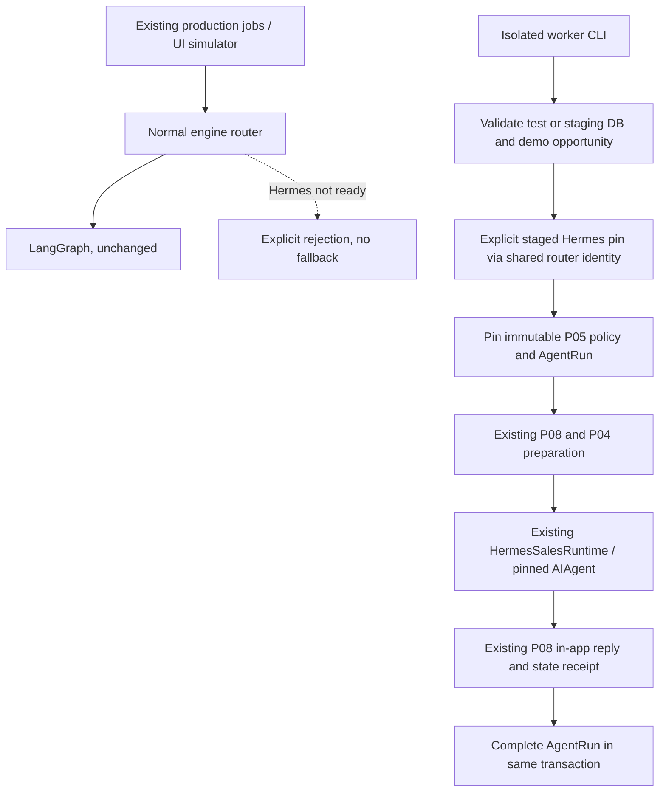

# HEI-01B — Hermes Runtime Integration (isolated lane)

**Base:** BlackPenguin `da348ad8ef1cffbad07d71cc0f76eb21be08eff4` (HEI-01A). GitHub Actions run [45756734466](https://github.com/BlackPenguinAI/BlackPenguin/actions/runs/45756734466) reports success. This is evidence of the previous deployment, not of the new SDK or staging journey.

**Commit:** `feat(hermes): integrate pinned SDK with isolated turn routing and receipts`

## Scope and design

The real Nous Research `AIAgent` runtime already exists in `hermes_sales_core/runtime.py`, and the P08 executor already commits a visible in-app message plus its scoped Hermes state receipt. HEI-01B connects those components to HEI-01A's engine/event ownership contract. It does not copy the demo database, add the SDK to the main API, replace any service, or remove LangGraph. The pinned Nous revision remains `b94cb8e2c4ebf2a8c7688cf676c3cf9899584adb`.



- Global selection, existing LangGraph prompts/steps/segments, SQL and NoSQL schemas, onboarding, assets, appointments, providers, deployment workflow and UI remain untouched.
- The production readiness function still returns `False`. `PUT /api/v1/ai/hermes/engine` continues rejecting activation of Hermes until the real effect adapter and acceptance gates are ready. There is no silent fallback.
- The isolated route explicitly selects Hermes **for that staged event only**. It does not write the global selection, call the legacy graph, or open an API listener. It is not connected to the normal Live Test UI or WhatsApp/SMS.
- The runner requires a physically separate test/staging database, `ENVIRONMENT=test` or `staging`, and an explicitly test/staging-named database. The name check is defense in depth, not proof of isolation. Never give it a production connection string, credentials, or real lead.
- Reuse the existing `hermes_global_settings`, `hermes_global_versions`, `hermes_sales_states`, `hermes_sales_state_events`, `agent_runs` and `sales_messages`; no new ORM tables, Alembic files, or collections. The existing P08 executor remains unchanged.
- Reserve a stable event and a previously published enabled policy before inference. Persist `sales_engine_pin` in the inbound metadata and the AgentRun snapshot; retries use the original model, prompt and tool allowlist. A never-published/disabled version cannot execute. New inference requires the current global Hermes policy to remain enabled.
- For the first successful turn, the existing P08 receipt callback completes the AgentRun in the same transaction as its visible reply/state receipt. Trace only allowlisted tool name, status and bounded error code (no raw tool arguments, raw model history or credentials). A completed event is replayed only if the message, receipt, run and pinned version agree. It does not require a new SDK call or an OpenRouter credential. On errors, a failed attempt has no new visible reply/receipt; re-execution is explicitly against the same event/policy. This is not an exactly-once guarantee for model billing after an interrupted request.
- No live operations: P04 tools continue to create drafts only; P08 never dispatches provider messages or commits real bookings/assets. Model wording about proposed effects is not certified by this phase. HEI-03 must implement effect authorization/receipts before real traffic.

## Upload

Extract the ZIP at the repository root and upload the included `backend`, `services`, `docs`, and `.github` paths preserving their hierarchy (including the hidden `.github/workflows` folder). No script, patch, dependency installation, migration or environment change is needed before uploading. Do not upload this ZIP as a single binary. No production switch change is needed.

### Changed files

| Path | Change |
|---|---|
| `backend/app/modules/sales_agent/engine_router.py` | Share event ownership resolution with an explicit isolated Hermes route; production gate unchanged |
| `backend/app/modules/hermes_sales_core/staged_runtime.py` | Isolated orchestration, scope, pinned policy, AgentRun and atomic receipt callback |
| `services/hermes_worker/run_staged_simulation.py` | Reuse isolated image entrypoint; stable existing inbound or explicit new staged event |
| `services/hermes_worker/sdk_smoke.py` | Include new bridge in offline import smoke |
| `backend/tests/test_bp_hei01b_staged_runtime.py` | Focused tests using SQLite stand-ins and P04 doubles |
| `.github/workflows/hermes-sdk-smoke.yml` | Independent build and offline import smoke of existing pinned SDK image; not a deploy job |
| `docs/hermes-integration/HEI_01B_UPLOAD_READY.md` | This guide |

## After upload

1. Verify the normal `Deploy Black Penguin API, Worker & Frontend to DigitalOcean` workflow. This preserves the existing release pipeline.
2. Separately verify `Hermes isolated SDK smoke (HEI-01B)`. It builds the existing worker Dockerfile from the candidate checkout, then runs imports and CLI `--help` with `--network none`. It does not deploy a new service, access production secrets, call a model or prove that the agent works end to end. It is deliberately not a dependency of the existing production deploy.
3. Do not activate Hermes yet. Do not run the staging CLI against `bp_api_prod` or the production database. No action is necessary on the production server in HEI-01B.

## Optional real SDK staging journey (after CI, only with an isolated environment)

Prerequisites: a separate migrated test/staging DB, test Company/Project with approved catalog, a consenting demo lead, an existing active unpaused simulation conversation, and an enabled **published** Hermes P05 version in that database. Use a dedicated test OpenRouter credential and the existing environment variables required by BP. Do not copy the production `.env`. A real SDK run may consume model tokens. The smoke workflow itself uses none.

The following is an example for an authorized operator with that staging environment; it is not a pre-upload command and not a production command.

```bash
docker build -f services/hermes_worker/Dockerfile -t bp-hermes-hei01b .
# staging.env must specify ENVIRONMENT=staging and an isolated staging DB.
# message.txt contains only a synthetic buyer question.
docker run --rm --env-file staging.env \
  --mount type=bind,source="$PWD/message.txt",target=/tmp/buyer.txt,readonly \
  bp-hermes-hei01b \
  --company-id "$TEST_COMPANY_ID" --project-id "$TEST_PROJECT_ID" \
  --conversation-id "$TEST_CONVERSATION_ID" --lead-id "$TEST_LEAD_ID" \
  --event-id hermes:staged:journey-001 --message-file /tmp/buyer.txt
```

The container must be able to reach the isolated DB and OpenRouter. Run the same event ID with identical text for replay; use a new event ID for a new buyer turn. For existing inbound, replace `--event-id ... --message-file ...` with `--inbound-message-id "$TEST_INBOUND_ID"`. Such a row must already carry a stable `provider_message_id` and must not have been handled or pinned by LangGraph. Earlier unpinned P08 replies are not silently adopted; use a fresh synthetic event. The runner intentionally never creates demo leads or unpauses conversations.

Output is metadata only (no buyer text or generated answer): engine, engine version, event ID, AgentRun ID, inbound/outbound message IDs, published policy version, state revision and replay flag. Inspect the existing simulation transcript/state in the isolated database to evaluate reply quality. Do not interpret `in_app_only` or a model statement as a real provider or Calendar receipt. The SDK may maintain its own logs; use synthetic input and isolated credentials.

## Test evidence and open gates

Local isolated run: 24 HEI-01B cases passed and the 30 HEI-01A regression cases passed (54 total). The tests load the actual HEI router, P05 registry and P08 transaction code; minimal SQLite ORM stand-ins, a mocked P04 preparation and receipt writer replace the full domain and SDK. The test confirms atomic local persistence, failure rollback, scope/consent gates, historical policy pinning, replay with no credential, non-interference with global routing and no new visible message on failure. It is **not** a test of real AIAgent, full BP ORM, PostgreSQL concurrency, OpenRouter, real Telnyx, Google Calendar, production data, full CI or Angular.

The real SDK image build/import is pending GitHub Actions; the real staging turn and P03/P04 domain/effect behavior remain to be verified on an isolated BP database. HEI-02 will address conversation parity (focus, option menus, preferences, lead profile) and HEI-03 real business effects, including safe provider delivery, verified assets and appointments. Only then can the production readiness gate and the admin switch be activated after acceptance. No live activation, production data change or remote repository write has been performed by the author of this package.
