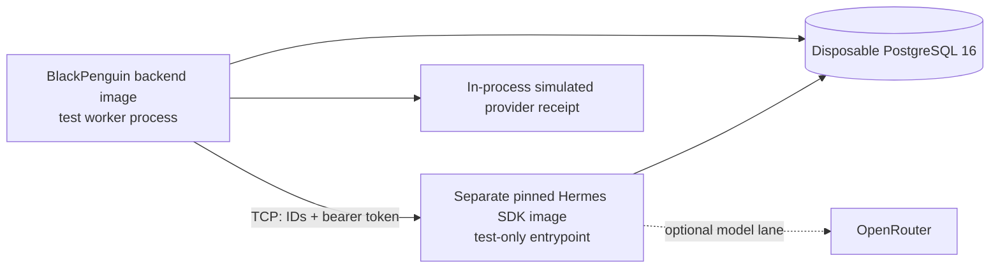

# HEI-06A — Private Runtime Staging (disposable acceptance)

## Decision and scope

Certified baseline: `92769b08ef8495bba711951594adcef26951752c`.

- [Deploy #478](https://github.com/BlackPenguinAI/BlackPenguin/actions/runs/45961324707): success.
- [Isolated evaluation #20](https://github.com/BlackPenguinAI/BlackPenguin/actions/runs/45961324686): 33/33 offline and 14/14 disposable PostgreSQL worker; frontend successful. Its separately opt-in four-case real-model job was skipped.
- [Controlled staging #4](https://github.com/BlackPenguinAI/BlackPenguin/actions/runs/45963307886): 56 focused/evidence, 22 offline, 9 imperfect-SDK, 9 reporting and 18/18 real SDK scenarios successful. The 18 scenarios used SQLite, a synthetic policy, loopback TCP and provider doubles.
- SDK revision: `b94cb8e2c4ebf2a8c7688cf676c3cf9899584adb`.
- Demo reference: `jorgektch/testing-hermes-agent` at `9ac4c8703d28eb3ca39fc762df0dd67c7196e324`. No conversational code changes in this delivery.

The remaining gap is **combined active cross-container TCP, PostgreSQL, worker and SDK**. This package is the first executable substage of HEI-06A, using a fresh GitHub-hosted runner and disposable database. It is not a persistent staging deployment or permission to contact actual recipients. It does not start a public API, real webhook, continuously polling worker, production database, real Telnyx or Calendar integration. A read-only synthetic conversation is intentionally used to isolate transport and persistence from commercial effects. Full real-provider staging still requires an independently reviewed, narrowly scoped authorization mechanism and provisioning; the evaluation fixture must never be reused for it.

## Architecture

The worker claims a synthetic job using `_claim_inbound_jobs`, reserves a real `AgentRun`, calls the unchanged `request_sdk_draft` client, and persists the prepared draft through `sdk_service.prepare_reserved`. The SDK restarts, and another authenticated prepare for the same reservation must return the same draft with one runtime invocation recorded in PostgreSQL. Then the SDK is stopped. The worker uses `route_live_job` and `process_hermes_inbound_job` to finish the already prepared turn via the real dispatcher, with provider methods replaced only in the fixture. Replaying the completed synthetic event must not produce another run, receipt, state revision or inference. The SDK is not needed to finish a previously durable draft. No claim is made about recovery after a crash during an uncertain external send or during inference before a draft has been persisted.

## Isolation controls

- Separate test Compose project per workflow run, attempt and lane. Only GitHub-hosted runners; no remote Docker context, no use on production VPS.
- New PostgreSQL volume and dedicated database/user/hostname; random credentials; marker table, database/user/version checks and empty-application-schema check before schema creation. `Base.metadata.create_all` is a disposable fixture, **not an Alembic migration certification**.
- Private Docker internal network with no published ports. Backend and SDK test containers run non-root, drop capabilities and use read-only test-source mounts. Offline lane has no external network. Optional model lane attaches only SDK to a separate normal egress bridge; not a domain-filtered firewall. Worker and DB remain on the internal network.
- Separate pinned Hermes SDK and ordinary backend images built from the same candidate SHA. Test scripts are mounted only by the workflow; not copied by either Dockerfile. No production compose/deploy changes. CI compares all changes against the certified baseline and rejects paths outside this package, and verifies the original production gate blob SHA.
- **Test fixture authorization only:** scoped process-local readiness substitution in the disposable worker/SDK probe, with exact synthetic job, message, lead, project, conversation, reserved run and published-policy validation. Production `live_hermes_ready()` remains `False`. Never use the test entrypoint to activate an actual staging/live provider route, and never copy the override into production code.
- No external provider credentials. Optional dedicated `HEI06_OPENROUTER_API_KEY` is passed only to the SDK container. The model lane uses the baseline synthetic published policy restricted to `get_project_overview` and `get_unit_details`. No other tools are enabled in this fixture. Actual staff-published production policy is not tested. A runtime invocation can involve multiple provider LLM requests; `runtime_invocations` is not a token count or a network-call count.
- No public API or provider network calls. Synthetic SMS receipt is labeled simulated; it does not prove real Telnyx acceptance or device receipt. No material shares, meetings or calendar connections should be created.
- Normal cleanup removes only the unique test project containers, networks and DB volume, and is checked before PASS summary generation. Failure cleanup is best-effort; hosted runner is disposable.

## Upload and run

1. Unzip and upload the contents preserving all repository-relative paths via https://github.com/BlackPenguinAI/BlackPenguin/upload/main . Do not upload the surrounding zip/extraction folder. No patch, generated-code step, or local build is needed before upload. Do not add a `.env` to the repo.
2. Ensure the hidden workflow is present at `.github/workflows/hermes-hei06a-private-runtime.yml`. If missing, upload the standalone YAML under this exact name to `.github/workflows/`.
3. Commit: `test(hermes): certify isolated cross-container runtime with postgres`.
4. Review normal automatic CI if triggered. This change adds only evaluation infrastructure. It does not deploy the staging stack to DigitalOcean.
5. In GitHub Actions select **Hermes HEI-06A private runtime staging** > Run workflow > branch `main`. Leave `run_openrouter` unchecked for the first run. A completed offline summary is not real-model evidence.
6. After offline success, run again with `run_openrouter` checked. Offline gate runs first; model stack is entirely fresh. Reuse the existing dedicated repository secret `HEI06_OPENROUTER_API_KEY`, preferably with a provider-side spending limit. Do not paste the secret into chat or create production `.env` changes. No Telnyx or Calendar secret required.
7. Download the `hei06a-private-runtime-<SHA>` artifact and inspect `offline/summary.json` and, when requested, `model/summary.json`. On failure, inspect the phase JSON and the failed step. Do not rerun uncertain tests or activate Hermes globally.

## Acceptance checks and evidence

| Phase | Mandatory checks |
|---|---|
| Seed | Exact isolated database identity/marker; fresh schema; synthetic catalog; restricted published policy fingerprint. |
| Prepare | Actual worker claim; no duplicate claim; reserved run/version; missing/wrong auth 401; extra prompt 422; wrong job/run 409; no OpenAPI 404; actual TCP preparation; durable hash; no outbound before dispatch; one runtime invocation. |
| Restart and replay | Same service restarted; exact prepare receipt and immutable draft hash; no second invocation; no outbound. |
| Stop and finish | SDK stopped before worker dispatch; accepted synthetic response contains the correct Van Buren fact; correct focus and pin; one simulated provider receipt; one revision; same completed event replay has no duplicate; zero meeting/material effects. |
| Teardown | Unique stack destroyed; no containers, networks or volume for the test project remain before PASS. |

Artifacts contain fixed check names, phase/checkpoint, exception class allowlist on failure, candidate and image IDs, policy fingerprint and immutable draft hash; no raw reply, tokens, phone numbers, model context, raw tracebacks, provider URLs, or secrets. `runtime_invocations=1` means exactly one runtime call, not one HTTP request to the model provider. The normal `acceptance-summary` is not a readiness token.

## Files

- `.github/workflows/hermes-hei06a-private-runtime.yml` — manual isolated workflow.
- `services/hermes_worker/staging/compose.yml` — private test topology.
- `services/hermes_worker/staging/compose.model.yml` — optional SDK egress only.
- `services/hermes_worker/staging/init.sql` — marker and test invocation counter.
- `services/hermes_worker/staging/guard.py` — environment/database/synthetic-scope validation.
- `services/hermes_worker/staging/sdk_probe.py` — test-only SDK process, real app and optional real inference.
- `services/hermes_worker/staging/worker_probe.py` — seed, prepare, replay, finish.
- `services/hermes_worker/staging/run.sh` — isolated lifecycle orchestration and evidence.
- `services/hermes_worker/staging/test_guard.py` — local guard tests.
- This document.

## Validation performed before upload

12 stdlib tests (including parameterized negative subcases) passed locally for environment and database guard validation using test doubles for database responses. Python AST parsing, YAML parsing, workflow Bash syntax and orchestration Bash syntax passed. Static Compose assertions confirm network isolation declarations, SDK-only optional egress, no public ports, separate non-root containers and no model key in the worker. The local execution environment has no Docker binary and cannot clone the private repository into a complete working tree; no container integration test, real PostgreSQL connection, paid OpenRouter inference or actual migration was run locally. Source interfaces and candidate SHA were checked against GitHub. CI is the first end-to-end execution of this new harness.

## Next gate

If offline and optional real-model combined lanes pass, record exact candidate SHA and reports. Complete the remaining HEI-06A provisioning/authorization design for actual provider staging before HEI-06B. See `HEI_06_REAL_PROVIDER_ACCEPTANCE.md`: dedicated staging PostgreSQL and policy, explicit scope allowlist and operator stop mechanism at enqueue/effect/dispatch, actual webhook verification, test-only recipients and separate Google test calendar. None of these real-provider requirements is marked passed by this package. Production readiness stays CLOSED; no LangGraph/Hermes selector change or fallback.
