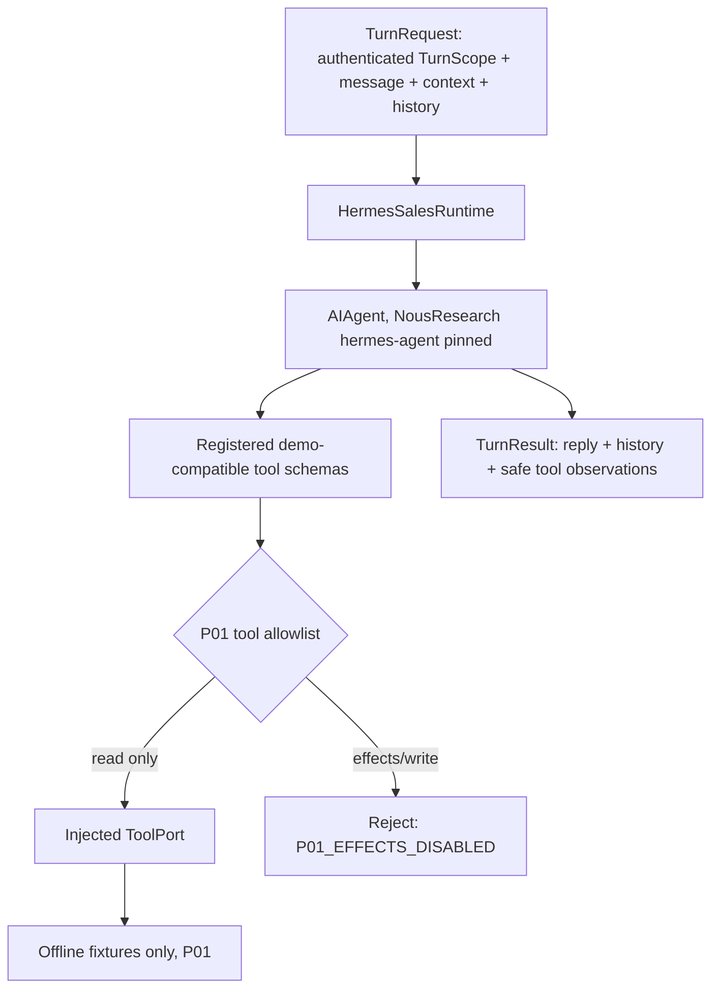

# P01 architecture: isolated Hermes core

## Key decisions

- `app.modules.hermes_sales_core` is a standalone **Python package** inside BP.
  Importing it does not replace BP's existing sales agent.
- The SDK is loaded lazily only on `process_turn()` so the normal BP FastAPI
  startup never needs to download or import Nous Research's agent in P01.
- The SDK invocation intentionally matches the demo's: `run_agent.AIAgent`,
  `tools.registry.registry.register`, `enabled_toolsets`, `disabled_toolsets`,
  `quiet_mode`, `skip_memory`, `skip_context_files`, `save_trajectories=False`,
  OpenRouter, `max_iterations=12`, and `run_conversation` with `persist_user_message`.
- The process-global lock avoids closure overlap **within a process**. This
  is a temporary isolation rule: throughput requires multiple isolated
  single-turn workers with BP's per-conversation FIFO claiming in P03/P04.
- P01 `ToolPort` **cannot be connected to production** as written; all tools
  that could mutate state or disclose media are rejected by the runtime.
- A `TurnScope` is intended to come from BP's authenticated and checked
  company/project/conversation/lead identities, not the browser or LLM.
- `verified_context` is passed as **data**; the scope is injected from
  `TurnScope`, with mismatches rejected before calling the LLM.
- `choice_state.record_delivered_menu()` accepts actual outbound message IDs;
  it must be called only after an outbound delivery receipt in a later phase.
  P01 does not connect that adapter to persisted messages.

## No double-agent architecture

There is **one intended engine**: Hermes. The current LangGraph code is left
untouched only so this P01 upload does not affect existing production services.
P07/P08 removes the obsolete LangGraph commercial paths after the Hermes
integration is proven. There is no dual-engine router or LangGraph fallback.

## Global configuration and language

P01 hard-codes the validated demo defaults: `openai/gpt-4o-mini`, 12 max
iterations, English prompt. P05 moves configuration into the existing
Staff Superadmin AI Settings panel, with one global published version.
No company-specific conversation policies, language overrides or Spanish UI
are implemented in this stage. Company/project onboarding is data, not policy.

## Tool authorization evolution

**P01:** synthetic fixture + all real effects prohibited.
**P02:** read-only BP data adapters by tenant scope, including inventory and
approved material discovery.
**P03:** PostgreSQL conversation state, receipts, provenance and worker leases.
**P04:** approved write actions (booking, cancellation, materials, CRM) under
BP service transactions, with verified idempotency and consent.

Do not toggle `P01_DENIED_TOOLS` to an empty set to simulate P04; implement a
separate reviewed gateway with explicit authorized capabilities and tests.
