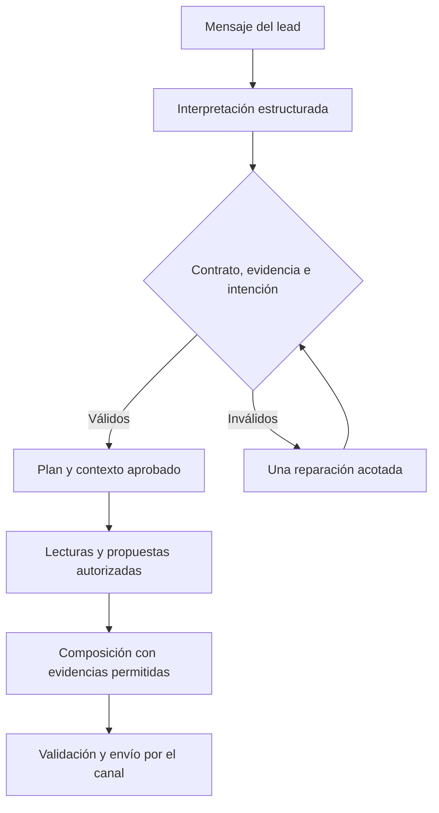
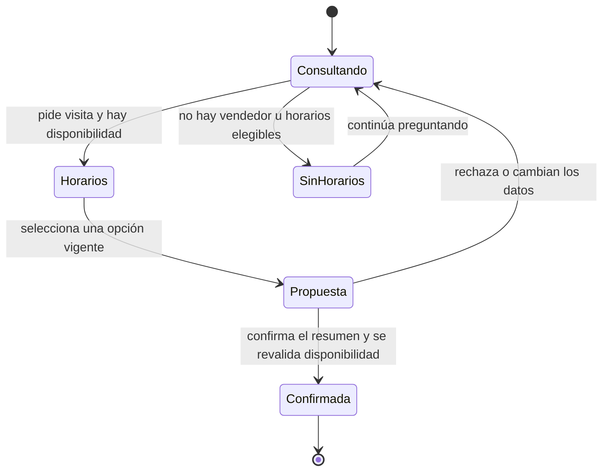

[Volver a la guía del agente](../README.md)

# Cómo funciona el agente

El nuevo flujo ya es el flujo actual para todos los scopes: el selector de compatibilidad `next_flow.selected` devuelve `True`. Los flags históricos no eligen otro motor. Esto no elimina permisos, requisitos de aprobación del project ni controles de disponibilidad. La etiqueta registrada del recorrido es `sales-current/1.0`.

El canal real recibe WhatsApp/SMS por el proveedor; el laboratorio sustituye únicamente ese transporte por una entrada directa al mismo core. El mensaje pertenece siempre a una company, project, lead y conversación. La autorización y continuidad se revalidan antes de efectos.

El diagrama muestra el recorrido lógico; la reparación tiene límite de un intento y no repite indefinidamente. Un fallo agotado se registra y usa el recorrido de respuesta segura, sin narrar problemas internos al lead.

1. **Interpretar:** el modelo devuelve solicitudes, preferencias, restricciones y evidencia literal del mensaje actual. No recibe autoridad para escribir datos o inventar IDs.
2. **Validar:** estructura, citas textuales, intención y sujeto deben ser coherentes. Copiar una frase no prueba que esa frase autorice una visita. Información histórica no se convierte en consentimiento nuevo.
3. **Conservar datos independientes:** presupuesto, moneda, pago de contado y motivación propia verificables se conservan sin inferir fondos disponibles o aprobación crediticia. “Cash” significa compra sin financiación, no billetes físicos ni pago dentro del chat.
4. **Consultar y planificar:** catálogo publicado, precios, disponibilidad, documentos y asignaciones se resuelven dentro del tenant y project. Desconocido no significa cero; un material no publicado no se inventa.
5. **Responder:** el compositor elige IDs y variantes de bloques redactados con evidencia del backend. No escribe hechos libres, enlaces arbitrarios ni promesas. Se validan bloques obligatorios, orden, agrupación y continuación.
6. **Ejecutar:** compartir recursos y agendar requieren autorización del backend. La continuidad evita que un turno antiguo actúe después de una intervención humana.

## Agendar una visita

**Solicitar** busca disponibilidad; **seleccionar** prepara un resumen con propiedad, fecha, timezone, vendedor, duración y dirección; **confirmar** crea la cita tras otra validación. Un ordinal de propiedad no equivale a elegir un horario. La recuperación añadida usa la opción pública completa que acaba de mostrarse, no IDs privados generados por el modelo.

Si no hay disponibilidad, se explica que no hay horarios y que podrá comunicarse disponibilidad futura, sin afirmar que se creó una alerta o que alguien ya fue notificado. Automatizar ese aviso sigue fuera de este experimento. Cancelar y reagendar no forman parte de esta batería, aunque existen recorridos y regresiones técnicas relacionados en el repositorio.

## Reglas comerciales y de cierre

| Situación | Comportamiento esperado |
|---|---|
| Presupuesto suficiente / contado | Informar y conservar la preferencia; no ofrecer crédito de forma repetitiva. |
| Presupuesto inferior | Mostrar alternativa del mismo alcance si existe, o financiación publicada sin prometer aprobación ni cambiar el precio. |
| Inicial conocida pero presupuesto total desconocido | Conservar la inicial; no tratarla como presupuesto total. |
| Financiación detallada | Solo condiciones publicadas; aclaraciones específicas durante visita. |
| Reserva o pago en chat | Aclarar que no se puede cobrar ni separar; sí coordinar visita. |
| Rechaza visita | Permitir otras consultas; si no hay más, despedirse sin presión. |
| Pide humano | Ofrecer responder su consulta; ante insistencia registrar la petición sin prometer una transferencia inmediata. |
| Despedida / retoma | Cerrar amablemente y permitir nuevas preguntas; no inventar frustración. |

Estas reglas se apoyan en información aprobada. No se cruzan compañías, no se inventan retornos de inversión y no se trata la intención del comprador como una operación financiera.
