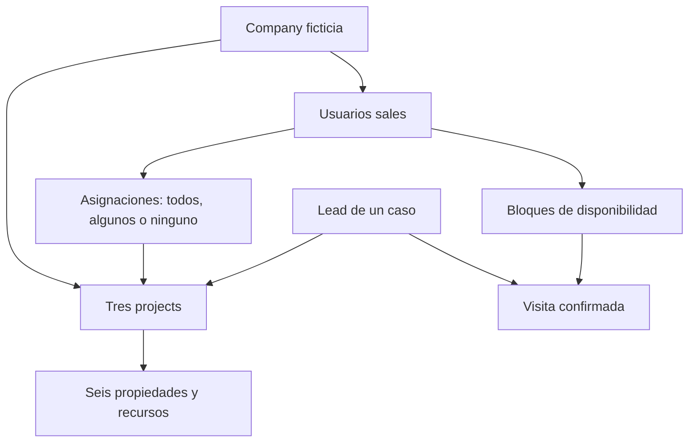

[Volver a la guía del agente](../README.md)

# Datos ficticios utilizados

El laboratorio actual contiene **una company, tres projects y seis tipos de propiedad**. No hay varias empresas sintéticas en esta fixture. El aislamiento entre compañías también cuenta con pruebas técnicas separadas, pero esta batería no demuestra por sí sola una matriz multicompañía.

| Conjunto | JSON completo |
|---|---|
| Empresa | [Empresa](empresa-y-proyectos/empresa.json) |
| Projects | [Proyectos](empresa-y-proyectos/proyectos.json) |
| Propiedades e inventario | [Propiedades](empresa-y-proyectos/propiedades.json) |
| Galerías y PDFs | [Recursos](empresa-y-proyectos/galerias-y-documentos.json) |
| Leads | [Perfiles](leads/perfiles-de-leads.json) |
| Usuarios sales | [Vendedores](vendedores-y-horarios/vendedores.json) |
| Alcance de cada vendedor | [Asignaciones](vendedores-y-horarios/asignaciones-a-proyectos.json) |
| Horarios | [Disponibilidad](vendedores-y-horarios/horarios-disponibles.json) |

## Empresa y proyectos

Empresa: **SYNTHETIC - Penguin Sales Laboratory**, país US, timezone corporativo UTC. Los proyectos tienen timezones propios. Sus fichas están aprobadas para aislar la calidad del diálogo de problemas del onboarding. Dirección, recursos y datos son ficticios.

| Project | Zona horaria | Dirección |
|---|---|---|
| SYNTHETIC Harbor Gardens | `America/New_York` | 1 Synthetic Avenue |
| SYNTHETIC Cedar Heights | `America/Chicago` | 2 Synthetic Avenue |
| SYNTHETIC Sierra Commons | `America/Denver` | 3 Synthetic Avenue |

Todos publican pago de contado y financiación bancaria, entrega diciembre de 2027 y amenidades de prueba. No se publican tasa, porcentaje de inicial, elegibilidad ni retornos garantizados.

| Propiedad | Dormitorios / baños | Área | Precio USD | Disponibles | Galería | PDF |
|---|---|---|---|---|---|---|
| Bay Residence | 4 / 3 | 240 m² | 780000 | 3 | Sí | Sí |
| Cedar Loft | 2 / 2 | 110 m² | 325000 | 5 | Sí | No |
| Cedar Studio | 1 / 1 | 52 m² | 210000 | 2 | No | Sí |
| Ridge Townhome | 3 / 2.5 | 165 m² | 460000 | 4 | No | No |
| Summit Villa | 4 / 3 | 220 m² | 620000 | 0 | Sí | Sí |
| Valley Apartment | 2 / 2 | 95 m² | Desconocido | Desconocido | No | No |

Los PDFs son archivos legibles generados para pruebas. Las galerías contienen ilustraciones sintéticas, no fotografías de inmuebles reales. Un PDF no prueba que existan fotos o planos: sus etiquetas de cobertura importan. Los enlaces exportados solo tienen sentido dentro del laboratorio; no son URLs públicas operativas de producción.

## Leads guionados: siete segmentos y uno desconocido

| Persona | Segmento | Presupuesto base USD |
|---|---|---|
| Emma Torres | `first_time_buyer` | 300000 |
| Daniel Brooks | `move_up_buyer` | 900000 |
| Sofia Reed | `relocation` | 900000 |
| Martin Vega | `downsizing` | 300000 |
| Lucas Chen | `rental_yield_investor` | 500000 |
| Valeria Cruz | `appreciation_resale_investor` | 900000 |
| Adrian Park | `portfolio_diversification` | 400000 |
| Alex Rivera | `sin segmento` | 500000 |

Los guiones A/B pueden cambiar el presupuesto o las condiciones respecto del perfil base: el valor exacto está en cada caso. No se fijaron edades ni ocupaciones; aparecen como `null`, no como hechos inventados. El segmento se deriva de la motivación expresada por el comprador, nunca de edad, ocupación o riqueza. No hay un LLM de lead: los mensajes iniciales y decisiones se guionan; el controlador solo lee opciones públicas del agente para seleccionar y confirmar.

## Vendedores y horarios

[Ver la matriz legible de los 80 vendedores y sus proyectos](vendedores-y-horarios/README.md)

La batería define **cinco usuarios por escenario**, 80 identidades sintéticas para 16 escenarios. No son 80 vendedores disponibles simultáneamente: antes de cada caso se reconstruyen las asignaciones y slots activos. Todos pertenecen a la misma company. IDs, emails `.invalid` y nombre real de fixture están en los JSON; las cuentas no sirven para iniciar sesión. No se exportan contraseñas ni credenciales.

| Rol del escenario | Alcance y elegibilidad |
|---|---|
| `candidate` | Candidato del project; todos, uno, dos projects o ninguno según el caso. Puede carecer de slots. |
| `other_project` | Tiene horarios, pero está asignado a otro project. |
| `none` | Ningún project asignado, aunque tenga horarios. |
| `inactive` | Asignado, pero usuario inactivo. |
| `no_appointments` | Asignado, pero no acepta citas. |

La disponibilidad documental usa un reloj fijo `2026-11-11T06:34:00` UTC: bloques 15:00–18:00 UTC a +2, +3 y +4 días para quienes tengan slots. Las corridas reales generan esos días desde su propio reloj; no son horarios permanentes ni promesas comerciales. Las visitas de prueba duran 45 minutos. Los JSON de asignaciones indican `scenario`, `user_id`, `company_id`, `access_scope`, `project_ids` y `target_project_id`.

El snapshot se genera desde las funciones reales `seed` y `team`, en SQLite desechable. El script de regeneración está en la sección técnica.
