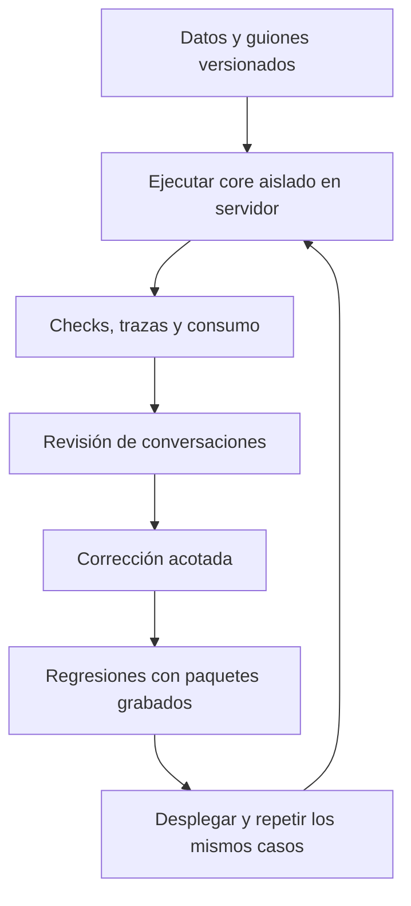

[Volver a la guía del agente](../README.md)

# Casos de prueba y diseño experimental

[Ver los 16 guiones completos en JSON](casos-guionados.json)

Hay ocho perfiles (siete segmentos y uno sin segmento), con dos variantes por perfil: **16 conversaciones independientes**. No se asigna anticipadamente el segmento al Lead de prueba; se comprueba después de interpretar su declaración. Los objetivos esperados no se pasan al modelo ni al controlador como hechos del cliente.

| Perfil | Variante A | Variante B |
|---|---|---|
| Primera compra | Información, PDF y visita | Inicial versus presupuesto total, financiación, PDF y rechazo |
| Cambio a vivienda mayor | Información, galería y visita | Elegir otra propiedad, fotos, rechazo y despedida |
| Reubicación | Ubicación, entrega y visita | Vendedor con horarios pero sin asignación al project |
| Vivienda menor | Información, PDF y visita | Material faltante y otra propiedad agotada |
| Inversión para alquiler | Información y visita | Retorno no publicado e inventario/precio desconocidos |
| Revalorización y reventa | Información y visita | Presupuesto inferior, financiación y rechazo de pago/reserva |
| Diversificación | Comparación, galería y otro slot | Comparación y ausencia de slots |
| Sin segmento | Información y visita | Petición humana insistente y cierre |

## Cómo ahorramos tokens

Solo el agente de ventas usa el modelo publicado. El lead y el juez no consumen llamadas LLM. Los guiones contienen intenciones y decisiones de un comprador; el controlador de disponibilidad observa la respuesta pública y nunca lee IDs privados de slots, la lista de vendedores o el resultado esperado. Se limita la repetición y se detiene si no hay avance. No se mantiene un role-play libre durante horas.

En la iteración actual se ejecutan tres casos (`first_time_A`, `move_up_B`, `unknown_A`), como máximo ocho turnos de lead por caso y sesenta llamadas globales. Un turno puede requerir interpretación, reparación y composición: no equivale a una llamada. Son límites operativos, no una estimación científica de duración media de conversaciones reales ni un límite monetario. Las dos visitas necesitan normalmente cuatro o cinco mensajes del lead en esta selección.

## Ciclo de mejora

Se empieza por una iteración puntual para resolver un bloqueo; después se amplía a batería compacta. No se aumentan casos ni se cambia de modelo mientras eso impida atribuir un cambio a la corrección del controlador. Las regresiones locales no simulan calidad del modelo: prueban que paquetes ya observados no vuelvan a romper el recorrido.

## Qué medimos

- Fidelidad de presupuesto, moneda, contado y motivación; ausencia de preguntas financieras repetidas.
- Respuesta a la propiedad solicitada, cambio de propiedad y comparación legítima.
- Entrega de recursos aprobados o explicación de ausencia; sin inventar cobertura.
- Asignación correcta por company/project y exclusión de usuarios inactivos/no elegibles/sin slots.
- Selección, resumen, confirmación y persistencia de exactamente una cita; ninguna antes de confirmar.
- Despedida, rechazo, petición humana y continuidad sin emociones inventadas ni narración técnica.
- Idempotencia, aislamiento, ausencia de outbox, llamadas, tokens y costo reportado.

Los checks no sustituyen una revisión comercial. Sus denominadores y reglas han cambiado históricamente; los resultados guardan la versión aplicada. Fuera de alcance: entrega efectiva SMS/WhatsApp, Google Calendar externo, round-robin real, concurrencia PostgreSQL, cancelación/reagendamiento y aviso automático de nuevos horarios.
