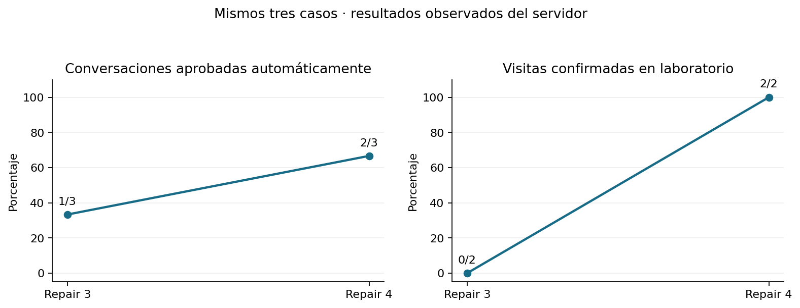
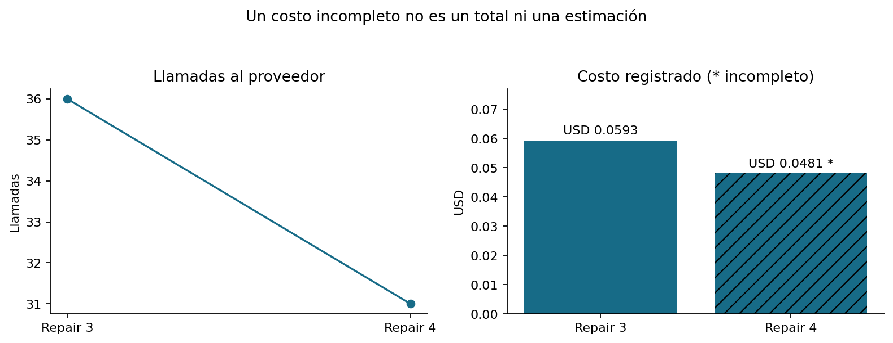
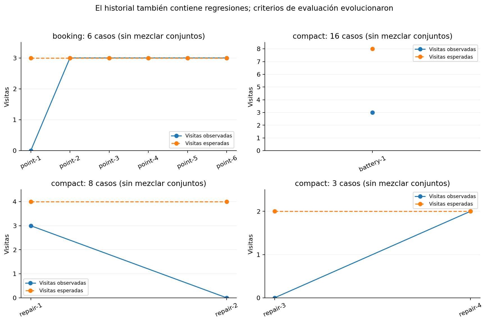

[Volver a la guía del agente](../README.md)

# Resultados observados y mejoras

[Historial JSON](corridas.json) · [Métricas CSV](metricas.csv) · [Conversaciones](../04-conversaciones/README.md)

Se conservan 14 corridas de servidor. **No hay mejora monótona**: Repair 1 logró tres de cuatro visitas y Repair 2 regresó a cero. Los cambios se documentan junto con los retrocesos. Repair 5 no tiene resultado live incorporado.

| Corrida | Casos aprobados automáticamente | Visitas / esperadas | Estado original | JSON y contexto |
|---|---|---|---|---|
| sales-booking-point-1 | 0/6 | 0/3 | FAIL | [Abrir](sales-booking-point-1/README.md) |
| sales-booking-point-2 | 0/6 | 3/3 | FAIL | [Abrir](sales-booking-point-2/README.md) |
| sales-booking-point-3 | 2/6 | 3/3 | FAIL | [Abrir](sales-booking-point-3/README.md) |
| sales-booking-point-4 | 0/6 | 3/3 | FAIL | [Abrir](sales-booking-point-4/README.md) |
| sales-booking-point-5 | 2/6 | 3/3 | FAIL | [Abrir](sales-booking-point-5/README.md) |
| sales-booking-point-6 | 3/6 | 3/3 | INCOMPLETE | [Abrir](sales-booking-point-6/README.md) |
| sales-closing-point-1 | 8/8 | 0/0 | PASS | [Abrir](sales-closing-point-1/README.md) |
| sales-commercial-point-1 | 7/8 | 0/0 | FAIL | [Abrir](sales-commercial-point-1/README.md) |
| sales-commercial-point-2 | 8/8 | 0/0 | PASS | [Abrir](sales-commercial-point-2/README.md) |
| sales-compact-battery-1 | 2/16 | 3/8 | FAIL | [Abrir](sales-compact-battery-1/README.md) |
| sales-compact-repair-1 | 0/8 | 3/4 | FAIL | [Abrir](sales-compact-repair-1/README.md) |
| sales-compact-repair-2 | 1/8 | 0/4 | FAIL | [Abrir](sales-compact-repair-2/README.md) |
| sales-compact-repair-3 | 1/3 | 0/2 | FAIL | [Abrir](sales-compact-repair-3/README.md) |
| sales-compact-repair-4 | 2/3 | 2/2 | FAIL | [Abrir](sales-compact-repair-4/README.md) |

## Comparación controlada reciente

Repair 3 y Repair 4 usaron los mismos tres casos y configuración publicada 8 de `openai/gpt-4o-mini`. Pasaron de una a dos conversaciones aprobadas y de cero a dos visitas confirmadas. Es evidencia de esos recorridos, no una tasa esperada de conversión comercial.

Las llamadas bajaron de 36 a 31. Repair 3 registró USD 0,0592518 con consumo completo; Repair 4 registró USD 0,0480819 para 30 de 31 respuestas. **El segundo costo es incompleto**: no representa un ahorro total exacto. No se estimó el costo faltante.

Cada panel separa suites y cantidades de casos. Dentro de un panel se conserva la selección de casos; aun así los criterios de validación evolucionaron. Un 0/0 en pruebas comerciales o de cierre significa que no se esperaba agendar, no un fracaso ni un éxito de reservas. `INCOMPLETE` conserva comprobaciones bloqueadas, por ejemplo disponibilidad pendiente de revisión.

## Qué fue cambiando

| Etapa | Hallazgo y corrección documentada |
|---|---|
| Composición inicial | El proveedor rechazaba el esquema estructurado; el probe comparó esquema legado y corregido. Esto precede a estas suites; no se inventan métricas para ese probe. |
| Booking point 1–6 | Se corrigieron persistencia de preferencias, evidencia financiera y continuación de selección/confirmación. Las tres visitas llegaron a persistirse, pero hubo errores y bloqueos de diálogo. |
| Commercial point 1–2 | Contado, inicial versus presupuesto total, financiación y límites de pago/reserva; se evitó repetir financiación e inventar frustración al cerrar. |
| Closing point 1 | Petición humana, rechazo, cierre y retoma en la misma corrida. Ocho casos aprobaron. |
| Compact battery 1 | Amplió a 16 casos y reveló fallos no vistos en las pruebas puntuales. |
| Repair 1–2 | Reparación y contrato de interpretación; persistencia independiente. La segunda corrida perdió visitas y mostró siete TypeError sin traza conservada. |
| Repair 3 | Conservó trazas frente a rollback y corrigió propietario de material/visita nueva. No reapareció TypeError en esa selección, pero hubo comparaciones inventadas y selecciones que no avanzaban. |
| Repair 4 | Material literal y selección de opción pública; dos visitas completadas. Quedó un fallo de composición y un catálogo demasiado amplio en `move_up_B`. |
| Repair 5 | Corrección del catálogo ligado a propiedad, información sin consentimiento de visita y orden seguro de bloques; pendiente de nueva evaluación live. |

## Límites de interpretación

El número de checks aprobados crece o baja con la longitud del diálogo y la versión del evaluador; no es un puntaje comparable de calidad. Los hashes de archivos, commits, modelos y denominadores permiten auditar la procedencia. Los ejemplos revisados no representan cobertura exhaustiva de todos los segmentos. Las figuras se generan con NumPy y Matplotlib, con puntos reales y sin suavizado, extrapolación ni barras de error inventadas.
