# Sales Agent · funcionamiento, experimentos y mejoras

[Inicio del repositorio](../../README.md) · [Datos JSON](02-datos-de-prueba/) · [Conversaciones](04-conversaciones/) · [Evidencia de corridas](05-resultados-y-mejoras/)

**Historial temprano: corte 11/11/2026; continuidad LangGraph recibida hasta el 16/11/2026.** Se reúne el trabajo del ciclo reciente con data sintética: **21 corridas del servidor, 144 conversaciones ejecutadas y 47 IDs de escenario distintos por suite**. Las repeticiones son parte del trabajo, no escenarios adicionales. En la batería compacta 2, **13/16 conversaciones cumplieron los checks originales y se registraron 7/8 visitas esperadas**; eso no certifica la calidad integral de esos diálogos. En el último subconjunto, Repair 8, **2/3 conversaciones cumplieron sus checks y se registró 1/2 visitas**: vivienda mayor y fotos ausentes se recuperaron; diversificación falló con tiempos de espera del modelo. No se mezclan ambos conjuntos como si fueran una nueva batería completa.

**Estado actual · LangGraph integrado.** La corrida `94f72bc` registra **6/6 conversaciones sin controles fallidos y 5/5 citas esperadas**, con 352 controles PASS y ninguno FAIL. Se resolvieron el cambio explícito de propiedad y la consulta combinada de materiales y financiamiento. Es evidencia del modelo publicado en el laboratorio del servidor, no aprobación integral de diálogos reales. El siguiente paso son dos repeticiones idénticas, todavía pendientes; esta entrega documenta y prepara esa comprobación sin modificar el motor.

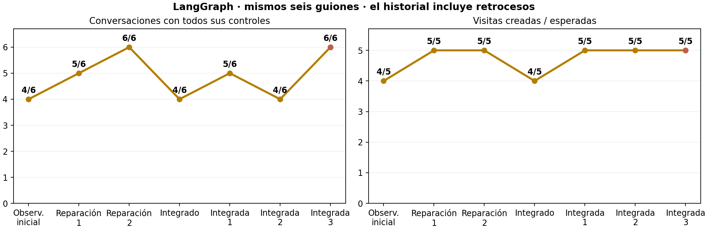

La curva conserva **4/6 → 5/6 → 6/6 → 4/6 → 5/6 → 4/6 → 6/6**, todos con los seis guiones de observaciones y el mismo modelo/configuración publicada. Evolucionaron criterios y contexto de ejecución; no es una estimación de conversión comercial. **Total de estas siete corridas LangGraph: 910 llamadas y USD 0.83863380**. La reparación local no añade un punto de éxito al gráfico. [Datos de la curva](05-resultados-y-mejoras/langgraph-integrado/historico-servidor.json).

| Corrida LangGraph | Conversaciones sin controles fallidos | Citas / esperadas | Llamadas | Total USD por fila |
|---|---:|---:|---:|---:|
| Observaciones · `31023e0` | 4/6 | 4/5 | 127 | 0.11234655 |
| Reparación 1 · `ba5c4c5` | 5/6 | 5/5 | 134 | 0.12726405 |
| Reparación 2 · `cb30201` | 6/6 | 5/5 | 130 | 0.11303685 |
| Integrado · `14dfa6f` | 4/6 | 4/5 | 126 | 0.11470965 |
| Reparación integrada 1 · `91e902a` | 5/6 | 5/5 | 132 | 0.12615315 |
| Reparación integrada 2 · `400593e` | 4/6 | 5/5 | 128 | 0.12411900 |
| Reparación integrada 3 · `94f72bc` | 6/6 | 5/5 | 133 | 0.12100455 |
| **TOTAL · siete corridas** | **34/42 ejecuciones; no calidad actual** | **No sumar como conversión** | **910** | **0.83863380** |

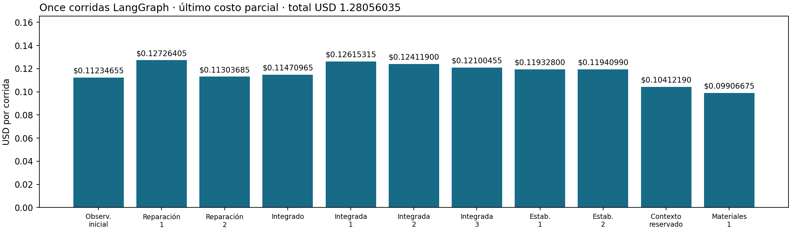

**Qué sucedió en la primera corrida integrada.** «Can I visit Cedar Studio?» generó comparaciones con referencias históricas y falló en `interpret`; no llegó a buscar horarios. En el pedido de fotos o folleto **y** financiamiento, el modelo produjo materiales y una preferencia inválida: se eliminó la preferencia, pero faltó conservar la consulta independiente. El `PASS` del ciclo de herramientas solo cubría las tareas recibidas, no todas las intenciones originales. Esta entrega registra por separado la cobertura literal de esas preguntas y la ejecución de herramientas; sigue sin certificar calidad integral. [Conversaciones del servidor, legibles](05-resultados-y-mejoras/langgraph-integrado-servidor/conversaciones.md) · [JSON original del resultado](05-resultados-y-mejoras/langgraph-integrado-servidor/resultado.json).

**Validación técnica de la integración previa:** 3,689 pruebas aprobadas en 149 módulos, 11 omitidas y cero fallos; 63 controles de aceptación aprobados y uno en vivo pendiente. Las 11 pruebas específicas de fronteras se repitieron aparte y se solapan con la regresión; no se suman como conversaciones nuevas. Red y modelos simulados, consumo pagado USD 0.00. [Validación local](05-resultados-y-mejoras/langgraph-integrado/validacion-local.json).

### Flujo integrado que reciben los leads

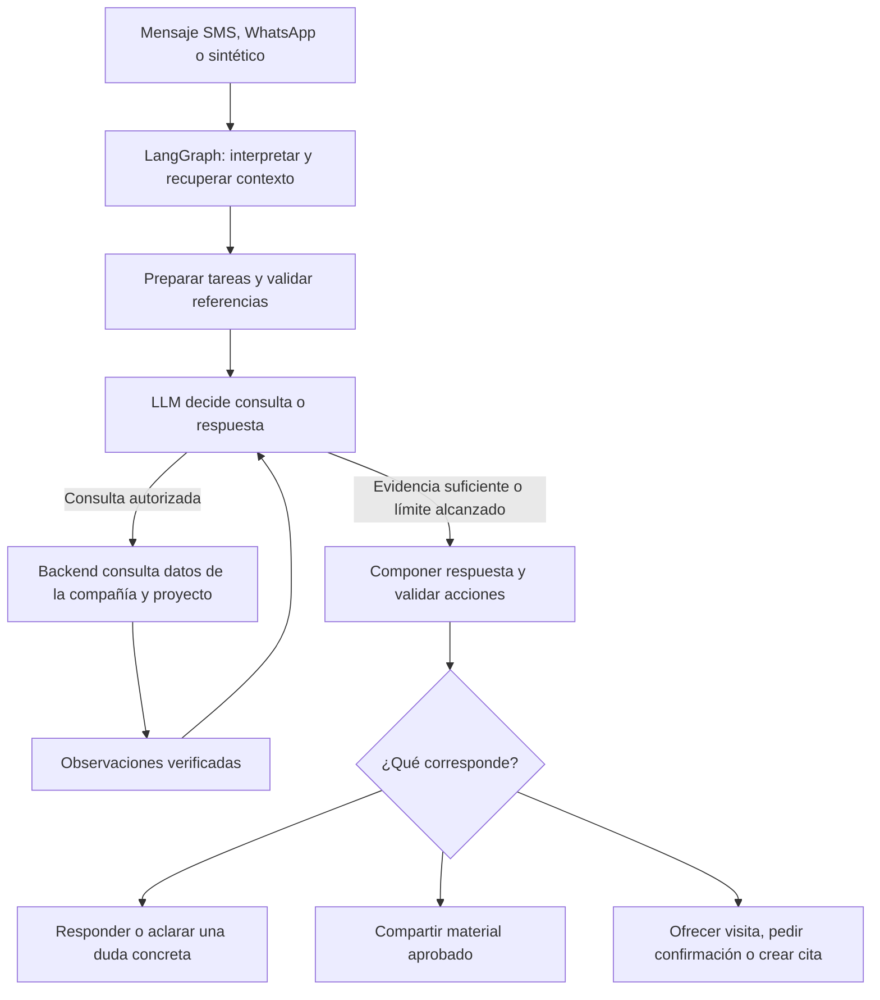

**Responsabilidades.** El LLM publicado, actualmente `openai/gpt-4o-mini` en la configuración evaluada, interpreta y decide entre consultas permitidas; recibe sus resultados antes de decidir nuevamente. El sistema de interpretación de esta reparación es `sales-interpretation-system/2.8` y el ciclo de observaciones `2.1`. El modelo efectivo siempre depende de la configuración publicada y queda registrado en la corrida. El backend conserva permisos, restricciones, catálogo aprobado, selección de propiedad, disponibilidad y confirmación de cita. LangGraph no es una nueva base de memoria: el estado y los recibos persistidos siguen siendo la fuente común. El ciclo permite dos rondas y hasta seis lecturas, con límite de contexto y tiempo por decisión. Las acciones de negocio se ejecutan después de sus validaciones, nunca desde la decisión de lectura.

**Mensajes sin razonamiento comercial.** El saludo inicial, avisos y recordatorios deterministas siguen siendo servicios del backend; no necesitan llamar al modelo ni representan un segundo agente. La integración del grafo corresponde a los turnos entrantes de conversación. Una pausa manual, falta de consentimiento o un evento ya procesado puede impedir que un mensaje recorra el grafo.

**Mismo motor, efectos diferentes.** Las simulaciones utilizan compañía, propiedades, vendedores y leads sintéticos en una base desechable; no contactan a personas ni crean eventos externos de Calendar. Las pruebas manuales usan los canales e integraciones reales. Las pruebas sintéticas no certifican transporte, concurrencia PostgreSQL ni entrega al teléfono. La simulación mantiene su adaptador de asignación de vendedor, indicado en las limitaciones de la corrida; no se confunde con la asignación concurrente real.

**Observabilidad.** `/api/v1/health/sales-engine` identifica la versión desplegada y `/health/sales` informa del worker. Cada turno registra nodos completados, nodo en curso, interpretación, decisiones, herramientas y resultados. Un error conserva el nodo en que ocurrió. Las conversaciones históricas conservan la versión con la que se ejecutaron; desplegar una versión no transforma sus resultados. Las decisiones tienen un tiempo límite y se revalidan permisos después de la espera y antes de cada consulta. El estado del turno conserva su reversión transaccional si la respuesta final es rechazada. No se usa una derivación al equipo comercial como respuesta automática a fallos internos.

**Cómo validar.** Ejecutar el [comando de evaluación](06-como-ejecutar-las-pruebas/ejecutar-langgraph-integrado.sh), revisar los seis diálogos y sus cinco citas esperadas y después repetir manualmente consultas, materiales y selección/confirmación de horario. El informe debe mostrar `coordinator_graph.mode=graph-observe`, versión `2.0` y la secuencia `interpret → plan → observe → fulfill`. Un `PASS` funcional no sustituye revisar pertinencia, continuidad y tono comercial. Se conservan los siete segmentos y el perfil desconocido; esta entrega integra el motor, no amplía aún la cobertura de perfiles ni resuelve por sí sola todos los errores de interpretación observados.

**Consumo.** En la última corrida previa, referencia: **78 llamadas, $0.11470410**; LangGraph: **130 llamadas, $0.11303685**; **total: 208 llamadas, $0.22774095**. La próxima ejecución de seis guiones usa solamente LangGraph: estimación orientativa **$0.10–$0.20 por corrida**, no un tope monetario. `--max-calls 300` limita llamadas, no dólares. El costo real se registra en la evidencia; no se atribuyen consumos de esta integración al servidor antes de ejecutarla. El ajuste posterior modifica interpretación, uso de contexto, decisiones, validaciones y composición; no reentrena los pesos del modelo.

La guía usa bloques con el mismo propósito: **qué se hizo → cómo funciona → qué evidencia hay → dónde están sus archivos**. Toda la explicación está aquí; los enlaces internos abren datos, código o carpetas de respaldo. Las referencias externas justifican la metodología, no sustituyen la evidencia del proyecto.

[1. Producto](#1-producto-y-rutas) · [2. LLM/backend](#2-llm-y-backend) · [3. Datos](#3-datos-sintéticos) · [4. Experimentos](#4-diseño-de-los-experimentos) · [5. Afinamiento](#5-qué-se-modifica-al-afinar) · [6. Evolución](#6-historia-y-evolución-medida) · [7. Diálogos](#7-conversaciones-para-repetir) · [8. Consumos](#8-consumo-real-y-saldo-de-openrouter) · [9. Referencias](#9-referencias-y-fundamento) · [10. Trabajo actual](#10-trabajo-actual) · [11. Trabajo futuro](#11-trabajo-futuro)

**Cómo leer «éxito».** Las etiquetas antiguas `aprobado` y la carpeta `funcionaron` conservan los checks y rutas históricos. No equivalen a una aprobación integral del diálogo. Tras revisar 144 conversaciones: **121 no tienen evaluación integral, nueve tienen revisión favorable de alcance limitado y 14 necesitan mejoras**. Los mensajes, costos y checks originales se conservaron; se añadieron etiquetas y hallazgos visibles en cada ficha. No se convierten resultados locales en resultados del servidor.

## 1. Producto y rutas

**Propósito.** Informar con el conocimiento aprobado y ayudar al lead a decidirse por una visita. El personal humano atiende esa visita y cierra la venta. En el chat no se cobra, separa un inmueble ni aprueba un crédito. “Cash” se interpreta como compra de contado, no billetes físicos ni fondos verificados.

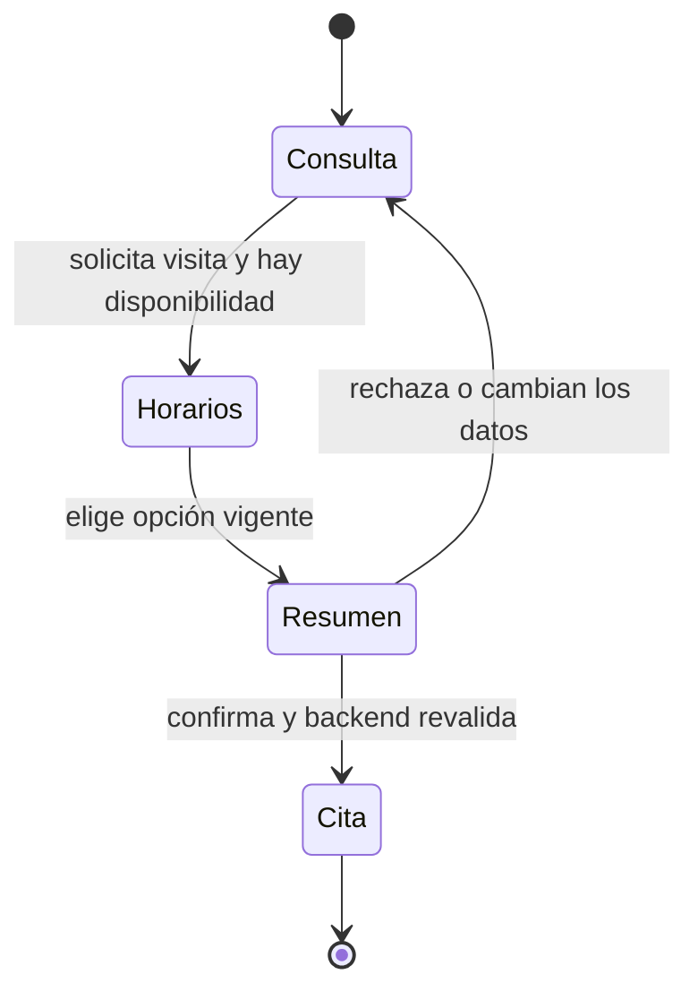

**Rutas del producto.** El flujo actual es `sales-current/1.0`; los flags históricos ya no seleccionan otro motor. Esto conserva autorización, aislamiento y control humano: una conversación pausada no debe responder automáticamente.

| Ruta/canal | Función | Acceso o condición |
|---|---|---|
| `/app/agent` | Conversaciones, alta y control humano | `admin`, `assistant`, `mkt`, según company/project. |
| WhatsApp/SMS entrante | Conduce al coordinador actual | Canal configurado, lead autorizado y estado activo. |
| `/app/schedule` | Disponibilidad y citas | `admin`, `assistant`, `sales`, con su alcance. |
| `/app/projects/:id/onboarding` | Conocimiento aprobado del project | `admin`, `assistant`; alimenta al vendedor. |
| `/admin/ai-settings` y `/admin/messaging-settings` | Modelo publicado y mensajería | `superadmin`; configuración no equivale a entrega exitosa. |
| Laboratorio CLI | El mismo core sin transporte | SQLite desechable; no escribe leads/citas productivos. |

**Alcance probado.** Información, contado/financiación publicada, PDF, visitas, rechazo, petición humana y retoma en la misma corrida. Cambio de propiedad/fotos aprobó en Repair 6 y 7; queda por comprobar su consistencia en más escenarios. La falta de horarios no debe inventar alertas; cancelación y reagendamiento no se acreditan con esta batería. [Rutas UI](../../frontend/src/app/app.routes.ts) · [API](../../backend/app/modules/sales_agent/router.py).

## 2. LLM y backend

**Modelo observado en el servidor:** `openai/gpt-4o-mini` mediante OpenRouter, configuración publicada **8**. Esa versión corresponde a settings, no a pesos del modelo. No hay evidencia aquí de un snapshot fechado del proveedor ni de entrenamiento propio. El lead actual está guionado y no usa otro LLM; el juez LLM está desactivado.

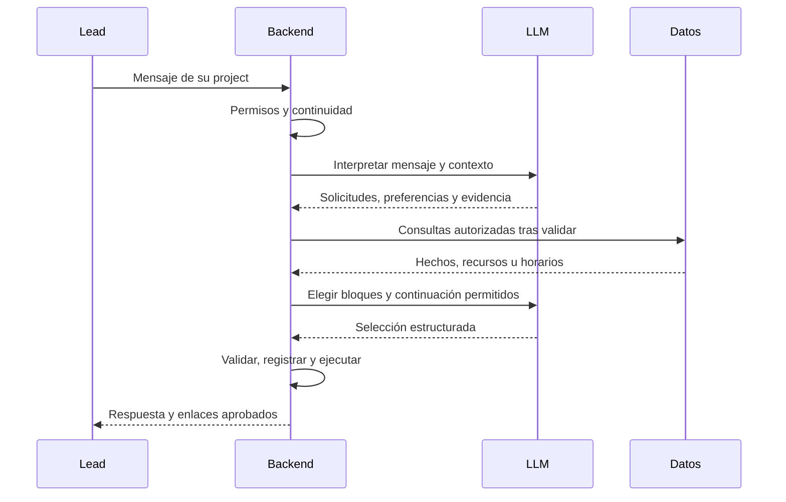

| Paso | Responsable | Regla principal |
|---|---|---|
| Interpretación | LLM | Identifica intención y sujeto con evidencia del mensaje actual. |
| Validación y memoria | Backend | Comprueba datos, conserva preferencias y no inventa consentimiento. |
| Plan y herramientas | LangGraph / LLM / backend | El modelo decide consultas permitidas; el backend resuelve y consulta dentro de la compañía y proyecto. |
| Composición | LLM / backend | El modelo selecciona variantes de evidencia; Repair 7 presenta directamente un comprobante de cita único ya validado. No escribe hechos libres. |
| Compartir/agendar/enviar | Backend | Verifica permisos y efectos; seleccionar horario solo prepara el resumen. |

**Límites.** Hay reparaciones acotadas; no se repite indefinidamente. Algunos turnos usan texto del backend, por lo que turno y llamada son unidades distintas. Los errores internos no se narran al lead. El protocolo actual es `sales-understanding-prompt/2.37` y el sistema de interpretación `sales-interpretation-system/2.8`; el contrato de entrada es `sales-interpretation-input/2.0` y el compositor `sales-commercial-composer/1.0` [R1–R3]. [Coordinador](../../backend/app/modules/sales_agent/active_service.py) · [Interpretación](../../backend/app/modules/sales_agent/understanding_service.py).

### Estructura de orquestación: qué está fijo y qué afinamos

**Un único motor comercial.** `process_live_inbound` y `current_simulation.turn` utilizan `active_service.maybe_process_active`. Este invoca el nuevo `StateGraph`: interpretación → preparación de tareas → ciclo de decisión/lecturas/observaciones → composición y acciones validadas. El grafo histórico `sales-turns-v5` sigue en el repositorio para trazabilidad, pero no procesa los mensajes nuevos. El coordinador ya no contiene una rama de ejecución `classic`.

| Capa | Función actual | Qué se afina |
|---|---|---|
| LangGraph `sales-coordinator-graph/2.0` | Mismo recorrido en canales reales y laboratorio. | Decisiones, límites y transición entre consulta y respuesta. |
| Ciclo `sales-observation-loop/2.0` | El LLM consulta herramientas permitidas y revisa resultados en hasta dos rondas. | Cobertura de preguntas y selección de consultas sin repeticiones. |
| Estado persistente | Propiedad, preferencias, restricciones, tareas y ofertas vigentes. | Referencias, interrupciones y cambios de intención. |
| Instrucciones y contrato | Interpretación con evidencia y composición basada en hechos. | Ejemplos, normalización y tono comercial; no pesos del modelo. |
| Backend transaccional | Permisos, materiales, vendedores, disponibilidad y confirmación. | Exactitud, idempotencia y presentación de resultados. |
| Experimentos | Mismo motor con datos y efectos aislados. | Casos y variantes; los controles no sustituyen revisión comercial. |

La integración cambia la topología que se ejecuta en producción. Las iteraciones posteriores pueden ajustar sus componentes sin reconectar el grafo en cada entrega. Los apartados 10.7–10.10 conservan el historial experimental anterior y sus mediciones; las instrucciones antiguas de comparación corresponden a esas versiones.

[Coordinador LangGraph](../../backend/app/modules/sales_agent/coordinator_graph.py) · [Ciclo de observaciones](../../backend/app/modules/sales_agent/observation_loop.py) · [Entrada real](../../backend/app/modules/sales_agent/live_service.py) · [Simulación](../../backend/app/modules/sales_agent/current_simulation.py).

### Correspondencia con la propuesta original del flujo híbrido

Se contrastó el código con [Cambio de funcionamiento del agente](https://docs.google.com/document/d/1-jzaKu5pbvZNgXh9ey9O7EWvxQlHHJ5ztupjZBn0Bew/edit), leído el 15/11/2026. El documento primero describe el antiguo commit `8f362e2` y después propone una arquitectura; esa descripción inicial no identifica el motor actual. **El propósito híbrido está implementado en buena parte, pero no toda la propuesta es una función ya disponible ni una calidad demostrada.**

| Propuesta | Implementación actual | Límite real |
|---|---|---|
| Interpretar cada mensaje y descomponer solicitudes | Contrato estructurado con solicitudes AND/OR, preferencias, restricciones y referencias. | Un JSON válido puede representar mal la intención; se valida y repara de forma acotada. |
| Conservar contexto y permitir interrupciones | Estado persistido con propiedad/unidad, tareas pendientes y propuestas. | Hay casos observados que conservan el dato pero no lo utilizan correctamente; no se declara continuidad perfecta. |
| Consultar antes de responder | El plan consulta herramientas y la composición posterior recibe evidencia y opciones permitidas. | El LLM selecciona bloques/redacciones autorizados; no redacta libremente cualquier hecho. |
| Reconsiderar resultados mediante ciclos | `turn_planner` ejecuta rondas acotadas y se detiene sin información nueva o por límites. | La planificación es por código; registra `additional_model_calls=0`. No hay un loop general LLM→herramienta→LLM que seleccione herramientas arbitrarias. |
| Corregir salidas incumplidas | Interpretación y composición admiten una reparación acotada con feedback verificable. | No hay una red de críticos ni una revisión semántica ilimitada. |
| Backend controla efectos | Alcance, permisos, consentimiento, cobertura, integridad y confirmación se vuelven a verificar. | El modelo propone; no reserva, cancela ni comparte por su cuenta. |
| Estrategias configurables | Se usa la configuración publicada y el playbook. | Varias reglas de interpretación, aclaración y redacción siguen fijadas/versionadas en código; no todo se cambia desde settings. |
| Conservar LangGraph | El grafo histórico sigue presente. | Esta entrega utiliza el nuevo StateGraph y ciclo posterior a herramientas tanto en canales reales como en simulación; 10.7–10.10 documentan sus fases previas. |

El motor integrado permite replantear consultas después de observar herramientas dentro de un conjunto autorizado y acotado; no es un agente con acceso libre a herramientas o escrituras. Las trazas y pruebas permiten separar un fallo de interpretación, referencia, planificación o presentación antes de atribuirlo al modelo o prometer una solución arquitectónica completa.

## 3. Datos sintéticos

**Se confeccionó una company**, SYNTHETIC - Penguin Sales Laboratory, con tres projects aprobados y seis tipos de propiedad. Las fichas tienen country US, timezones de proyecto, direcciones ficticias y pago publicado de contado/financiación bancaria, sin tasa, inicial o rentabilidad garantizada inventada.

| Project / timezone | Propiedad | Precio USD | Disponibles | Galería / PDF |
|---|---|---|---|---|
| Harbor Gardens / New York | Bay Residence | 780.000 | 3 | Ambos |
| Cedar Heights / Chicago | Cedar Loft | 325.000 | 5 | Galería |
| Cedar Heights / Chicago | Cedar Studio | 210.000 | 2 | PDF |
| Sierra Commons / Denver | Ridge Townhome | 460.000 | 4 | Ninguno |
| Sierra Commons / Denver | Summit Villa | 620.000 | **0** | Ambos |
| Sierra Commons / Denver | Valley Apartment | **Desconocido** | **Desconocido** | Ninguno |

**Leads actuales: siete segmentos y uno desconocido.** Son perfiles ficticios con una guía de motivación y objetivos, no personas contactadas. En las corridas actuales sus mensajes los conduce un guion; no se paga otro LLM para representar al lead.

| Lead sintético | Segmento / motivación | Qué permite comprobar |
|---|---|---|
| Emma Torres | Primera vivienda | Explicar la propiedad, entregar PDF y guiar hacia una visita. |
| Daniel Brooks | Cambiar a una vivienda mayor | Respetar cambios de propiedad, fotos y rechazo temporal de visita. |
| Sofia Reed | Reubicación por trabajo | Responder ubicación y ofrecer solo vendedores habilitados. |
| Martin Vega | Cambiar a una vivienda menor | Entregar material correcto y reconocer recursos ausentes o propiedades agotadas. |
| Lucas Chen | Inversión para alquiler | Informar sin inventar rentabilidad, precios o inventario. |
| Valeria Cruz | Valorización y posterior reventa | Explicar condiciones publicadas sin cobrar ni reservar por chat. |
| Adrian Park | Diversificación de inversiones | Comparar opciones y gestionar disponibilidad de visitas. |
| Alex Rivera | Motivación desconocida, sin segmento | Ayudar y agendar sin atribuir una motivación no declarada. |

**Total: ocho perfiles**, con variantes A/B que conforman 16 escenarios. Edad y ocupación no están definidas. Cada variante fija presupuesto, restricciones y resultado esperado; el segmento se verifica desde lo dicho, no se precarga como respuesta correcta.

**Vendedores.** Cinco roles por escenario: candidato, asignado a otro project, ninguno, inactivo y no acepta citas. El candidato puede abarcar todos, dos, uno o ningún project de su company y puede no tener slots. Son 80 identidades para 16 escenarios, no 80 elegibles a la vez. Se reconstruyen asignaciones activas por caso. El snapshot documental tiene bloques 15:00–18:00 UTC a +2/+3/+4 días; las corridas calculan sus propias fechas.

```json
{
  "case": "first_time_A", "goal": "booked", "access": "single",
  "budget": 300000, "cash": true, "material": "pdf"
}
```

**Organización.** Empresa → projects → propiedades → recursos; vendedor → company + asignaciones + slots; lead → perfil + escenario + conversación. PDFs e ilustraciones son reales como archivos, pero ficticios como oferta. Un PDF no acredita fotos/planos; los enlaces solo viven dentro del laboratorio.

[Empresa y propiedades JSON](02-datos-de-prueba/empresa-y-proyectos/) · [Perfiles de leads](02-datos-de-prueba/leads/) · [Vendedores, asignaciones y horarios](02-datos-de-prueba/vendedores-y-horarios/) · [16 guiones](03-casos-de-prueba/casos-guionados.json).

## 4. Diseño de los experimentos

**Inicio: lead LLM.** Tres perfiles por project —nuevo comprador, materiales de una propiedad y continuidad de contado a financiación—: nueve diálogos, hasta seis turnos del lead. En Lab 2 y 3 ambos participantes usaron `gpt-4o-mini`. El comprador veía su guía y la conversación pública, no la base, los IDs privados o las respuestas esperadas.

**Corrección del simulador.** Al detectar repeticiones, desvíos y borradores con rol de vendedor se pasó a un controlador backend: dos intentos por objetivo, terminación acotada y respaldo trazable. Lab 3 terminó sus nueve controladores, pero solo cuatro casos resolvieron todos sus objetivos percibidos. Terminar no equivale a aprobar.

**Etapa actual: guiones para ahorrar y repetir.** No se redacta manualmente cada conversación por WhatsApp. Una batería define mensajes/objetivos; el controlador lee solo opciones públicas del agente para elegir horario y confirmar. El modelo de ventas sigue siendo real en la corrida del servidor; se sustituyen el transporte y el comprador, no el core.

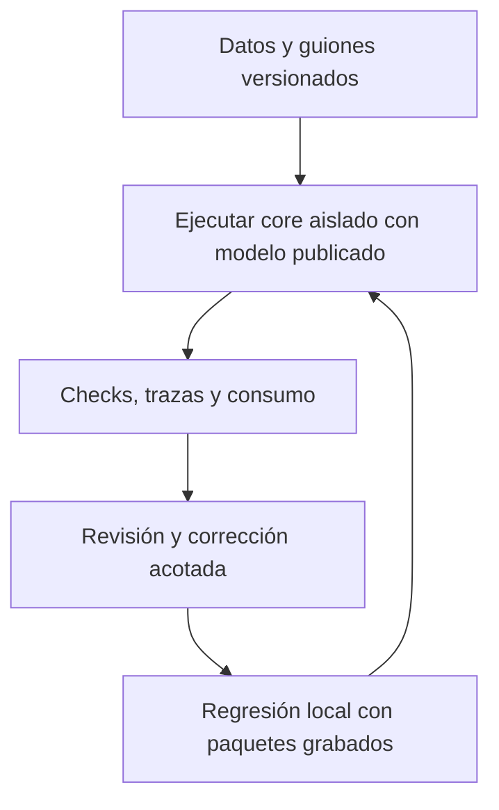

| Conjunto | Para qué se diseñó | Resultado esperado, no necesariamente una cita |
|---|---|---|
| Agenda puntual | Asignación, slots, selección y confirmación | Crear una sola cita tras aceptar el resumen, o explicar ausencia de horarios. |
| Comercial | Contado, inicial, presupuesto inferior, pago/reserva | Informar con hechos publicados, sin cobrar ni prometer crédito. |
| Cierres/retoma | Rechazo, humano, despedida y pregunta posterior | Mantener ayuda disponible y cerrar sin presión. |
| Compacta | Ocho perfiles × A/B = 16 escenarios | Cruzar información, materiales, disponibilidad y decisiones. |
| Selección de tres | PDF/visita, cambio/fotos/rechazo y visita sin segmento | Aislar el bloqueo y repetir barato antes de ampliar. |

**Qué se evalúa:** evidencia, sujeto, preferencias persistidas, recursos entregados, resultado en base, consentimiento, no duplicación y claridad pública. Una cita declarada sin registro no cuenta. Las pruebas locales con HTTP simulado previenen regresiones, pero no miden al modelo real. Esta distinción coincide con evaluación de comportamiento, trazas y estado final [R4–R6]. [Guiones](03-casos-de-prueba/casos-guionados.json) · [Primeros perfiles LLM](02-datos-de-prueba/leads/perfiles-iniciales-adaptativos.json).

## 5. Qué se modifica al afinar

**Afinar aquí significa cambiar instrucciones y código versionados; los pesos del modelo se conservan.** Se localiza un fallo observado, se modifica su causa y se repite la misma conversación más variantes. No se considera mejora únicamente que el texto suene más amable.

| Pieza modificada | Problema observado | Qué se actualizó y cómo | Beneficio buscado |
|---|---|---|---|
| Prompt y esquema de salida | El proveedor rechazaba el formato JSON; después hubo interpretaciones incorrectas. | Se corrigió el esquema aceptado por el proveedor y se versionaron instrucciones con ejemplos de contado, selección, materiales y visita. Se exige citar el mensaje actual como evidencia. | Obtener respuestas procesables y distinguir información, preferencias y consentimiento. |
| Validación semántica | Pedir fotos se interpretaba como pedir una visita; una selección, como comparación. | Se añadieron comprobaciones que contrastan la acción con su cita y rechazan visitas sin petición explícita, acciones incompatibles y evidencia ajena al turno. La reparación recibe la regla concreta incumplida. | Evitar acciones no pedidas y corregir errores sin ocultarlos. |
| Referencias y planificación | Se confundía el nombre de una propiedad con un material o se mostraba un catálogo demasiado amplio. | El backend resuelve nombres solo dentro del project. En Repair 6 vincula una elección explícita única con «sus fotos» en el mismo mensaje, conserva la confianza y elimina la visita inventada; ambigüedades y restricciones siguen bloqueando la acción. | Responder y compartir el recurso de la propiedad elegida. |
| Estado y persistencia | Se perdían presupuesto y preferencia de contado tras un rollback. | Se ajustó la conservación y recuperación de declaraciones verificadas al restaurar el estado de la conversación. Repair 8 omite copias históricas verificadas de preferencias opcionales sin borrar las ya guardadas. Los tests comprueban que sobrevivan errores y no se vuelvan a preguntar datos conocidos. | Recordar lo ya dicho y mantener continuidad. |
| Composición de respuesta | Bloques de evidencia en orden inválido provocaban rechazo y reintentos; Repair 6 también agotó tiempo al confirmar. | Se ajustaron las reglas de selección y orden de bloques completos autorizados. El LLM elige variantes de esa evidencia; el backend valida enlaces y hechos. En Repair 7 un comprobante de cita ya registrada, completo y sin otra decisión se presenta directamente, sin otra llamada al modelo. | Dar respuestas claras sin inventar condiciones ni perder confirmaciones reales. |
| Ciclo posterior a herramientas, solo laboratorio | El modelo no podía elegir otra consulta después de ver el resultado. | Se añadió `observation_loop` con `StateGraph`: decisión estructurada, lectura autorizada, devolución de observaciones y nueva decisión, hasta dos rondas. El backend conserva restricciones y acciones. | Comprobar si la elección dinámica reduce vacíos y repreguntas; aún sin beneficio real acreditado. |
| Controlador del lead sintético | El comprador LLM repetía objetivos o respondía como vendedor. | Se limitaron intentos por objetivo y se añadieron condiciones de terminación; después se adoptaron guiones A/B con elección de horarios basada en opciones públicas del agente. | Repetir pruebas válidas con menos consumo, sin escribir manualmente cada diálogo por WhatsApp. |
| Evaluador y regresiones | Se marcaba como fallo una respuesta correcta por no llevar metadata de catálogo. | En Repair 6 el check acepta catálogo acotado o detalle con referencia resuelta a la propiedad esperada. Rechaza referencias erróneas, respuestas vagas o varias propiedades. Se conservaron paquetes reales y variantes negativas como pruebas repetibles. | Medir el comportamiento correcto sin borrar fallos históricos ni relajar el ámbito. |

**Ejemplo de una corrección anterior.** “Actually I prefer Cedar Loft instead. Please send its photos.” se vincula a la elección explícita del mismo mensaje cuando es única y del ámbito permitido. Se elimina una visita no solicitada, sin elevar la confianza del modelo. Una negación, hipótesis, tercero, varios candidatos o una restricción siguen bloqueando esa recuperación.

**En la comparación de Repair 7 no cambiaron:** modelo de ventas, configuración publicada 8, compañía y selección de tres casos. La corrección local se valida con paquetes reales grabados y con negativos; Repair 7 aprobó los tres casos seleccionados; falta ampliar y comprobar consistencia. Los tests de infraestructura y transporte son otra cobertura, no sustituyen calidad conversacional.

[Normalización](../../backend/app/modules/sales_agent/interpretation_consistency.py) · [Planner](../../backend/app/modules/sales_agent/turn_planner.py) · [Compositor](../../backend/app/modules/sales_agent/commercial_composer.py) · [Regresiones nuevas](../../backend/tests/test_sales_current_choice_materials.py).

## 6. Historia y evolución medida

**Qué se conserva.** Desde la primera preparación de fixtures hasta la batería compacta 2 se guardan avances y retrocesos. No hay un ZIP de ejecución “Lab 1” disponible; preparar sin inferencia no es una medición. Los números siguientes son del servidor; no se incluyen tests locales como conversaciones LLM.

| Corrida | Casos aprobados / ejecutados | Visitas / esperadas | Costo total de la corrida (USD) | Acumulado registrado (USD) |
|---|---|---|---:|---:|
| synthetic-lab-2 | 1/9 | No evaluadas | 0.15620250 | 0.15620250 |
| synthetic-lab-3 | 4/9 | No evaluadas | 0.07491450* | 0.23111700 |
| booking-point-1 | 0/6 | 0/3 | 0.08159205 | 0.31270905 |
| booking-point-2 | 0/6 | 3/3 | 0.04804425 | 0.36075330 |
| booking-point-3 | 2/6 | 3/3 | 0.05101845 | 0.41177175 |
| booking-point-4 | 0/6 | 3/3 | 0.06180480 | 0.47357655 |
| booking-point-5 | 2/6 | 3/3 | 0.04668780 | 0.52026435 |
| booking-point-6 | 3/6 | 3/3 | 0.05161695 | 0.57188130 |
| commercial-point-1 | 7/8 | 0/0 | 0.04402260 | 0.61590390 |
| commercial-point-2 | 8/8 | 0/0 | 0.04607130 | 0.66197520 |
| closing-point-1 | 8/8 | 0/0 | 0.02099955 | 0.68297475 |
| compact-battery-1 | 2/16 | 3/8 | 0.15877665 | 0.84175140 |
| compact-repair-1 | 0/8 | 3/4 | 0.12409320 | 0.96584460 |
| compact-repair-2 | 1/8 | 0/4 | 0.08193825 | 1.04778285 |
| compact-repair-3 | 1/3 | 0/2 | 0.05925180 | 1.10703465 |
| compact-repair-4 | 2/3 | 2/2 | 0.04808190* | 1.15511655 |
| compact-repair-5 | 2/3 | 2/2 | 0.04584570 | 1.20096225 |
| compact-repair-6 | 2/3 | 2/2 | 0.04528275* | 1.24624500 |
| compact-repair-7 | 3/3 | 2/2 | 0.04357335 | 1.28981835 |
| compact-battery-2 | 13/16 | 7/8 | 0.21501390* | 1.50483225 |
| compact-repair-8 | 2/3 | 1/2 | 0.03150990* | 1.53634215 |
| **SUBTOTAL · bloque temprano de 21 corridas** | **63/144 ejecuciones** | **No sumar como conversión** | **1.53634215*** | **1.53634215*** |

\* Suma de costos informados, **parcial**, porque faltan importes de ocho llamadas. Cada fila contiene el total de esa corrida, no un precio por conversación. El acumulado ya incluye las anteriores: **no se suman entre sí los acumulados**. Se usan ocho decimales y punto decimal para poder comprobar las sumas. `0/0` en comercial/cierres significa que no se esperaba agendar. En agenda hubo checks bloqueados incluso después de obtener tres citas; las definiciones del evaluador también evolucionaron.

**Mejoras observadas:** Lab 2→3 subió de **1/9 a 4/9**, con cambio del simulador; comercial 1→2, de **7/8 a 8/8**; la selección reciente, de **1/3 a 3/3** y de **0/2 a 2/2 visitas**. Cierres aprobó **8/8**. En la batería completa, Batería 1→2 pasó de **2/16 a 13/16 casos** y de **3/8 a 7/8 visitas**, con correcciones del motor y del evaluador entre ambas; no es un experimento que aísle una sola causa. Se reconoce también la regresión de tres a cero visitas entre Repair 1 y 2. No se extrapola una tasa de conversión de clientes reales.

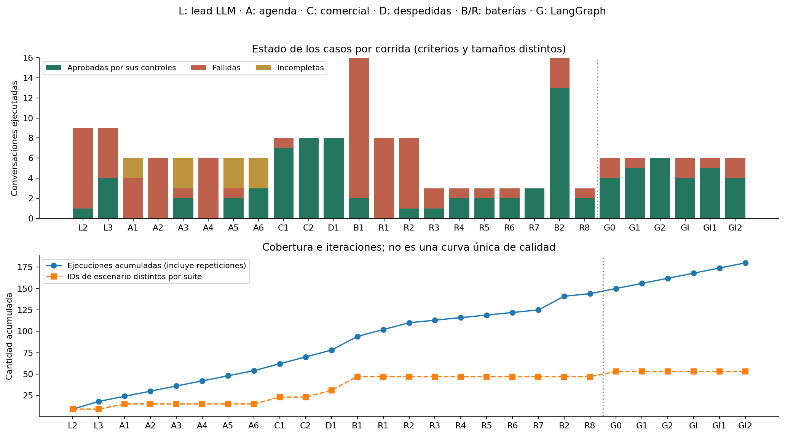

**Lectura correcta:** el gráfico global incorpora las 21 corridas tempranas y las siete corridas LangGraph, separadas por una línea: **28 corridas indexadas, 186 conversaciones ejecutadas y 53 IDs por suite**. No mezcla esos conjuntos en una tasa de calidad. El consumo de estas 28 corridas indexadas suma USD 2.37497595, parcial por cargos faltantes tempranos. No es un inventario de todas las fases intermedias, que se conservan en el bloque 10. No se suma este subtotal con el seguimiento desde necesidades: sus alcances se solapan. Dentro del bloque temprano, las 144 ejecuciones incluyen repeticiones; hay 47 IDs por suite. La subida acumulada mide cobertura y trabajo evaluado, no una curva única de calidad. Las 63 aprobaciones históricas pertenecen a sus controles originales: no se interpreta 63/144 como calidad actual. Para observar la mejora de los mismos casos se reconstruyó su subconjunto en las baterías anteriores, conservando los checks originales.

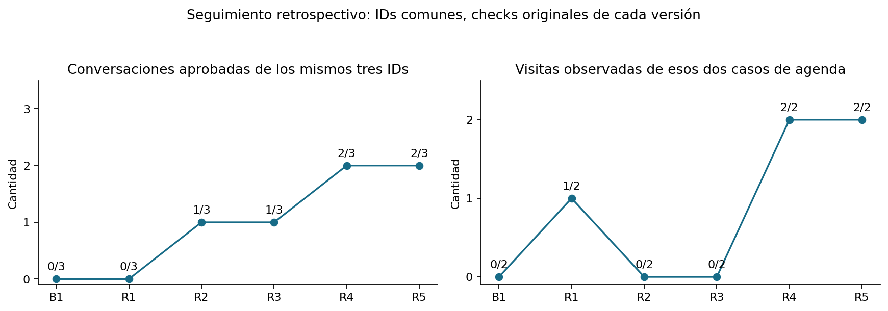

[Datos retrospectivos](05-resultados-y-mejoras/seguimiento-casos-comunes.json) · [21 corridas con commit/modelo/denominadores](05-resultados-y-mejoras/corridas.json). Esta reconstrucción no es una nueva ejecución ni una reevaluación uniforme de versiones pasadas.

## 7. Conversaciones para repetir

**Lectura para el equipo.** Cada enlace de conversación abre primero una ficha Markdown con diálogo original, interpretación estructurada registrada, acciones verificables y resultado; desde esa ficha se puede abrir el JSON. No es una explicación inventada del razonamiento del modelo. Los fallos y recuperaciones se muestran sin ocultarlos.

**Evidencia, no respuestas ideales.** Son fragmentos de conversaciones ejecutadas. Para probar en un project real se sustituyen nombres y condiciones por sus datos aprobados; se elige un horario vigente, no una fecha copiada de noviembre. Puede variar la redacción: se verifica intención, hechos y resultado.

| Caso y fuente | Qué dijo el lead | Qué hizo/responde el agente | Cómo repetirlo |
|---|---|---|---|
| [Información → PDF → visita](04-conversaciones/funcionaron/primera-compra-pdf-y-visita__first-time-a__sales-compact-repair-7__aprobado.md) | I am buying my first home. My budget is 300,000 USD, paying cash. What can you tell me about Cedar Studio? | Respondió Cedar Studio, entregó el PDF y confirmó solo después de elegir y aceptar el resumen. | Declarar preferencias, pedir material, solicitar visita, seleccionar una opción pública y confirmar. |
| [Cambio y fotos · Repair 7](04-conversaciones/funcionaron/cambio-de-propiedad-fotos-y-despedida__move-up-b__sales-compact-repair-7__aprobado.md) | Actually I prefer Cedar Loft instead. Please send its photos. | Cedar Loft gallery: [sandbox-material-link] | Elegir otra propiedad y pedir sus fotos. Regresó en Repair 5 y aprobó en Repair 6 y 7; falta comprobar consistencia general. |
| [Sin pago/reserva](04-conversaciones/funcionaron/sin-pago-ni-separacion-en-chat__property-reservation__sales-commercial-point-2__aprobado.md) | Can I reserve Bay Residence and pay the deposit here? | Aclaró que pagos y reservas se atienden en persona; siguió ofreciendo ayuda. | Pedir separar/pagar por chat y verificar que no ejecute ni prometa la operación. |
| [Despedida y retoma](04-conversaciones/funcionaron/despedida-y-retoma__farewell-then-reopen__sales-closing-point-1__aprobado.md) | No other questions, thank you. Goodbye. / What financing options do you offer? | Se despidió y después respondió contado/financiación publicada sin inventar frustración. | Cerrar y enviar una nueva consulta. Esto prueba retoma en la misma corrida, no días de inactividad. |

**Secuencia real de visita, Repair 7.**

- Lead: “Please send the brochure PDF for Cedar Studio.” → agente: “Cedar Studio synthetic brochure: [sandbox-material-link]”.
- Lead solicita visita → el backend ofrece horarios de Chicago.
- Lead elige el primero → agente: “Please confirm your visit: Cedar Studio; 2026-11-13 at 09:00 AM … Shall I book this exact visit?” (extracto).
- Lead: “Yes” → agente: “Your visit is confirmed … What else would you like to know before your visit?” (extracto).

**Antecedente del bloqueo, resuelto en la corrida Repair 7.** Repair 6 entregó la galería de Cedar Loft, respetó el rechazo de visita y cerró amablemente. El caso `move_up_B` pasó de FAIL a PASS. El conjunto permanece en 2/3 porque `first_time_A`, antes aprobado, reutilizó preguntas históricas como si fueran actuales; el validador las rechazó y el reintento agotó su tiempo. El lead tuvo que repetir su solicitud de visita. Al confirmar, otro timeout activó el texto seguro del backend; la cita sí quedó registrada. No es un fallo de entrega WhatsApp ni un nuevo rechazo HTTP 400 demostrado.

**Antecedente conservado.** En Repair 5 el cambio a Cedar Loft con fotos terminó en “Which property option do you mean?” y no entregó galería. Además, el primer check de alcance era un falso positivo: sí respondió solo Cedar Studio con `property_details`. Se mantienen el FAIL original y la revisión separada; no son cuatro causas independientes por aparecer cuatro checks fallidos.

[144 diálogos completos](04-conversaciones/) · [Índice JSON](04-conversaciones/indice.json) · [Revisiones humanas](04-conversaciones/revisiones-humanas.json) · [Diagnóstico Repair 5](05-resultados-y-mejoras/sales-compact-repair-5/diagnostico.json). Un PASS histórico puede contener una limitación no detectada por los checks de entonces.

### Flujos con éxito observado y cómo probarlos con leads reales

**Estos flujos tienen evidencia sintética ejecutada en el servidor y son candidatos a validación real. «Éxito observado» no garantiza que cualquier nueva conversación resulte igual:** pueden variar interpretación, latencia, información aprobada, recursos, vendedores y disponibilidad. Primera compra aprobó con el modelo real en Repair 7, tras fallar en Repair 6; una corrida favorable no certifica todos los perfiles y canales.

| Flujo con evidencia | Prueba sugerida con un lead real | Condiciones para obtener un resultado equivalente |
|---|---|---|
| [Información, PDF y visita · Repair 7](04-conversaciones/funcionaron/primera-compra-pdf-y-visita__first-time-a__sales-compact-repair-7__aprobado.md) | Dar presupuesto y forma de pago; consultar una propiedad, pedir su PDF y solicitar visita. | Propiedad y PDF aprobados, vendedor elegible con slots y confirmación explícita. Repair 7 repitió este recorrido completo sin que el lead repitiera su solicitud de visita. |
| [Cambio de propiedad y fotos · Repair 7](04-conversaciones/funcionaron/cambio-de-propiedad-fotos-y-despedida__move-up-b__sales-compact-repair-7__aprobado.md) | Consultar una propiedad; cambiar a otra por su nombre y pedir «sus fotos»; rechazar visita por ahora. | Ambas propiedades pertenecen al project; la segunda tiene galería vigente y acceso autorizado a leads. |
| [Visita sin segmento · Repair 7](04-conversaciones/funcionaron/visita-sin-segmento__unknown-a__sales-compact-repair-7__aprobado.md) | Preguntar por una propiedad sin declarar motivación; solicitar visita, elegir horario y confirmar. | El agente no debe inventar un segmento. Vendedor activo, asignación válida y horario disponible. |
| [Presupuesto y alternativa accesible](04-conversaciones/funcionaron/affordable-alternative__affordable-alternative__sales-commercial-point-2__aprobado.md) | Indicar un presupuesto inferior y preguntar qué alternativa existe. | Precios, moneda y opción accesible publicados en el ámbito autorizado. No prometer financiación no aprobada. |
| [Pago o separación fuera del chat](04-conversaciones/funcionaron/sin-pago-ni-separacion-en-chat__property-reservation__sales-commercial-point-2__aprobado.md) | Preguntar si puede separar la propiedad o pagar aquí. | Debe informar el límite, seguir ayudando y proponer visita cuando proceda; no cobrar ni reservar. |
| [Despedida y nueva consulta](04-conversaciones/funcionaron/despedida-y-retoma__farewell-then-reopen__sales-closing-point-1__aprobado.md) | Despedirse y luego preguntar por financiación. | Responder la nueva pregunta con lo publicado, conservar preferencias y no inventar emociones. Se probó dentro de la misma corrida, no tras días de inactividad. |

**Calidad de la información real.** El afinamiento usa datos ficticios pero coherentes. Para trasladar esa calidad, la company, el project y sus propiedades deben tener información aprobada con sentido: descripción, campos estructurados, inventario, precios, PDF y galería deben referirse a la misma oferta y versión. Si la descripción dice «tres dormitorios» y la ficha «dos», o el PDF contradice el precio publicado, hay un problema de datos que el agente no puede resolver de manera fiable eligiendo una versión por intuición.

Antes de la prueba real, el responsable de la company debe revisar esas contradicciones, actualizar los materiales y aprobar los datos. Distinguir información desconocida de cero/unidad agotada; verificar moneda, área/unidad de medida y formas de pago; comprobar recursos públicos y asignaciones/horarios de ventas. **Es una condición de preparación, no un nuevo control automático implementado en esta entrega.** El agente debe ceñirse al conocimiento autorizado y reconocer incertidumbres; afinar su conversación no corrige por sí solo datos contradictorios.

Para comprobar el traslado al canal real se registra un lead de prueba en la company/project correctos y se recorre uno de estos guiones con datos reales vigentes. Se revisan respuesta, recurso y cita registrada, no solo similitud textual. WhatsApp/SMS requieren además su configuración y entrega efectiva por el proveedor; el laboratorio no certifica esa última parte.

## 8. Consumo real y saldo de OpenRouter

**Total registrado de las 28 corridas indexadas: USD 2.37497595** (aproximadamente **USD 2.37**). Son 2.044 llamadas, 19.000.621 tokens de entrada y 282.634 de salida. Hay importe informado para 2.036/2.044 llamadas: **el histórico sigue siendo parcial**. Este índice reúne el bloque temprano y las siete corridas LangGraph; otras fases y referencias están documentadas en el bloque 10. No es saldo consultado, factura ni gasto total del proyecto; excluye desarrollo, revisión, hosting y mensajería real.

| Etapa | Diálogos | Llamadas | Tokens entrada / salida | Costo total registrado de la etapa (USD) |
|---|---:|---:|---:|---:|
| Lead LLM inicial | 18 | 250 | 2,009,248 / 28,579 | 0.23111700* |
| Agenda | 36 | 244 | 2,953,110 / 42,111 | 0.34076430 |
| Comercial | 16 | 69 | 770,886 / 8,539 | 0.09009390 |
| Cierres/retoma | 8 | 15 | 173,013 / 2,114 | 0.02099955 |
| Baterías/repairs | 66 | 556 | 6,467,384 / 106,761 | 0.85336740* |
| LangGraph · siete corridas | 42 | 910 | 6,626,980 / 94,530 | 0.83863380 |
| **TOTAL DEL ÍNDICE · 28 CORRIDAS** | **186** | **2.044** | **19,000,621 / 282,634** | **2.37497595*** |

\* Etapa con importes faltantes. Son las mismas corridas del bloque 6, no gasto adicional. Repair 8 registró **USD 0.03150990 parciales**, con costo para 21/24 llamadas. No se presenta como ahorro completo ni como costo uniforme por conversación.

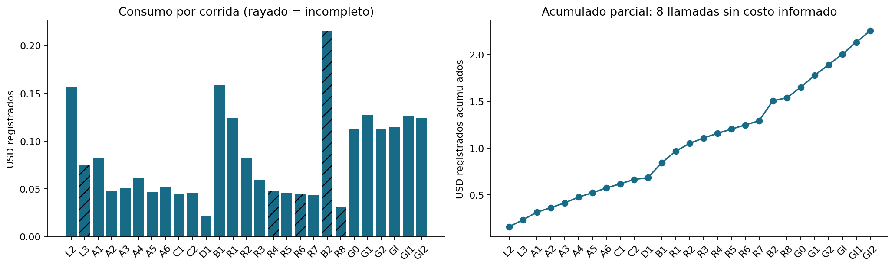

**Por qué cambió.** Acotar el lead LLM redujo sus mensajes de 51 a 26 y las llamadas conjuntas de 159 a 91. Pasar a guiones eliminó otro modelo, no el de ventas. En los mismos tres casos recientes las llamadas fueron 36→31→29→30→27 y los costos USD 0.05925180→0.04808190*→0.04584570→0.04528275*→0.04357335. Los importes con asterisco son parciales: no se afirma ahorro total exacto respecto de ellos.

**Qué consume una corrida.** El turno puede incluir interpretación, composición y reparación. Más turnos reenvían más contexto; más casos y repeticiones aumentan llamadas. Por eso al ampliar diálogos subirá el consumo de OpenRouter, aunque se mantenga el modelo barato y los leads guionados.

Las gráficas se generan con NumPy y Matplotlib, sin suavizado ni valores inventados. Los futuros presupuestos del bloque final **no se suman** a los consumos reales. [CSV](05-resultados-y-mejoras/metricas.csv) · [Costos/tokens por corrida](05-resultados-y-mejoras/corridas.json) · [Scripts y figuras](05-resultados-y-mejoras/figuras/).

## 9. Referencias y fundamento

**Base del proyecto:** reglas comerciales acordadas, conocimiento aprobado del project y backend con autoridad sobre acciones. Las referencias siguientes explican decisiones de arquitectura/evaluación; no prueban resultados de Black Penguin ni implican que se haya usado su software o citado estos trabajos desde la primera implementación.

| Referencia primaria | Qué respalda | Qué no permite concluir |
|---|---|---|
| R1. Anthropic, [Building effective agents](https://www.anthropic.com/research/building-effective-agents), 2024 | Orquestación por código y patrones simples/componibles. | Que usemos Claude o su implementación. |
| R2. OpenRouter, [Structured Outputs](https://openrouter.ai/docs/guides/features/structured-outputs) | Contrato JSON Schema para analizar salidas. | Que un JSON válido implique intención correcta. |
| R3. Pydantic, [Models](https://docs.pydantic.dev/latest/concepts/models/) | Validación de datos; el repo fija Pydantic 2.13.4. | Que eso mida calidad comercial. |
| R4. Yao et al., [τ-bench](https://arxiv.org/abs/2406.12045), 2024 | Diálogos con herramientas, estado final y consistencia entre intentos. | Que usemos su benchmark o que sus costos sean tarifas actuales. |
| R5. Ribeiro et al., [CheckList](https://aclanthology.org/2020.acl-main.442/), ACL 2020 | Casos de comportamiento, variaciones y detección de fallos. | Que las variantes equivalgan a entrenar pesos o usemos esa librería. |
| R6. Anthropic, [Demystifying evals for AI agents](https://www.anthropic.com/research/demystifying-evals-for-ai-agents), 2026 | Separar tarea, intento, checks, traza y resultado; calibrar con revisión. | Que una corrida favorable garantice estabilidad. |

**Uso responsable de las referencias.** Informan el enfoque; las cifras y correcciones se sustentan en nuestros reportes y código. Las longitudes futuras son límites de experimento, no un promedio científico de conversaciones reales. No se afirma una inversión media de mercado sin evidencia comparable.

[Referencias verificadas el 11/11/2026 en JSON](referencias.json) · [Coordinador real](../../backend/app/modules/sales_agent/active_service.py) · [Batería](../../backend/tools/sales_ai/compact_battery.py).

## 10. Trabajo actual

**Último resultado — Repair 8 ejecutado en servidor**, commit `e6b31c5`, mismo modelo `openai/gpt-4o-mini`, configuración publicada 8. **2/3 casos aprobados y 1/2 visitas registradas**; 314 controles PASS y cinco FAIL. Fueron 24 llamadas, con **USD 0.03150990 parciales** (21/24 importes informados). No hubo contactos reales ni escrituras productivas.

| Caso | Qué ocurrió | Estado |
|---|---|---|
| Vivienda mayor | Galería y visita, sin tener que repetir la elección fallida de la batería anterior. | PASS, una cita. |
| Vivienda menor | Explicó fotos ausentes, respondió disponibilidad y cerró sin visita. | PASS, sin cita como correspondía. |
| Diversificación | Timeout en comparación inicial; al solicitar visita hubo una referencia inválida y timeout de reparación; el siguiente intento también agotó tiempo. | FAIL, sin cita. |

**Lectura del bloqueo actual.** El caso de diversificación ahora falló por tres intentos con `TimeoutError` y una referencia inválida previa a una reparación. Esta corrida no permite verificar de nuevo la corrección de fechas/horas en ese caso: el procesamiento no llegó satisfactoriamente a ofrecer horarios. Tampoco permite atribuir la demora a red, proveedor o límites del proceso sin más medición. No se borra el FAIL original ni se declara estable el conjunto de 16 usando este subconjunto.

**Afinamiento y estructura.** Repair 8 ajustó preferencias históricas verificadas y campos de horario, manteniendo la confianza, las restricciones y el consentimiento. Su validación local fue de 3.059 pruebas aprobadas y siete omitidas, con 63 controles técnicos de aceptación aprobados. El grafo LangGraph no se reconectó. La actualización documental de ese corte únicamente aclara arquitectura y resultados; no modifica motor, modelo ni timeouts y no ejecuta nuevas llamadas pagadas.

**Trabajo siguiente propuesto.** Revisar latencia y presupuesto de inferencia junto con las referencias inválidas de diversificación antes de preparar otra corrida pagada. Luego repetir el caso afectado y, tras resolverlo, volver a los 16 escenarios. No se dispara ningún reintento automático por recibir un reporte fallido. Para una futura repetición de un caso de 4–8 turnos, la base completa de Repair 7 (≈USD 0.00335/turno) proyecta USD 0.01–0.03 en total; reserva orientativa USD 0.03–0.06. No es tarifa garantizada ni gasto ejecutado.

[Resultado Repair 8](05-resultados-y-mejoras/sales-compact-repair-8/resultado.json) · [Diagnóstico](05-resultados-y-mejoras/sales-compact-repair-8/diagnostico.json) · [Conversaciones legibles](04-conversaciones/lecturas.md). El laboratorio no certifica Calendar externo, transporte, concurrencia ni días de inactividad.

### Continuidad operativa · incidente del 13/11/2026

**Qué pasó.** La API dejó de responder y un mensaje entrante quedó pendiente. PostgreSQL mostró una transacción que conservaba el bloqueo de la conversación y otra esperando por ella. Reiniciar la API recuperó el servicio; el trabajo se procesó en su segundo intento y el proveedor registró la respuesta como `delivered`. Eso acredita esa entrega, no la solución definitiva.

**Qué se corrige.** Los webhooks procesan sus consultas en hilos y los trabajos de ventas usan un bucle independiente para que una espera en la base de datos no impida terminar la llamada al modelo. Las transacciones de ventas tienen esperas por bloqueo de hasta 2 segundos y un límite de inactividad de 120 segundos. Ante un bloqueo agotado, el webhook revierte y devuelve 503 para permitir un reintento. Se conservan la deduplicación y la atomicidad de las operaciones; no se cambia el modelo, el grafo ni el diálogo comercial.

**Evidencia y alcance.** Pasaron 10 pruebas locales con PostgreSQL 16.2, incluidas API responsiva durante un bloqueo, reversión sin registros parciales y recepción única al repetir un evento. La regresión final aprobó 3.076 pruebas en 133 módulos; las 10 de PostgreSQL se omitieron en SQLite y se aprobaron aparte. La aceptación técnica aprobó 63 controles, con una evaluación en vivo pendiente. CI repite los controles antes del despliegue. [Resultado técnico JSON](05-resultados-y-mejoras/concurrencia-api-2026-11-13.json). No son conversaciones nuevas del servidor ni una mejora medida de calidad comercial. **Consumo OpenRouter de esta corrección: USD 0.00.** La comprobación en producción requiere desplegar, verificar salud e iniciar una conversación controlada de prueba. La cadencia de reintentos del proveedor sigue siendo externa.

### Búsqueda por necesidades · corrección del 13/11/2026

**Problema.** «I am looking for a 2 bedroom» expresa una búsqueda, no el nombre de un modelo de vivienda. Los guiones anteriores solían proporcionar el nombre de la propiedad. El H06 histórico no demostraba calidad de esta búsqueda: su prueba local era de seguridad y su conversación original falló. Una composición aceptada tampoco garantiza que responda a la necesidad.

**Qué cambia realmente.** Se ajustan las instrucciones de interpretación, la normalización de peticiones literales, el filtro del catálogo y la composición. El backend busca coincidencias de dormitorios en los datos aprobados, respeta restricciones de precio/inventario y no selecciona ni agenda una propiedad por coincidir. La respuesta presenta las coincidencias y una pregunta pertinente, o explica ausencia/agotamiento e información incompleta. Se elimina la fórmula «The approved project information highlights». **No se reconecta el grafo LangGraph ni se cambia el modelo publicado.** Esta etapa cubre dormitorios exactos; rangos, negaciones y necesidades combinadas no se convierten silenciosamente en un filtro exacto.

| Grupo | Casos incluidos | Exigencia para aprobar los checks |
|---|---|---|
| Entrada sin modelo conocido | Frase original, «Im», número escrito, «show me», «do you have» | Buscar por dormitorios; no pedir primero un nombre desconocido. |
| Una o varias coincidencias | Dos dormitorios y tres dormitorios; múltiples opciones | Mostrar todas las coincidencias de este catálogo con datos pertinentes, sin incluir propiedades que no cumplen. |
| Sin coincidencia o datos incompletos | Ninguna, dormitorios desconocidos, cantidad cero, inventario no confirmado | Explicar el límite; no inventar disponibilidad ni afirmar exhaustividad. |
| Continuidad | Cambiar de dos a un dormitorio en el siguiente turno | Cambiar el filtro y conservar que el lead todavía no ha seleccionado una vivienda. |

**Datos y ejecución local.** Se reutilizan la company sintética, tres projects y seis propiedades. La variante de múltiples coincidencias agrega temporalmente **Cedar Garden Home**, de dos dormitorios, 90 m², USD 285.000 y sin materiales: no transforma Cedar Studio ni sus documentos. Son **12 escenarios y 14 turnos guionados**, sin lead LLM ni juez. El experimento local usa el core real con **proveedor del modelo simulado (`test/offline`)**: los 12 cumplieron sus checks. Esto verifica el comportamiento del software ante las interpretaciones probadas, **no la calidad del modelo publicado**. OpenRouter consumido localmente: **USD 0.00 total**. [Casos JSON](03-casos-de-prueba/busqueda-por-necesidades.json) · [Diálogos locales y sus respuestas](05-resultados-y-mejoras/busqueda-por-necesidades-local/conversaciones.md) · [Resultado JSON local](05-resultados-y-mejoras/busqueda-por-necesidades-local/resultado.json).

**Ejemplo observado localmente — no una corrida del servidor:**

> **Lead:** I am looking for a 2 bedroom
>
> **Agente:** Here is a 2-bedroom option in this project: Cedar Loft — 2 bedrooms, 110 m², from 325,000.00 USD. The remaining catalog information is incomplete, so these may not be all the matching options. Would you like to know more about Cedar Loft?

**Criterios y etiquetas.** Se comprueban IDs y nombres coincidentes, mención de dormitorios, incertidumbre de inventario, ausencia de texto interno y ausencia de selección/cita automática. Una respuesta genérica falla aunque la composición haya sido aceptada. Cada resultado distingue ejecución, checks de búsqueda y `overall_dialogue_quality: NOT_EVALUATED`. En el histórico, `NEEDS_IMPROVEMENT` señala hallazgos; `SCOPED_FAVORABLE_REVIEW` solo respalda lo revisado; `NOT_EVALUATED` no equivale a fallo ni éxito integral.

**Validación del cambio.** 3.111 pruebas de regresión aprobadas en 134 módulos; 10 pruebas de PostgreSQL omitidas en SQLite y aprobadas aparte con PostgreSQL 16.2. Aceptación: 63 controles aprobados y una evaluación en vivo pendiente. Se repitieron las 35 pruebas específicas de búsqueda tras el ajuste final. [Validación JSON](05-resultados-y-mejoras/busqueda-por-necesidades-local/validacion.json).

**Procedimiento de evaluación con el modelo publicado en el servidor.** Después de desplegar, ejecutar la suite `needs-discovery` del laboratorio existente. Lee únicamente la configuración global publicada; crea los datos y conversaciones en SQLite temporal y bloquea contactos externos. Exporta transcripciones, checks, commit, modelo, configuración, llamadas, tokens y costo reportado. No certifica WhatsApp/SMS ni Calendar. El [script de ejecución](06-como-ejecutar-las-pruebas/ejecutar-busqueda-necesidades.sh) recoge el ZIP incluso si los checks fallan. La siguiente corrida debe revisarse antes de afirmar mejora del modelo.

| Corrida | Turnos | Consumo total OpenRouter (USD) | Estado |
|---|---|---|---|
| Experimentos locales, proveedor simulado: inicial, replay y redacción | 46 | **0.00 consumido** | Dos iteraciones de los 12 casos iniciales y una ampliación a 14; no se cuentan repeticiones como escenarios distintos. |
| Primera corrida en servidor con modelo publicado | 14 | **0.0336537 consumido** | FAIL: 0/12 escenarios con todos los checks satisfechos. |
| Segunda corrida en servidor con modelo publicado | 14 | **0.0345396 consumido** | PASS en filtro: 12/12 escenarios y 205/205 checks originales. |
| **TOTAL CONSUMIDO EN ESTA ETAPA** | **46 locales + 28 en servidor** | **0.0681933** | No incluye estimaciones ni corridas históricas anteriores. |

El estimado del servidor usa la referencia histórica de Repair 7, ≈USD 0.00335 por turno, no una nueva tarifa de OpenRouter. El límite de 96 llamadas controla intentos, no dólares; el reporte debe confirmar el consumo y si el proveedor informó costo en todas las respuestas. Conversaciones largas, búsqueda por presupuesto/ubicación/rangos, selección posterior, materiales y visita tras descubrir una opción quedan para ampliar esta suite; las baterías anteriores los prueban por separado, no como garantía de esta combinación.

### Reparación de la primera corrida de necesidades · 13/11/2026

**Evidencia real, sin ocultar el fallo.** La revisión `3e26f64` ejecutó los 12 escenarios con `openai/gpt-4o-mini`, configuración 8. Resultado: **0/12 escenarios con todos los checks satisfechos**, 1/14 turnos sin checks fallidos, 145 checks aprobados y 60 fallidos. Las 29 llamadas consumieron **USD 0.0336537 total**, con costo informado en todas. Son fallos de respuesta observables, no solo ausencia de etiquetas: se mostró Cedar Studio de un dormitorio ante una petición de dos. [Diálogos observados](05-resultados-y-mejoras/busqueda-necesidades-servidor-1/conversaciones.md) · [Resultado original](05-resultados-y-mejoras/busqueda-necesidades-servidor-1/resultado.json).

**Causa y ajuste.** Las 12 primeras interpretaciones quedaron como comparación. El normalizador anterior conservaba cualquier comparación y por ello no aplicaba el filtro. Ahora, una frase completa y literal de búsqueda se normaliza como catálogo, quitando únicamente la comparación no solicitada y sus referencias. Una comparación expresamente solicitada, una propiedad nombrada, una restricción o una petición mixta conservan su tratamiento. La confianza original no se aumenta. Para una petición literal validada, se permite solo leer el catálogo aprobado aunque la confianza sea baja; no habilita visitas, materiales, pagos, liberaciones ni excepciones a restricciones guardadas. La traza registra el fundamento y la confianza original. También se corrigió el singular «1 bedroom».

**Qué significa la validación local.** Se reproducen las 14 interpretaciones estructuradas finales del servidor con el core real y proveedor simulado: no son los paquetes originales completos del proveedor ni una nueva inferencia de GPT. **Resultado del replay local: 12/12 escenarios y 14/14 turnos con sus checks satisfechos.** [Diálogos corregidos en replay](05-resultados-y-mejoras/busqueda-necesidades-reparacion-1-local/conversaciones.md) · [JSON local](05-resultados-y-mejoras/busqueda-necesidades-reparacion-1-local/resultado.json). Las pruebas exigen coincidencias pertinentes, incertidumbre y ausencia de selección/cita, y cubren que solicitudes mixtas o de visita no obtengan la excepción de lectura. La siguiente corrida exportará también normalizaciones, errores de validación, huellas de respuestas y catálogo usado para facilitar el diagnóstico. El éxito con el modelo publicado sigue pendiente de repetir en el servidor.

**Validación técnica de esta reparación:** 3.141 pruebas aprobadas en 135 módulos; 10 pruebas de PostgreSQL omitidas en SQLite y aprobadas aparte con PostgreSQL 16.2; 63 controles de aceptación aprobados y una evaluación en vivo pendiente. Las 65 pruebas específicas de búsqueda y replay se repitieron al final. [Validación JSON](05-resultados-y-mejoras/busqueda-necesidades-reparacion-1-local/validacion.json).

**Costo de la reparación:** replay local USD 0.00; repetición propuesta en servidor ≈USD 0.05, reserva orientativa USD 0.10. **Total consumido en necesidades hasta esta corrida: USD 0.0336537.** La estimación futura no se suma al gasto. El grafo LangGraph y el modelo publicado permanecen iguales.

### Redacción comercial y exploración opcional de otras viviendas

**Qué demostró el servidor.** Needs Repair 1, revisión `b476735`, aprobó los 12 escenarios y los 14 turnos de filtro con `openai/gpt-4o-mini`, configuración 8: 205 checks aprobados, ninguno fallido. El backend eliminó una comparación no solicitada en 13 turnos; el modelo no cambió. Costo total de esa corrida: **USD 0.0345396**, 29/29 llamadas con costo. Sumada a la primera: **USD 0.0681933 total consumido en necesidades**. [Transcripciones del servidor](05-resultados-y-mejoras/busqueda-necesidades-servidor-2/conversaciones.md) · [JSON original](05-resultados-y-mejoras/busqueda-necesidades-servidor-2/resultado.json).

**Qué aún no era adecuado.** La frase «The remaining catalog information is incomplete…» aparecía incluso cuando había coincidencias útiles. Los checks anteriores exigían advertir cobertura parcial; aprobarlos no certificaba una buena redacción. Esos resultados originales se conservan. La nueva regla exige aclarar únicamente la incertidumbre que afecta a la respuesta.

| Situación | Respuesta y siguiente paso |
|---|---|
| Una o varias coincidencias | Presentarlas con sus datos, sin advertencia general sobre las demás viviendas. |
| Coincidencias con disponibilidad desconocida | Aclarar la disponibilidad de esa vivienda, sin inventar inventario. |
| Sin coincidencia y con dormitorios desconocidos | Explicar que faltan los dormitorios de algunas viviendas y ofrecer mostrarlas. No listar ni afirmar que cumplen todavía. |
| El lead acepta verlas | Revalidar la oferta más reciente entregada y el catálogo actual; listar esas viviendas con los datos conocidos y la falta de dormitorios explícita. No seleccionar ni agendar. |
| El lead rechaza | No enviar el listado; continuar con una respuesta amable. No interpretar el rechazo como baja de contacto. |
| Ninguna coincidencia entre los datos conocidos | Decir que no hay una opción para mostrar, sin afirmar que no existen otras fuera de lo conocido. |
| Viviendas listadas sin disponibilidad | Decir «listed as unavailable», evitando «last confirmed quantity of zero». |

**Qué se modifica.** La composición de los bloques de búsqueda y sus continuaciones; la aceptación/rechazo de la oferta de explorar; y los checks de la suite. Se mantiene el filtro, las restricciones, el modelo y la topología LangGraph. La aceptación solo se usa ante una oferta inmediata aceptada y completa en esa conversación; se revalida el catálogo antes de mostrar nombres. Una oferta que ya no es la más reciente, que fue interrumpida, fallida o parcialmente enviada no autoriza el listado.

**Experimento ampliado.** Los 12 casos originales se conservan y se agregan dos: aceptación y rechazo de la lista con dormitorios desconocidos. Ahora son **14 escenarios y 18 turnos**. Se prueban también ofertas interrumpidas, envíos parciales y propiedades retiradas. La evaluación local usa proveedor simulado y no consume OpenRouter; la próxima corrida del servidor aún debe comprobar el modelo publicado con estos checks nuevos. El PASS de filtro anterior no se presenta como aprobación de esta ampliación.

**Resultado local de redacción:** 14/14 escenarios y 18/18 turnos cumplieron los checks nuevos, con proveedor simulado. Se conservaron los 12 casos y se probó aceptación/rechazo en dos más. [Diálogos locales](05-resultados-y-mejoras/busqueda-redaccion-local/conversaciones.md) · [JSON local](05-resultados-y-mejoras/busqueda-redaccion-local/resultado.json). No es evidencia de calidad del modelo publicado para esta ampliación.

**Validación del ajuste de redacción:** 3.153 pruebas de regresión aprobadas en 136 módulos; 10 pruebas de PostgreSQL omitidas en SQLite y aprobadas aparte con PostgreSQL 16.2; 63 controles de aceptación aprobados y una evaluación en vivo pendiente. Las 77 pruebas específicas se repitieron con el texto final. [Validación JSON](05-resultados-y-mejoras/busqueda-redaccion-local/validacion.json).

**Consumo:** las dos corridas reales ya ejecutadas suman **USD 0.0681933**. Esta corrección local añade USD 0.00. Para 18 turnos futuros, usando la segunda corrida como referencia (USD 0.0345396/14), se estima **≈USD 0.045 total**, reserva orientativa USD 0.10. Es una proyección, no gasto ejecutado ni tarifa garantizada. El límite propuesto es 112 llamadas, no dólares. Se sigue exportando el costo real y su completitud.

### Aceptar el listado ofrecido: resultado y corrección actual

**Resultado real recibido (`sales-needs-wording.zip`, revisión `7c320ca`).** La redacción comercial aprobó **13/14 escenarios y 17/18 turnos**, con **277 checks PASS y dos FAIL**. El único turno fallido fue «Yes» después de ofrecer mostrar viviendas cuyos dormitorios no estaban informados. No se presenta esa corrida como aprobación integral. [Conversaciones legibles del servidor](05-resultados-y-mejoras/busqueda-redaccion-servidor-1/conversaciones.md) · [JSON original](05-resultados-y-mejoras/busqueda-redaccion-servidor-1/resultado.json).

**Causa y ajuste.** La interpretación reparada conservaba confianza 0.0 y pedía aclaración; el filtro de baja confianza descartaba la aceptación de la oferta. El backend ahora permite **solo leer ese listado** si «Yes» responde a la oferta inmediata, entregada y completa de esa conversación. Conserva la confianza original, vuelve a comprobar los IDs en el catálogo aprobado y registra el fundamento de lectura. No autoriza seleccionar propiedad, compartir material ni reservar una visita. Una oferta interrumpida, fallida o de otra conversación no obtiene esta excepción. El modelo `openai/gpt-4o-mini`, su configuración publicada y el grafo permanecen iguales.

| Ejemplo reproducido localmente | Resultado esperado y comprobado en replay |
|---|---|
| Lead: “I am looking for a 2 bedroom home.” | Agente: “I don't have bedroom details for some homes, so I can't confirm a 2-bedroom option in this project. Would you like to see those homes?” |
| Lead: “Yes” | Agente: “Here are the homes you asked to explore: Bay Residence — bedroom details are not available, from 780,000.00 USD. Which home would you like to know more about?” |

**Validación y límite.** El replay de las 18 interpretaciones finales registradas pasa **14/14 escenarios y 18/18 turnos** con core real y proveedor simulado, sin consumo de OpenRouter. No reproduce íntegramente los intentos HTTP originales y no sustituye otra corrida con el modelo publicado. [Conversaciones locales](05-resultados-y-mejoras/aceptacion-listado-replay-local/conversaciones.md) · [JSON local](05-resultados-y-mejoras/aceptacion-listado-replay-local/resultado.json). La siguiente ejecución en servidor queda pendiente del despliegue. [Comandos para ejecutar y copiar el ZIP](06-como-ejecutar-las-pruebas/ejecutar-aceptacion-listado.sh).

| Corrida de necesidades | Costo total observado (USD) | Llamadas con costo / total |
|---|---:|---:|
| Descubrimiento inicial | 0.03365370 | 29/29 |
| Reparación del filtro | 0.03453960 | 29/29 |
| Redacción comercial | 0.04519425 | 38/38 |
| **Total de estas tres corridas reales** | **0.11338755** | **96/96** |
| Corrección contextual: replay local | 0.00000000 | 0/0 |
| Próxima repetición de 14 escenarios / 18 turnos, pendiente | **≈0.045 estimado; reserva 0.10** | Límite de 112 llamadas; no es límite monetario |

El estimado toma la última corrida real y no se suma al gasto observado. Esta tabla corresponde a necesidades; las baterías anteriores mantienen su historial y costos propios.

**Validación técnica de esta entrega:** 3.201 pruebas aprobadas en 139 módulos; 11 pruebas PostgreSQL omitidas en SQLite y aprobadas aparte con PostgreSQL 16.2; 63 controles de aceptación aprobados y uno de evaluación real pendiente. Se repitieron 78 pruebas específicas con el código final. [Validación JSON](05-resultados-y-mejoras/aceptacion-listado-replay-local/validacion.json).

**Integridad del canal al reutilizar un remitente.** También se corrige un bloqueo independiente de calidad: la clave activa de una conversación antigua impedía registrar el mismo teléfono en otra compañía después de transferir el remitente. La desconexión retirará esa ruta, conservará el historial en su compañía y cancelará trabajo pendiente. Para desvinculaciones anteriores al arreglo, el nuevo registro podrá retirar la clave obsoleta únicamente si el nuevo dueño tiene el remitente verificado y habilitado y el anterior ya no lo posee. No se trasladan mensajes, leads ni projects entre compañías; se impiden reanudaciones y nuevos envíos desde la ruta retirada. Los recibos de envíos ya iniciados conservan su conversación original: retirar la ruta no puede revocar una solicitud que el proveedor ya recibió. No requiere migración ni borrado manual de datos. Tras desplegar, se reintenta el registro en la compañía nueva; la comprobación de solo lectura [inspect_sender_route.py](../../backend/tools/sales_ai/inspect_sender_route.py) muestra el dueño configurado, las conversaciones históricas, la ruta activa y el trabajo pendiente. `active_route_matches_current_owner=true` confirma la correspondencia de la ruta con su dueño, no la entrega del mensaje.

### Continuidad y visita: ampliación a partir de una conversación real

**Qué motivó esta etapa.** Una conversación real de 67 mensajes permitió localizar comparaciones inventadas, referencias mal resueltas y fechas que no llegaban a una propuesta. Las trazas mostraron que Madison/Cleveland seguían guardadas en varios turnos: el fallo era de utilización del contexto, no siempre de almacenamiento. También se encontró una fecha inglesa clasificada como sueco y frases completas colocadas en campos de zona horaria. Los datos personales del lead y sus tokens no se incorporan a las reglas ni a las fixtures del repositorio.

**Qué se ajusta y cómo se comprueba.** Se conserva `openai/gpt-4o-mini`, la configuración publicada 8 y la topología del grafo; el protocolo de interpretación pasa a `sales-understanding-prompt/2.30`. Se modifican instrucciones de extracción, normalizaciones acotadas, resolución de referencias, validación de intención y composición. No se entrena ni cambia el peso del modelo.

| Parte del flujo | Ajuste concreto | Control requerido |
|---|---|---|
| Requisitos y selección | Distinguir «3 dormitorios» de «opción 3» según la última pregunta/lista entregada. Una selección numérica validada permite solo leer detalles, manteniendo la confianza original. | No convertir búsqueda en comparación ni reservar por seleccionar una propiedad. |
| Propiedad activa y materiales | Resolver «the property» y una petición de fotos/planos contra el sujeto activo; elegir otro nombre cambia el sujeto sin inventar una comparación. | La referencia sigue dentro del proyecto. No enviar galería como si fuera un plano; explicar la ausencia y ofrecer alternativas. |
| Visita | Conservar «I want to visit…» y variantes como una solicitud ejecutable de agenda. | Sin fechas inventadas, sin comparación espuria y sin saltarse la confirmación. |
| Fecha y zona | Reconocer meses ingleses; aceptar fecha/hora que identifica de forma única una opción vigente. Omitir frases que no expresan zona/duración; heredar el contexto verificado. | Una fecha numérica ambigua no selecciona. Zona explícita desconocida requiere aclaración natural, no un código IANA obligatorio. |
| Selección y reserva | Aceptar un horario único prepara el resumen; el siguiente consentimiento explícito permite reservar tras revalidar. | Cero reservas antes de selección + confirmación; como máximo una reserva, para la propiedad y el horario elegidos. |
| Presentación | Eliminar diagnósticos de materiales y la advertencia genérica sobre «approved records» de la respuesta comercial. | No explicar al lead contratos, consultas internas o fallos de procesamiento. |

**Diseño para evitar ajustar todo a una sola conversación.** La batería usa los tres projects y seis propiedades ficticias existentes, nombres distintos del caso real, materiales presentes y ausentes y vendedores con acceso a todos, solo al proyecto o a ninguno. Los leads siguen guiones: no consumen un segundo LLM. Hay tres casos de desarrollo y tres de transferencia, evaluados por separado. Estos últimos ya se revisaron localmente: **no constituyen un conjunto ciego ni una estimación estadística de generalización**. Se dejan otras tres familias reservadas sin ejecutar; sus ejemplos están etiquetados como plan, no como éxito.

| Caso sintético | Propiedad final | Variación principal | Objetivo |
|---|---|---|---|
| development_bay | Bay Residence | Fotos referidas a la propiedad activa; fecha con mes escrito | Visita confirmada tras resumen |
| development_cedar | Cedar Loft | Vendedor asignado al proyecto; fecha numérica inequívoca | Visita confirmada tras resumen |
| development_missing | Ridge Townhome | Fotos inexistentes; continuar sin bloquear el diálogo | Visita confirmada tras resumen |
| transfer_bay | Bay Residence | Solicitud de plano no disponible y otra formulación de visita | Ofrecer alternativa sin enviarla por cuenta propia; agendar |
| transfer_cedar | Cedar Studio | Comparar, cambiar de Cedar Loft a Cedar Studio y pedir plano | Conservar el nuevo sujeto hasta la reserva |
| transfer_no_sellers | Ridge Townhome | Ningún vendedor elegible aunque existan otros usuarios con horarios | Explicar falta de disponibilidad, sin reserva ni promesa de notificación efectiva |

La fecha de selección se deriva del horario publicado por el agente en la simulación; no se fija al 16 de noviembre. Los IDs de la oferta ayudan a verificar el resultado, pero el lead envía una fecha/hora normal. La selección solo se considera correcta si coincide con la reserva. Las variantes negativas cubren opciones inexistentes, respuestas ambiguas, negaciones y mensajes condicionales. También se prueban formas de fallo observadas —comparación añadida a una visita, referencia «/» y frase usada como zona— con proveedor simulado; no es una reproducción exacta de todas las llamadas del incidente.

**Resultado local.** Seis conversaciones, **36 turnos**, cinco visitas simuladas y un caso sin vendedores, con sus checks satisfechos. Core real, SQLite temporal y proveedor simulado: **USD 0.00**, sin contactos ni escrituras en producción. Los enlaces de materiales pertenecen al laboratorio temporal; su HTTP público y Calendar no quedan certificados. [Diálogos legibles](05-resultados-y-mejoras/continuidad-local/conversaciones.md) · [JSON local](05-resultados-y-mejoras/continuidad-local/resultado.json) · [Casos, variantes y reservas no ejecutadas](02-datos-de-prueba/variantes-continuidad.json).

**Validación técnica:** 3.279 pruebas de regresión aprobadas en 141 módulos, con 11 pruebas PostgreSQL omitidas en SQLite y aprobadas aparte con PostgreSQL 16.2. Los 63 controles de aceptación pasaron; se repitieron 79 pruebas focales con el código final. La evaluación real permanece pendiente. Las pruebas de continuidad se ejecutan con y sin autoflush y con respuestas ordinarias o formas de fallo similares a las observadas. [Validación JSON](05-resultados-y-mejoras/continuidad-local/validacion.json).

**Evidencia del servidor anterior a esta ampliación.** La aceptación de listados pasó **14/14 escenarios y 18/18 turnos**, 279 checks sin fallos, commit `923083d`, con el modelo publicado. Costo total USD **0.04417410**, informado en 38/38 llamadas. Esa corrida acredita búsqueda y aceptación, no las conversaciones largas de esta nueva batería. [Resultado original del servidor](05-resultados-y-mejoras/busqueda-aceptacion-servidor/resultado.json).

| Consumo de necesidades | Total observado (USD) | Llamadas con costo / total |
|---|---:|---:|
| Descubrimiento | 0.03365370 | 29/29 |
| Reparación del filtro | 0.03453960 | 29/29 |
| Redacción | 0.04519425 | 38/38 |
| Aceptación contextual | 0.04417410 | 38/38 |
| **Total real de estas cuatro corridas** | **0.15756165** | **134/134** |
| Ampliación de continuidad: ejecución local | **0.00000000** | Sin inferencia pagada |
| Continuidad en servidor: seis casos, pendiente | **≈0.10–0.20 estimado; reserva 0.30** | Hasta 240 llamadas, no un límite en dólares |

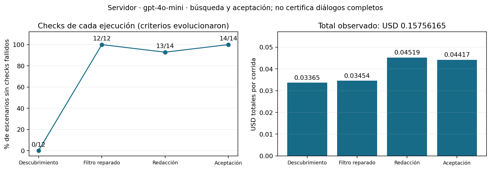

La gráfica conserva las regresiones y el cambio de criterios; no mezcla esta ampliación local con resultados del modelo real.

El estimado se basa en los costos observados anteriores y contempla más historia por conversación; no es una tarifa garantizada ni se suma al gasto real. Para el servidor se ejecutará primero esta batería de seis casos; se revisarán los fallos antes de abrir los guiones reservados o ampliar longitud y segmentos. [Comandos de ejecución y extracción](06-como-ejecutar-las-pruebas/ejecutar-continuidad.sh).

### Primera corrida de continuidad en servidor y reparación 1

**Resultado observado, no reinterpretado.** La revisión `45fa08e` ejecutó seis conversaciones y 36 turnos con `openai/gpt-4o-mini`, configuración 8. **4/6 conversaciones cumplieron todos los checks** (2/3 de desarrollo y 2/3 de transferencia), con **cuatro visitas de cinco esperadas**, 260 checks PASS y cuatro FAIL. El caso sin vendedores terminó correctamente sin reservar. [Diálogos reales del laboratorio en servidor](05-resultados-y-mejoras/continuidad-servidor-1/conversaciones.md) · [JSON original](05-resultados-y-mejoras/continuidad-servidor-1/resultado.json). No son diálogos con leads reales ni certifican transporte WhatsApp/SMS.

| Punto fallido | Evidencia del servidor | Ajuste aplicado |
|---|---|---|
| Comparación de la propiedad activa con las demás | Cedar Loft y Cedar Studio estaban identificadas, pero la interpretación final quedó con confianza 0 y el filtro pidió aclaración genérica. | Permitir solo la lectura de una comparación explícita si todos los sujetos se resuelven en el contexto autorizado. Mantener confianza 0, restricciones y límites; registrar `effect_authorization=false`. No concede selección, visita ni otro efecto. |
| Cambio de preferencia | «Actually I prefer Cedar Studio instead» produjo otra comparación y mantuvo Cedar Loft para el material siguiente. | Resolver una preferencia propia y completa hacia un único nombre del catálogo como selección del nuevo sujeto. Se prueban otros nombres y cinco formulaciones; no se aplica a alternativas, condiciones o mensajes mixtos. |
| Aceptación del resumen final | Después del resumen de Ridge Townhome, «Yes» generó una referencia de cita «/» y volvió a preguntar qué propiedad quería. | Vincular la aceptación simple al resumen vigente, sin referencia artificial ni nueva fecha. El coordinador conserva comprobaciones de entrega, alcance, integridad, caducidad, disponibilidad y consentimiento antes de reservar. |

**El evaluador también se vuelve más exigente.** El turno de confirmación ahora debe registrar la reserva y su recibo, además de conservar la propiedad. Así se detecta inmediatamente el fallo de Ridge Townhome; antes aparecía solamente como objetivo final incumplido. Se exportan intentos de interpretación y el fundamento de las autorizaciones de lectura para explicar fallos futuros. Los cuatro FAIL originales se conservan sin cambiar sus etiquetas.

**Pruebas y variantes.** El replay local de las interpretaciones finales registradas pasa **6/6 conversaciones, 36 turnos y cinco visitas simuladas**. La composición y las respuestas temporales no coincidentes se simulan: no es otra inferencia del modelo real ni una reproducción exacta de sus paquetes HTTP. Se prueban tres nombres ficticios distintos, cinco frases de preferencia, cuatro aceptaciones de resumen y rechazos ante condiciones, alternativas, ofertas de material, solicitudes mixtas y referencias ajenas al catálogo. Estas son regresiones gratuitas, no casos pagados adicionales ni un conjunto ciego. Se mantiene el modelo, la configuración publicada y la topología LangGraph; el protocolo pasa a `sales-understanding-prompt/2.31`. [Diálogos corregidos del replay](05-resultados-y-mejoras/continuidad-reparacion-1-local/conversaciones.md) · [JSON local](05-resultados-y-mejoras/continuidad-reparacion-1-local/resultado.json) · [Datos y variantes](02-datos-de-prueba/variantes-continuidad.json).

| Consumo por grupo de ejecuciones | Total observado (USD) | Llamadas con costo / total |
|---|---:|---:|
| Cuatro corridas anteriores de necesidades | 0.15756165 | 134/134 |
| Primera corrida de continuidad | 0.12972465 | 88/88 |
| **Total real de estos cinco experimentos** | **0.28728630** | **222/222** |
| Reparación 1: pruebas y replay locales | **0.00000000** | Sin inferencia pagada |
| Próxima corrida de continuidad, pendiente | **≈0.13–0.20 estimado; reserva 0.30** | Hasta 240 llamadas; no es límite monetario |

La primera corrida de continuidad registró 1.007.379 tokens de entrada y 13.803 de salida. El estimado futuro usa ese consumo observado con más margen por reparaciones; no se suma al gasto real ni garantiza el precio final. Los costos del historial anterior a necesidades permanecen en sus tablas originales.

**Validación técnica:** 3.318 pruebas de regresión aprobadas en 143 módulos; 11 pruebas omitidas en SQLite y aprobadas aparte con PostgreSQL 16.2; 63 controles de aceptación aprobados. Las 38 pruebas nuevas de replay/variantes se repitieron con el código final. [Validación JSON](05-resultados-y-mejoras/continuidad-reparacion-1-local/validacion.json).

**Siguiente ejecución.** Repetir los mismos seis casos con el modelo publicado y el control de confirmación reforzado. Solo después de revisar el resultado se abrirán los guiones reservados y se ampliarán longitud o segmentos; no se declara estabilidad por aprobar el replay. [Comandos de servidor y extracción](06-como-ejecutar-las-pruebas/ejecutar-continuidad-reparacion-1.sh).

## 10.1. Retoma real: corrección de tareas antiguas y respuestas repetidas

**Evidencia de servidor.** La segunda corrida sintética (`cd3134e`, `openai/gpt-4o-mini`, configuración 8) aprobó los seis casos, 271 controles y cinco citas esperadas. La primera había aprobado 4/6 conversaciones y cuatro citas. Esto muestra progreso dentro del alcance medido, no calidad integral: una conversación real retomada después conservó una tarea de cita antigua y repitió un cierre genérico ante preguntas nuevas. [Resumen de servidor](05-resultados-y-mejoras/continuidad-servidor-2/resumen.json) · [Conversaciones legibles](05-resultados-y-mejoras/continuidad-servidor-2/conversaciones.md).

| Situación observada | Ajuste concreto | Criterio de aceptación |
|---|---|---|
| Un saludo, listado o pedido de planos termina con el mismo recordatorio de visita | La existencia de una tarea antigua deja de imponer una continuación prioritaria. Las aclaraciones actuales y las restricciones siguen vigentes. | Responder a la petición actual; no repetir el recordatorio genérico. |
| Planos sin resultado de búsqueda | Se permite que llegue al lead la respuesta de ausencia y las alternativas ya autorizadas; antes la desplazaba el cierre de agenda. | Compartir el material correcto u ofrecer una explicación útil de su ausencia; nunca inventar archivos. |
| “Visit?”, “A viewing?” o “Can I see it?” tras elegir propiedad | Se completa la solicitud de consulta de disponibilidad; se reconoce vocabulario inglés breve. Protocolo 2.32. | Ofrecer horarios o explicar indisponibilidad, sin reservar antes del resumen y la confirmación. |
| Cambiar de propiedad con búsqueda de cita anterior | Se invalidan búsqueda y propuesta no confirmadas de la propiedad previa y tareas de cita vinculadas a ella. Las reuniones existentes no se cancelan. | La nueva visita corresponde a la propiedad actual. |

**Diseño de la nueva iteración.** Tres conversaciones sintéticas comienzan con selección y tarea de cita pendientes de una sesión previa. Luego saludan, consultan dormitorios, eligen una propiedad, piden materiales, repiten la petición y solicitan una visita con frases breves. Se usan tres proyectos, materiales presentes/ausentes y ocho turnos de lead por conversación si se completa el recorrido. Dos casos ofrecen cambio entre propiedades y uno retoma la misma. Los seis casos anteriores permanecen como regresión. [Guiones y variantes](02-datos-de-prueba/variantes-retoma.json) · [Diálogos locales legibles](05-resultados-y-mejoras/retoma-reparacion-2-local/conversaciones.md) · [JSON local](05-resultados-y-mejoras/retoma-reparacion-2-local/resultado.json). Los leads siguen guiones: no hay modelo lead ni juez adicional. El core interpreta con el modelo publicado solamente en las corridas de servidor; localmente se usan respuestas simuladas y replay. El laboratorio no contacta leads reales ni genera citas en producción ni prueba transporte/Google Calendar.

| Consumo de experimentos desde necesidades | Total USD | Llamadas con costo |
|---|---:|---:|
| Cuatro corridas de necesidades | 0.15756165 | 134 |
| Primera continuidad | 0.12972465 | 88 |
| Segunda continuidad | 0.12658365 | 86 |
| **TOTAL OBSERVADO** | **0.41386995** | **308** |
| Reparación de retoma: pruebas locales | **0.00000000** | 0 pagadas |
| Próxima corrida de tres retomas | **≈0.06–0.12 estimado; reserva 0.20** | Máximo 120; no equivale a límite monetario |

**Validación local del código final:** 168 pruebas específicas aprobadas. El core recorrió nueve conversaciones con proveedor simulado: 60 turnos, ocho citas simuladas y 499 controles correctos, sin fallos. Las tres retomas nuevas completaron 24 turnos y tres citas; no hubo consumo pagado. [Resumen de validación](05-resultados-y-mejoras/retoma-reparacion-2-local/validacion-core.json). La suite completa de CI se ejecutará al subir el cambio.

El estimado utiliza las 86 llamadas y USD 0.12658365 de la segunda continuidad, ajustando el número de turnos y con margen para reparaciones. No se suma al gasto observado. La reparación también reconcilia una búsqueda antigua que ya no coincide con la propiedad guardada, sin exigir borrar el chat ni volver a elegirla. Se aplica al procesar un nuevo mensaje, sin modificar el historial. La nueva evaluación con el modelo real queda pendiente de despliegue; no se etiqueta como aprobada por los resultados locales. [Comandos de evaluación y extracción](06-como-ejecutar-las-pruebas/ejecutar-retoma-reparacion-2.sh).

## 10.2. Corrección del bloqueo de GitHub Actions

La entrega de retoma quedó bloqueada antes de desplegarse: dos shards fallaron y el job `deploy` se omitió. Se reprodujeron localmente los siete fallos del [run 43609644336](https://github.com/BlackPenguinAI/BlackPenguin/actions/runs/43609644336) y se corrigieron sus dos causas, manteniendo todos los controles.

| Fallo | Causa comprobada | Ajuste |
|---|---|---|
| Una visita no se reserva tras aceptar su resumen | La limpieza de contexto descartaba una propuesta válida cuando el interés comercial guardado apuntaba a otra propiedad. | Conservarla únicamente ante la aceptación del último resumen entregado con el mismo identificador; el coordinador vuelve a validar alcance, integridad, caducidad y disponibilidad. Un nuevo cambio explícito de propiedad sigue invalidando el contexto anterior. |
| Seis variantes breves terminan en respuesta de respaldo durante las pruebas | El proveedor simulado intentaba acceder a `requests[0]` cuando la variante generaba `requests=[]`, y lanzaba `IndexError` antes de devolver la respuesta simulada. | Construir explícitamente la interpretación errónea de catálogo que se quiere probar, manteniendo la comparación y zona horaria incorrectas como entradas de reparación. Añadir controles directos sobre los tres mensajes breves. |

**Ejemplo del criterio conservado:** si el lead está mirando Loft, pero selecciona una oferta todavía válida para Studio y acepta el resumen que nombra Studio, la cita debe corresponder a Studio. Preguntar por otra propiedad no autoriza a cambiar silenciosamente la propiedad de una oferta confirmada. Si solicita una visita nueva para Loft, se consulta disponibilidad para Loft.

**Validación local final:** los tres shards completos aprobaron **3.363 pruebas**, con 11 omisiones por condiciones de entorno y cero fallos. El verificador confirmó que los **144 módulos** aparecen exactamente una vez. También pasaron ocho controles de partición. Esta ejecución usó Python local y SQLite; GitHub vuelve a validar la imagen candidata y las pruebas aisladas de PostgreSQL antes de desplegar.

Se añaden variantes que distinguen una búsqueda antigua de una confirmación válida y comprueban que un cambio de propiedad en el mensaje actual invalida el contexto anterior. No se elimina ningún caso ni se rebajan las etiquetas de éxito. Estas son pruebas gratuitas con proveedores simulados: el costo adicional de OpenRouter es **USD 0.00** y no hay nueva evidencia de calidad del modelo real. La evaluación pagada de las tres retomas continúa pendiente del despliegue correcto. [Validación de esta corrección](05-resultados-y-mejoras/retoma-correccion-ci/validacion.json).

## 10.3. Retoma contextual: archivos, visita y saludo

**Corrida observada con el modelo publicado (`6621241`).** Se completaron dos citas en tres guiones, con 208 controles PASS y dos FAIL, 56 llamadas y **USD 0.08616360**. La tercera conversación compartió una galería ante «Can I see it?» después de ofrecer archivos: esa lectura era razonable. El guion esperaba una visita sin expresarlo con claridad. Los dos FAIL originales se conservan; no se cambia su etiqueta para aparentar una mejora del agente. [Resultado original](05-resultados-y-mejoras/retoma-servidor-3/resumen.json) · [Conversaciones originales legibles](05-resultados-y-mejoras/retoma-servidor-3/conversaciones.md).

| Hallazgo | Qué se ajusta y cómo | Qué se exige ahora |
|---|---|---|
| Un «Hi» interpretado con confianza cero recibía una aclaración comercial | Una comprobación limitada autoriza solo el saludo literal cuando la interpretación contiene únicamente cortesía, sin solicitudes de negocio. Se conserva la confianza original y se registra que no hay autorización de acciones. | Saludar sin pedir que el lead declare todavía una intención; negar el atajo en mensajes mixtos. |
| Repetición de una petición de planos/fotos ausentes | Se compara el formato y la propiedad/unidad con el turno anterior; se vuelve a consultar la disponibilidad real y se reconoce la insistencia. | Explicar que el material sigue sin estar disponible y ofrecer solo alternativas aprobadas del objetivo correcto. |
| Etiquetas técnicas dentro de descripciones comerciales sintéticas | Se sustituyen las frases de prueba por descripciones coherentes con dormitorios y características ya existentes. Los identificadores, aislamiento, marcas de los archivos y naturaleza sintética permanecen. Versión de texto comercial `sales-lab-commercial-copy/2`. | No mostrar instrucciones internas como descripción de una vivienda. No se cambian datos de compañías reales. |
| «Can I see it?» asumía siempre visita en el guion | Batería 1.1: se separan oferta de archivos e invitación presencial. La plantilla general 2.33 describe el contexto (ver instrucción efectiva en 10.5) sin imponer la intención. | Compartir un archivo ofrecido o aclarar su identidad; consultar horarios cuando se trata de una visita, sin reservar antes de la confirmación. |

| Próxima conversación | Contexto / respuesta esperada | Turnos de lead previstos |
|---|---|---:|
| `resume_missing_visit` | Fotos ausentes, reiteración, «Visit?», horarios, resumen y confirmación. | 8 |
| `resume_cedar_viewing` | Fotos disponibles, reiteración, «A viewing?», horarios y confirmación. | 8 |
| `resume_bay_see` (guion revisado) | Planos ausentes, alternativas y solicitud explícita «Can I visit the property?». | 8 |
| `context_material_see` | Tras ofrecer archivos, «Can I see it?» acepta material o pide aclaración concreta. Después solicita expresamente visita. | 9 |
| `context_visit_see` | Tras una invitación presencial sembrada en el contexto sintético, la misma frase pide horarios o una aclaración. La invitación no contiene horarios ni autoriza reservar. | 6–7 |
| **TOTAL** | **Cinco conversaciones; máximo diez turnos por caso.** | **39–40** |

No se elimina la variante ambigua: se prueba en ambos contextos. El controlador solo responde a una aclaración pública sobre la visita; no lee razonamiento privado para decidir qué debe decir el lead. Los seis recorridos anteriores continúan como regresión. El laboratorio completo contiene once guiones. [Guiones y expectativas](02-datos-de-prueba/variantes-retoma.json) · [Replay local legible](05-resultados-y-mejoras/retoma-contextual-local/conversaciones.md) · [JSON local](05-resultados-y-mejoras/retoma-contextual-local/resultado.json).

**Validación técnica del código final:** 3.384 pruebas aprobadas en los tres shards, 11 omitidas por condiciones de entorno y cero fallos. Se verificó que los 144 módulos aparezcan exactamente una vez; ocho controles de partición también aprobaron. GitHub volverá a validar la imagen candidata y PostgreSQL aislado. [Reporte de validación](05-resultados-y-mejoras/retoma-contextual-local/validacion.json).

**Evidencia local, no calidad del modelo real.** El replay usa 22 respuestas de interpretación registradas y proveedores simulados para el resto y la composición. Los once guiones completaron 75 turnos, diez citas simuladas y 650 controles correctos. El caso restante termina sin cita por falta de vendedores elegibles. No se consumió OpenRouter. El core, modelo publicado, configuración 8 y topología LangGraph se mantienen; se ajustan el protocolo, las continuaciones del backend, los guiones y el texto comercial de las fixtures. La nueva corrida con el modelo publicado sigue pendiente de despliegue.

| Consumo rastreado desde necesidades | Total USD | Llamadas con costo |
|---|---:|---:|
| Cuatro corridas de necesidades | 0.15756165 | 134 |
| Primera continuidad | 0.12972465 | 88 |
| Segunda continuidad | 0.12658365 | 86 |
| Primera retoma de tres guiones | 0.08616360 | 56 |
| **TOTAL OBSERVADO** | **0.50003355** | **364** |
| Ajuste contextual y regresiones locales | **0.00000000** | 0 pagadas |
| Próximos cinco guiones, pendientes | **≈0.12–0.22 estimado; reserva 0.35** | Hasta 200 llamadas; no es un límite en dólares |

El estimado escala los USD 0.08616360 de 22 turnos a 39–40 turnos y añade margen por reparaciones. No se suma al gasto observado; puede variar con la longitud del contexto. Este acumulado no reemplaza los costos de experimentos anteriores a necesidades documentados en sus tablas.

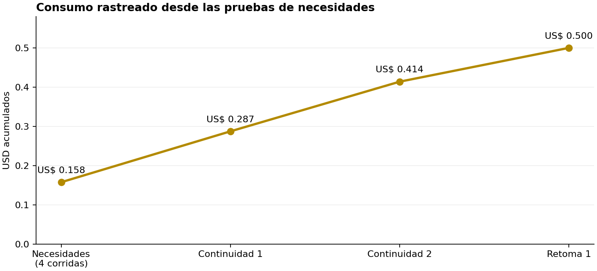

La curva muestra gasto, no calidad: las corridas tienen distinto número de casos y criterios. [Reproducir figura con NumPy y Matplotlib](05-resultados-y-mejoras/retoma-contextual-local/generar_consumo.py) · [Comandos de la próxima evaluación](06-como-ejecutar-las-pruebas/ejecutar-retoma-contextual.sh).

## 10.4. Visita nueva: propiedad conocida y reparación semántica

**Evidencia del servidor (`1569573`).** Los cinco guiones registraron 315 PASS, seis FAIL y dos citas. No hubo pérdida general de todas las mejoras: el saludo y la reiteración de materiales funcionaron. Dos solicitudes explícitas de visita generaron una referencia de cita «/» en vez de apuntar a la propiedad ya elegida; otra respuesta pidió material después de una invitación presencial. El JSON reparado era válido, pero esas interpretaciones no resolvían la petición actual. [Resumen original sin cambiar etiquetas](05-resultados-y-mejoras/retoma-servidor-4/resumen.json) · [Diálogos originales legibles](05-resultados-y-mejoras/retoma-servidor-4/conversaciones.md).

| Qué se modifica | Ajuste concreto | Límite conservado |
|---|---|---|
| Referencia inválida en una visita nueva | Con intención de visita nueva y evidencia propia, «the property/this unit» puede vincular el marcador inválido «/» al sujeto actual. Un nombre explícito solo se usa si pertenece al catálogo aprobado del proyecto. | No se cambia una referencia real de horario, una confirmación, cancelación ni consulta de una cita existente; la confianza no aumenta. |
| Respuesta corta contradictoria con una invitación | Después de una invitación presencial entregada, si «Can I see it?» se interpreta como lectura de material, se pregunta si quiere visita o fotos. | No comparte archivos ni consulta horarios por ese supuesto. Una oferta actual de archivos conserva su significado. |
| Interpretación de visita coherente con la invitación | Si el modelo sí solicita una visita nueva, una referencia inválida puede enlazarse al sujeto de esa invitación. | Solo consulta disponibilidad; seleccionar horario y confirmar resumen siguen siendo pasos distintos. |
| Protocolo del modelo | Plantilla general 2.34 (ver instrucción efectiva en 10.5): una visita nueva tiene como objetivo una propiedad/unidad, no una cita «/»; las citas anteriores se resuelven por separado. | Se mantiene `openai/gpt-4o-mini`, configuración 8 y topología LangGraph. No se modifican pesos del modelo ni datos reales. |

**Cómo se prueba.** El replay conserva 33 secuencias de mensajes de la corrida, incluidos los primeros intentos inválidos y los paquetes de reparación. Se añaden variaciones de nombre, pronombres, viviendas/unidades, formas de pedir visita, ofertas de archivos e invitaciones fallidas. También se comprueba que no se sustituyan horarios reales, confirmaciones ni referencias a otra propiedad. La versión del guion sigue siendo 1.1: no se suavizan los objetivos ni se cambia el texto del lead para evitar el fallo.

**Validación del código final:** 3.417 pruebas aprobadas, 11 omitidas por condiciones de entorno y cero fallos en los tres shards; los 144 módulos quedaron cubiertos exactamente una vez. Ocho controles de partición también aprobaron. La imagen candidata y PostgreSQL aislado se verificarán nuevamente en GitHub. [Validación JSON](05-resultados-y-mejoras/visita-contexto-local/validacion.json).

En local, los once recorridos completaron **76 turnos, diez citas simuladas y 659 controles correctos**; el caso sin vendedor elegible termina sin cita. La variante ambigua ahora pregunta «Do you mean viewing the property in person or seeing its photos?», el lead responde «I mean an in-person visit to Bay Residence» y recién se ofrecen horarios. La composición y respuestas no registradas se simulan: esto no sustituye otra corrida del modelo publicado. [Conversaciones corregidas legibles](05-resultados-y-mejoras/visita-contexto-local/conversaciones.md) · [JSON local](05-resultados-y-mejoras/visita-contexto-local/resultado.json).

| Consumo rastreado desde necesidades | Total USD | Llamadas con costo |
|---|---:|---:|
| Cuatro corridas de necesidades | 0.15756165 | 134 |
| Primera continuidad | 0.12972465 | 88 |
| Segunda continuidad | 0.12658365 | 86 |
| Primera retoma | 0.08616360 | 56 |
| Segunda retoma, cinco guiones | 0.12500070 | 85 |
| **TOTAL OBSERVADO** | **0.62503425** | **449** |
| Corrección y pruebas locales de referencia/contexto | **0.00000000** | 0 pagadas |
| Próxima repetición de los mismos cinco guiones | **≈0.12–0.22 estimado; reserva 0.35** | Hasta 200 llamadas; no equivale a límite monetario |

La última corrida se interrumpió tras 33 turnos. Escalar USD 0.12500070 a los 39–40 turnos completos previstos da aproximadamente USD 0.15, antes de variaciones por contexto y reparación. Los estimados no se suman al consumo real. La evaluación con modelo publicado sigue pendiente de despliegue; se compararán estos mismos cinco objetivos.

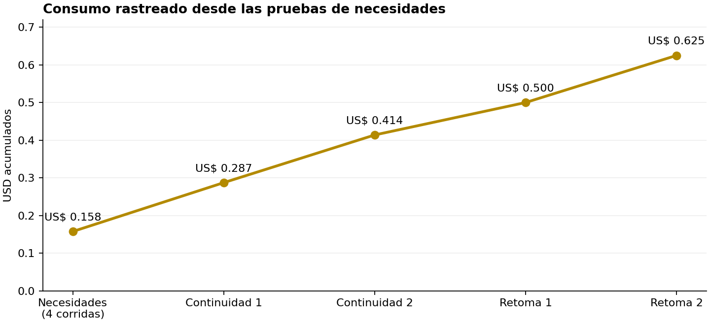

La curva representa gasto acumulado, no calidad integral. [Reproducir figura](05-resultados-y-mejoras/visita-contexto-local/generar_consumo.py) · [Comandos de evaluación](06-como-ejecutar-las-pruebas/ejecutar-visita-contexto.sh).

## 10.5. Coherencia entre material, propietario e intención ejecutable

**Última evidencia con modelo publicado (`c087cf7`).** Se generaron cuatro citas de cinco, frente a dos en la corrida anterior de estos cinco guiones. Tres conversaciones cumplieron todos los controles: Cedar Loft llegó a cita pero repreguntó innecesariamente por la propiedad al reiterar fotos, y la visita aclarada explícitamente no avanzó. Se conservan **365 PASS y seis FAIL**: cuatro corresponden al turno de fotos y dos al recorrido de aclaración interrumpido. No equivalen a seis defectos independientes ni a una aprobación integral del diálogo. [Resumen original](05-resultados-y-mejoras/retoma-servidor-5/resumen.json) · [Conversaciones originales legibles](05-resultados-y-mejoras/retoma-servidor-5/conversaciones.md).

| Regla general | Qué se ajusta y cómo | Qué sigue protegiendo el backend |
|---|---|---|
| El propietario de las fotos no es un archivo | Si una petición explícita de fotos/PDF/planos clasifica el nombre del propietario actual como material, se corrige su tipo usando el catálogo aprobado y la selección vigente. | No se adivinan otros propietarios, no se convierten archivos reales con ese nombre ni se colapsa una unidad dentro de otra tipología. Las restricciones y cobertura siguen vigentes. |
| Una intención de visita no puede quedar sin tarea | La validación exige que `visit.action=request` tenga una solicitud de cita o una aclaración justificada, después de cualquier reparación. Una declaración propia y actual de visita presencial puede completar esa solicitud faltante, conservando evidencia y confianza. | No se completa a partir de citas pasadas, negaciones, discurso de terceros ni mensajes sin evidencia suficiente. Reservar exige todavía elegir y confirmar un resumen válido. |
| Verificar las instrucciones realmente enviadas | La ruta actual sustituye la plantilla general por `interpretation_input.SYSTEM`. Se actualiza esa instrucción efectiva y se registra `input_system_version=sales-interpretation-system/2.1` en la traza. Una prueba comprueba el contenido del mensaje HTTP y su versión guardada. | El formato de entrada continúa en `sales-interpretation-input/2.0`; el protocolo general/UI pasa a 2.35. No se cambia LangGraph, el modelo ni la configuración publicada 8. |

**Aclaración de auditoría:** las versiones 2.33/2.34 de la plantilla general registradas en secciones anteriores no identifican por sí solas el texto del system de la ruta wire. Los cambios de backend de esas entregas sí se ejecutaban. Desde esta corrección, la instrucción efectiva tiene una versión propia comprobada en la solicitud y en el snapshot; no se presume su aplicación por actualizar otra plantilla.

**Validación del código final:** 3.441 pruebas aprobadas, 11 omitidas por condiciones de entorno y cero fallos en los tres shards; 144 módulos cubiertos exactamente una vez y ocho controles de partición aprobados. La imagen candidata y PostgreSQL aislado se verificarán en GitHub. [Validación JSON](05-resultados-y-mejoras/coherencia-material-visita-local/validacion.json).

**Diseño de pruebas.** Se conservan 38 secuencias de la última corrida, incluidos los intentos inválidos y reparaciones. Hay variantes de nombres, formatos de material, unidades, referencias a archivos reales y declaraciones propias, históricas o negadas. El replay local completa **once recorridos, 76 turnos, diez citas simuladas y 659 controles correctos**. La composición y las respuestas posteriores no registradas se simulan, por lo que estos resultados no prueban otra inferencia del modelo publicado. [Replay legible](05-resultados-y-mejoras/coherencia-material-visita-local/conversaciones.md) · [JSON local](05-resultados-y-mejoras/coherencia-material-visita-local/resultado.json).

| Consumo rastreado desde necesidades | Total USD | Llamadas con costo |
|---|---:|---:|
| Cuatro corridas de necesidades | 0.15756165 | 134 |
| Primera continuidad | 0.12972465 | 88 |
| Segunda continuidad | 0.12658365 | 86 |
| Primera retoma | 0.08616360 | 56 |
| Segunda retoma | 0.12500070 | 85 |
| Tercera retoma | 0.15285525 | 101 |
| **TOTAL OBSERVADO** | **0.77788950** | **550** |
| Corrección y regresiones locales de coherencia | **0.00000000** | 0 pagadas |
| Próxima repetición de los mismos cinco guiones | **≈0.12–0.22 estimado; reserva 0.35** | Hasta 200 llamadas; no es límite monetario |

La última corrida tuvo 38 turnos. Escalar USD 0.15285525 a los 39–40 previstos da aproximadamente USD 0.16, con variaciones por contexto y reparaciones. El estimado no se añade al consumo observado; este acumulado no incluye etapas anteriores a necesidades. La siguiente corrida real sigue pendiente de despliegue y mantiene los mismos cinco objetivos, sin borrar fallos ni debilitar criterios.

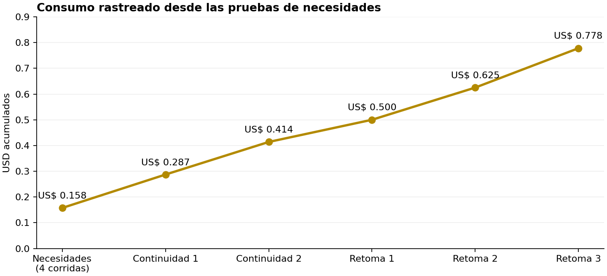

La curva representa consumo, no calidad integral. [Reproducir figura](05-resultados-y-mejoras/coherencia-material-visita-local/generar_consumo.py) · [Comandos de servidor y extracción](06-como-ejecutar-las-pruebas/ejecutar-coherencia-material-visita.sh).

## 10.6. Materiales, exclusiones y aclaraciones útiles

**Qué mostró el servidor (`b9e3ceb`).** El modelo sigue siendo `openai/gpt-4o-mini`, configuración publicada 8. Se registraron **360 PASS y 10 FAIL**, 95 llamadas, 1.107.091 tokens de entrada, 13.661 de salida y **USD 0.14232105 total**. Cedar Loft dejó de repreguntar al reiterar fotos y logró cita; otros recorridos volvieron a fallar. La propiedad permanecía guardada: el bloqueo ocurría al interpretar y resolver referencias o al aplicar el umbral de confianza. [Resumen original](05-resultados-y-mejoras/retoma-servidor-6/resumen.json) · [Diálogos originales](05-resultados-y-mejoras/retoma-servidor-6/conversaciones.md).

| Cinco guiones comparables | Conversaciones sin controles fallidos | Visitas simuladas | Total USD por corrida |
|---|---:|---:|---:|
| Retoma 2 (`1569573`) | 2/5 | 2/5 | 0.12500070 |
| Retoma 3 (`c087cf7`) | 3/5 | 4/5 | 0.15285525 |
| Retoma 4 (`b9e3ceb`) | 2/5 | 4/5 | 0.14232105 |
| **TOTAL de estas tres corridas** | **7/15 ejecuciones; no casos únicos ni calidad integral** | **10/15** | **0.42017700** |

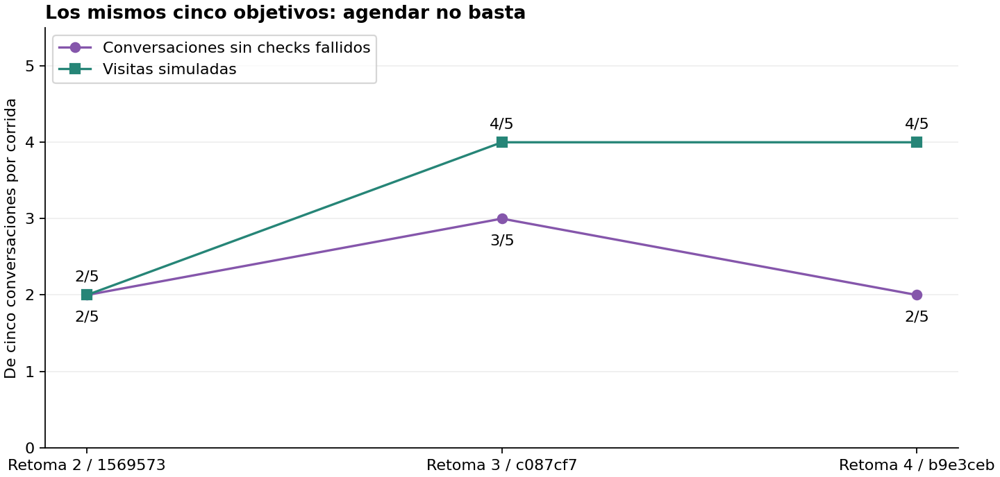

**Lectura honesta:** no hay mejora global en la última repetición; agendar no basta si el recorrido tiene preguntas innecesarias. Las curvas comparan controles de esas ejecuciones, no tasas de conversión de leads reales. Los nuevos controles de fluidez se aplican desde la siguiente corrida, sin alterar las etiquetas históricas.

| Problema | Qué se actualiza y cómo | Protección conservada |
|---|---|---|
| «photos/floor_plan» se interpreta como nombre de archivo | Se distingue formato de identidad: un formato genérico se vincula al propietario activo aprobado; el nombre de un archivo real no se reinterpreta. | No adivinar otra propiedad ni sustituir unidades; revalidar alcance, permiso y cobertura del material antes de compartir. |
| Petición afirmativa marcada como exclusión | Un normalizador reconoce solo una petición literal, propia y única de material, sin negación ni restricciones. Otros casos contradictorios reciben feedback concreto para la reparación acotada. | Conservar restricciones, alternativas, discurso de terceros y mensajes mixtos; no aumentar confianza ni autorizar reservas. |
| «Can I see it?» después de ofrecer archivos | Con una oferta entregada, un archivo único se resuelve contra esa oferta. Si hay varios, se pregunta cuál material desea. | El backend vuelve a validar vigencia e integridad; no convertir aceptación de material en visita. |
| Seleccionar «Ridge Townhome» provoca otra pregunta comercial | El nombre exacto de una vivienda en la última lista completa permite leer sus detalles, incluso con baja confianza. Se registra autorización de lectura, separada de acciones. | No usar nombres fuera del catálogo/oferta ni listas incompletamente entregadas; no reservar por seleccionar una propiedad. |
| Visita clara, confianza cero y aclaración genérica | Se pregunta **«Would you like me to check available visit times for Bay Residence?»**. No se eleva la confianza ni se consulta agenda en ese turno. | Pedir una respuesta nueva antes de seguir; selección y confirmación final de cita continúan siendo obligatorias. |

**Ejemplo local del recorrido reparado.** Lead: «I mean an in-person visit to Bay Residence.» → backend: propiedad aprobada e intención de visita identificadas, confianza del modelo 0 → agente: «Would you like me to check available visit times for Bay Residence?» → lead guionado: «Yes, please check available visit times for Bay Residence.» → agente: horarios verificados → lead: elige uno → agente: resumen exacto → lead: confirma → backend: crea una sola cita simulada. **Este ejemplo incorpora continuación simulada: aún no es una nueva conversación del modelo real en el servidor.**

**Diseño para no ajustar una sola frase.** Se conservan 38 secuencias reales de interpretación, con intentos iniciales y reparaciones, y se añaden variantes de tres nombres, fotos/planos/PDF, formas de pedirlos, selección nominal con confianza cero y aclaración de visita. Las negativas comprueban que no se cambien exclusiones reales, mensajes hipotéticos o de terceros, ofertas no entregadas, ofertas mixtas ni archivos con el mismo nombre. Se ejecuta con `autoflush=False` (producción) y `True`. El modelo, los tres projects, seis propiedades, vendedores y topología LangGraph permanecen; cambia la instrucción efectiva a **`sales-interpretation-system/2.2`**, el protocolo general a **2.36** y el guion a **1.2**.

**Evaluación más exigente.** Elegir una propiedad debe producir sus detalles sin preguntar nuevamente qué tipo de consulta quiere. Si el agente pregunta específicamente por permiso para buscar horarios, el lead guionado responde a ese texto público; no accede a interpretaciones privadas para escoger su respuesta. Esto suma hasta un turno al recorrido, pero **no sustituye seleccionar horario ni confirmar el resumen**. Los controles locales no rebajan un FAIL del servidor ni certifican la calidad integral. [Guiones documentados](02-datos-de-prueba/variantes-retoma.json).

**Validación local final:** 3.479 pruebas aprobadas, 11 omitidas por condiciones de entorno y cero fallos en los tres shards; 144 módulos cubiertos exactamente una vez y ocho controles de partición aprobados. La aceptación técnica registra 63 PASS y un control real pendiente. La regresión detectó tres incompatibilidades con ofertas sin archivos; se corrigió el código conservando esas pruebas. GitHub volverá a validar la imagen candidata y PostgreSQL aislado. [Validación JSON](05-resultados-y-mejoras/materiales-aclaraciones-local/validacion.json).

**Replay local:** once recorridos, **77 turnos, diez citas simuladas y 680 controles PASS**. Un caso finaliza sin cita por falta de vendedores elegibles. Se usa el core real, datos temporales, secuencias registradas y proveedores simulados para composición y continuaciones no observadas. **Costo total local: USD 0.00; calidad del modelo publicado todavía no evaluada en esta entrega.** [Conversaciones legibles](05-resultados-y-mejoras/materiales-aclaraciones-local/conversaciones.md) · [JSON local](05-resultados-y-mejoras/materiales-aclaraciones-local/resultado.json).

| Consumo rastreado desde necesidades | Total USD | Llamadas con costo |
|---|---:|---:|
| Cuatro corridas de necesidades | 0.15756165 | 134 |
| Primera continuidad | 0.12972465 | 88 |
| Segunda continuidad | 0.12658365 | 86 |
| Primera retoma | 0.08616360 | 56 |
| Segunda retoma | 0.12500070 | 85 |
| Tercera retoma | 0.15285525 | 101 |
| Cuarta retoma, recibida en esta entrega | 0.14232105 | 95 |
| **TOTAL OBSERVADO desde necesidades** | **0.92021055** | **645** |
| Correcciones y pruebas locales de esta entrega | **0.00000000** | **0 pagadas** |
| Próxima corrida de los mismos cinco objetivos | **≈0.12–0.23 estimado; reserva 0.35** | Hasta 200; no equivale a límite monetario |

El acumulado excluye las fases anteriores a necesidades y no suma estimaciones futuras. La última ejecución costó USD 0.14232105 por 38 turnos: escalar a aproximadamente 39–41 da USD 0.15–0.16; el intervalo permite variaciones por contexto y reparaciones. Se conserva el máximo de diez turnos por caso. La próxima corrida decidirá si disminuyen las repreguntas y si la visita aclarada llega a confirmación; no se amplía la batería pagada hasta revisarla.

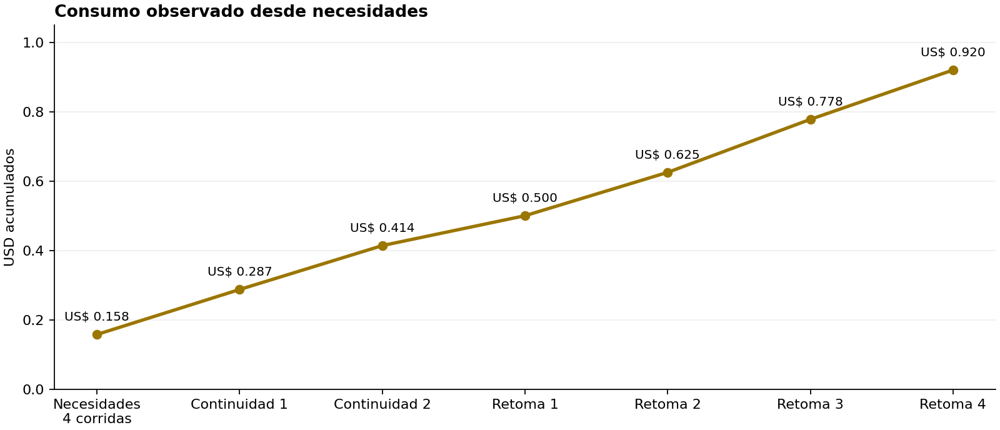

[Reproducir figuras con NumPy/Matplotlib](05-resultados-y-mejoras/materiales-aclaraciones-local/generar_figuras.py) · [Comandos de evaluación y descarga](06-como-ejecutar-las-pruebas/ejecutar-materiales-aclaraciones.sh).

## 10.7. Recuperación de materiales y grafo LangGraph experimental

**Evidencia recibida, sin cambiar etiquetas.** En `108846e`, con `openai/gpt-4o-mini`, configuración 8, hubo **391 PASS y cinco FAIL**, 103 llamadas, 1.216.849 tokens de entrada, 15.476 de salida y **USD 0.15659055 total**. Se agendaron las cinco visitas; tres diálogos cumplieron todos sus controles. Las otras dos conversaciones pidieron aclaración genérica ante fotos/planos ya solicitados. [Resumen original](05-resultados-y-mejoras/retoma-servidor-7/resumen.json) · [Diálogos originales legibles](05-resultados-y-mejoras/retoma-servidor-7/conversaciones.md).

| Ajuste | Qué se modifica realmente | Control conservado |
|---|---|---|
| Pedir pictures/blueprints no es comparar | Se amplía la detección de peticiones interrogativas y la normalización de una petición literal, única y propia, vinculada a la propiedad activa. | No transformar comparaciones genuinas, negaciones, terceros, restricciones o consultas mixtas en aceptación de material. |
| Material claro con confianza cero | Una capacidad de lectura exige la petición literal reconocida, un único formato y el propietario actual aprobado y resuelto. La confianza sigue en cero. | Descubrir no autoriza reservar; compartir conserva las validaciones de aprobación, cobertura, restricciones e integridad. Sin esa prueba se formula una pregunta de material específica. |
| Etapas explícitas sin rehacer los servicios | El coordinador se divide en callbacks de interpretación, planificación y cumplimiento/composición; los manejadores y el envío con sus recibos siguen siendo los mismos. | El modo de referencia y el grafo sin reconsideración deben producir iguales diálogos y citas. No se trasladan las transacciones a un checkpointer de LangGraph. |
| Reconsideración selectiva | Solo una petición informativa de material, única y con confianza baja puede volver al mismo modelo antes de planificar. Una llamada adicional como máximo, en un evento de auditoría distinto. | Rechazar resultados que añadan visitas, cancelaciones, restricciones u otros temas o resuelvan otro propietario. El backend conserva autorización de efectos y comprueba control/epoch de nuevo. |
| Fallo o incertidumbre persistente | Se conserva la interpretación original si el candidato no supera las validaciones; cuando el formato/propiedad lo permiten, se pregunta por ese material. | No aumentar la confianza en código, no repetir herramientas/operaciones y no presentar un fallo interno al lead como explicación comercial. |

**Qué grafo existe ahora.** Es un `StateGraph` nuevo, `sales-coordinator-graph/1.0`; no es el grafo histórico `sales-turns-v5` renombrado. Los nodos ejecutan las etapas reales del coordinador, no otro motor simulado. La selección experimental exige una conversación dentro del sandbox; los SMS/WhatsApp reales siguen usando `classic` tras desplegar esta entrega.

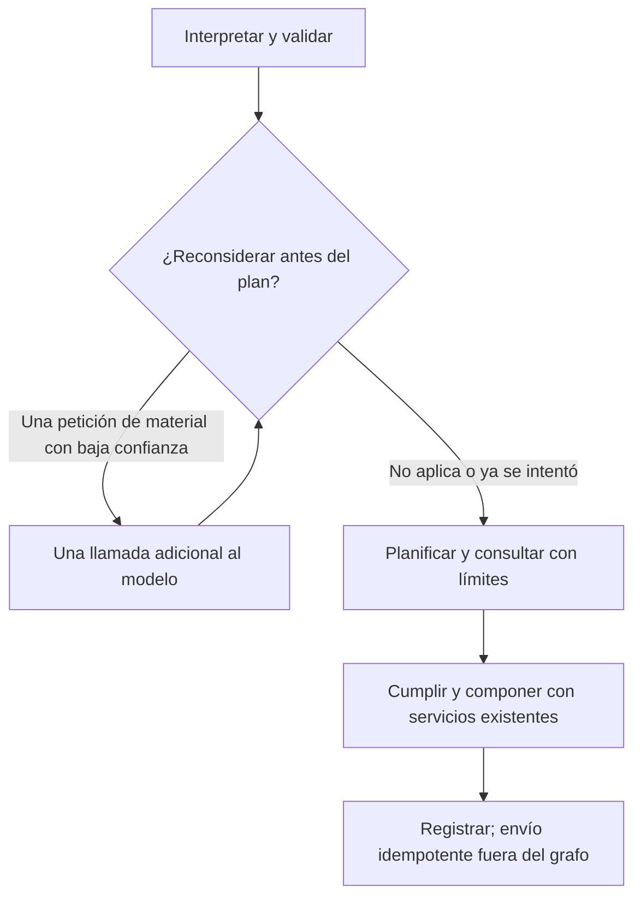

El grafo tiene límite de recursión y contador de una reconsideración. **No es todavía un ciclo general LLM→herramienta→LLM que replantea herramientas después de cada resultado.** La ruta añadida reconsidera interpretación antes del plan; las rondas posteriores de herramientas siguen delimitadas por el backend. Si se necesita el ciclo posterior a herramientas, requiere otro diseño y evaluación, no se considera entregado aquí.

| Modo | Dónde se usa | Propósito |
|---|---|---|
| `classic` | Producción y laboratorio | Referencia con las dos correcciones comunes; ejecuta las etapas secuencialmente. |
| `graph` | Solo laboratorio aislado | Ejecuta interpretación→evaluación→plan→cumplimiento mediante LangGraph, sin nueva inferencia. Prueba equivalencia. |
| `graph-reconsider` | Solo laboratorio aislado | Mismo grafo, con una reconsideración opcional anterior al plan. Fue el candidato de la comparación recibida; 10.8 evalúa el ciclo posterior a herramientas. |

**Separar arquitectura de calidad.** La corrección de materiales se aplica a ambos modos: una mejora compartida no se atribuye al grafo. Localmente se comparan tres escenarios observados, dos configuraciones de autoflush y ambos recorridos: doce conversaciones ejecutadas para equivalencia, con iguales mensajes públicos y citas. Otro caso fuerza únicamente en el proveedor simulado una primera respuesta de baja confianza y comprueba que haya una sola reconsideración y que planificación/cumplimiento no se repitan. No se cambia el modelo ni se añaden un lead LLM o juez. La instrucción efectiva pasa a `sales-interpretation-system/2.3` y el protocolo general a 2.37; la configuración publicada sigue siendo 8.

**Validación local:** 3.507 pruebas aprobadas en los tres shards, 11 omisiones por condiciones de entorno y cero fallos; 145 módulos cubiertos exactamente una vez. Ocho pruebas de partición y 63 controles de aceptación aprobaron; un control de aceptación real sigue pendiente. Se comprobaron aparte cuatro pruebas del comparador y se repitieron seis de auditoría/CLI tras completar la exportación de trazas. La imagen candidata y PostgreSQL aislado volverán a validarse en GitHub. [Validación JSON](05-resultados-y-mejoras/grafo-acotado-local/validacion.json).

**Replay local de la corrección común:** once recorridos, **76 turnos, diez citas simuladas y 670 controles PASS**. El caso restante finaliza sin cita por falta de vendedores. Las interpretaciones registradas se reproducen; composición y continuaciones no observadas se simulan. No hubo llamadas pagadas ni contactos. **Esto no es una nueva medición de calidad del modelo real.** [Conversaciones legibles](05-resultados-y-mejoras/grafo-acotado-local/conversaciones.md) · [JSON local](05-resultados-y-mejoras/grafo-acotado-local/resultado.json).

**Diseño de la comparación anterior; resultados recibidos en 10.8.** Se propuso ejecutar los mismos cinco guiones primero con `classic` y luego con `graph-reconsider`, en bases SQLite privadas distintas, usando la configuración publicada. Comparar por caso: pertinencia, repreguntas, propiedad retenida, cita exacta y ausencia de reservas prematuras; además llamadas, tokens, costo, latencia por turno y reconsideraciones efectivamente ejecutadas/aceptadas. El reporte guarda modo solicitado y traza de nodos y falla si no corresponden. El comparador verifica que commit, modelo, configuración, catálogo y casos coincidan y conserva ambos ZIP originales junto con un resumen JSON y Markdown; comparabilidad no equivale a aprobación de calidad. Si no se activa ninguna reconsideración, la corrida no acredita calidad de esa rama. Una sola pareja no demuestra significancia ni estabilidad: repetir o ampliar únicamente tras revisar el resultado. No se activará el candidato en conversaciones reales por aprobar pruebas locales.

| Consumo rastreado desde necesidades | Total USD observado | Llamadas con costo |
|---|---:|---:|
| Cuatro corridas de necesidades | 0.15756165 | 134 |
| Dos corridas de continuidad | 0.25630830 | 174 |
| Retoma 1 | 0.08616360 | 56 |
| Retoma 2 | 0.12500070 | 85 |
| Retoma 3 | 0.15285525 | 101 |
| Retoma 4 | 0.14232105 | 95 |
| Retoma 5, recibida ahora | 0.15659055 | 103 |
| **TOTAL OBSERVADO** | **1.07680110** | **748** |
| Corrección, equivalencia y pruebas locales de esta entrega | **0.00000000** | **0 pagadas** |

| Plan de la pareja anterior; resultados recibidos en 10.8 | Conversaciones / turnos previstos | Total USD estimado por fila |
|---|---|---:|
| Referencia `classic` | 5 / aproximadamente 39–41 | 0.15–0.25 |
| Candidato `graph-reconsider` | 5 / aproximadamente 39–41, más llamadas selectivas | 0.15–0.25 |
| **TOTAL estimado de la pareja** | **10 conversaciones** | **0.30–0.50** |
| **Reserva sugerida para esa pareja** | No se suma al estimado base | **0.60** |

Este estimado histórico partía de la corrida de 40 turnos y USD 0.15659055; no es una tarifa nueva ni un tope garantizado. Cada ejecución permite hasta 200 llamadas, 400 entre ambas; el límite es de llamadas, no de dólares. La comparación puede no mejorar calidad y añadir costo/latencia. Los importes futuros no se suman al gasto observado, que sigue excluyendo etapas anteriores a necesidades.

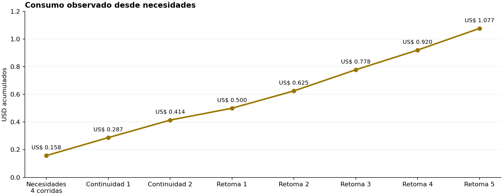

[Datos y guiones de continuidad](02-datos-de-prueba/variantes-retoma.json) · [Grafo ejecutable](../../backend/app/modules/sales_agent/coordinator_graph.py) · [Comandos de comparación y descarga](06-como-ejecutar-las-pruebas/ejecutar-grafo-comparacion.sh).

## 10.8. Decisiones después de consultar herramientas: nueva iteración

**Diseño incorporado en la entrega anterior.** Antes, el backend elegía las consultas y el modelo componía después. El candidato `graph-observe` ahora permite que el mismo modelo seleccione consultas autorizadas, vea sus resultados y decida otra consulta o pasar a responder. El backend sigue resolviendo identidades, restricciones y acciones. Es un ciclo LangGraph ejecutable; no se limita a envolver las mismas etapas ni a repetir la interpretación inicial. La documentación oficial diferencia precisamente los recorridos prefijados de las decisiones dinámicas sobre herramientas ([LangGraph](https://docs.langchain.com/oss/python/langgraph/workflows-agents)).

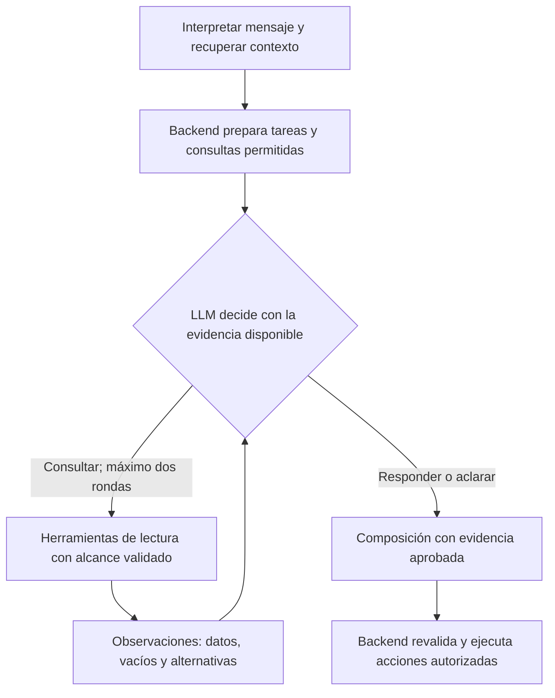

**Quién controla cada parte.** `active_service` sigue siendo la entrada común. El plan conserva tareas, propiedad y restricciones en los eventos de diálogo existentes; LangGraph no introduce una memoria paralela. El modelo elige IDs de consultas que prepara el backend, nunca SQL, IDs de otra company ni instrucciones de reserva. Las consultas ofrecen catálogo, detalles/comparación, materiales, financiación, precios, inventario, ubicación, entrega, amenities y disponibilidad para una petición explícita de visita. El resultado puede abrir una consulta de alternativas de material; descubrir un PDF no autoriza a enviarlo ni a afirmar que contiene fotos. Al agendar, la selección y confirmación explícitas y la revalidación transaccional siguen siendo necesarias.

**Límites concretos.** Dos rondas de herramientas, hasta tres decisiones del modelo, 15 segundos por decisión, cuatro consultas elegidas por decisión y hasta seis lecturas según el presupuesto del plan. Contexto compacto máximo de 24 KB. No se repite una operación ya intentada; se revalida el alcance después de esperar al modelo y antes de leer. Una decisión inválida queda como FAIL; si se agotan rondas con solicitudes obligatorias pendientes, queda PARTIAL y se conservan las tareas. No se certifica como éxito solo porque haya respuesta o cita. Las restricciones, confirmaciones y controles finales siguen en el backend; las herramientas de este ciclo no envían archivos ni crean citas. La comprobación final de horarios puede repetir una lectura por seguridad: no se elimina esa revalidación para ahorrar consultas.

| Guion breve | Situación y datos | Qué se exige |
|---|---|---|
| `obs_alternative` | Cedar Studio: fotos sin cobertura confirmada y PDF aprobado | Consultar alternativas tras observar el vacío; ofrecer PDF y esperar petición explícita. |
| `obs_mixed` | Bay Residence: fotos **o** PDF, **y** financiación | Respetar OR entre materiales y responder también la consulta independiente de financiación. |
| `obs_switch` | Cedar Loft → Cedar Studio → PDF → visita | Cambiar la propiedad activa y conservar el dueño correcto de material y cita. |
| `obs_interrupt` | Visita → fotos antes de elegir hora → visita | Resolver la interrupción y retomar la agenda sin reservar prematuramente. |
| `obs_time` | Visita una mañana en los próximos siete días, hora del proyecto | Resolver un rango natural sin exigir al lead escribir un código IANA; elegir y confirmar. |
| `obs_no_seller` | Ridge: vendedor de la compañía sin asignación elegible al proyecto | Informar la falta de disponibilidad, sin cita ni promesa de aviso automático. |

**Datos y modelo.** Reutilizamos la company sintética, sus tres projects y seis tipologías, con materiales y vendedores de alcance diferente descritos en el bloque 3. Los siete segmentos y el desconocido siguen documentados; estos seis guiones prueban funciones y **no representan una nueva cobertura de los ocho segmentos**. Lead guionado, sin costo de lead LLM ni juez. El agente usa el modelo y configuración publicados: en la evidencia recibida, `openai/gpt-4o-mini`, versión 8; el comando no los reemplaza. Cada ejecución prepara SQLite y recursos desechables privados. No se crean leads/citas productivos ni contactos por WhatsApp/SMS. [Guiones completos](02-datos-de-prueba/guiones-observaciones.json).

**Cómo iteramos.** Primero se comparan exactamente estos seis casos en `classic` y `graph-observe`, con el mismo commit/modelo/configuración/catálogo. Se revisa solicitud por solicitud, propiedad retenida, alternativas, horarios, repreguntas, citas y la traza real de decisiones posteriores a herramientas. Se corrigen instrucciones, contratos o validaciones con el fallo observado y se repiten ambos recorridos antes de ampliar. Una mejora compartida no se atribuye al grafo; un aumento de costo sin mejor diálogo no justifica promoverlo. No hemos activado el candidato en canales reales ni afirmamos mejora del modelo antes de recibir esa corrida. Una intención mal interpretada aguas arriba puede seguir fallando: este ciclo decide sobre solicitudes validadas y no sustituye las pruebas de interpretación ni convierte cualquier mensaje en una acción.

**Corrección de la medición anterior.** El comparador ignoraba incorrectamente que cada base privada genera nuevos `asset_id` para los mismos archivos: ahora excluye solo ese campo y conserva hash/contenido, cobertura y catálogo. Además, una traza `coordinator_graph=null` ya no borra la conversación por un `.get` inválido; se conserva el diálogo con un control FAIL. El resumen corregido de la pareja anterior es **INCOMPLETE_EVIDENCE**: el catálogo sí coincide, pero el caso perdido de la referencia no se puede reconstruir. Se conserva el resultado original, sin convertirlo en PASS. [Reanálisis sin llamadas al modelo](05-resultados-y-mejoras/flujo-observaciones-local/comparacion-anterior-reanalizada.json).

| Evidencia del servidor recibida | Casos completos sin fallos | Citas registradas | Llamadas | Total USD por fila |
|---|---:|---:|---:|---:|
| Referencia `classic` | 4/5; falta evidencia del quinto | 4 exportadas | 94 | 0.13637820 |
| Candidato previo `graph-reconsider` | 5/5 | 5 | 97 | 0.13746525 |
| **TOTAL de esa pareja** | **No determina ganador** | **9 exportadas** | **191** | **0.27384345** |
| Histórico anterior desde necesidades | Conjuntos distintos, no se agrega su tasa de éxito | — | 748 | 1.07680110 |
| **TOTAL OBSERVADO desde necesidades** | **Excluye fases anteriores sin detalle de consumo aquí** | — | **939** | **1.35064455** |
| Pruebas locales de esta entrega | Proveedores simulados; no miden calidad real | Solo simuladas | 0 pagadas | 0.00000000 |

Cuatro conversaciones completas tuvieron los mismos textos públicos en ambos modos. Hubo una reconsideración previa, pero cero aceptadas. Los 5/5 del candidato anterior no acreditan una mejora causal. No se mezcla este resultado con `graph-observe`; su primera corrida recibida se analiza en 10.9.

| Estimación anterior; ejecución recibida en 10.9 | Conversaciones / límite por conversación | Total USD estimado por fila |
|---|---|---:|
| Referencia `classic` | 6 / hasta 10 turnos de lead | 0.15–0.30 |
| Candidato `graph-observe` | 6 / hasta 10 turnos; decisiones adicionales | 0.25–0.50 |
| **TOTAL ESTIMADO** | **12 / hasta 120 turnos** | **0.40–0.80** |
| **Reserva sugerida** | Alternativa de presupuesto; no se suma al estimado | **1.00** |

Estimación propia a partir de la pareja recibida y del contexto compacto adicional; no es tarifa garantizada ni compromiso de ahorro. Cada conversación suele terminar antes del límite cuando alcanza su objetivo o no hay vendedor. Los comandos permiten hasta 300 llamadas por recorrido (600 la pareja): **ese límite no es un tope en dólares**. Se contabilizarán tokens y cargos efectivamente reportados por OpenRouter. Una decisión del nuevo ciclo añade costo y latencia; el beneficio debe observarse en el diálogo, no inferirse de la arquitectura.

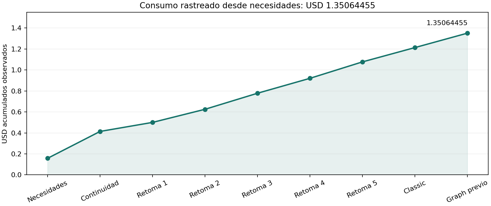

**Validación local y lectura humana.** 3.554 pruebas de regresión aprobadas. 11 omisiones por condiciones de entorno y cero fallos; 146 módulos cubiertos exactamente una vez. El nuevo módulo aporta 43 pruebas. incluidos seis recorridos en dos modos y dos configuraciones de autoflush. decisiones inválidas. restricciones. comparación y límite de rondas. Además. ocho pruebas del particionado y 63 controles de aceptación aprobaron; uno de aceptación real sigue pendiente. Los ejemplos exportados de autoflush de producción reúnen 12 diálogos. 70 turnos. diez citas simuladas y 618 controles PASS. sin llamadas pagadas. Los ejemplos locales permiten inspeccionar lead, respuesta, observación y próxima consulta, pero no sustituyen el comportamiento del modelo publicado. [Conversaciones legibles](05-resultados-y-mejoras/flujo-observaciones-local/conversaciones.md) · [Datos locales](05-resultados-y-mejoras/flujo-observaciones-local/conversaciones-locales.json) · [Validación](05-resultados-y-mejoras/flujo-observaciones-local/validacion.json) · [Comandos de despliegue, comparación y descarga](06-como-ejecutar-las-pruebas/ejecutar-observaciones-comparacion.sh).

## 10.9. Reparación de solicitudes mixtas y horarios naturales

**Qué mostró el servidor.** Ambos modos usaron el commit `31023e0`, `openai/gpt-4o-mini`, configuración publicada 8 y el mismo catálogo. El ciclo nuevo ejecutó 50 decisiones y 26 rondas, pero ambos quedaron en **4/6 casos sin controles fallidos**. El candidato registró 4/5 citas esperadas; la referencia 3/5, afectada por un timeout al interpretar una hora elegida. Esta diferencia no prueba mejora del grafo. La falta de vendedor es un sexto caso correcto sin cita. Se conserva la evidencia original, sin cambiar sus etiquetas ni convertir fallos en éxitos.

| Guion | Referencia del servidor | Candidato del servidor | Lectura objetiva |
|---|---|---|---|
| Fotos ausentes → ofrecer PDF | Cumple controles | Cumple controles; consulta alternativas tras leer | Hay ciclo real, pero la respuesta pública fue igual. |
| Fotos **o** PDF **y** financiación | Repregunta la propiedad; luego timeout de interpretación | Misma repregunta, aunque después agenda | El fallo de interpretación es compartido; más citas no significa diálogo aprobado. |
| Cambio de propiedad | Cumple controles | Cumple controles | Material y cita corresponden a la nueva propiedad. |
| Agenda interrumpida por fotos | Cumple controles | Cumple controles | Resuelve material y retoma la agenda. |
| Cualquier mañana en los próximos siete días | Pide otra vez zona horaria | Pide una hora exacta y rechaza aclaración de su herramienta | Franja mal normalizada; no se llega a ofrecer horarios. |
| Sin vendedor elegible | Cumple controles | Cumple controles | No reserva; ofrece una espera que requiere consentimiento. |

**Qué se corrigió y cómo.** Son cambios de código e instrucciones, no entrenamiento de pesos ni cambio del modelo.

| Pieza | Ajuste concreto | Protección que conserva |
|---|---|---|
| Interpretación de materiales | Los formatos genéricos se guardan como `subject`, no como propiedad/archivo inventado; “financing options” deja de ser una propiedad. Se recupera OR literal entre dos solicitudes ya existentes y se mantiene financiación como solicitud independiente. | No crea nuevos pedidos, no eleva confianza, conserva nombres de archivos conocidos, nombres desconocidos y restricciones. Negaciones, terceros e hipótesis quedan fuera de la recuperación literal. |
| Instrucción efectiva | Pasa a `sales-interpretation-system/2.4`: ejemplos de OR/AND, propiedad implícita, periodos del día y zona del proyecto. | Misma configuración publicada 8 y modelo; el backend mantiene la autoridad sobre referencias y acciones. |
| Fechas y horas | “Morning/afternoon/evening” se transforma en franja, no en reloj. Se reconocen formas como “use the property's timezone.”; una franja nueva reemplaza horas históricas y conserva límites explícitos actuales. | No cambia una zona IANA explícita; una zona desconocida o ambigua sigue necesitando aclaración. No selecciona ni confirma citas por el lead. |
| Decisión posterior a herramientas | La herramienta puede justificar una aclaración temporal. El resultado queda `CLARIFICATION_REQUIRED`, no como decisión rechazada ni PASS. | Una aclaración sin tarea ambigua ni evidencia de herramienta sigue siendo inválida. |
| Medición del trabajo pendiente | Tareas pendientes, bloqueadas o esperando aclaración ya no desaparecen de la auditoría por no tener herramienta elegible. | PASS no equivale a “no se ejecutó nada”; los diálogos mantienen controles funcionales independientes. |
| Ausencia de vendedor | Se añadió un control que exige cero esperas creadas antes del consentimiento. | Se auditó el código existente: `wait_service` sí implementa espera/aviso con aceptación. Ofrecerla no demuestra que se guardó ni que se notificó. |

**Cómo probamos sin ajustar una sola frase.** Se guardaron las interpretaciones y fallos de los dos recorridos recibidos. Se reproducen sobre el core actual los seis guiones, en ambos modos y con autoflush de producción y alternativo. Además se varían verbos, formatos y orden del OR, tres franjas del día y formas de expresar la zona del proyecto. Los negativos conservan exclusiones, terceros, hipótesis, archivos conocidos, destinos desconocidos y zonas explícitas/ambiguas. Las decisiones posteriores a herramientas y la composición se simulan localmente; las continuaciones sin interpretación registrada —incluido el turno que originalmente agotó tiempo— también se simulan. **No se afirma haber eliminado el timeout del proveedor ni haber medido nueva calidad del modelo real.** [Interpretaciones originales](../../backend/tests/fixtures/sales_observation_repair/server_frames.json) · [Pruebas](../../backend/tests/test_sales_observation_repair.py) · [Guía JSON de variantes](02-datos-de-prueba/variantes-observaciones-reparacion-1.json).

**Validación local.** La regresión de 147 módulos terminó con 3.638 pruebas aprobadas. 11 omisiones por condiciones de entorno y cero fallos. Después de las últimas protecciones se repitieron 132 pruebas específicas (89 de esta reparación y 43 del ciclo anterior). todas aprobadas; se solapan con la regresión y no se suman. También aprobaron ocho pruebas del particionado y 63 controles técnicos de aceptación; uno de aceptación real sigue pendiente. La matriz reproduce 48 diálogos (seis guiones × dos fuentes registradas × dos modos × dos configuraciones de autoflush). Los ejemplos exportados muestran 12 diálogos. 70 turnos. 10 citas simuladas y 620 controles PASS. no resultados nuevos de calidad del modelo. [Conversaciones legibles del replay](05-resultados-y-mejoras/observaciones-reparacion-1-local/conversaciones.md) · [JSON local](05-resultados-y-mejoras/observaciones-reparacion-1-local/conversaciones-locales.json) · [Validación](05-resultados-y-mejoras/observaciones-reparacion-1-local/validacion.json) · [Resultado anterior del servidor](05-resultados-y-mejoras/observaciones-reparacion-1-local/resultado-servidor-anterior.json).

| Consumo de la pareja recibida | Llamadas | Cargos informados (USD), total por fila | Completitud |
|---|---:|---:|---|
| `classic` | 75 | 0.10905435 | Parcial: 74 respuestas con costo de 75 llamadas. |
| `graph-observe` | 127 | 0.11234655 | Completo: 127/127. |
| **SUBTOTAL INFORMADO de esta pareja** | **202** | **0.22140090** | **Total definitivo desconocido.** |
| Histórico completo anterior desde necesidades | 939 | 1.35064455 | Excluye fases anteriores sin detalle aquí. |
| **SUMA HISTÓRICA DE IMPORTES INFORMADOS** | **1.141** | **1.57204545** | **Parcial; no es un total auditado completo.** |
| Reparación y pruebas locales | 0 pagadas | 0.00000000 | No se llamó a OpenRouter. |

La referencia tuvo media de 9,79 segundos por turno y el candidato 10,04; el candidato hizo 127 llamadas frente a 75. Los costos incompletos impiden calcular un ahorro exacto. La media incluye diálogos de distinta longitud y fallos: no permite atribuir rendimiento a la arquitectura por sí sola.

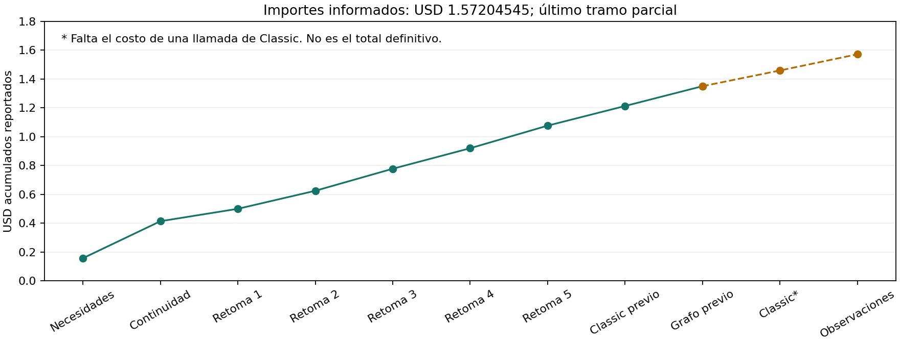

| Estimación previa; resultado recibido en 10.10 | Casos / límite | Total USD estimado por fila |
|---|---|---:|
| Referencia reparada `classic` | Mismos seis guiones / hasta 10 turnos cada uno | 0.12–0.20 |
| Candidato reparado `graph-observe` | Mismos seis guiones / hasta 10 turnos cada uno | 0.13–0.25 |
| **TOTAL ESTIMADO** | **12 conversaciones** | **0.25–0.45** |
| **Reserva sugerida, alternativa al estimado** | No se suma al total base | **0.60** |

Estimación propia basada en los importes de esta pareja y un margen para las nuevas instrucciones/reparaciones; no garantiza precio, costo ni éxito. El límite de 300 llamadas por recorrido no es un límite en dólares. Se conserva el modelo publicado, el lead guionado, sin juez LLM y sin contactos reales. La comparación debe repetir los seis casos antes de ampliar. El candidato continúa aislado; las correcciones compartidas sí se aplican al core de producción al desplegar. [Comandos de Git, servidor y PowerShell](06-como-ejecutar-las-pruebas/ejecutar-observaciones-reparacion-1.sh).

## 10.10. Cerrar los seis casos actuales y hacer visible cada decisión

**Resultado recibido, no resultado de la reparación local.** En el commit `ba5c4c5` el candidato alcanzó cinco de seis casos sin controles fallidos y las cinco citas esperadas. El caso mixto siguió fallando aunque luego agendó: una cita no convierte el diálogo en aprobado. Los seis guiones, compañía, tres projects, seis propiedades y vendedores se mantienen; no se amplía el espectro antes de cerrar estos casos. La configuración publicada continúa en 8 y el modelo observado es `openai/gpt-4o-mini`, sin lead LLM ni juez.

| Medición del servidor | `classic` | `graph-observe` |
|---|---:|---:|
| Casos sin controles fallidos | 3/6 | 5/6 |
| Citas de cinco esperadas | 3/5 | 5/5 |
| Llamadas | 79 | 134 |
| Latencia media por turno | 9,83 s | 10,22 s |
| Total USD por recorrido, completo | 0.11750550 | 0.12726405 |
| **TOTAL USD de la pareja** | **0.24476955 entre ambos** | **No se suma dos veces** |

El candidato hizo 50 decisiones posteriores a herramientas y 26 rondas. Costó aproximadamente 8,3 % más en esta pareja, pero una sola repetición no prueba una mejora estable ni separa el efecto del grafo del de las distintas interpretaciones del modelo. [Evidencia anterior conservada](05-resultados-y-mejoras/observaciones-reparacion-2-local/resultado-servidor-anterior.json).

**Qué se ajusta ahora.** Se usan las respuestas registradas —también el intento inválido de la interrupción— y variantes locales. La instrucción efectiva de esa entrega pasó a `sales-interpretation-system/2.5`, el ciclo a `sales-observation-loop/1.2` y la batería a 1.2, conservando sus seis guiones.

| Bloque | Causa observada | Cambio y límite |
|---|---|---|
| Referencias de lectura | El modelo inventó `.` o `/` como archivo; en otra respuesta colapsó fotos o PDF en una sola solicitud sin subtipo. | Los marcadores sin significado se omiten solo en pedidos literales de lectura. Se descompone el OR explícito, conservando financiación independiente. No se reemplazan nombres textuales desconocidos, archivos conocidos ni propietarios explícitos ajenos. Sin propiedad activa, se pide aclaración. |
| Franjas del día | El modelo copió “morning” tanto en inicio como en fin. | Ambos campos se convierten en una sola franja respaldada por el mensaje. Se conservan las horas concretas y las zonas explícitas; no se fabrica una elección ni una confirmación. |
| Interrupciones por materiales | “Before choosing a time…” se convirtió en comparación y reutilizó evidencia histórica. | Una gramática acotada de pedido literal de material se recompila como lectura antes de vincular referencias. Se conserva confianza y se elimina la visita inventada; comparaciones reales, negaciones, terceros e hipótesis quedan fuera. |
| Confirmación de resumen | “Yes” fue normalizado como confirmación, pero quedó una aclaración residual y volvió a bloquearse por confianza baja. | Una aceptación literal de un resumen actual puede continuar con confianza numérica sin cambios. Se exige propuesta con firma, alcance, vigencia y recibo completo coincidente. El backend sigue comprobando disponibilidad, permisos y contexto antes de reservar. Resúmenes interrumpidos, parciales o mezclados y respuestas condicionales no reciben esta autorización. |

**Sí: el nuevo ciclo permite observar más.** Se ve la decisión estructurada y la evidencia disponible en cada paso, no el razonamiento privado del modelo. Estos datos permiten distinguir una interpretación equivocada, referencia sin resolver, consulta vacía, decisión inválida o bloqueo transaccional.

| Registro | Qué permite revisar | Qué no demuestra por sí solo |
|---|---|---|
| `interpretation_attempts` y normalizaciones | Contrato recibido, regla incumplida, reparación y referencias corregidas. | Que una interpretación válida represente bien al lead. |
| `coordinator_graph` | Modo solicitado y nodos realmente ejecutados. | Que el grafo mejore el diálogo. |
| `observation_loop` | Consultas elegidas, argumentos autorizados, resultados recibidos, rondas, decisiones y tareas pendientes. Ahora disponibilidad incluye los filtros temporales normalizados. | Que leer material equivalga a enviarlo o consultar horarios equivalga a reservar. |
| `booking_confirmation_authorization` | Continuidad respaldada por resumen aceptado, confianza original y necesidad de revalidación final. | Permiso directo para crear una cita ni aumento artificial de confianza. |
| Resultado de cumplimiento | Archivo efectivamente preparado/compartido en simulación, propuesta, cita y controles por turno. | Entrega por Telnyx, Google Calendar ni concurrencia PostgreSQL, que no se prueban aquí. |
| Uso del proveedor | Llamadas, tokens, costos y completitud de cargos reportados. | Tope de gasto garantizado o calidad comercial. |

**Prueba con los datos actuales.** La regresión de 148 módulos terminó con 3.749 pruebas aprobadas. 11 omisiones por condiciones de entorno y cero fallos. El módulo nuevo tiene 106 pruebas: 48 diálogos reproducidos (seis casos × dos fuentes registradas × dos modos × dos configuraciones de autoflush). más 58 variantes y controles negativos. Esas 106 pruebas forman parte de la regresión. no se suman otra vez. Pasaron ocho pruebas del particionado y 63 controles técnicos de aceptación; uno de aceptación real sigue pendiente. Se exportan 24 diálogos. 140 turnos. 20 citas simuladas y 1240 controles PASS con autoflush de producción. Los ejemplos legibles separan mensaje, interpretación, consultas, observaciones y respuesta. Composición y decisiones de lectura se simulan; las interpretaciones no registradas de continuaciones también. No son nuevas respuestas de OpenRouter ni una garantía de 6/6 en la próxima corrida real. [Replay legible](05-resultados-y-mejoras/observaciones-reparacion-2-local/conversaciones.md) · [JSON local](05-resultados-y-mejoras/observaciones-reparacion-2-local/conversaciones-locales.json) · [Variantes](02-datos-de-prueba/variantes-observaciones-reparacion-2.json) · [Validación](05-resultados-y-mejoras/observaciones-reparacion-2-local/validacion.json).

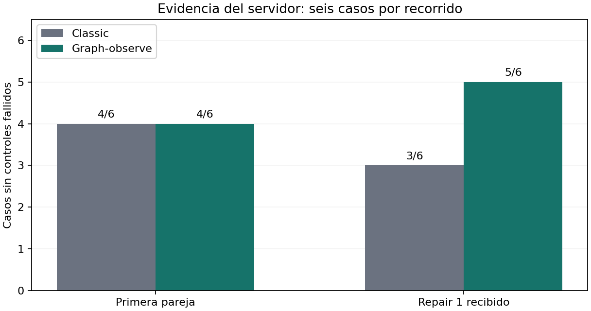

La figura compara las mismas seis situaciones, con controles internos adicionales en Repair 1; no representa una estimación estadística ni aprobación integral. El criterio para avanzar es cerrar fallos y revisar el diálogo, no solo elevar el número de citas. Primero se repite la misma pareja; después se revisa consistencia antes de decidir una ampliación.

| Consumo rastreado desde necesidades | Llamadas | Total USD por fila | Completitud |
|---|---:|---:|---|
| Importes informados antes de esta pareja | 1.141 | 1.57204545 | Parcial: falta un cargo histórico. |
| Pareja recibida `ba5c4c5` | 213 | 0.24476955 | Completo para esta pareja. |
| Pareja recibida `cb30201` | 208 | 0.22774095 | Completo para esta pareja. |
| LangGraph integrado `14dfa6f` | 126 | 0.11470965 | Completo para esta corrida. |
| Reparación integrada 1 `91e902a` | 132 | 0.12615315 | Completo para esta corrida. |
| Reparación integrada 2 `400593e` | 128 | 0.12411900 | Completo para esta corrida. |
| Reparación integrada 3 `94f72bc` | 133 | 0.12100455 | Completo para esta corrida. |
| **SUMA HISTÓRICA INFORMADA** | **2.081** | **2.53054230** | **Parcial; excluye además fases previas no detalladas aquí.** |
| Reparación y pruebas locales | 0 pagadas | 0.00000000 | Sin llamadas a OpenRouter. |

| Próxima repetición, todavía no ejecutada | Alcance | Total USD estimado por fila |
|---|---|---:|
| `classic` reparado | Los mismos seis casos, hasta diez turnos cada uno | 0.12–0.20 |
| `graph-observe` reparado | Los mismos seis casos, hasta diez turnos cada uno | 0.13–0.25 |
| **TOTAL ESTIMADO** | **12 conversaciones** | **0.25–0.45** |
| **Reserva sugerida, alternativa al estimado** | No se añade al total base | **0.60** |

Estimación propia a partir de la última pareja, no garantía de tarifa, éxito o consumo. El máximo de 300 llamadas por recorrido no es un límite en dólares. Se conserva el modelo publicado y el aislamiento; el candidato no se activa en leads reales al desplegar este ZIP. [Comandos de Git, servidor, docker cp y PowerShell](06-como-ejecutar-las-pruebas/ejecutar-observaciones-reparacion-2.sh).

## 10.11. Reparación del flujo integrado: cobertura, visitas y presentación

| Elemento | Qué se ajusta | Qué conserva |
|---|---|---|
| Interpretación de visita simple | Antes de compilar referencias, una petición literal de visitar una sola propiedad se conserva como solicitud de visita, no comparación ni OR inventado. Se prueban nombres y formas de pedirla distintos. | Confianza original, resolución por compañía/proyecto, nombres desconocidos y confirmación obligatoria posterior. No transforma selecciones en reservas. |
| Preguntas independientes | Se recuperan preguntas literales de financiamiento omitidas por el modelo; quedan como lectura obligatoria fuera del OR de materiales. El validador rechaza la omisión o su mezcla dentro de ese OR. | No convierte «tengo cash» en pregunta, no cambia una preferencia financiera y no concede financiamiento. El control literal tiene alcance acotado; no comprende por sí solo todas las formas de preguntar. |
| Observabilidad | La traza distingue cobertura de preguntas literales y cumplimiento de las tareas validadas. | Un `PASS` de herramientas no equivale a aprobación comercial completa. |
| Respuesta al lead | Descripción individual sin presentar una única propiedad como varias opciones; se omiten hechos ya incluidos sin depender del texto del encabezado; materiales sin etiquetas repetidas; zonas como «Chicago local time» en lugar del código IANA. | Precios y beneficios aprobados, fecha/hora exacta, zona interna y recibos anteriores. |
| Regresión y variantes | Se reproducen las interpretaciones grabadas de los seis casos y los dos fallos de visita; variantes y negativos protegen negaciones, terceros, hipótesis, mensajes mixtos, propietarios desconocidos y confirmaciones. | Mismo motor LangGraph, modelo publicado, datos de tres proyectos/seis propiedades y vendedores sintéticos. No hay llamadas pagadas locales. |

El endpoint `/health/sales-engine` puede requerir autenticación; los comandos comprueban las versiones dentro del contenedor sin pedir credenciales ni consumir el modelo.

**Validación de esta reparación:** 3,762 pruebas aprobadas, 11 omitidas y cero fallos en 150 módulos. Pasaron 63 controles de aceptación y ocho pruebas del particionado; uno de aceptación en vivo sigue pendiente. El módulo nuevo tiene 72 pruebas, incluidas 14 secuencias de replay y 58 variantes/negativos; forman parte de la regresión y no se suman otra vez. Se muestran seis ejemplos locales, 35 mensajes del lead y cinco citas en base temporal: proveedores de decisión y composición simulados, consumo pagado USD 0.00. [Validación local](05-resultados-y-mejoras/langgraph-reparacion-1-local/validacion-local.json).

**Ejemplos locales de la corrección, todavía sin nueva medición del modelo publicado.**

| Mensaje del lead | Interpretación y acción esperadas, reproducidas localmente |
|---|---|
| «Can I visit Cedar Studio?» | Solicitud de visita para Cedar Studio; consulta de disponibilidad y oferta de horas en «Chicago local time». No comparación con otra propiedad ni reserva automática. |
| «Could you send photos or a brochure and explain the financing options?» | Alternativa de materiales y consulta de financiamiento por separado. Comparte el folleto y responde «Cash; Bank financing», remitiendo condiciones detalladas a la visita presencial, sin convertir la pregunta en preferencia de pago. |

Las seis conversaciones locales completas y sus trazas están en [lectura de los diálogos](05-resultados-y-mejoras/langgraph-reparacion-1-local/conversaciones.md) y [JSON del replay](05-resultados-y-mejoras/langgraph-reparacion-1-local/conversaciones-locales.json). Se conserva como pendiente la revisión comercial de cierres con preguntas compuestas: aprobar estos controles no demuestra fluidez perfecta.

La próxima corrida repite únicamente LangGraph: seis casos, hasta diez turnos y 300 llamadas como tope de llamadas, sin LLM lead ni juez. **Estimación orientativa: USD 0.10–0.20 por corrida; total de una corrida USD 0.10–0.20**, sin garantía monetaria. El servidor permitirá comprobar si se recuperan la visita y la respuesta de financiamiento. No se amplía aún la batería ni se afirma éxito nuevo del modelo por los resultados locales. [Comandos completos de comprobación, evaluación y descarga](06-como-ejecutar-las-pruebas/ejecutar-langgraph-reparacion-1.sh). El saludo inicial y los recordatorios deterministas siguen siendo servicios del backend, no otro agente.

## 10.12. Folleto explícito sin repregunta: propietario, confianza y permisos

**Resultado recibido.** En `91e902a` hubo 351 controles PASS y uno FAIL; los seis casos llegaron a su objetivo de cita o indisponibilidad, pero uno pidió una confirmación innecesaria antes del folleto. La conversación «Please send the brochure for Cedar Studio» recibió «Would you like the brochure of Cedar Studio?». No se presenta esa cita posterior como aprobación del diálogo completo. [Conversación original legible](05-resultados-y-mejoras/langgraph-reparacion-1-servidor/conversaciones.md) · [Resultado JSON del servidor](05-resultados-y-mejoras/langgraph-reparacion-1-servidor/resultado.json).

| Parte | Qué se modifica | Qué permanece obligatorio |
|---|---|---|
| Propiedad y formato | El pedido literal se valida contra un único nombre aprobado; se conserva un solo vínculo al propietario, sin la referencia sustituida que lo confundía con un archivo. | No se adivinan propietarios desconocidos, nombres duplicados, unidades ni archivos con nombres coincidentes. |
| Baja confianza | Un pedido propio, explícito y único de folleto/PDF, fotos o planos para esa propiedad puede consultar materiales aunque el modelo devuelva cero. La confianza se conserva y se registra una autorización acotada de lectura. | Esto no autoriza citas ni comparte cualquier archivo: siguen vigentes aprobación, cobertura, canal, alcance y revalidación antes del envío. |
| Experimentos | Se reproducen las interpretaciones registradas de los seis guiones; se añaden variaciones de nombres y formatos, y controles negativos de negación, terceros y solicitudes mixtas. | Mismo LangGraph, modelo publicado y datos de laboratorio. El replay local usa proveedores simulados y no es una corrida adicional del servidor. |

**Validación de esta reparación:** 3,796 pruebas aprobadas en 151 módulos, 11 omitidas y cero fallos. Pasaron 63 controles de aceptación y ocho pruebas del particionado; una aceptación en vivo sigue pendiente. El módulo nuevo reúne 34 pruebas: 12 recorridos de replay y 22 variantes/negativos, incluidos dentro de la regresión. Los ejemplos locales son seis conversaciones, 35 mensajes del lead y cinco citas en base temporal; no son nuevas respuestas del modelo publicado ni consumo pagado. [Validación local](05-resultados-y-mejoras/langgraph-reparacion-2-local/validacion-local.json).

**Ejemplo reproducido localmente:** «Please send the brochure for Cedar Studio.» conserva `confidence=0`, queda asociado a una sola referencia de propiedad y recibe el enlace del folleto en ese mismo turno. Los otros cinco guiones mantienen sus controles. Estos ejemplos no son otra medición del modelo publicado. [Diálogos legibles del replay](05-resultados-y-mejoras/langgraph-reparacion-2-local/conversaciones.md) · [JSON local](05-resultados-y-mejoras/langgraph-reparacion-2-local/conversaciones-locales.json).

La siguiente ejecución repite los seis casos, hasta diez turnos y 300 llamadas. Estimación de consumo **USD 0.10–0.20 en total**, no un límite monetario garantizado. [Comando de evaluación y descarga](06-como-ejecutar-las-pruebas/ejecutar-langgraph-reparacion-2.sh).

## 10.13. Cambio de preferencia y consultas combinadas · reparación integrada 3

**Resultado recibido del servidor.** `sales-graph-repair-2.zip`, commit `400593e`: **347 controles PASS y cinco FAIL**, concentrados en dos turnos. Cuatro de seis conversaciones cumplen todos sus controles; las cinco citas previstas se registran. Consumo completo: **128 llamadas, 967.248 tokens de entrada, 13.661 de salida; total USD 0.12411900**. Se utilizó `openai/gpt-4o-mini`, configuración 8, con 35 mensajes guionados del lead. Los 35 turnos recorren el motor LangGraph integrado. [Diálogos legibles del servidor](05-resultados-y-mejoras/langgraph-reparacion-2-servidor/conversaciones.md) · [JSON original](05-resultados-y-mejoras/langgraph-reparacion-2-servidor/resultado.json).

| Mensaje | Lo ocurrido | Qué se ajusta y cómo |
|---|---|---|
| Actually I prefer Cedar Studio instead. | El modelo inventó visita y comparación; se rechazaron los dos intentos antes de guardar el cambio. | Una declaración propia completa de preferencia se conserva como selección comercial de propiedad. El nombre pasa por resolución del catálogo de la empresa; no cambia ninguna cita. |
| Could you send photos or a brochure and explain the financing options? | Se respondió financiamiento, pero la confianza cero activó una aclaración genérica y omitió materiales. | La petición literal permite lecturas acotadas si existe una propiedad activa resuelta: fotos **o** folleto, **además** financiamiento. No eleva confianza ni concede permisos de visita. |
| Please send the brochure for Cedar Studio. | Se entregó directamente el folleto. | Se conserva la reparación anterior. En esta corrida la confianza fue alta; no es nueva evidencia del caso de confianza cero. |

**Diseño del ajuste.** Se reproducen las seis conversaciones con interpretaciones registradas y proveedores simulados; se añaden otros nombres, formas de elegir y variantes de solicitudes combinadas. Negaciones, atribuciones a terceros, hipótesis, varios propietarios, solicitudes de agendar y ausencia de propietario activo quedan fuera del permiso literal. La confianza original permanece en la traza. Los horarios, selección, aprobación de material y confirmación final siguen validados por el backend.

**Validación técnica final:** 3,861 pruebas aprobadas, 11 omitidas y cero fallos pendientes, cubriendo 152 módulos. Se conserva la evidencia original y la repetición completa del módulo nuevo tras corregir dos fixtures de prueba. Los 63 controles de aceptación local pasaron; una aceptación en vivo sigue pendiente. No son resultados del modelo publicado. [Validación y procedencia](05-resultados-y-mejoras/langgraph-reparacion-3-local/validacion-local.json).

**Replay local:** los seis recorridos superan sus controles, con 35 mensajes del lead y cinco citas en base desechable. El módulo específico suma 65 pruebas, incluidas variantes y negativos. [Conversaciones locales legibles](05-resultados-y-mejoras/langgraph-reparacion-3-local/conversaciones.md) · [JSON local](05-resultados-y-mejoras/langgraph-reparacion-3-local/conversaciones-locales.json).

**Límites.** Un replay aprobado no es un resultado nuevo del modelo. No verifica transporte WhatsApp/SMS, Calendar externo ni concurrencia de PostgreSQL. La batería tampoco acredita todos los segmentos ni una calidad comercial integral. No se amplía todavía el espectro: primero se repiten estos seis casos tras desplegar. Estimación de consumo de la siguiente corrida: **USD 0.10–0.20 total**, sin garantía de tope monetario. [Comandos de despliegue, evaluación y descarga](06-como-ejecutar-las-pruebas/entrega-langgraph-reparacion-3.md).

## 10.14. Primer 6/6 del motor integrado reparado y comprobación de estabilidad

**Qué se midió.** `sales-graph-repair-3.zip`, commit `94f72bc`, `openai/gpt-4o-mini`, configuración publicada 8. Los 35 mensajes recorrieron `sales-langgraph/2.0`: seis conversaciones superaron sus controles, se crearon cinco citas en base temporal y el caso sin vendedor terminó sin reservar. No hubo errores finales de ejecución. El ciclo registró 53 decisiones y 28 rondas de lectura. Consumo completo de 133/133 llamadas: **962.969 tokens de entrada, 13.924 de salida, USD 0.12100455 total**. [Conversaciones del servidor, legibles](05-resultados-y-mejoras/langgraph-reparacion-3-servidor/conversaciones.md) · [JSON original](05-resultados-y-mejoras/langgraph-reparacion-3-servidor/resultado.json).

| Flujo | Resultado observado | Límite de esta evidencia |
|---|---|---|
| Cambio de propiedad | La preferencia por Cedar Studio produce sus detalles; el folleto y la cita corresponden a ella. | No equivale a cambiar una cita existente. |
| Materiales y financiamiento | Se entrega el folleto y se responde la consulta financiera en el mismo turno. | Esta vez la confianza del modelo fue alta; la confianza cero solo tiene replay local en este patrón. |
| Material alternativo | Se ofrece el folleto sin asegurar que incluya fotos y se entrega después de aceptarlo. | No se inspecciona visualmente su contenido. |
| Interrumpir la agenda | Se entregan fotos y se vuelve a agendar al pedirlo explícitamente. | No acredita retoma espontánea: el guion repite la petición de visita. |
| Horario de visita | Se ofrecen mañanas en la zona de la propiedad, con selección y confirmación antes de reservar. | Calendar externo y concurrencia PostgreSQL no se ejercitan. |
| Sin vendedor | Se informa indisponibilidad y se ofrece guardar interés. | No se crea una alerta sin consentimiento ni se prueba su entrega futura. |

**Qué todavía requiere afinamiento.** Se registraron **15 intentos de interpretación inválidos**, recuperados con reintentos, y 35 interpretaciones finalmente aceptadas. No son 15 conversaciones fallidas: son errores intermedios que agregan trabajo y variabilidad. Tiempo medio registrado: **9,3 segundos por mensaje del lead**, no latencia de entrega por WhatsApp. La redacción aún repite características, utiliza encabezados mecánicos como “Verified visit options” y muestra `America/Denver` al no encontrar horarios. Estos puntos no están suficientemente penalizados por los controles funcionales actuales.

**Experimento inmediato: repetir sin ajustar.** Se conserva la misma batería de seis guiones, catálogo, modelo y configuración; dos ejecuciones consecutivas y separadas, con nuevas bases temporales. Se mantiene fijo el contenedor durante ambas y se registran resultados aunque una falle. Las fechas disponibles dependen del reloj del laboratorio: por eso se conserva catálogo y plan de cada ejecución y no se presenta como comparación causal controlada. No se cambia entre corridas ni el prompt ni la redacción. Un nuevo fallo se diagnostica por turno y traza antes de ampliar segmentos.

| Ejecución | Estado | Conversaciones / mensajes previstos | Consumo total USD por fila |
|---|---|---:|---:|
| Base `94f72bc` | Ejecutada; 6/6 controles de conversación | 6 / 35 | 0.12100455 real |
| Repetición 1 | Pendiente | 6 / aproximadamente 35 | 0.12–0.20 estimado |
| Repetición 2 | Pendiente | 6 / aproximadamente 35 | 0.12–0.20 estimado |
| **TOTAL NUEVO POR EJECUTAR** | **Pendiente** | **12 / aproximadamente 70** | **0.24–0.40 estimado** |
| **BASE + DOS REPETICIONES** | **Un resultado real y dos estimados** | **18 / aproximadamente 105** | **0.36100455–0.52100455 mixto** |

El estimado se apoya en la última corrida, no es un límite de facturación. Cada ejecución limita 300 llamadas y diez mensajes por conversación; esos límites no equivalen a dólares. Si ambas repeticiones mantienen todos los controles, habrá **tres ejecuciones consecutivas favorables de esta batería**, sin que ello demuestre generalización a todos los leads. Entonces se propondrá ampliar las variantes y mejorar los criterios comerciales. [Comandos de servidor y descarga](06-como-ejecutar-las-pruebas/estabilidad-langgraph.md) · [Script Bash](06-como-ejecutar-las-pruebas/ejecutar-estabilidad-langgraph.sh).

## 11. Trabajo futuro

**Más casos y conversaciones más largas, no nuevas funciones de canal.** Se avanza por etapas, corrigiendo y repitiendo antes de ampliar. Se incluyen compradores que rechazan o abandonan: no toda conversación correcta termina con cita [R4–R6].

| Etapa propuesta | Conversaciones × turnos de lead | Beneficio / criterio de avance | Costo total estimado de la etapa (USD) | Reserva total 2× (USD) |
|---|---|---|---|---|
| Batería base | 16 × 6–8 | Cubrir los 16 escenarios sin checks obligatorios fallidos. | 0.346–0.461 | 0.692–0.922 |
| Variantes | 32 × 8–12 | Dos variantes por escenario: negación, pronombres y consultas múltiples. | 0.923–1.384 | 1.846–2.768 |
| Diálogos largos | 16 × 12–16 | Retomar temas y cambiar datos sin olvidar preferencias ni entrar en bucles. | 0.692–0.923 | 1.384–1.846 |
| Consistencia | 48 × 8–12 | 16 escenarios repetidos tres veces; revelar inestabilidad. | 1.384–2.076 | 2.768–4.152 |
| **TOTAL DE LAS CUATRO ETAPAS** | **112 conversaciones** | **Una ejecución de cada etapa; solo planificación.** | **3.345–4.844** | **6.690–9.688** |

**Totales futuros:** se muestran tres decimales orientativos; se sumaron los importes mostrados por fila; la reserva es una alternativa de presupuesto y **no se añade al estimado base**. Tampoco se suman estos USD al histórico ya ejecutado.

**Cálculo y límites.** Estas ampliaciones se recalculan con LangGraph integrado `91e902a`: 35 turnos, 132 llamadas, 991.738 tokens y USD 0.12615315 completos: ≈3.77 llamadas y USD 0.003604 por turno. Se extrapola linealmente manteniendo guiones, sin juez y con el mismo modelo. La reserva 2× es planificación, no intervalo estadístico ni garantía: historia más larga, precios/proveedor o reparaciones pueden superarla. Límites de llamadas no son límites en dólares. [Tokens, llamadas y supuestos por etapa](05-resultados-y-mejoras/propuesta-ampliacion.json).

**Cuánto invertir.** No se encontró un promedio comparable de inversión total para este producto. Como escala histórica, τ-bench reportó USD 0,38 de GPT-4o agente + USD 0,23 de GPT-4 usuario por tarea en 2024: escalar ese ejemplo a 100–500 tareas da USD 61–305 por repetición, sin trabajo humano ([§5.1](https://arxiv.org/html/2406.12045v1#S5.SS1)). No es un precio actual de OpenRouter ni una norma del sector. Nuestro uso de guiones y `gpt-4o-mini` tiene otra escala. Se propone una bolsa inicial propia de USD 5 para primeras ampliaciones o USD 10 si incluye largos/repeticiones, revisada por bloques; no garantiza estabilización ni cubre horas de ingeniería/revisión.


Antes de ejecutar la ampliación hay que preparar sus guiones y checks: los 32 casos y los diálogos largos no están incorporados todavía como nueva batería. Las tres repeticiones serán corridas separadas. Se actualiza el costo observado después de cada bloque, sin sumar estimaciones al histórico.
