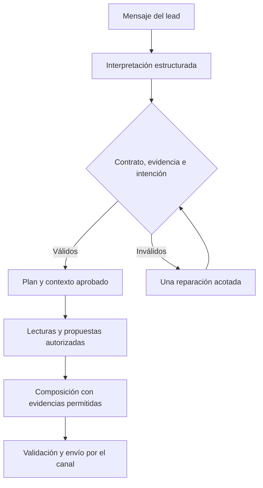
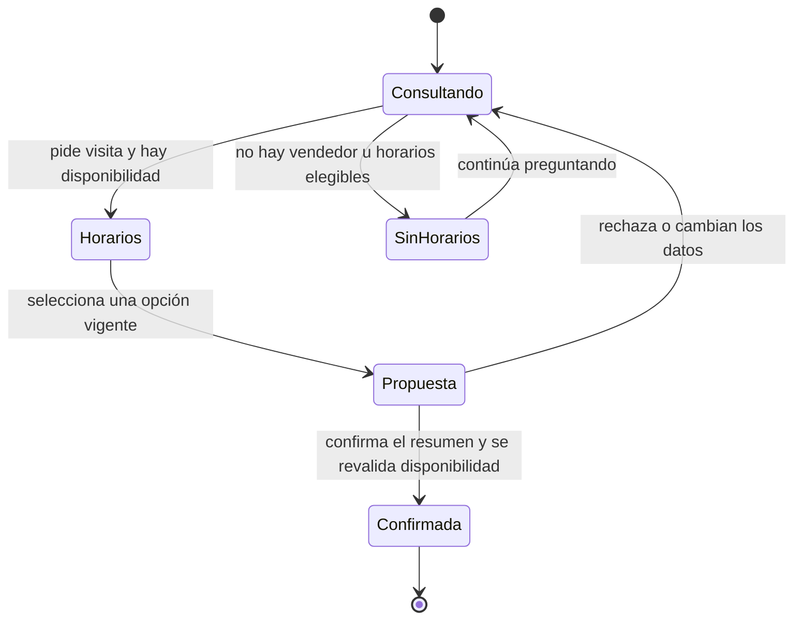
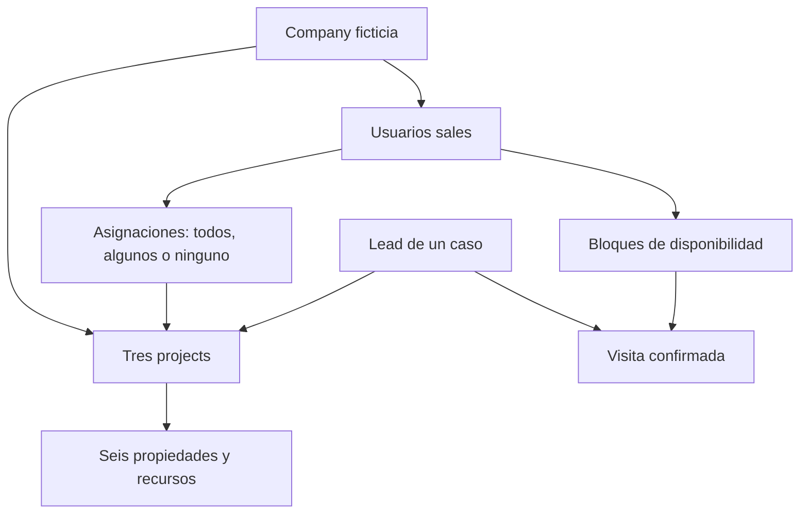
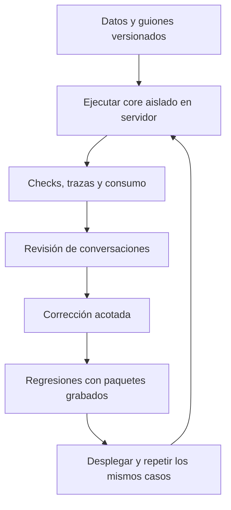
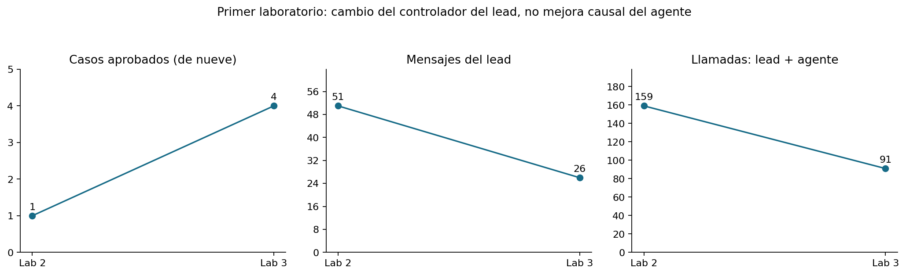
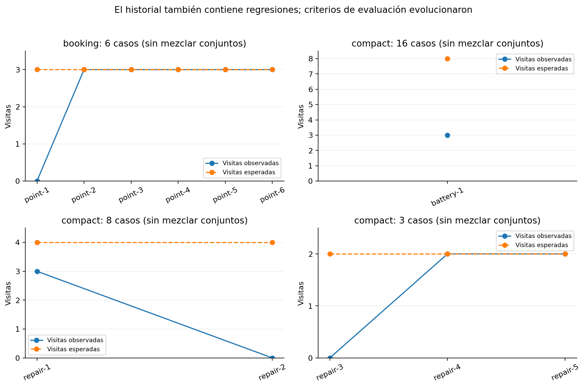
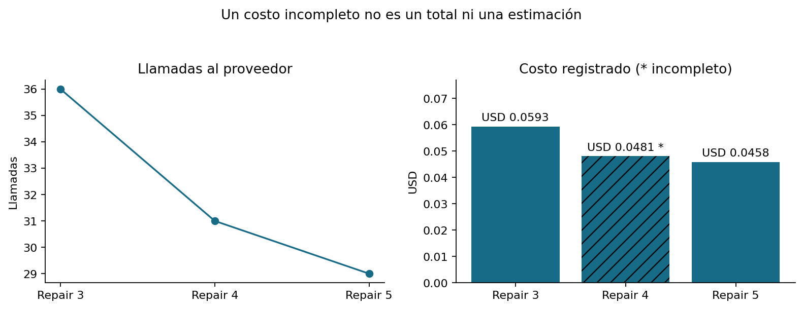

# Agente de ventas IA: flujo, datos sintéticos, experimentos y evolución

[Volver al README principal del repositorio](../../README.md)

Este es el documento principal y autocontenido del afinamiento del Sales Agent. Explica el recorrido completo, cómo se creó y utilizó la data sintética, qué conversaciones se ejecutaron, qué se corrigió y cómo cambiaron las métricas. Las carpetas enlazadas guardan los archivos completos y material técnico adicional; no es necesario abrir otros README para entender el trabajo.

**Corte de evidencia: 11 de noviembre de 2026.** Última corrida recibida: **Repair 5**, commit `4fb17071b617cc430698885fafdde8d209f1d562`, modelo `openai/gpt-4o-mini`, configuración publicada 8. Se conserva el resultado original **FAIL**: dos de tres conversaciones aprobadas, dos de dos visitas confirmadas en laboratorio y un cambio de propiedad con fotos todavía fallido. Esta entrega consolida documentación y analiza esa evidencia; **no modifica el motor ni corrige aún el fallo pendiente**.

## Contenido

1. [Objetivo y flujo actual](#objetivo-y-flujo-actual)
2. [Desde el inicio de la data sintética](#desde-el-inicio-de-la-data-sintética)
3. [Empresa, proyectos, propiedades, leads y vendedores](#datos-sintéticos-y-su-organización)
4. [Diseño de experimentos e iteración](#diseño-de-experimentos-e-iteración)
5. [Conversaciones reales del laboratorio](#conversaciones-ejecutadas-en-el-servidor)
6. [Hallazgos de Repair 5 y siguiente trabajo](#hallazgos-de-repair-5-y-siguiente-trabajo)
7. [Reproducir y mantener la evidencia](#reproducir-y-mantener-la-evidencia)
8. [Métricas y evolución histórica](#métricas-y-evolución-histórica)

## Objetivo y flujo actual

El agente informa sobre el conocimiento aprobado, resuelve dudas y anima al lead a conocer presencialmente la propiedad. La venta la cierra el personal humano durante/después de la visita. El chat no cobra, no separa inmuebles y no aprueba créditos. “Tengo cash” significa capacidad/intención de comprar de contado, sin necesidad de financiación; no prueba dinero físico ni fondos verificados.

El nuevo flujo ya es el flujo actual para todos los scopes: el selector de compatibilidad `next_flow.selected` devuelve `True`. Los flags históricos no eligen otro motor. Esto no elimina permisos, requisitos de aprobación del project ni controles de disponibilidad. La etiqueta registrada del recorrido es `sales-current/1.0`.

El canal real recibe WhatsApp/SMS por el proveedor; el laboratorio sustituye únicamente ese transporte por una entrada directa al mismo core. El mensaje pertenece siempre a una company, project, lead y conversación. La autorización y continuidad se revalidan antes de efectos.



El diagrama muestra el recorrido lógico; la reparación tiene límite de un intento y no repite indefinidamente. Un fallo agotado se registra y usa el recorrido de respuesta segura, sin narrar problemas internos al lead.

1. **Interpretar:** el modelo devuelve solicitudes, preferencias, restricciones y evidencia literal del mensaje actual. No recibe autoridad para escribir datos o inventar IDs.
2. **Validar:** estructura, citas textuales, intención y sujeto deben ser coherentes. Copiar una frase no prueba que esa frase autorice una visita. Información histórica no se convierte en consentimiento nuevo.
3. **Conservar datos independientes:** presupuesto, moneda, pago de contado y motivación propia verificables se conservan sin inferir fondos disponibles o aprobación crediticia. “Cash” significa compra sin financiación, no billetes físicos ni pago dentro del chat.
4. **Consultar y planificar:** catálogo publicado, precios, disponibilidad, documentos y asignaciones se resuelven dentro del tenant y project. Desconocido no significa cero; un material no publicado no se inventa.
5. **Responder:** el compositor elige IDs y variantes de bloques redactados con evidencia del backend. No escribe hechos libres, enlaces arbitrarios ni promesas. Se validan bloques obligatorios, orden, agrupación y continuación.
6. **Ejecutar:** compartir recursos y agendar requieren autorización del backend. La continuidad evita que un turno antiguo actúe después de una intervención humana.

### Agendar una visita



**Solicitar** busca disponibilidad; **seleccionar** prepara un resumen con propiedad, fecha, timezone, vendedor, duración y dirección; **confirmar** crea la cita tras otra validación. Un ordinal de propiedad no equivale a elegir un horario. La recuperación añadida usa la opción pública completa que acaba de mostrarse, no IDs privados generados por el modelo.

Si no hay disponibilidad, se explica que no hay horarios y que podrá comunicarse disponibilidad futura, sin afirmar que se creó una alerta o que alguien ya fue notificado. Automatizar ese aviso sigue fuera de este experimento. Cancelar y reagendar no forman parte de esta batería, aunque existen recorridos y regresiones técnicas relacionados en el repositorio.

### Reglas comerciales y de cierre

| Situación | Comportamiento esperado |
|---|---|
| Presupuesto suficiente / contado | Informar y conservar la preferencia; no ofrecer crédito de forma repetitiva. |
| Presupuesto inferior | Mostrar alternativa del mismo alcance si existe, o financiación publicada sin prometer aprobación ni cambiar el precio. |
| Inicial conocida pero presupuesto total desconocido | Conservar la inicial; no tratarla como presupuesto total. |
| Financiación detallada | Solo condiciones publicadas; aclaraciones específicas durante visita. |
| Reserva o pago en chat | Aclarar que no se puede cobrar ni separar; sí coordinar visita. |
| Rechaza visita | Permitir otras consultas; si no hay más, despedirse sin presión. |
| Pide humano | Ofrecer responder su consulta; ante insistencia registrar la petición sin prometer una transferencia inmediata. |
| Despedida / retoma | Cerrar amablemente y permitir nuevas preguntas; no inventar frustración. |

Estas reglas se apoyan en información aprobada. No se cruzan compañías, no se inventan retornos de inversión y no se trata la intención del comprador como una operación financiera.

## Desde el inicio de la data sintética

### Por qué se creó el laboratorio

Las pruebas manuales por WhatsApp mostraron respuestas de respaldo, pérdida de preferencias, mensajes que explicaban procesos internos y diálogos poco comerciales. Se separaron dos problemas: la calidad del motor y los fallos del canal/proveedor. Antes de medir el diálogo había que corregir bloqueos de esquema/HTTP y registrar reglas de validación concretas, no únicamente hashes o nombres genéricos de excepción.

El laboratorio se diseñó para ejercitar **el mismo core del agente**, usando contexto aprobado y servicios reales de lectura, recursos y persistencia contra una base SQLite desechable. No es otro agente simplificado. La preparación de fixtures sin inferencia no es un resultado de calidad. No hay un ZIP de ejecución “lab 1” disponible en esta evidencia: la primera corrida cuantificable conservada aquí es `sales-synthetic-lab-2.zip`. No se inventa una medición anterior.

### Primera etapa: lead LLM adaptativo

Se creó una company ficticia con tres projects y seis propiedades, galerías/PDFs legibles y hechos aprobados. Se probaron tres conversaciones por project: **nueve casos**, hasta seis mensajes de lead por caso. Tanto el agente como el lead utilizaron `openai/gpt-4o-mini` en las dos primeras corridas conservadas. El juez LLM estaba desactivado.

| Perfil inicial | Qué buscaba | Qué no debía hacer |
|---|---|---|
| `new_buyer` | Tipos/precios, dormitorios/área de una propiedad y presupuesto si se lo preguntaban | Cambiar a investigación de barrio o repetir lo ya respondido |
| `targeted_materials` | Fotos y PDF de una propiedad concreta, luego parking | Aceptar otra propiedad o pedir sustitutos no deseados |
| `continuity` | Precio/disponibilidad, declarar contado y después cambiar explícitamente a financiación junto con una pregunta | Repetir indefinidamente la declaración o adoptar el rol del vendedor |

El lead veía su perfil/objetivos y la conversación pública, no el catálogo verdadero, las respuestas esperadas, los IDs privados ni las trazas internas. [Perfiles iniciales y objetivos en JSON](02-datos-de-prueba/leads/perfiles-iniciales-adaptativos.json) · [JSON de las primeras conversaciones](04-conversaciones/) · [Diseño técnico original](synthetic-company-laboratory.md).

Se observó que el propio simulador podía repetir preguntas, desviarse del objetivo o generar mensajes con papel de vendedor. En la segunda corrida conservada (`lab 3`) se cambió **el controlador del lead**, sin cambiar en esa entrega el motor de ventas: el backend pasó a decidir avance y terminación, con dos intentos máximos por objetivo, rechazo de repeticiones/desvíos/rol y mensajes de respaldo observables. Una declaración de “terminé” del LLM dejó de ser suficiente para aprobar.

En Lab 3 terminaron los nueve controladores; solo cuatro casos tuvieron resolución percibida de todos sus objetivos. Se registraron cinco objetivos no resueltos, cinco borradores repetidos rechazados y trece mensajes de respaldo. **Que el controlador termine no significa que el agente haya vendido bien.** Esa percepción tampoco sustituye las verificaciones de hechos/recursos. [Métricas de esa etapa](05-resultados-y-mejoras/sales-synthetic-lab-3/resultado.json) · [Controlador v2](lead-controller-v2.md).

### Segunda etapa: guiones para ahorrar y atribuir los cambios

Por costo y necesidad de iterar se pasó a leads guionados, sin otro modelo ni juez LLM. Se mantuvo el modelo publicado del agente. El comprador simulado expresa objetivos concretos y solo usa la respuesta pública para elegir horarios y confirmar. Primero se trabajaron bloques puntuales de agendamiento, luego políticas comerciales y cierres/retoma, y finalmente una batería compacta de ocho perfiles por dos variantes.

Esto hizo más barato repetir exactamente el mismo estímulo después de una corrección. No prueba que el agente comprenda cualquier paráfrasis: por eso se guardan paquetes reales de interpretación, se añaden variantes y se hace revisión humana del diálogo. Las métricas finales de este documento separan esta etapa de la etapa con lead LLM.

### Registro de hitos y retrocesos

| Etapa | Qué se intentó mejorar y qué se aprendió |
|---|---|
| Preparación sintética | Fichas publicadas, recursos legibles y aislamiento; preparar datos no mide calidad. |
| Lab 2–3 adaptativo | Separamos fallos del vendedor y del comprador simulado; acotamos objetivos y repeticiones. |
| Booking point 1–6 | Persistencia de presupuesto/contado, evidencia y selección/resumen/confirmación; se obtuvieron citas, pero hubo fallos de diálogo y checks bloqueados. |
| Commercial point 1–2 | Contado versus crédito, inicial versus presupuesto total, alternativas asequibles y límites de pago/reserva. Se detectó que un PASS antiguo podía incluir frustración inventada y financiación repetida. |
| Closing point 1 | Rechazo de visita, petición humana insistente, despedida y retoma en la misma corrida. |
| Compact battery 1 | Los 16 casos descubrieron errores no visibles en pruebas puntuales. |
| Repair 1–2 | Contrato y reparación de interpretación; hubo regresión de tres a cero visitas entre estas dos corridas y siete TypeError sin traza conservada en Repair 2. |
| Repair 3 | Trazas supervivientes al rollback y datos literales independientes. Aparecieron comparaciones inventadas y selecciones que no avanzaban. No reapareció TypeError en esa selección, sin demostrar su eliminación universal. |
| Repair 4 | Se completaron dos visitas, se entregó PDF y se respetó rechazo; quedó composición/orden y catálogo amplio. |
| Repair 5 | Se mantuvieron las dos visitas; mejoró la primera respuesta de propiedad. Se detectó un falso positivo del evaluador y un fallo real al cambiar a Cedar Loft y pedir sus fotos. |

## Datos sintéticos y su organización

El laboratorio actual contiene **una company, tres projects y seis tipos de propiedad**. No hay varias empresas sintéticas en esta fixture. El aislamiento entre compañías también cuenta con pruebas técnicas separadas, pero esta batería no demuestra por sí sola una matriz multicompañía.

| Conjunto | JSON completo |
|---|---|
| Empresa | [Empresa](02-datos-de-prueba/empresa-y-proyectos/empresa.json) |
| Projects | [Proyectos](02-datos-de-prueba/empresa-y-proyectos/proyectos.json) |
| Propiedades e inventario | [Propiedades](02-datos-de-prueba/empresa-y-proyectos/propiedades.json) |
| Galerías y PDFs | [Recursos](02-datos-de-prueba/empresa-y-proyectos/galerias-y-documentos.json) |
| Leads | [Perfiles](02-datos-de-prueba/leads/perfiles-de-leads.json) |
| Usuarios sales | [Vendedores](02-datos-de-prueba/vendedores-y-horarios/vendedores.json) |
| Alcance de cada vendedor | [Asignaciones](02-datos-de-prueba/vendedores-y-horarios/asignaciones-a-proyectos.json) |
| Horarios | [Disponibilidad](02-datos-de-prueba/vendedores-y-horarios/horarios-disponibles.json) |



### Empresa y proyectos

Empresa: **SYNTHETIC - Penguin Sales Laboratory**, país US, timezone corporativo UTC. Los proyectos tienen timezones propios. Sus fichas están aprobadas para aislar la calidad del diálogo de problemas del onboarding. Dirección, recursos y datos son ficticios.

| Project | Zona horaria | Dirección |
|---|---|---|
| SYNTHETIC Harbor Gardens | `America/New_York` | 1 Synthetic Avenue |
| SYNTHETIC Cedar Heights | `America/Chicago` | 2 Synthetic Avenue |
| SYNTHETIC Sierra Commons | `America/Denver` | 3 Synthetic Avenue |

Todos publican pago de contado y financiación bancaria, entrega diciembre de 2027 y amenidades de prueba. No se publican tasa, porcentaje de inicial, elegibilidad ni retornos garantizados.

| Propiedad | Dormitorios / baños | Área | Precio USD | Disponibles | Galería | PDF |
|---|---|---|---|---|---|---|
| Bay Residence | 4 / 3 | 240 m² | 780000 | 3 | Sí | Sí |
| Cedar Loft | 2 / 2 | 110 m² | 325000 | 5 | Sí | No |
| Cedar Studio | 1 / 1 | 52 m² | 210000 | 2 | No | Sí |
| Ridge Townhome | 3 / 2.5 | 165 m² | 460000 | 4 | No | No |
| Summit Villa | 4 / 3 | 220 m² | 620000 | 0 | Sí | Sí |
| Valley Apartment | 2 / 2 | 95 m² | Desconocido | Desconocido | No | No |

Los PDFs son archivos legibles generados para pruebas. Las galerías contienen ilustraciones sintéticas, no fotografías de inmuebles reales. Un PDF no prueba que existan fotos o planos: sus etiquetas de cobertura importan. Los enlaces exportados solo tienen sentido dentro del laboratorio; no son URLs públicas operativas de producción.

### Leads guionados: siete segmentos y uno desconocido

| Persona | Segmento | Presupuesto base USD |
|---|---|---|
| Emma Torres | `first_time_buyer` | 300000 |
| Daniel Brooks | `move_up_buyer` | 900000 |
| Sofia Reed | `relocation` | 900000 |
| Martin Vega | `downsizing` | 300000 |
| Lucas Chen | `rental_yield_investor` | 500000 |
| Valeria Cruz | `appreciation_resale_investor` | 900000 |
| Adrian Park | `portfolio_diversification` | 400000 |
| Alex Rivera | `sin segmento` | 500000 |

Los guiones A/B pueden cambiar el presupuesto o las condiciones respecto del perfil base: el valor exacto está en cada caso. No se fijaron edades ni ocupaciones; aparecen como `null`, no como hechos inventados. El segmento se deriva de la motivación expresada por el comprador, nunca de edad, ocupación o riqueza. No hay un LLM de lead: los mensajes iniciales y decisiones se guionan; el controlador solo lee opciones públicas del agente para seleccionar y confirmar.

### Vendedores y horarios

[Ver la matriz legible de los 80 vendedores y sus proyectos](02-datos-de-prueba/vendedores-y-horarios/README.md)

La batería define **cinco usuarios por escenario**, 80 identidades sintéticas para 16 escenarios. No son 80 vendedores disponibles simultáneamente: antes de cada caso se reconstruyen las asignaciones y slots activos. Todos pertenecen a la misma company. IDs, emails `.invalid` y nombre real de fixture están en los JSON; las cuentas no sirven para iniciar sesión. No se exportan contraseñas ni credenciales.

| Rol del escenario | Alcance y elegibilidad |
|---|---|
| `candidate` | Candidato del project; todos, uno, dos projects o ninguno según el caso. Puede carecer de slots. |
| `other_project` | Tiene horarios, pero está asignado a otro project. |
| `none` | Ningún project asignado, aunque tenga horarios. |
| `inactive` | Asignado, pero usuario inactivo. |
| `no_appointments` | Asignado, pero no acepta citas. |

La disponibilidad documental usa un reloj fijo `2026-11-11T06:34:00` UTC: bloques 15:00–18:00 UTC a +2, +3 y +4 días para quienes tengan slots. Las corridas reales generan esos días desde su propio reloj; no son horarios permanentes ni promesas comerciales. Las visitas de prueba duran 45 minutos. Los JSON de asignaciones indican `scenario`, `user_id`, `company_id`, `access_scope`, `project_ids` y `target_project_id`.

El snapshot se genera desde las funciones reales `seed` y `team`, en SQLite desechable. El script de regeneración está en la sección técnica.

### Ejemplo de empresa, project y propiedad

Estos son campos reales del snapshot documental; `null` conserva un desconocido, no equivale a cero. Los recursos pertenecen a la propiedad y al project del mismo snapshot.

```json
{
  "company": {
    "id": "f0ebe3a5-6c04-5b8e-8cd8-423859aa39d7",
    "name": "SYNTHETIC - Penguin Sales Laboratory",
    "country": "US",
    "timezone": "UTC",
    "fictional": true
  },
  "project": {
    "id": "abf88941-5a70-5a06-a1ed-bca5b42bb90a",
    "company_id": "f0ebe3a5-6c04-5b8e-8cd8-423859aa39d7",
    "name": "SYNTHETIC Cedar Heights",
    "timezone": "America/Chicago",
    "address": "2 Synthetic Avenue",
    "payment_methods": [
      "Cash",
      "Bank financing"
    ]
  },
  "property": {
    "id": "bb1d7fba-2496-5256-a405-535cd3455066",
    "project_id": "abf88941-5a70-5a06-a1ed-bca5b42bb90a",
    "name": "Cedar Studio",
    "facts": {
      "key": "studio",
      "name": "Cedar Studio",
      "bedrooms": 1,
      "bathrooms": 1,
      "area": 52,
      "price": 210000,
      "available": 2,
      "gallery": false,
      "pdf": true,
      "features": [
        "Shared rooftop terrace"
      ]
    },
    "area_unit": "m²",
    "currency": "USD"
  }
}
```

### Ejemplo de lead y de guion

El perfil base no se introduce como segmento ya asignado en el Lead de la base: se verifica que la declaración propia lo permita inferir. La variante puede cambiar presupuesto u objetivos sin cambiar arbitrariamente otros hechos.

```json
{
  "key": "first_time",
  "name": "Emma Torres",
  "segment": "first_time_buyer",
  "motive": "I am buying my first home.",
  "budget": 300000,
  "age": null,
  "occupation": null,
  "note": "Age and occupation are not defined or used to infer a segment."
}
```
```json
{
  "goal": "booked",
  "access": "single",
  "budget": 300000,
  "cash": true,
  "material": "pdf",
  "phases": [
    [
      "information",
      "I am buying my first home. My budget is 300,000 USD, paying cash. What can you tell me about Cedar Studio?"
    ],
    [
      "material",
      "Please send the brochure PDF for Cedar Studio."
    ],
    [
      "request_visit",
      "I would like to arrange an in-person visit to Cedar Studio. Any available time in the next seven days works for me. Please use the project timezone."
    ]
  ]
}
```

[Todos los perfiles actuales](02-datos-de-prueba/leads/) · [Guiones completos](03-casos-de-prueba/casos-guionados.json)

### Ejemplo de asignación de vendedor

```json
{
  "sales_user": {
    "id": "919e8ff1-50c2-540e-92e0-dac4c05356fb",
    "company_id": "f0ebe3a5-6c04-5b8e-8cd8-423859aa39d7",
    "role": "candidate",
    "active": true,
    "accepts_appointments": true,
    "has_slots": true,
    "scenario": "first_time_A",
    "user_role": "sales",
    "name": "Synthetic candidate",
    "email": "first_time_A-candidate@compact.synthetic.invalid",
    "login_enabled": false
  },
  "assignment": {
    "scenario": "first_time_A",
    "user_id": "919e8ff1-50c2-540e-92e0-dac4c05356fb",
    "company_id": "f0ebe3a5-6c04-5b8e-8cd8-423859aa39d7",
    "access_scope": "selected",
    "project_ids": [
      "abf88941-5a70-5a06-a1ed-bca5b42bb90a"
    ],
    "target_project_id": "abf88941-5a70-5a06-a1ed-bca5b42bb90a"
  },
  "availability_block": {
    "scenario": "first_time_A",
    "user_id": "919e8ff1-50c2-540e-92e0-dac4c05356fb",
    "starts_at_utc": "2026-11-13 15:00:00",
    "ends_at_utc": "2026-11-13 18:00:00",
    "timezone": "UTC"
  }
}
```

El vendedor de ejemplo pertenece a la única company ficticia y al project Cedar Heights. En otros escenarios el candidato está habilitado para todos, para dos, para uno o para ninguno. Tener horarios no compensa una asignación incorrecta. [Matriz legible por escenario de todos los vendedores](02-datos-de-prueba/vendedores-y-horarios/README.md) · [Carpeta de JSON](02-datos-de-prueba/vendedores-y-horarios/).

## Diseño de experimentos e iteración

[Ver los 16 guiones completos en JSON](03-casos-de-prueba/casos-guionados.json)

Hay ocho perfiles (siete segmentos y uno sin segmento), con dos variantes por perfil: **16 conversaciones independientes**. No se asigna anticipadamente el segmento al Lead de prueba; se comprueba después de interpretar su declaración. Los objetivos esperados no se pasan al modelo ni al controlador como hechos del cliente.

| Perfil | Variante A | Variante B |
|---|---|---|
| Primera compra | Información, PDF y visita | Inicial versus presupuesto total, financiación, PDF y rechazo |
| Cambio a vivienda mayor | Información, galería y visita | Elegir otra propiedad, fotos, rechazo y despedida |
| Reubicación | Ubicación, entrega y visita | Vendedor con horarios pero sin asignación al project |
| Vivienda menor | Información, PDF y visita | Material faltante y otra propiedad agotada |
| Inversión para alquiler | Información y visita | Retorno no publicado e inventario/precio desconocidos |
| Revalorización y reventa | Información y visita | Presupuesto inferior, financiación y rechazo de pago/reserva |
| Diversificación | Comparación, galería y otro slot | Comparación y ausencia de slots |
| Sin segmento | Información y visita | Petición humana insistente y cierre |

### Cómo ahorramos tokens

Solo el agente de ventas usa el modelo publicado. El lead y el juez no consumen llamadas LLM. Los guiones contienen intenciones y decisiones de un comprador; el controlador de disponibilidad observa la respuesta pública y nunca lee IDs privados de slots, la lista de vendedores o el resultado esperado. Se limita la repetición y se detiene si no hay avance. No se mantiene un role-play libre durante horas.

En la iteración actual se ejecutan tres casos (`first_time_A`, `move_up_B`, `unknown_A`), como máximo ocho turnos de lead por caso y sesenta llamadas globales. Un turno puede requerir interpretación, reparación y composición: no equivale a una llamada. Son límites operativos, no una estimación científica de duración media de conversaciones reales ni un límite monetario. Las dos visitas necesitan normalmente cuatro o cinco mensajes del lead en esta selección.

### Ciclo de mejora



Se empieza por una iteración puntual para resolver un bloqueo; después se amplía a batería compacta. No se aumentan casos ni se cambia de modelo mientras eso impida atribuir un cambio a la corrección del controlador. Las regresiones locales no simulan calidad del modelo: prueban que paquetes ya observados no vuelvan a romper el recorrido.

### Qué medimos

- Fidelidad de presupuesto, moneda, contado y motivación; ausencia de preguntas financieras repetidas.
- Respuesta a la propiedad solicitada, cambio de propiedad y comparación legítima.
- Entrega de recursos aprobados o explicación de ausencia; sin inventar cobertura.
- Asignación correcta por company/project y exclusión de usuarios inactivos/no elegibles/sin slots.
- Selección, resumen, confirmación y persistencia de exactamente una cita; ninguna antes de confirmar.
- Despedida, rechazo, petición humana y continuidad sin emociones inventadas ni narración técnica.
- Idempotencia, aislamiento, ausencia de outbox, llamadas, tokens y costo reportado.

Los checks no sustituyen una revisión comercial. Sus denominadores y reglas han cambiado históricamente; los resultados guardan la versión aplicada. Fuera de alcance: entrega efectiva SMS/WhatsApp, Google Calendar externo, round-robin real, concurrencia PostgreSQL, cancelación/reagendamiento y aviso automático de nuevos horarios.

### Criterios de aceptación y de lectura humana

No basta con que no haya excepciones. Se inspeccionan intención/sujeto, preferencias persistidas, recursos efectivamente compartidos, consentimiento, respuesta pública y recepción/persistencia de efectos. El mismo presupuesto no debe preguntarse de nuevo. Un material no disponible debe explicarse. Una visita solo se crea después de confirmar el resumen.

Hay tres niveles distintos: **regresión local con HTTP simulado**, **corrida del servidor con modelo publicado y transporte simulado**, y **prueba real de canal/calendario**. Las dos primeras no demuestran entrega por operador. Los 3.003 tests técnicos reportados en la entrega anterior no son 3.003 conversaciones con LLM; el historial de corridas es otra evidencia.

## Conversaciones ejecutadas en el servidor

Se conservan **119 conversaciones de 17 corridas** al corte de esta guía, incluidas 18 de los primeros experimentos con lead LLM. Los ejemplos siguientes provienen de esos archivos ejecutados; no se redactaron respuestas ideales para ilustrar la arquitectura. Se mantienen en inglés porque es el idioma de salida del agente evaluado.

[Carpeta completa](04-conversaciones/) · [Índice JSON](04-conversaciones/indice.json) · [Aprobadas automáticamente](04-conversaciones/funcionaron/) · [Necesitan mejoras](04-conversaciones/necesitan-mejoras/) · [Anotaciones humanas](04-conversaciones/revisiones-humanas.json)

**La etiqueta del nombre del archivo es el resultado automático original.** La revisión humana se guarda aparte. Un PASS antiguo puede tener limitaciones no cubiertas por sus checks; hay un ejemplo de financiación repetida y frustración inventada en la carpeta de mejoras, sin borrar que aprobó sus controles de entonces.

### Primera compra: información, PDF y visita completa

Evidencia: `sales-compact-repair-5`, commit `4fb1707`. Resultado automático **aprobado**. [JSON completo](04-conversaciones/funcionaron/primera-compra-pdf-y-visita__first-time-a__sales-compact-repair-5__aprobado.json) · [Carpeta de conversaciones](04-conversaciones/).

**Lead:** I am buying my first home. My budget is 300,000 USD, paying cash. What can you tell me about Cedar Studio?

**Agente:**

> Here are the property options I can confirm:
>
> 1. Cedar Studio — 1 bedroom, 1 bathroom, 52 m². Synthetic property for testing. Only the listed features are confirmed. Features: Shared rooftop terrace.
>
> You are considering an outright purchase, without financing.
>
> What would you like to know next about the property?

**Lead:** Please send the brochure PDF for Cedar Studio.

**Agente:**

> Cedar Studio synthetic brochure: [sandbox-material-link]

**Lead:** I would like to arrange an in-person visit to Cedar Studio. Any available time in the next seven days works for me. Please use the project timezone.

**Agente:**

> Verified visit options:
>
> 1. 2026-11-13 at 09:00 AM (America/Chicago, UTC-0600); Synthetic candidate
>
> 2. 2026-11-13 at 09:30 AM (America/Chicago, UTC-0600); Synthetic candidate
>
> 3. 2026-11-13 at 10:00 AM (America/Chicago, UTC-0600); Synthetic candidate
>
> Which time would you like me to prepare for confirmation?

**Lead:** I would like the first appointment: 2026-11-13 at 09:00 AM (America/Chicago, UTC-0600); Synthetic candidate.

**Agente:**

> Please confirm your visit: Cedar Studio; 2026-11-13 at 09:00 AM (America/Chicago, UTC-0600); Synthetic candidate; 45 minutes; Primary location: 2 Synthetic Avenue. Shall I book this exact visit?

**Lead:** Yes

**Agente:**

> Your visit is confirmed: Cedar Studio; 2026-11-13 at 09:00 AM (America/Chicago, UTC-0600); Synthetic candidate; 45 minutes; Primary location: 2 Synthetic Avenue. What else would you like to know before your visit?

Se observan los pasos separados: la solicitud de material entrega el PDF, elegir el horario solo prepara la propuesta, y el “Yes” posterior confirma. [Más conversaciones de primera compra](04-conversaciones/funcionaron/).

### Lead sin segmento: visita sin inventar una motivación

Evidencia: `sales-compact-repair-5`, commit `4fb1707`. Resultado automático **aprobado**. [JSON completo](04-conversaciones/funcionaron/visita-sin-segmento__unknown-a__sales-compact-repair-5__aprobado.json) · [Carpeta de conversaciones](04-conversaciones/).

**Lead:** My budget is 500,000 USD, paying cash. What can you tell me about Ridge Townhome?

**Agente:**

> Here are the property options I can confirm:
>
> 1. Ridge Townhome — 3 bedrooms, 2.5 bathrooms, 165 m². Synthetic property for testing. Only the listed features are confirmed. Features: Private patio.
>
> You are considering an outright purchase, without financing.
>
> What would you like to know next about the property?

**Lead:** I would like to arrange an in-person visit to Ridge Townhome. Any available time in the next seven days works for me. Please use the project timezone.

**Agente:**

> Verified visit options:
>
> 1. 2026-11-13 at 08:00 AM (America/Denver, UTC-0700); Synthetic candidate
>
> 2. 2026-11-13 at 08:30 AM (America/Denver, UTC-0700); Synthetic candidate
>
> 3. 2026-11-13 at 09:00 AM (America/Denver, UTC-0700); Synthetic candidate
>
> Which time would you like me to prepare for confirmation?

**Lead:** I would like the first appointment: 2026-11-13 at 08:00 AM (America/Denver, UTC-0700); Synthetic candidate.

**Agente:**

> Please confirm your visit: Ridge Townhome; 2026-11-13 at 08:00 AM (America/Denver, UTC-0700); Synthetic candidate; 45 minutes; Primary location: 3 Synthetic Avenue. Shall I book this exact visit?

**Lead:** Yes

**Agente:**

> Your visit is confirmed: Ridge Townhome; 2026-11-13 at 08:00 AM (America/Denver, UTC-0700); Synthetic candidate; 45 minutes; Primary location: 3 Synthetic Avenue. What else would you like to know before your visit?

La falta de segmento no impide resolver consultas o agendar; no se inventa una motivación para completar el perfil.

### Cambio de propiedad, galería, rechazo y despedida que sí funcionaron

Evidencia: `sales-compact-repair-3`, commit `6a61c35`. Resultado automático **aprobado**. [JSON completo](04-conversaciones/funcionaron/cambio-de-propiedad-fotos-y-despedida__move-up-b__sales-compact-repair-3__aprobado.json) · [Carpeta de conversaciones](04-conversaciones/).

**Lead:** I want to move from my current small home to a larger home. My budget is 400,000 USD, paying cash. Please show me Cedar Studio.

**Agente:**

> Here are the property options I can confirm:
>
> 1. Cedar Loft — 2 bedrooms, 2 bathrooms, 110 m². Published prices start at 325,000.00 USD.
>
> 2. Cedar Studio — 1 bedroom, 1 bathroom, 52 m². Published prices start at 210,000.00 USD.
>
> You are considering an outright purchase, without financing.
>
> What would you like to know next about the property?

**Lead:** Actually I prefer Cedar Loft instead. Please send its photos.

**Agente:**

> Cedar Loft gallery: [sandbox-material-link]

**Lead:** I do not want a visit yet.

**Agente:**

> No visit has been booked. You can continue asking about the property.
>
> Is there another property question I can help with?

**Lead:** No other questions, thank you. Goodbye.

**Agente:**

> You're welcome. Thank you for your interest and have a good day. You can message again whenever another question comes up.

Este ejemplo anterior funcionó; la regresión del mismo tipo de solicitud en Repair 5 se documenta abajo. No se presume estabilidad de una sola ejecución favorable.

### Presupuesto inferior: financiación informativa sin promesa de aprobación

Evidencia: `sales-commercial-point-2`, commit `b672f9e`. Resultado automático **aprobado**. [JSON completo](04-conversaciones/funcionaron/presupuesto-inferior-y-financiacion__lower-budget-financing__sales-commercial-point-2__aprobado.json) · [Carpeta de conversaciones](04-conversaciones/).

**Lead:** My budget is 500,000 USD and I need financing. What options can you offer?

**Agente:**

> The published payment information is: Cash; Bank financing.
>
> Detailed financing and down payment conditions can be reviewed with the sales team during an in-person visit. Financing eligibility and approval are not determined in this chat.
>
> Financing may be an option to discuss, but it does not guarantee approval or change the published property price.
>
> I do not have a listed option within your stated total budget in this project.
>
> Would you like to review visit options to discuss those terms, or do you have another question?

**Lead:** No other questions, thank you. Goodbye.

**Agente:**

> You're welcome. Feel free to message again whenever you have another question.


### Petición humana: registro y continuación de preguntas

Evidencia: `sales-closing-point-1`, commit `d5ad9bc`. Resultado automático **aprobado**. [JSON completo](04-conversaciones/funcionaron/peticion-humana-y-pregunta-posterior__human-record-then-question__sales-closing-point-1__aprobado.json) · [Carpeta de conversaciones](04-conversaciones/).

**Lead:** I want to speak to a human

**Agente:**

> I can help with questions about the property, pricing and visits. What would you like to ask?

**Lead:** I still want to speak to a human

**Agente:**

> I've saved your request to speak with the Sales team. Is there another property question I can help with? If not, thank you for your interest and have a good day.

**Lead:** What financing options do you offer?

**Agente:**

> The published payment information is: Cash; Bank financing.
>
> Detailed financing and down payment conditions can be reviewed with the sales team during an in-person visit. Financing eligibility and approval are not determined in this chat.
>
> Is there another property question I can help with?

**Lead:** No other questions, thank you. Goodbye.

**Agente:**

> You're welcome. Thank you for your interest and have a good day. You can message again whenever another question comes up.


### Retomar después de despedirse

Evidencia: `sales-closing-point-1`, commit `d5ad9bc`. Resultado automático **aprobado**. [JSON completo](04-conversaciones/funcionaron/despedida-y-retoma__farewell-then-reopen__sales-closing-point-1__aprobado.json) · [Carpeta de conversaciones](04-conversaciones/).

**Lead:** No other questions, thank you. Goodbye.

**Agente:**

> You're welcome. Thank you for your interest and have a good day. You can message again whenever another question comes up.

**Lead:** What financing options do you offer?

**Agente:**

> The published payment information is: Cash; Bank financing.
>
> Detailed financing and down payment conditions can be reviewed with the sales team during an in-person visit. Financing eligibility and approval are not determined in this chat.
>
> Would you like to review visit options to discuss those details, or is there another question I can help with?

**Lead:** No other questions, thank you. Goodbye.

**Agente:**

> You're welcome. Thank you for your interest and have a good day. You can message again whenever another question comes up.

La retoma fue en la misma corrida. No demuestra persistencia tras días de inactividad, recuperación de procesos ni transporte real.

## Hallazgos de Repair 5 y siguiente trabajo

Los dos casos de visita completaron el recorrido. El caso `move_up_B` mantiene **FAIL** por cuatro checks originales, que no son cuatro causas independientes:

| Comprobación | Lectura de la evidencia |
|---|---|
| `initial_named_property_scope` | Falso positivo: respondió solo Cedar Studio, la referencia y el ID seleccionado son correctos. La petición fue `property_details`, que no publica necesariamente `property_catalog_offer`. |
| `material_request_delivered_this_turn` | Fallo real: no se entregaron las fotos al pedir cambiar a Cedar Loft. |
| `requested_material_delivered` | Consecuencia del mismo fallo de galería en la evaluación de todo el caso. |
| `property_switch_reflected` | Consecuencia adicional: no cambió el ID de propiedad seleccionado. |

El primer turno ya no inventa consentimiento de visita y la composición fue aceptada en los turnos observados. Eso no convierte toda la conversación en correcta.

### Fragmento pendiente: el cambio explícito sigue sin resolverse

Evidencia: `sales-compact-repair-5`, commit `4fb1707`. Resultado automático **fallido**. [JSON completo](04-conversaciones/necesitan-mejoras/cambio-de-propiedad-fotos-y-despedida__move-up-b__sales-compact-repair-5__fallido__revision-necesita-mejoras.json) · [Carpeta de conversaciones](04-conversaciones/).

**Lead:** I want to move from my current small home to a larger home. My budget is 400,000 USD, paying cash. Please show me Cedar Studio.

**Agente:**

> Here are the property options I can confirm:
>
> 1. Cedar Studio — 1 bedroom, 1 bathroom, 52 m². Synthetic property for testing. Only the listed features are confirmed. Features: Shared rooftop terrace.
>
> You are considering an outright purchase, without financing.
>
> What would you like to know next about the property?

**Lead:** Actually I prefer Cedar Loft instead. Please send its photos.

**Agente:**

> Which property option do you mean?
>
> 1. Cedar Loft
>
> 2. Cedar Studio


La traza del segundo turno contiene `kind: material`, expresión `Cedar Loft`, evidencia “Actually I prefer Cedar Loft instead.”, `requires_clarification: true` y confianza `0.0`. La petición de fotos usa “its” en otra frase. El sujeto no se resuelve como la propiedad explícitamente elegida y el agente pregunta de nuevo cuál propiedad.

El trabajo siguiente es corregir el check para aceptar metadata de detalles y de catálogo, y resolver el cambio explícito con petición anafórica sin inferir un sujeto ante ambigüedad real. Se deben conservar ambos paquetes de interpretación y probar variantes, exclusiones, varios candidatos y referencias a otra company. **No se cambia el agente en esta entrega documental ni se marca el fallo como resuelto.** [Diagnóstico estructurado](05-resultados-y-mejoras/sales-compact-repair-5/diagnostico.json).

## Reproducir y mantener la evidencia

Los siguientes accesos son herramientas complementarias; los conceptos y ejemplos ya están en este documento. Para repetir una medición se debe conservar la selección de casos, modelo/configuración y límites, y guardar el commit ejecutado. Una entrega solo documental no requiere pagar otra corrida para validar cambios de texto.

### Reproducir Repair 5 si se necesita una nueva medición

El modelo se lee de la configuración publicada, no de un nombre escrito en el guion. En la última evidencia era `openai/gpt-4o-mini` versión de configuración 8; comprobar el modelo y digest exportados si cambian los settings. Lead simulado: guionado, sin modelo. Juez LLM: ninguno.

```bash
docker exec -i -w /app bp_api_prod python -m tools.sales_ai.synthetic_lab \
  --suite compact-battery \
  --configuration-id cbc8abfa-23d3-417c-97dd-fd12e3406ed4 \
  --cases first_time_A move_up_B unknown_A \
  --max-calls 60 --max-turns 8 \
  --output /tmp/sales-compact-repair-5
```

Se esperan dos visitas. Copiar el ZIP incluso si termina en `FAIL`:

```bash
docker cp bp_api_prod:/tmp/sales-compact-repair-5/synthetic-sales-results.zip ~/sales-compact-repair-5.zip
```

En PowerShell:

```powershell
& "$env:WINDIR\System32\OpenSSH\scp.exe" jorge@206.189.118.99:~/sales-compact-repair-5.zip "$env:USERPROFILE\Downloads\sales-compact-repair-5.zip"
```

El worker usa SQLite privado, credenciales de configuración solo para inferencia y guardas de red/DB. No ejecutar seeds contra PostgreSQL productivo. No escribe leads, citas u outbox productivos ni llama Calendar externo. Usa primer vendedor elegible en la simulación, no el cursor round-robin productivo. Los enlaces locales no validan autenticación HTTP pública.

### Regenerar el snapshot de datos

Desde la raíz, con las dependencias y variables de test habituales del backend:

```bash
PYTHONPATH=backend python -m tools.sales_ai.export_documentation --output docs/sales-agent --clock 2026-11-11T06:34:00
```

[Exportador de fixtures](../../backend/tools/sales_ai/export_documentation.py). Crea SQLite en memoria, archivos temporales y exporta campos permitidos; no consulta la base de producción ni llama un modelo. Los horarios son un snapshot fijo para lectura, no disponibilidad vigente.

### Incorporar resultados y regenerar figuras

Mantener los ZIP originales fuera de Git. El importador acepta únicamente nombres de suites sintéticas conocidas, exige `synthetic_only` y rechaza escrituras/contactos productivos. Publica campos seleccionados, no prompts completos ni credenciales.

```bash
python docs/sales-agent/06-como-ejecutar-las-pruebas/herramientas/importar_resultados.py --source /ruta/a/zips --output docs/sales-agent
python docs/sales-agent/06-como-ejecutar-las-pruebas/herramientas/generar_graficas.py
```

[Importador](06-como-ejecutar-las-pruebas/herramientas/importar_resultados.py) · [Generador NumPy/Matplotlib](06-como-ejecutar-las-pruebas/herramientas/generar_graficas.py) · [Anotaciones humanas](04-conversaciones/revisiones-humanas.json)

Para generar figuras se necesitan `numpy` y `matplotlib` en el entorno documental; no se añadieron dependencias al runtime del agente. Añadir anotaciones con clave `nombre-del-zip-sin-extension:caso`; el importador las conserva. Antes de publicar nuevos archivos, revisar que todos los datos sean ficticios y que la etiqueta humana no se confunda con una evaluación automática. Esta exportación no es un importador de datos reales de clientes. El importador actualiza JSON, CSV y resúmenes por corrida; al incorporar corridas nuevas también hay que actualizar el texto, las tablas e índices Markdown y su revisión humana. Los IDs de recursos pueden cambiar al regenerar fixtures; siempre usar las relaciones del mismo snapshot.

### Qué falta tras recibir Repair 5

1. Corregir el falso positivo del check de alcance y el cambio explícito a otra propiedad con fotos; esta entrega no cambia el agente.
2. Agregar variantes y repetir los tres casos después de esa corrección del motor.
3. Ampliar escenarios cuando pasen y la lectura humana sea favorable.
4. Evaluar transporte/calendario, inactividad prolongada, aviso de nuevos slots y cancelación/reagendamiento por separado.

## Métricas y evolución histórica

Esta sección cierra la guía con los resultados observados. La fuente es el ZIP entregado del servidor en cada corrida; los JSON guardan nombre y SHA-256 del archivo, commit, modelo/configuración, denominadores y estado original. No se incluyen ejecuciones locales simuladas como evidencia live, no se rellenan corridas ausentes y no se reetiquetan resultados antiguos con criterios nuevos.

### Primer laboratorio con leads LLM

| Corrida | Casos aprobados / ejecutados | Turnos de lead | Llamadas de lead + agente | Checks FAIL | Costo registrado | Cobertura de costo |
|---|---|---|---|---|---|---|
| sales-synthetic-lab-2 | 1/9 | 51 | 159 | 42 | USD 0.156203 | Completa |
| sales-synthetic-lab-3 | 4/9 | 26 | 91 | 16 | USD 0.074915 | Incompleta |



Los mensajes bajaron de 51 a 26 y las llamadas de 159 a 91 al acotar el controlador del comprador. No puede atribuirse toda esa diferencia a una mejora del vendedor: se cambió el experimento. Las percepciones del lead y la finalización del controlador no son una evaluación factual independiente. No se ejercitaba agendamiento en esa suite.

### Historial de baterías guionadas

| Corrida | Casos aprobados / ejecutados | Visitas / esperadas | Llamadas | Estado original | Evidencia |
|---|---|---|---|---|---|
| sales-booking-point-1 | 0/6 | 0/3 | 61 | FAIL | [JSON](05-resultados-y-mejoras/sales-booking-point-1/resultado.json) |
| sales-booking-point-2 | 0/6 | 3/3 | 37 | FAIL | [JSON](05-resultados-y-mejoras/sales-booking-point-2/resultado.json) |
| sales-booking-point-3 | 2/6 | 3/3 | 37 | FAIL | [JSON](05-resultados-y-mejoras/sales-booking-point-3/resultado.json) |
| sales-booking-point-4 | 0/6 | 3/3 | 41 | FAIL | [JSON](05-resultados-y-mejoras/sales-booking-point-4/resultado.json) |
| sales-booking-point-5 | 2/6 | 3/3 | 33 | FAIL | [JSON](05-resultados-y-mejoras/sales-booking-point-5/resultado.json) |
| sales-booking-point-6 | 3/6 | 3/3 | 35 | INCOMPLETE | [JSON](05-resultados-y-mejoras/sales-booking-point-6/resultado.json) |
| sales-commercial-point-1 | 7/8 | 0/0 | 34 | FAIL | [JSON](05-resultados-y-mejoras/sales-commercial-point-1/resultado.json) |
| sales-commercial-point-2 | 8/8 | 0/0 | 35 | PASS | [JSON](05-resultados-y-mejoras/sales-commercial-point-2/resultado.json) |
| sales-closing-point-1 | 8/8 | 0/0 | 15 | PASS | [JSON](05-resultados-y-mejoras/sales-closing-point-1/resultado.json) |
| sales-compact-battery-1 | 2/16 | 3/8 | 110 | FAIL | [JSON](05-resultados-y-mejoras/sales-compact-battery-1/resultado.json) |
| sales-compact-repair-1 | 0/8 | 3/4 | 72 | FAIL | [JSON](05-resultados-y-mejoras/sales-compact-repair-1/resultado.json) |
| sales-compact-repair-2 | 1/8 | 0/4 | 57 | FAIL | [JSON](05-resultados-y-mejoras/sales-compact-repair-2/resultado.json) |
| sales-compact-repair-3 | 1/3 | 0/2 | 36 | FAIL | [JSON](05-resultados-y-mejoras/sales-compact-repair-3/resultado.json) |
| sales-compact-repair-4 | 2/3 | 2/2 | 31 | FAIL | [JSON](05-resultados-y-mejoras/sales-compact-repair-4/resultado.json) |
| sales-compact-repair-5 | 2/3 | 2/2 | 29 | FAIL | [JSON](05-resultados-y-mejoras/sales-compact-repair-5/resultado.json) |

`0/0` en comercial/cierres significa que no se esperaba una cita, no un fracaso de conversión. Los estados `INCOMPLETE` conservan checks bloqueados. Los conteos PASS/FAIL de assertions cambian con las reglas y longitud del diálogo; no son un puntaje universal de calidad ni equivalen a cantidad de conversaciones.



Cada panel agrupa la misma selección de casos y muestra los puntos reales, incluidas regresiones. La suite de 16 no se mezcla con la selección de ocho ni con la de tres. Aun dentro de un panel las reglas del evaluador evolucionaron: no es un estudio estadístico controlado ni una estimación de conversión de clientes.

### Mismos tres casos: Repair 3, 4 y 5

| Métrica | Repair 3 | Repair 4 | Repair 5 |
|---|---|---|---|
| Casos aprobados | 1/3 | 2/3 | 2/3 |
| Visitas confirmadas | 0/2 | 2/2 | 2/2 |
| Turnos del lead | 15 | 13 | 13 |
| Llamadas al proveedor | 36 | 31 | 29 |
| Costo registrado USD | 0,0592518 | 0,0480819 | 0,0458457 |
| Consumo informado | 36/36 | 30/31 | 29/29 |




Se mantuvo `openai/gpt-4o-mini`, configuración publicada 8 y digest `51ff65376dad421328dab993a4fc71939489386f1ed173514cf13a244ac79f1c`. Repair 5 registra todas sus 29 llamadas; el costo de Repair 4 es **parcial**, por lo que no afirmamos un ahorro total exacto frente a esa corrida. No hay extrapolación a un costo medio de clientes reales.

Las figuras se generan con NumPy y Matplotlib a partir de los JSON versionados, sin suavizado, puntos inventados, intervalos de confianza artificiales ni proyecciones. [Todas las figuras](05-resultados-y-mejoras/figuras/) · [Datos de las 17 corridas](05-resultados-y-mejoras/corridas.json) · [CSV](05-resultados-y-mejoras/metricas.csv) · [Script de generación](06-como-ejecutar-las-pruebas/herramientas/generar_graficas.py).

**Conclusión del corte:** el recorrido de visita probado se sostiene en dos casos; el cambio de propiedad con fotos continúa pendiente. La evidencia permite acotar la próxima corrección, no declarar estable todo el agente ni extrapolar estos porcentajes a leads reales por WhatsApp/SMS.
