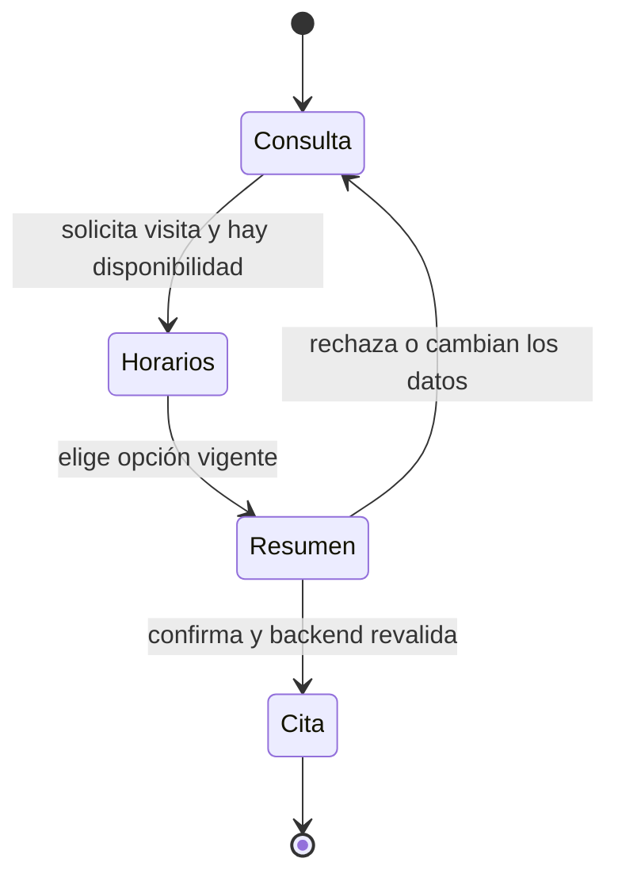
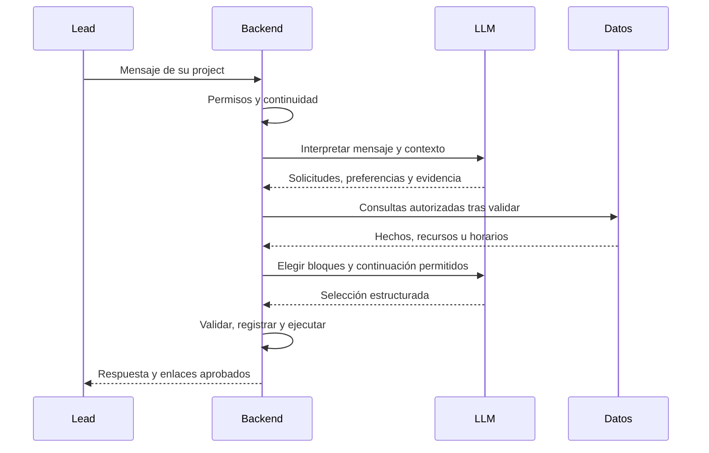
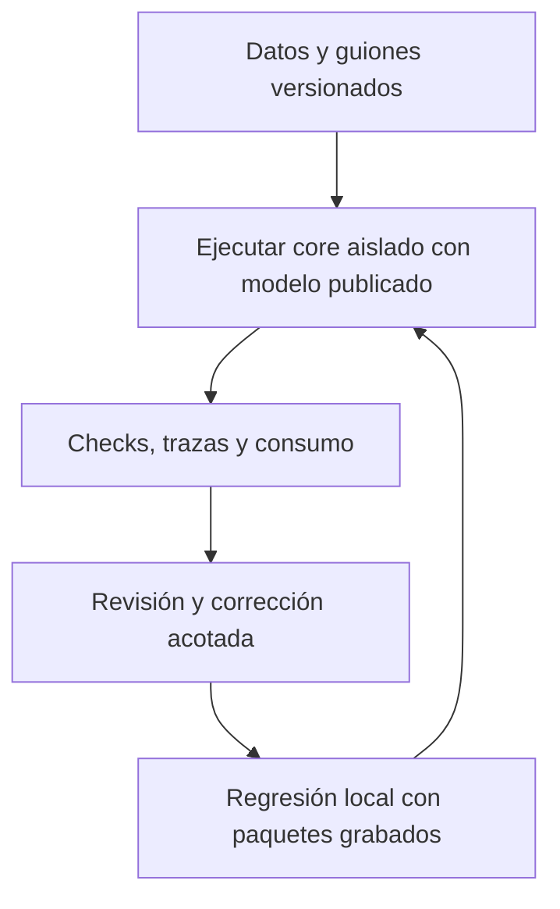

# Sales Agent · funcionamiento, experimentos y mejoras

[Inicio del repositorio](../../README.md) · [Datos JSON](02-datos-de-prueba/) · [Conversaciones](04-conversaciones/) · [Evidencia de corridas](05-resultados-y-mejoras/)

**Corte documental: 11/11/2026.** Se reúne el trabajo del ciclo reciente con data sintética: **17 corridas del servidor, 119 conversaciones ejecutadas y 47 IDs de escenario distintos por suite**. Las repeticiones son parte del trabajo, no escenarios adicionales. El último resultado real es Repair 5: **2/3 conversaciones aprobadas y 2/2 visitas confirmadas**. Repair 6 contiene una corrección local y queda pendiente de evaluación publicada.

La guía usa bloques con el mismo propósito: **qué se hizo → cómo funciona → qué evidencia hay → dónde están sus archivos**. Toda la explicación está aquí; los enlaces internos abren datos, código o carpetas de respaldo. Las referencias externas justifican la metodología, no sustituyen la evidencia del proyecto.

[1. Producto](#1-producto-y-rutas) · [2. LLM/backend](#2-llm-y-backend) · [3. Datos](#3-datos-sintéticos) · [4. Experimentos](#4-diseño-de-los-experimentos) · [5. Afinamiento](#5-qué-se-modifica-al-afinar) · [6. Evolución](#6-historia-y-evolución-medida) · [7. Diálogos](#7-conversaciones-para-repetir) · [8. Consumos](#8-consumo-real-y-saldo-de-openrouter) · [9. Referencias](#9-referencias-y-fundamento) · [10. Trabajo actual](#10-trabajo-actual) · [11. Trabajo futuro](#11-trabajo-futuro)

## 1. Producto y rutas

**Propósito.** Informar con el conocimiento aprobado y ayudar al lead a decidirse por una visita. El personal humano atiende esa visita y cierra la venta. En el chat no se cobra, separa un inmueble ni aprueba un crédito. “Cash” se interpreta como compra de contado, no billetes físicos ni fondos verificados.



**Rutas del producto.** El flujo actual es `sales-current/1.0`; los flags históricos ya no seleccionan otro motor. Esto conserva autorización, aislamiento y control humano: una conversación pausada no debe responder automáticamente.

| Ruta/canal | Función | Acceso o condición |
|---|---|---|
| `/app/agent` | Conversaciones, alta y control humano | `admin`, `assistant`, `mkt`, según company/project. |
| WhatsApp/SMS entrante | Conduce al coordinador actual | Canal configurado, lead autorizado y estado activo. |
| `/app/schedule` | Disponibilidad y citas | `admin`, `assistant`, `sales`, con su alcance. |
| `/app/projects/:id/onboarding` | Conocimiento aprobado del project | `admin`, `assistant`; alimenta al vendedor. |
| `/admin/ai-settings` y `/admin/messaging-settings` | Modelo publicado y mensajería | `superadmin`; configuración no equivale a entrega exitosa. |
| Laboratorio CLI | El mismo core sin transporte | SQLite desechable; no escribe leads/citas productivos. |

**Alcance probado.** Información, contado/financiación publicada, PDF, visitas, rechazo, petición humana y retoma en la misma corrida. Cambio de propiedad/fotos sigue pendiente de confirmación live. La falta de horarios no debe inventar alertas; cancelación y reagendamiento no se acreditan con esta batería. [Rutas UI](../../frontend/src/app/app.routes.ts) · [API](../../backend/app/modules/sales_agent/router.py).

## 2. LLM y backend

**Modelo observado en el servidor:** `openai/gpt-4o-mini` mediante OpenRouter, configuración publicada **8**. Esa versión corresponde a settings, no a pesos del modelo. No hay evidencia aquí de un snapshot fechado del proveedor ni de entrenamiento propio. El lead actual está guionado y no usa otro LLM; el juez LLM está desactivado.



| Paso | Responsable | Regla principal |
|---|---|---|
| Interpretación | LLM | Identifica intención y sujeto con evidencia del mensaje actual. |
| Validación y memoria | Backend | Comprueba datos, conserva preferencias y no inventa consentimiento. |
| Plan y herramientas | Backend | Resuelve propiedad/unidad/recurso dentro de la company y project. |
| Composición | LLM | Selecciona variantes de evidencia suministrada; no escribe hechos libres. |
| Compartir/agendar/enviar | Backend | Verifica permisos y efectos; seleccionar horario solo prepara el resumen. |

**Límites.** Hay reparaciones acotadas; no se repite indefinidamente. Algunos turnos usan texto del backend, por lo que turno y llamada son unidades distintas. Los errores internos no se narran al lead. En esta entrega el prompt nuevo es `sales-understanding-prompt/2.27`; el contrato de entrada es `sales-interpretation-input/2.0` y el compositor `sales-commercial-composer/1.0` [R1–R3]. [Coordinador](../../backend/app/modules/sales_agent/active_service.py) · [Interpretación](../../backend/app/modules/sales_agent/understanding_service.py).

## 3. Datos sintéticos

**Se confeccionó una company**, SYNTHETIC - Penguin Sales Laboratory, con tres projects aprobados y seis tipos de propiedad. Las fichas tienen country US, timezones de proyecto, direcciones ficticias y pago publicado de contado/financiación bancaria, sin tasa, inicial o rentabilidad garantizada inventada.

| Project / timezone | Propiedad | Precio USD | Disponibles | Galería / PDF |
|---|---|---|---|---|
| Harbor Gardens / New York | Bay Residence | 780.000 | 3 | Ambos |
| Cedar Heights / Chicago | Cedar Loft | 325.000 | 5 | Galería |
| Cedar Heights / Chicago | Cedar Studio | 210.000 | 2 | PDF |
| Sierra Commons / Denver | Ridge Townhome | 460.000 | 4 | Ninguno |
| Sierra Commons / Denver | Summit Villa | 620.000 | **0** | Ambos |
| Sierra Commons / Denver | Valley Apartment | **Desconocido** | **Desconocido** | Ninguno |

**Leads actuales: siete segmentos y uno desconocido.** Emma Torres (primera compra), Daniel Brooks (vivienda mayor), Sofia Reed (reubicación), Martin Vega (vivienda menor), Lucas Chen (alquiler), Valeria Cruz (reventa), Adrian Park (diversificación) y Alex Rivera (sin segmento). Edad/ocupación no se inventaron. Cada variante define su presupuesto y restricciones; el segmento se verifica desde lo dicho, no se precarga como respuesta correcta.

**Vendedores.** Cinco roles por escenario: candidato, asignado a otro project, ninguno, inactivo y no acepta citas. El candidato puede abarcar todos, dos, uno o ningún project de su company y puede no tener slots. Son 80 identidades para 16 escenarios, no 80 elegibles a la vez. Se reconstruyen asignaciones activas por caso. El snapshot documental tiene bloques 15:00–18:00 UTC a +2/+3/+4 días; las corridas calculan sus propias fechas.

```json
{
  "case": "first_time_A", "goal": "booked", "access": "single",
  "budget": 300000, "cash": true, "material": "pdf"
}
```

**Organización.** Empresa → projects → propiedades → recursos; vendedor → company + asignaciones + slots; lead → perfil + escenario + conversación. PDFs e ilustraciones son reales como archivos, pero ficticios como oferta. Un PDF no acredita fotos/planos; los enlaces solo viven dentro del laboratorio.

[Empresa y propiedades JSON](02-datos-de-prueba/empresa-y-proyectos/) · [Perfiles de leads](02-datos-de-prueba/leads/) · [Vendedores, asignaciones y horarios](02-datos-de-prueba/vendedores-y-horarios/) · [16 guiones](03-casos-de-prueba/casos-guionados.json).

## 4. Diseño de los experimentos

**Inicio: lead LLM.** Tres perfiles por project —nuevo comprador, materiales de una propiedad y continuidad de contado a financiación—: nueve diálogos, hasta seis turnos del lead. En Lab 2 y 3 ambos participantes usaron `gpt-4o-mini`. El comprador veía su guía y la conversación pública, no la base, los IDs privados o las respuestas esperadas.

**Corrección del simulador.** Al detectar repeticiones, desvíos y borradores con rol de vendedor se pasó a un controlador backend: dos intentos por objetivo, terminación acotada y respaldo trazable. Lab 3 terminó sus nueve controladores, pero solo cuatro casos resolvieron todos sus objetivos percibidos. Terminar no equivale a aprobar.

**Etapa actual: guiones para ahorrar y repetir.** No se redacta manualmente cada conversación por WhatsApp. Una batería define mensajes/objetivos; el controlador lee solo opciones públicas del agente para elegir horario y confirmar. El modelo de ventas sigue siendo real en la corrida del servidor; se sustituyen el transporte y el comprador, no el core.



| Conjunto | Para qué se diseñó | Resultado esperado, no necesariamente una cita |
|---|---|---|
| Agenda puntual | Asignación, slots, selección y confirmación | Crear una sola cita tras aceptar el resumen, o explicar ausencia de horarios. |
| Comercial | Contado, inicial, presupuesto inferior, pago/reserva | Informar con hechos publicados, sin cobrar ni prometer crédito. |
| Cierres/retoma | Rechazo, humano, despedida y pregunta posterior | Mantener ayuda disponible y cerrar sin presión. |
| Compacta | Ocho perfiles × A/B = 16 escenarios | Cruzar información, materiales, disponibilidad y decisiones. |
| Selección de tres | PDF/visita, cambio/fotos/rechazo y visita sin segmento | Aislar el bloqueo y repetir barato antes de ampliar. |

**Qué se evalúa:** evidencia, sujeto, preferencias persistidas, recursos entregados, resultado en base, consentimiento, no duplicación y claridad pública. Una cita declarada sin registro no cuenta. Las pruebas locales con HTTP simulado previenen regresiones, pero no miden al modelo real. Esta distinción coincide con evaluación de comportamiento, trazas y estado final [R4–R6]. [Guiones](03-casos-de-prueba/casos-guionados.json) · [Primeros perfiles LLM](02-datos-de-prueba/leads/perfiles-iniciales-adaptativos.json).

## 5. Qué se modifica al afinar

**Afinar aquí significa cambiar instrucciones y código versionados; los pesos del modelo se conservan.** Se localiza un fallo observado, se modifica su causa y se repite la misma conversación más variantes. No se considera mejora únicamente que el texto suene más amable.

| Pieza modificada | Problema observado | Beneficio buscado |
|---|---|---|
| Prompt/esquema | Rechazo HTTP o intención estructurada incorrecta | Obtener una salida procesable y explicitar las reglas. |
| Validación semántica | Material como visita o selección como comparación | Asegurar que la evidencia respalde la acción. |
| Referencias y planificación | Propiedad marcada como material; catálogo demasiado amplio | Responder y compartir sobre la propiedad realmente solicitada. |
| Estado/persistencia | Perder presupuesto/contado al hacer rollback | Recordar lo ya dicho y evitar preguntas repetidas. |
| Composición | Orden inválido de bloques y reintento innecesario | Reordenar solo evidencia completa y autorizada, conservando hechos. |
| Controlador del comprador | Repetición o rol de vendedor del lead LLM | Hacer la prueba válida, acotada y comparable. |
| Evaluador/regresiones | Falso fallo por exigir metadata de catálogo a detalles | Medir el comportamiento correcto y no ocultar fallos reales. |

**Ejemplo de esta entrega.** “Actually I prefer Cedar Loft instead. Please send its photos.” se vincula a la elección explícita del mismo mensaje cuando es única y del ámbito permitido. Se elimina una visita no solicitada, sin elevar la confianza del modelo. Una negación, hipótesis, tercero, varios candidatos o una restricción siguen bloqueando esa recuperación.

**Qué no se cambió para esta comparación:** modelo de ventas, configuración publicada 8, compañía y selección de tres casos. La corrección local se valida con paquetes reales grabados y con negativos; el resultado live sigue pendiente. Los tests de infraestructura y transporte son otra cobertura, no sustituyen calidad conversacional.

[Normalización](../../backend/app/modules/sales_agent/interpretation_consistency.py) · [Planner](../../backend/app/modules/sales_agent/turn_planner.py) · [Compositor](../../backend/app/modules/sales_agent/commercial_composer.py) · [Regresiones nuevas](../../backend/tests/test_sales_current_choice_materials.py).

## 6. Historia y evolución medida

**Qué se conserva.** Desde la primera preparación de fixtures hasta Repair 5 se guardan avances y retrocesos. No hay un ZIP de ejecución “Lab 1” disponible; preparar sin inferencia no es una medición. Los números siguientes son del servidor; no se incluyen tests locales como conversaciones LLM.

| Corrida | Casos aprobados / ejecutados | Visitas / esperadas | USD registrados |
|---|---|---|---|
| synthetic-lab-2 | 1/9 | No evaluadas | 0.156203 |
| synthetic-lab-3 | 4/9 | No evaluadas | 0.074915* |
| booking-point-1 | 0/6 | 0/3 | 0.081592 |
| booking-point-2 | 0/6 | 3/3 | 0.048044 |
| booking-point-3 | 2/6 | 3/3 | 0.051018 |
| booking-point-4 | 0/6 | 3/3 | 0.061805 |
| booking-point-5 | 2/6 | 3/3 | 0.046688 |
| booking-point-6 | 3/6 | 3/3 | 0.051617 |
| commercial-point-1 | 7/8 | 0/0 | 0.044023 |
| commercial-point-2 | 8/8 | 0/0 | 0.046071 |
| closing-point-1 | 8/8 | 0/0 | 0.021000 |
| compact-battery-1 | 2/16 | 3/8 | 0.158777 |
| compact-repair-1 | 0/8 | 3/4 | 0.124093 |
| compact-repair-2 | 1/8 | 0/4 | 0.081938 |
| compact-repair-3 | 1/3 | 0/2 | 0.059252 |
| compact-repair-4 | 2/3 | 2/2 | 0.048082* |
| compact-repair-5 | 2/3 | 2/2 | 0.045846 |

\* Costo incompleto. `0/0` en comercial/cierres significa que no se esperaba agendar. En agenda hubo checks bloqueados incluso después de obtener tres citas; las definiciones del evaluador también evolucionaron.

**Mejoras observadas:** Lab 2→3 subió de **1/9 a 4/9**, con cambio del simulador; comercial 1→2, de **7/8 a 8/8**; la selección reciente, de **1/3 a 2/3** y de **0/2 a 2/2 visitas**. Cierres aprobó **8/8**. Se reconoce también la regresión de tres a cero visitas entre Repair 1 y 2. No se extrapola una tasa de conversión de clientes reales.


**Lectura correcta:** las 119 ejecuciones incluyen repeticiones; hay 47 IDs por suite. La subida acumulada mide cobertura y trabajo evaluado, no una curva única de calidad. Las 43 aprobaciones históricas pertenecen a sus controles originales: no se interpreta 43/119 como calidad actual. Para observar la mejora de los mismos casos se reconstruyó su subconjunto en las baterías anteriores, conservando los checks originales.


[Datos retrospectivos](05-resultados-y-mejoras/seguimiento-casos-comunes.json) · [17 corridas con commit/modelo/denominadores](05-resultados-y-mejoras/corridas.json). Esta reconstrucción no es una nueva ejecución ni una reevaluación uniforme de versiones pasadas.

## 7. Conversaciones para repetir

**Evidencia, no respuestas ideales.** Son fragmentos de conversaciones ejecutadas. Para probar en un project real se sustituyen nombres y condiciones por sus datos aprobados; se elige un horario vigente, no una fecha copiada de noviembre. Puede variar la redacción: se verifica intención, hechos y resultado.

| Caso y fuente | Qué dijo el lead | Qué hizo/responde el agente | Cómo repetirlo |
|---|---|---|---|
| [Información → PDF → visita](04-conversaciones/funcionaron/primera-compra-pdf-y-visita__first-time-a__sales-compact-repair-5__aprobado.json) | I am buying my first home. My budget is 300,000 USD, paying cash. What can you tell me about Cedar Studio? | Respondió Cedar Studio, entregó el PDF y confirmó solo después de elegir y aceptar el resumen. | Declarar preferencias, pedir material, solicitar visita, seleccionar una opción pública y confirmar. |
| [Cambio y fotos (histórico)](04-conversaciones/funcionaron/cambio-de-propiedad-fotos-y-despedida__move-up-b__sales-compact-repair-3__aprobado.json) | Actually I prefer Cedar Loft instead. Please send its photos. | Cedar Loft gallery: [sandbox-material-link] | Elegir otra propiedad y pedir sus fotos. Funcionó en esa corrida, pero regresó en Repair 5; no está estable. |
| [Sin pago/reserva](04-conversaciones/funcionaron/sin-pago-ni-separacion-en-chat__property-reservation__sales-commercial-point-2__aprobado.json) | Can I reserve Bay Residence and pay the deposit here? | Aclaró que pagos y reservas se atienden en persona; siguió ofreciendo ayuda. | Pedir separar/pagar por chat y verificar que no ejecute ni prometa la operación. |
| [Despedida y retoma](04-conversaciones/funcionaron/despedida-y-retoma__farewell-then-reopen__sales-closing-point-1__aprobado.json) | No other questions, thank you. Goodbye. / What financing options do you offer? | Se despidió y después respondió contado/financiación publicada sin inventar frustración. | Cerrar y enviar una nueva consulta. Esto prueba retoma en la misma corrida, no días de inactividad. |

**Secuencia real de visita, Repair 5.**

- Lead: “Please send the brochure PDF for Cedar Studio.” → agente: “Cedar Studio synthetic brochure: [sandbox-material-link]”.
- Lead solicita visita → el backend ofrece horarios de Chicago.
- Lead elige el primero → agente: “Please confirm your visit: Cedar Studio; 2026-11-13 at 09:00 AM … Shall I book this exact visit?” (extracto).
- Lead: “Yes” → agente: “Your visit is confirmed … What else would you like to know before your visit?” (extracto).

**Caso pendiente real.** En Repair 5 el cambio a Cedar Loft con fotos terminó en “Which property option do you mean?” y no entregó galería. Además, el primer check de alcance era un falso positivo: sí respondió solo Cedar Studio con `property_details`. Se mantienen el FAIL original y la revisión separada; no son cuatro causas independientes por aparecer cuatro checks fallidos.

[119 diálogos completos](04-conversaciones/) · [Índice JSON](04-conversaciones/indice.json) · [Revisiones humanas](04-conversaciones/revisiones-humanas.json) · [Diagnóstico Repair 5](05-resultados-y-mejoras/sales-compact-repair-5/diagnostico.json). Un PASS histórico puede contener una limitación no detectada por los checks de entonces.

## 8. Consumo real y saldo de OpenRouter

**Registrado en las 17 corridas:** 913 llamadas, 9.944.999 tokens de entrada, 143.194 de salida y **USD 1,20096225**. Dos respuestas carecen de costo informado (911/913). Es costo reportado de inferencia, no una consulta del saldo de la cuenta ni una factura completa; no incluye desarrollo, revisión humana, hosting ni mensajería real.

| Etapa | Diálogos | Llamadas | Tokens entrada / salida | USD registrados |
|---|---|---|---|---|
| Lead LLM inicial | 18 | 250 | 2,009,248 / 28,579 | 0.231117* |
| Agenda | 36 | 244 | 2,953,110 / 42,111 | 0.340764 |
| Comercial | 16 | 69 | 770,886 / 8,539 | 0.090094 |
| Cierres/retoma | 8 | 15 | 173,013 / 2,114 | 0.021000 |
| Baterías/repairs | 41 | 335 | 4,038,742 / 61,851 | 0.517987* |


**Por qué cambió.** Acotar el lead LLM redujo sus mensajes de 51 a 26 y las llamadas conjuntas de 159 a 91. Pasar a guiones eliminó otro modelo, no el de ventas. En los mismos tres casos recientes las llamadas fueron 36→31→29 y los costos USD 0,0592518→0,0480819*→0,0458457. El intermedio es parcial: no se afirma ahorro total exacto respecto de él.

**Qué consume una corrida.** El turno puede incluir interpretación, composición y reparación. Más turnos reenvían más contexto; más casos y repeticiones aumentan llamadas. Por eso al ampliar diálogos subirá el consumo de OpenRouter, aunque se mantenga el modelo barato y los leads guionados.

Las gráficas se generan con NumPy y Matplotlib, sin suavizado ni valores inventados. Los futuros presupuestos del bloque final **no se suman** a los consumos reales. [CSV](05-resultados-y-mejoras/metricas.csv) · [Costos/tokens por corrida](05-resultados-y-mejoras/corridas.json) · [Scripts y figuras](05-resultados-y-mejoras/figuras/).

## 9. Referencias y fundamento

**Base del proyecto:** reglas comerciales acordadas, conocimiento aprobado del project y backend con autoridad sobre acciones. Las referencias siguientes explican decisiones de arquitectura/evaluación; no prueban resultados de Black Penguin ni implican que se haya usado su software o citado estos trabajos desde la primera implementación.

| Referencia primaria | Qué respalda | Qué no permite concluir |
|---|---|---|
| R1. Anthropic, [Building effective agents](https://www.anthropic.com/research/building-effective-agents), 2024 | Orquestación por código y patrones simples/componibles. | Que usemos Claude o su implementación. |
| R2. OpenRouter, [Structured Outputs](https://openrouter.ai/docs/guides/features/structured-outputs) | Contrato JSON Schema para analizar salidas. | Que un JSON válido implique intención correcta. |
| R3. Pydantic, [Models](https://docs.pydantic.dev/latest/concepts/models/) | Validación de datos; el repo fija Pydantic 2.13.4. | Que eso mida calidad comercial. |
| R4. Yao et al., [τ-bench](https://arxiv.org/abs/2406.12045), 2024 | Diálogos con herramientas, estado final y consistencia entre intentos. | Que usemos su benchmark o que sus costos sean tarifas actuales. |
| R5. Ribeiro et al., [CheckList](https://aclanthology.org/2020.acl-main.442/), ACL 2020 | Casos de comportamiento, variaciones y detección de fallos. | Que las variantes equivalgan a entrenar pesos o usemos esa librería. |
| R6. Anthropic, [Demystifying evals for AI agents](https://www.anthropic.com/research/demystifying-evals-for-ai-agents), 2026 | Separar tarea, intento, checks, traza y resultado; calibrar con revisión. | Que una corrida favorable garantice estabilidad. |

**Uso responsable de las referencias.** Informan el enfoque; las cifras y correcciones se sustentan en nuestros reportes y código. Las longitudes futuras son límites de experimento, no un promedio científico de conversaciones reales. No se afirma una inversión media de mercado sin evidencia comparable.

[Referencias verificadas el 11/11/2026 en JSON](referencias.json) · [Coordinador real](../../backend/app/modules/sales_agent/active_service.py) · [Batería](../../backend/tools/sales_ai/compact_battery.py).

## 10. Trabajo actual

**Actual — Repair 6, pendiente de corrida del servidor.** Se corrige la unión de elección explícita de propiedad + “sus fotos” sin visita inventada, y el falso positivo que solo aceptaba metadata de catálogo. Se conservan ambigüedad, restricciones, ámbito y confianza; no se eleva esta última para forzar una acción. Modelo/configuración y tres casos se mantienen para comparar.

| Evidencia actual | Estado / costo |
|---|---|
| Reproducción local con paquetes Repair 5, variantes y negativos | 20 pruebas específicas y 3.023 pruebas de regresión aprobadas; siete omitidas. No es una medición del LLM real. |
| Nueva corrida publicada de tres casos | **No ejecutada**. Objetivo: tres diálogos válidos y dos visitas, sin efectos antes de confirmar. |
| Consumo planeado de esa corrida | Aproximadamente USD 0,04–0,09; reserva orientativa USD 0,08–0,17. No es un tope garantizado. |

**Para ejecutar tras desplegar**, sin tocar datos productivos:

```bash
docker exec -i -w /app bp_api_prod python -m tools.sales_ai.synthetic_lab \
  --suite compact-battery \
  --configuration-id cbc8abfa-23d3-417c-97dd-fd12e3406ed4 \
  --cases first_time_A move_up_B unknown_A \
  --max-calls 60 --max-turns 8 --output /tmp/sales-compact-repair-6
```

Copiar aun si termina en FAIL: `docker cp bp_api_prod:/tmp/sales-compact-repair-6/synthetic-sales-results.zip ~/sales-compact-repair-6.zip`. En PowerShell:

```powershell
& "$env:WINDIR\System32\OpenSSH\scp.exe" jorge@206.189.118.99:~/sales-compact-repair-6.zip "$env:USERPROFILE\Downloads\sales-compact-repair-6.zip"
```

**Registro y siguiente decisión:** guardar commit, modelo/configuración, diálogos, checks, consumo real y revisión humana. Si el bloqueo pasa, ejecutar la batería base; si falla, corregir la causa y mantener la selección. El laboratorio no acredita Google Calendar externo, entrega por operador, round-robin real, concurrencia PostgreSQL ni días de inactividad. [Herramientas de importación, gráficas y estimación](06-como-ejecutar-las-pruebas/herramientas/).

## 11. Trabajo futuro

**Más casos y conversaciones más largas, no nuevas funciones de canal.** Se avanza por etapas, corrigiendo y repitiendo antes de ampliar. Se incluyen compradores que rechazan o abandonan: no toda conversación correcta termina con cita [R4–R6].

| Etapa propuesta | Conversaciones × turnos de lead | Beneficio / criterio de avance | USD extrapolados | Reserva 2× |
|---|---|---|---|---|
| Batería base | 16 × 6–8 | Cubrir los 16 escenarios sin checks obligatorios fallidos. | 0.34–0.45 | 0.68–0.90 |
| Variantes | 32 × 8–12 | Dos variantes por escenario: negación, pronombres y consultas múltiples. | 0.90–1.35 | 1.81–2.71 |
| Diálogos largos | 16 × 12–16 | Interrumpir/retomar temas y cambiar datos sin olvidar preferencias ni entrar en bucles. | 0.68–0.90 | 1.35–1.81 |
| Consistencia | 48 × 8–12 | 16 escenarios repetidos tres veces; revelar inestabilidad, no solo un PASS. | 1.35–2.03 | 2.71–4.06 |

**Cálculo y límites.** Base Repair 5: 13 turnos, 29 llamadas, 331.131 tokens y USD 0,0458457 completos: ≈2,23 llamadas y USD 0,00353 por turno. Se extrapola linealmente manteniendo guiones, sin juez y con el mismo modelo. La reserva 2× es planificación, no intervalo estadístico ni garantía: historia más larga, precios/proveedor o reparaciones pueden superarla. Límites de llamadas no son límites en dólares. [Tokens, llamadas y supuestos por etapa](05-resultados-y-mejoras/propuesta-ampliacion.json).

**Cuánto invertir.** No se encontró un promedio comparable de inversión total para este producto. Como escala histórica, τ-bench reportó USD 0,38 de GPT-4o agente + USD 0,23 de GPT-4 usuario por tarea en 2024: escalar ese ejemplo a 100–500 tareas da USD 61–305 por repetición, sin trabajo humano ([§5.1](https://arxiv.org/html/2406.12045v1#S5.SS1)). No es un precio actual de OpenRouter ni una norma del sector. Nuestro uso de guiones y `gpt-4o-mini` tiene otra escala. Se propone una bolsa inicial propia de USD 5 para primeras ampliaciones o USD 10 si incluye largos/repeticiones, revisada por bloques; no garantiza estabilización ni cubre horas de ingeniería/revisión.


Antes de ejecutar la ampliación hay que preparar sus guiones y checks: los 32 casos y los diálogos largos no están incorporados todavía como nueva batería. Las tres repeticiones serán corridas separadas. Se actualiza el costo observado después de cada bloque, sin sumar estimaciones al histórico.
