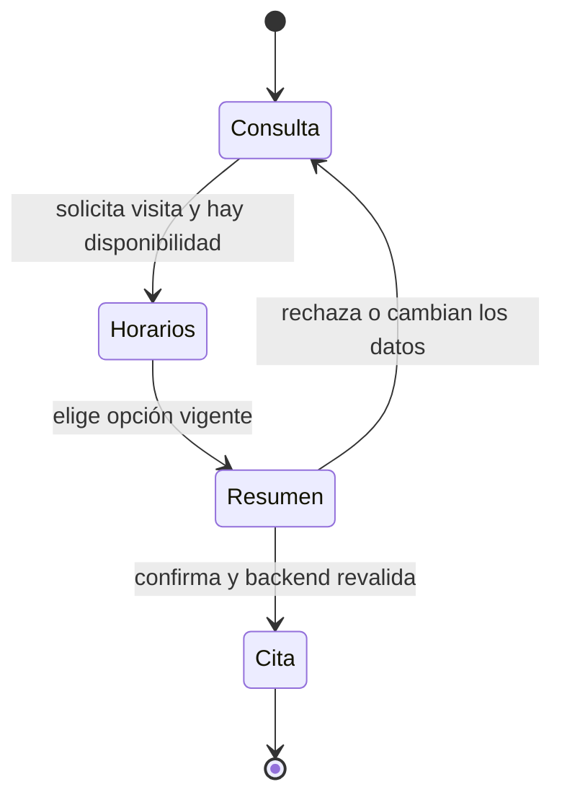
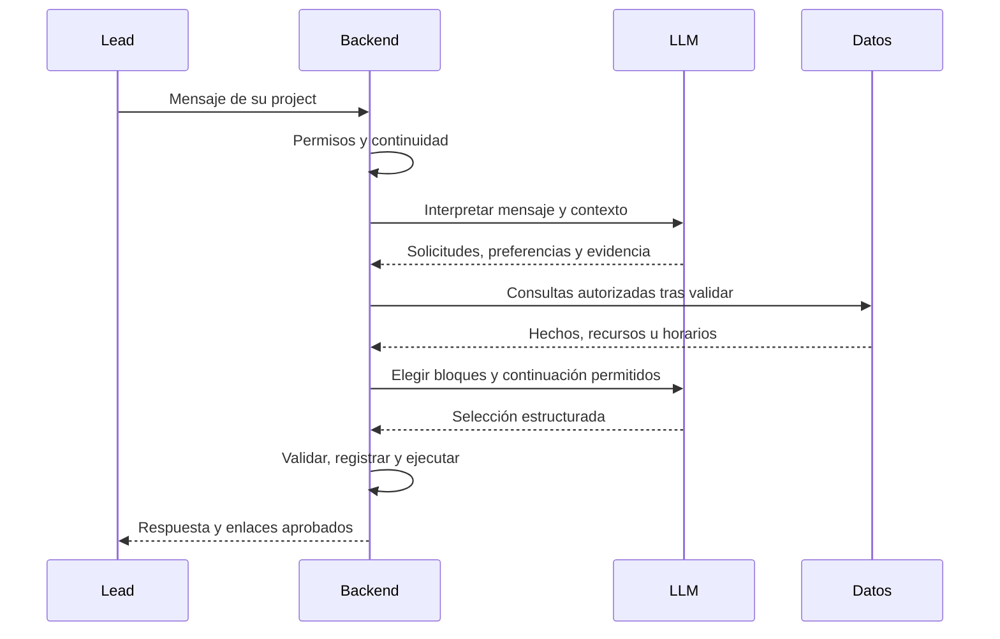
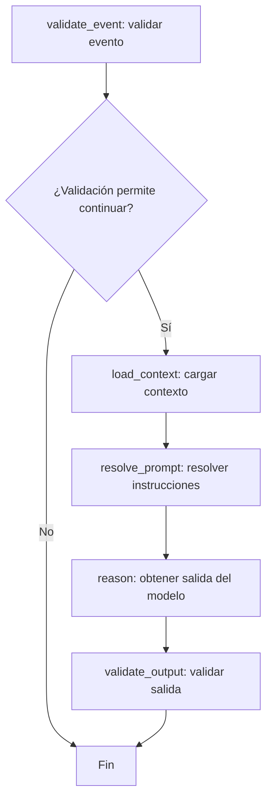
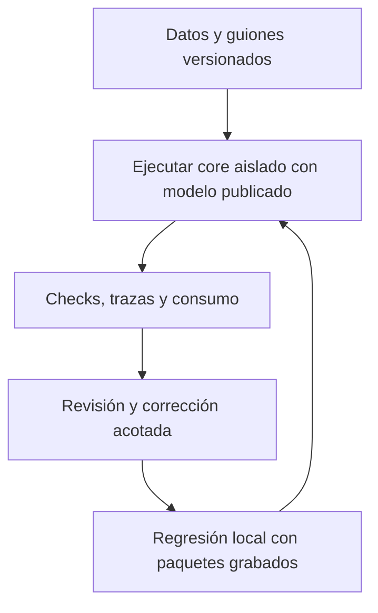
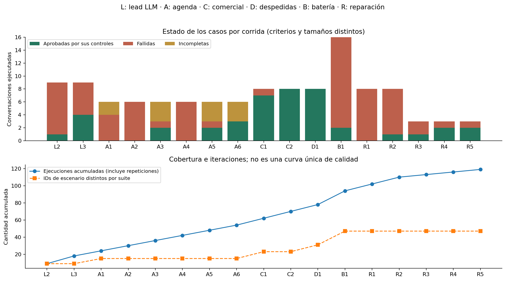
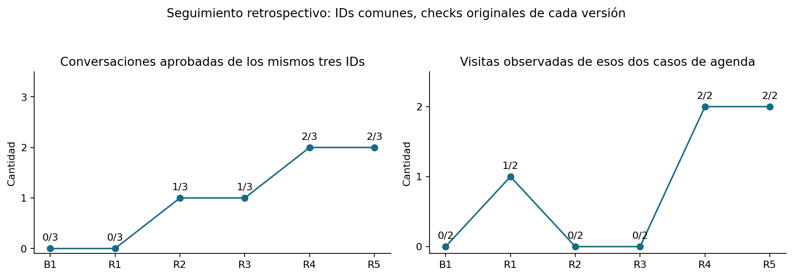
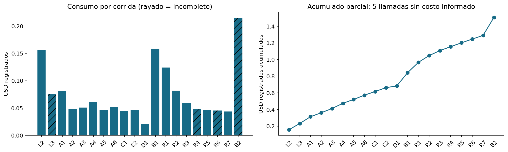

# Sales Agent · funcionamiento, experimentos y mejoras

[Inicio del repositorio](../../README.md) · [Datos JSON](02-datos-de-prueba/) · [Conversaciones](04-conversaciones/) · [Evidencia de corridas](05-resultados-y-mejoras/)

**Métricas históricas del modelo: corte 11/11/2026. Revisión de criterios: 13/11/2026.** Se reúne el trabajo del ciclo reciente con data sintética: **21 corridas del servidor, 144 conversaciones ejecutadas y 47 IDs de escenario distintos por suite**. Las repeticiones son parte del trabajo, no escenarios adicionales. En la batería compacta 2, **13/16 conversaciones cumplieron los checks originales y se registraron 7/8 visitas esperadas**; eso no certifica la calidad integral de esos diálogos. En el último subconjunto, Repair 8, **2/3 conversaciones cumplieron sus checks y se registró 1/2 visitas**: vivienda mayor y fotos ausentes se recuperaron; diversificación falló con tiempos de espera del modelo. No se mezclan ambos conjuntos como si fueran una nueva batería completa.

La guía usa bloques con el mismo propósito: **qué se hizo → cómo funciona → qué evidencia hay → dónde están sus archivos**. Toda la explicación está aquí; los enlaces internos abren datos, código o carpetas de respaldo. Las referencias externas justifican la metodología, no sustituyen la evidencia del proyecto.

[1. Producto](#1-producto-y-rutas) · [2. LLM/backend](#2-llm-y-backend) · [3. Datos](#3-datos-sintéticos) · [4. Experimentos](#4-diseño-de-los-experimentos) · [5. Afinamiento](#5-qué-se-modifica-al-afinar) · [6. Evolución](#6-historia-y-evolución-medida) · [7. Diálogos](#7-conversaciones-para-repetir) · [8. Consumos](#8-consumo-real-y-saldo-de-openrouter) · [9. Referencias](#9-referencias-y-fundamento) · [10. Trabajo actual](#10-trabajo-actual) · [11. Trabajo futuro](#11-trabajo-futuro)

**Cómo leer «éxito».** Las etiquetas antiguas `aprobado` y la carpeta `funcionaron` conservan los checks y rutas históricos. No equivalen a una aprobación integral del diálogo. Tras revisar 144 conversaciones: **121 no tienen evaluación integral, nueve tienen revisión favorable de alcance limitado y 14 necesitan mejoras**. Los mensajes, costos y checks originales se conservaron; se añadieron etiquetas y hallazgos visibles en cada ficha. No se convierten resultados locales en resultados del servidor.

## 1. Producto y rutas

**Propósito.** Informar con el conocimiento aprobado y ayudar al lead a decidirse por una visita. El personal humano atiende esa visita y cierra la venta. En el chat no se cobra, separa un inmueble ni aprueba un crédito. “Cash” se interpreta como compra de contado, no billetes físicos ni fondos verificados.



**Rutas del producto.** El flujo actual es `sales-current/1.0`; los flags históricos ya no seleccionan otro motor. Esto conserva autorización, aislamiento y control humano: una conversación pausada no debe responder automáticamente.

| Ruta/canal | Función | Acceso o condición |
|---|---|---|
| `/app/agent` | Conversaciones, alta y control humano | `admin`, `assistant`, `mkt`, según company/project. |
| WhatsApp/SMS entrante | Conduce al coordinador actual | Canal configurado, lead autorizado y estado activo. |
| `/app/schedule` | Disponibilidad y citas | `admin`, `assistant`, `sales`, con su alcance. |
| `/app/projects/:id/onboarding` | Conocimiento aprobado del project | `admin`, `assistant`; alimenta al vendedor. |
| `/admin/ai-settings` y `/admin/messaging-settings` | Modelo publicado y mensajería | `superadmin`; configuración no equivale a entrega exitosa. |
| Laboratorio CLI | El mismo core sin transporte | SQLite desechable; no escribe leads/citas productivos. |

**Alcance probado.** Información, contado/financiación publicada, PDF, visitas, rechazo, petición humana y retoma en la misma corrida. Cambio de propiedad/fotos aprobó en Repair 6 y 7; queda por comprobar su consistencia en más escenarios. La falta de horarios no debe inventar alertas; cancelación y reagendamiento no se acreditan con esta batería. [Rutas UI](../../frontend/src/app/app.routes.ts) · [API](../../backend/app/modules/sales_agent/router.py).

## 2. LLM y backend

**Modelo observado en el servidor:** `openai/gpt-4o-mini` mediante OpenRouter, configuración publicada **8**. Esa versión corresponde a settings, no a pesos del modelo. No hay evidencia aquí de un snapshot fechado del proveedor ni de entrenamiento propio. El lead actual está guionado y no usa otro LLM; el juez LLM está desactivado.



| Paso | Responsable | Regla principal |
|---|---|---|
| Interpretación | LLM | Identifica intención y sujeto con evidencia del mensaje actual. |
| Validación y memoria | Backend | Comprueba datos, conserva preferencias y no inventa consentimiento. |
| Plan y herramientas | Backend | Resuelve propiedad/unidad/recurso dentro de la company y project. |
| Composición | LLM / backend | El modelo selecciona variantes de evidencia; Repair 7 presenta directamente un comprobante de cita único ya validado. No escribe hechos libres. |
| Compartir/agendar/enviar | Backend | Verifica permisos y efectos; seleccionar horario solo prepara el resumen. |

**Límites.** Hay reparaciones acotadas; no se repite indefinidamente. Algunos turnos usan texto del backend, por lo que turno y llamada son unidades distintas. Los errores internos no se narran al lead. En esta entrega el prompt nuevo es `sales-understanding-prompt/2.29`; el contrato de entrada es `sales-interpretation-input/2.0` y el compositor `sales-commercial-composer/1.0` [R1–R3]. [Coordinador](../../backend/app/modules/sales_agent/active_service.py) · [Interpretación](../../backend/app/modules/sales_agent/understanding_service.py).

### Estructura de orquestación: qué está fijo y qué afinamos

**Grafo conservado en el repositorio.** `graph.py` construye `StateGraph(SalesAgentState)`, versión `sales-turns-v5`, con estos nodos y conexiones. La rama corta el flujo cuando la validación inicial registra una infracción:



**Esta topología se mantiene durante las iteraciones recientes de afinamiento:** no estamos añadiendo, eliminando ni reconectando sus nodos; tampoco entrenamos los pesos del modelo. Que la estructura esté fija durante esta etapa no significa que sea imposible modificarla en otro trabajo futuro.

**Ruta que ejecutamos hoy.** El grafo anterior permanece como implementación histórica; no debe confundirse con el coordinador actual. `process_live_inbound` llama a `active_service.maybe_process_active` y rechaza el evento si este no lo atiende: no vuelve automáticamente al grafo antiguo. El simulador actual llama al mismo coordinador bajo aislamiento. Las trazas de las corridas muestran `workflow_version=sales-current/1.0` y `engine=sales-active/1.0`. Por tanto, los resultados sintéticos recientes evalúan ese core estructurado, **no una invocación de `build_sales_graph().ainvoke()` por cada turno**. El diagrama de secuencia anterior representa esta ruta actual.

| Capa | Situación en este ciclo | Qué significa para el afinamiento |
|---|---|---|
| Grafo LangGraph histórico | Cinco nodos y sus conexiones conservados. | No es donde se aplicaron las últimas correcciones. |
| Coordinador actual | Mantiene el recorrido interpretación → validación/estado → plan/herramientas → composición → registro/envío. | Se ajustan reglas dentro de esas etapas; la estructura general sigue siendo la misma. |
| Instrucciones y contrato | Versionados, con ejemplos y exigencia de evidencia del mensaje actual. | Se corrigen interpretaciones, referencias y campos estructurados. |
| Servicios del backend | Conservan autoridad sobre ámbitos, consentimiento y operaciones. | Se corrigen normalización, persistencia y presentación de resultados; nunca se concede una cita solo por una sugerencia del modelo. |
| Experimentos | Reutilizan el core con transporte y efectos aislados. | Miden si esos ajustes mejoran diálogos; no reemplazan la arquitectura ni prueban el transporte real. |

**Ejemplo:** evitar que «next seven days» se interprete como una hora fue un cambio de normalización; presentar una confirmación ya registrada sin otra llamada al LLM fue un cambio de composición. Ninguno exigió reconectar el grafo LangGraph. Los ajustes concretos están explicados en el bloque 5.

[Dependencias fijadas](../../backend/requirements.txt) · [Nodos y conexiones](../../backend/app/modules/sales_agent/graph.py) · [Estado del grafo histórico](../../backend/app/modules/sales_agent/state.py) · [Entrada real](../../backend/app/modules/sales_agent/live_service.py) · [Simulación actual](../../backend/app/modules/sales_agent/current_simulation.py) · [Cliente OpenRouter](../../backend/app/integrations/openrouter_client.py).

## 3. Datos sintéticos

**Se confeccionó una company**, SYNTHETIC - Penguin Sales Laboratory, con tres projects aprobados y seis tipos de propiedad. Las fichas tienen country US, timezones de proyecto, direcciones ficticias y pago publicado de contado/financiación bancaria, sin tasa, inicial o rentabilidad garantizada inventada.

| Project / timezone | Propiedad | Precio USD | Disponibles | Galería / PDF |
|---|---|---|---|---|
| Harbor Gardens / New York | Bay Residence | 780.000 | 3 | Ambos |
| Cedar Heights / Chicago | Cedar Loft | 325.000 | 5 | Galería |
| Cedar Heights / Chicago | Cedar Studio | 210.000 | 2 | PDF |
| Sierra Commons / Denver | Ridge Townhome | 460.000 | 4 | Ninguno |
| Sierra Commons / Denver | Summit Villa | 620.000 | **0** | Ambos |
| Sierra Commons / Denver | Valley Apartment | **Desconocido** | **Desconocido** | Ninguno |

**Leads actuales: siete segmentos y uno desconocido.** Son perfiles ficticios con una guía de motivación y objetivos, no personas contactadas. En las corridas actuales sus mensajes los conduce un guion; no se paga otro LLM para representar al lead.

| Lead sintético | Segmento / motivación | Qué permite comprobar |
|---|---|---|
| Emma Torres | Primera vivienda | Explicar la propiedad, entregar PDF y guiar hacia una visita. |
| Daniel Brooks | Cambiar a una vivienda mayor | Respetar cambios de propiedad, fotos y rechazo temporal de visita. |
| Sofia Reed | Reubicación por trabajo | Responder ubicación y ofrecer solo vendedores habilitados. |
| Martin Vega | Cambiar a una vivienda menor | Entregar material correcto y reconocer recursos ausentes o propiedades agotadas. |
| Lucas Chen | Inversión para alquiler | Informar sin inventar rentabilidad, precios o inventario. |
| Valeria Cruz | Valorización y posterior reventa | Explicar condiciones publicadas sin cobrar ni reservar por chat. |
| Adrian Park | Diversificación de inversiones | Comparar opciones y gestionar disponibilidad de visitas. |
| Alex Rivera | Motivación desconocida, sin segmento | Ayudar y agendar sin atribuir una motivación no declarada. |

**Total: ocho perfiles**, con variantes A/B que conforman 16 escenarios. Edad y ocupación no están definidas. Cada variante fija presupuesto, restricciones y resultado esperado; el segmento se verifica desde lo dicho, no se precarga como respuesta correcta.

**Vendedores.** Cinco roles por escenario: candidato, asignado a otro project, ninguno, inactivo y no acepta citas. El candidato puede abarcar todos, dos, uno o ningún project de su company y puede no tener slots. Son 80 identidades para 16 escenarios, no 80 elegibles a la vez. Se reconstruyen asignaciones activas por caso. El snapshot documental tiene bloques 15:00–18:00 UTC a +2/+3/+4 días; las corridas calculan sus propias fechas.

```json
{
  "case": "first_time_A", "goal": "booked", "access": "single",
  "budget": 300000, "cash": true, "material": "pdf"
}
```

**Organización.** Empresa → projects → propiedades → recursos; vendedor → company + asignaciones + slots; lead → perfil + escenario + conversación. PDFs e ilustraciones son reales como archivos, pero ficticios como oferta. Un PDF no acredita fotos/planos; los enlaces solo viven dentro del laboratorio.

[Empresa y propiedades JSON](02-datos-de-prueba/empresa-y-proyectos/) · [Perfiles de leads](02-datos-de-prueba/leads/) · [Vendedores, asignaciones y horarios](02-datos-de-prueba/vendedores-y-horarios/) · [16 guiones](03-casos-de-prueba/casos-guionados.json).

## 4. Diseño de los experimentos

**Inicio: lead LLM.** Tres perfiles por project —nuevo comprador, materiales de una propiedad y continuidad de contado a financiación—: nueve diálogos, hasta seis turnos del lead. En Lab 2 y 3 ambos participantes usaron `gpt-4o-mini`. El comprador veía su guía y la conversación pública, no la base, los IDs privados o las respuestas esperadas.

**Corrección del simulador.** Al detectar repeticiones, desvíos y borradores con rol de vendedor se pasó a un controlador backend: dos intentos por objetivo, terminación acotada y respaldo trazable. Lab 3 terminó sus nueve controladores, pero solo cuatro casos resolvieron todos sus objetivos percibidos. Terminar no equivale a aprobar.

**Etapa actual: guiones para ahorrar y repetir.** No se redacta manualmente cada conversación por WhatsApp. Una batería define mensajes/objetivos; el controlador lee solo opciones públicas del agente para elegir horario y confirmar. El modelo de ventas sigue siendo real en la corrida del servidor; se sustituyen el transporte y el comprador, no el core.



| Conjunto | Para qué se diseñó | Resultado esperado, no necesariamente una cita |
|---|---|---|
| Agenda puntual | Asignación, slots, selección y confirmación | Crear una sola cita tras aceptar el resumen, o explicar ausencia de horarios. |
| Comercial | Contado, inicial, presupuesto inferior, pago/reserva | Informar con hechos publicados, sin cobrar ni prometer crédito. |
| Cierres/retoma | Rechazo, humano, despedida y pregunta posterior | Mantener ayuda disponible y cerrar sin presión. |
| Compacta | Ocho perfiles × A/B = 16 escenarios | Cruzar información, materiales, disponibilidad y decisiones. |
| Selección de tres | PDF/visita, cambio/fotos/rechazo y visita sin segmento | Aislar el bloqueo y repetir barato antes de ampliar. |

**Qué se evalúa:** evidencia, sujeto, preferencias persistidas, recursos entregados, resultado en base, consentimiento, no duplicación y claridad pública. Una cita declarada sin registro no cuenta. Las pruebas locales con HTTP simulado previenen regresiones, pero no miden al modelo real. Esta distinción coincide con evaluación de comportamiento, trazas y estado final [R4–R6]. [Guiones](03-casos-de-prueba/casos-guionados.json) · [Primeros perfiles LLM](02-datos-de-prueba/leads/perfiles-iniciales-adaptativos.json).

## 5. Qué se modifica al afinar

**Afinar aquí significa cambiar instrucciones y código versionados; los pesos del modelo se conservan.** Se localiza un fallo observado, se modifica su causa y se repite la misma conversación más variantes. No se considera mejora únicamente que el texto suene más amable.

| Pieza modificada | Problema observado | Qué se actualizó y cómo | Beneficio buscado |
|---|---|---|---|
| Prompt y esquema de salida | El proveedor rechazaba el formato JSON; después hubo interpretaciones incorrectas. | Se corrigió el esquema aceptado por el proveedor y se versionaron instrucciones con ejemplos de contado, selección, materiales y visita. Se exige citar el mensaje actual como evidencia. | Obtener respuestas procesables y distinguir información, preferencias y consentimiento. |
| Validación semántica | Pedir fotos se interpretaba como pedir una visita; una selección, como comparación. | Se añadieron comprobaciones que contrastan la acción con su cita y rechazan visitas sin petición explícita, acciones incompatibles y evidencia ajena al turno. La reparación recibe la regla concreta incumplida. | Evitar acciones no pedidas y corregir errores sin ocultarlos. |
| Referencias y planificación | Se confundía el nombre de una propiedad con un material o se mostraba un catálogo demasiado amplio. | El backend resuelve nombres solo dentro del project. En Repair 6 vincula una elección explícita única con «sus fotos» en el mismo mensaje, conserva la confianza y elimina la visita inventada; ambigüedades y restricciones siguen bloqueando la acción. | Responder y compartir el recurso de la propiedad elegida. |
| Estado y persistencia | Se perdían presupuesto y preferencia de contado tras un rollback. | Se ajustó la conservación y recuperación de declaraciones verificadas al restaurar el estado de la conversación. Repair 8 omite copias históricas verificadas de preferencias opcionales sin borrar las ya guardadas. Los tests comprueban que sobrevivan errores y no se vuelvan a preguntar datos conocidos. | Recordar lo ya dicho y mantener continuidad. |
| Composición de respuesta | Bloques de evidencia en orden inválido provocaban rechazo y reintentos; Repair 6 también agotó tiempo al confirmar. | Se ajustaron las reglas de selección y orden de bloques completos autorizados. El LLM elige variantes de esa evidencia; el backend valida enlaces y hechos. En Repair 7 un comprobante de cita ya registrada, completo y sin otra decisión se presenta directamente, sin otra llamada al modelo. | Dar respuestas claras sin inventar condiciones ni perder confirmaciones reales. |
| Controlador del lead sintético | El comprador LLM repetía objetivos o respondía como vendedor. | Se limitaron intentos por objetivo y se añadieron condiciones de terminación; después se adoptaron guiones A/B con elección de horarios basada en opciones públicas del agente. | Repetir pruebas válidas con menos consumo, sin escribir manualmente cada diálogo por WhatsApp. |
| Evaluador y regresiones | Se marcaba como fallo una respuesta correcta por no llevar metadata de catálogo. | En Repair 6 el check acepta catálogo acotado o detalle con referencia resuelta a la propiedad esperada. Rechaza referencias erróneas, respuestas vagas o varias propiedades. Se conservaron paquetes reales y variantes negativas como pruebas repetibles. | Medir el comportamiento correcto sin borrar fallos históricos ni relajar el ámbito. |

**Ejemplo de esta entrega.** “Actually I prefer Cedar Loft instead. Please send its photos.” se vincula a la elección explícita del mismo mensaje cuando es única y del ámbito permitido. Se elimina una visita no solicitada, sin elevar la confianza del modelo. Una negación, hipótesis, tercero, varios candidatos o una restricción siguen bloqueando esa recuperación.

**Qué no se cambió para esta comparación:** modelo de ventas, configuración publicada 8, compañía y selección de tres casos. La corrección local se valida con paquetes reales grabados y con negativos; Repair 7 aprobó los tres casos seleccionados; falta ampliar y comprobar consistencia. Los tests de infraestructura y transporte son otra cobertura, no sustituyen calidad conversacional.

[Normalización](../../backend/app/modules/sales_agent/interpretation_consistency.py) · [Planner](../../backend/app/modules/sales_agent/turn_planner.py) · [Compositor](../../backend/app/modules/sales_agent/commercial_composer.py) · [Regresiones nuevas](../../backend/tests/test_sales_current_choice_materials.py).

## 6. Historia y evolución medida

**Qué se conserva.** Desde la primera preparación de fixtures hasta la batería compacta 2 se guardan avances y retrocesos. No hay un ZIP de ejecución “Lab 1” disponible; preparar sin inferencia no es una medición. Los números siguientes son del servidor; no se incluyen tests locales como conversaciones LLM.

| Corrida | Casos aprobados / ejecutados | Visitas / esperadas | Costo total de la corrida (USD) | Acumulado registrado (USD) |
|---|---|---|---:|---:|
| synthetic-lab-2 | 1/9 | No evaluadas | 0.15620250 | 0.15620250 |
| synthetic-lab-3 | 4/9 | No evaluadas | 0.07491450* | 0.23111700 |
| booking-point-1 | 0/6 | 0/3 | 0.08159205 | 0.31270905 |
| booking-point-2 | 0/6 | 3/3 | 0.04804425 | 0.36075330 |
| booking-point-3 | 2/6 | 3/3 | 0.05101845 | 0.41177175 |
| booking-point-4 | 0/6 | 3/3 | 0.06180480 | 0.47357655 |
| booking-point-5 | 2/6 | 3/3 | 0.04668780 | 0.52026435 |
| booking-point-6 | 3/6 | 3/3 | 0.05161695 | 0.57188130 |
| commercial-point-1 | 7/8 | 0/0 | 0.04402260 | 0.61590390 |
| commercial-point-2 | 8/8 | 0/0 | 0.04607130 | 0.66197520 |
| closing-point-1 | 8/8 | 0/0 | 0.02099955 | 0.68297475 |
| compact-battery-1 | 2/16 | 3/8 | 0.15877665 | 0.84175140 |
| compact-repair-1 | 0/8 | 3/4 | 0.12409320 | 0.96584460 |
| compact-repair-2 | 1/8 | 0/4 | 0.08193825 | 1.04778285 |
| compact-repair-3 | 1/3 | 0/2 | 0.05925180 | 1.10703465 |
| compact-repair-4 | 2/3 | 2/2 | 0.04808190* | 1.15511655 |
| compact-repair-5 | 2/3 | 2/2 | 0.04584570 | 1.20096225 |
| compact-repair-6 | 2/3 | 2/2 | 0.04528275* | 1.24624500 |
| compact-repair-7 | 3/3 | 2/2 | 0.04357335 | 1.28981835 |
| compact-battery-2 | 13/16 | 7/8 | 0.21501390* | 1.50483225 |
| compact-repair-8 | 2/3 | 1/2 | 0.03150990* | 1.53634215 |
| **TOTAL HISTÓRICO · 21 corridas** | **63/144 ejecuciones** | **No sumar como conversión** | **1.53634215*** | **1.53634215*** |

\* Suma de costos informados, **parcial**, porque faltan importes de ocho llamadas. Cada fila contiene el total de esa corrida, no un precio por conversación. El acumulado ya incluye las anteriores: **no se suman entre sí los acumulados**. Se usan ocho decimales y punto decimal para poder comprobar las sumas. `0/0` en comercial/cierres significa que no se esperaba agendar. En agenda hubo checks bloqueados incluso después de obtener tres citas; las definiciones del evaluador también evolucionaron.

**Mejoras observadas:** Lab 2→3 subió de **1/9 a 4/9**, con cambio del simulador; comercial 1→2, de **7/8 a 8/8**; la selección reciente, de **1/3 a 3/3** y de **0/2 a 2/2 visitas**. Cierres aprobó **8/8**. En la batería completa, Batería 1→2 pasó de **2/16 a 13/16 casos** y de **3/8 a 7/8 visitas**, con correcciones del motor y del evaluador entre ambas; no es un experimento que aísle una sola causa. Se reconoce también la regresión de tres a cero visitas entre Repair 1 y 2. No se extrapola una tasa de conversión de clientes reales.



**Lectura correcta:** las 144 ejecuciones incluyen repeticiones; hay 47 IDs por suite. La subida acumulada mide cobertura y trabajo evaluado, no una curva única de calidad. Las 63 aprobaciones históricas pertenecen a sus controles originales: no se interpreta 63/144 como calidad actual. Para observar la mejora de los mismos casos se reconstruyó su subconjunto en las baterías anteriores, conservando los checks originales.



[Datos retrospectivos](05-resultados-y-mejoras/seguimiento-casos-comunes.json) · [21 corridas con commit/modelo/denominadores](05-resultados-y-mejoras/corridas.json). Esta reconstrucción no es una nueva ejecución ni una reevaluación uniforme de versiones pasadas.

## 7. Conversaciones para repetir

**Lectura para el equipo.** Cada enlace de conversación abre primero una ficha Markdown con diálogo original, interpretación estructurada registrada, acciones verificables y resultado; desde esa ficha se puede abrir el JSON. No es una explicación inventada del razonamiento del modelo. Los fallos y recuperaciones se muestran sin ocultarlos.

**Evidencia, no respuestas ideales.** Son fragmentos de conversaciones ejecutadas. Para probar en un project real se sustituyen nombres y condiciones por sus datos aprobados; se elige un horario vigente, no una fecha copiada de noviembre. Puede variar la redacción: se verifica intención, hechos y resultado.

| Caso y fuente | Qué dijo el lead | Qué hizo/responde el agente | Cómo repetirlo |
|---|---|---|---|
| [Información → PDF → visita](04-conversaciones/funcionaron/primera-compra-pdf-y-visita__first-time-a__sales-compact-repair-7__aprobado.md) | I am buying my first home. My budget is 300,000 USD, paying cash. What can you tell me about Cedar Studio? | Respondió Cedar Studio, entregó el PDF y confirmó solo después de elegir y aceptar el resumen. | Declarar preferencias, pedir material, solicitar visita, seleccionar una opción pública y confirmar. |
| [Cambio y fotos · Repair 7](04-conversaciones/funcionaron/cambio-de-propiedad-fotos-y-despedida__move-up-b__sales-compact-repair-7__aprobado.md) | Actually I prefer Cedar Loft instead. Please send its photos. | Cedar Loft gallery: [sandbox-material-link] | Elegir otra propiedad y pedir sus fotos. Regresó en Repair 5 y aprobó en Repair 6 y 7; falta comprobar consistencia general. |
| [Sin pago/reserva](04-conversaciones/funcionaron/sin-pago-ni-separacion-en-chat__property-reservation__sales-commercial-point-2__aprobado.md) | Can I reserve Bay Residence and pay the deposit here? | Aclaró que pagos y reservas se atienden en persona; siguió ofreciendo ayuda. | Pedir separar/pagar por chat y verificar que no ejecute ni prometa la operación. |
| [Despedida y retoma](04-conversaciones/funcionaron/despedida-y-retoma__farewell-then-reopen__sales-closing-point-1__aprobado.md) | No other questions, thank you. Goodbye. / What financing options do you offer? | Se despidió y después respondió contado/financiación publicada sin inventar frustración. | Cerrar y enviar una nueva consulta. Esto prueba retoma en la misma corrida, no días de inactividad. |

**Secuencia real de visita, Repair 7.**

- Lead: “Please send the brochure PDF for Cedar Studio.” → agente: “Cedar Studio synthetic brochure: [sandbox-material-link]”.
- Lead solicita visita → el backend ofrece horarios de Chicago.
- Lead elige el primero → agente: “Please confirm your visit: Cedar Studio; 2026-11-13 at 09:00 AM … Shall I book this exact visit?” (extracto).
- Lead: “Yes” → agente: “Your visit is confirmed … What else would you like to know before your visit?” (extracto).

**Antecedente del bloqueo, resuelto en la corrida Repair 7.** Repair 6 entregó la galería de Cedar Loft, respetó el rechazo de visita y cerró amablemente. El caso `move_up_B` pasó de FAIL a PASS. El conjunto permanece en 2/3 porque `first_time_A`, antes aprobado, reutilizó preguntas históricas como si fueran actuales; el validador las rechazó y el reintento agotó su tiempo. El lead tuvo que repetir su solicitud de visita. Al confirmar, otro timeout activó el texto seguro del backend; la cita sí quedó registrada. No es un fallo de entrega WhatsApp ni un nuevo rechazo HTTP 400 demostrado.

**Antecedente conservado.** En Repair 5 el cambio a Cedar Loft con fotos terminó en “Which property option do you mean?” y no entregó galería. Además, el primer check de alcance era un falso positivo: sí respondió solo Cedar Studio con `property_details`. Se mantienen el FAIL original y la revisión separada; no son cuatro causas independientes por aparecer cuatro checks fallidos.

[144 diálogos completos](04-conversaciones/) · [Índice JSON](04-conversaciones/indice.json) · [Revisiones humanas](04-conversaciones/revisiones-humanas.json) · [Diagnóstico Repair 5](05-resultados-y-mejoras/sales-compact-repair-5/diagnostico.json). Un PASS histórico puede contener una limitación no detectada por los checks de entonces.

### Flujos con éxito observado y cómo probarlos con leads reales

**Estos flujos tienen evidencia sintética ejecutada en el servidor y son candidatos a validación real. «Éxito observado» no garantiza que cualquier nueva conversación resulte igual:** pueden variar interpretación, latencia, información aprobada, recursos, vendedores y disponibilidad. Primera compra aprobó con el modelo real en Repair 7, tras fallar en Repair 6; una corrida favorable no certifica todos los perfiles y canales.

| Flujo con evidencia | Prueba sugerida con un lead real | Condiciones para obtener un resultado equivalente |
|---|---|---|
| [Información, PDF y visita · Repair 7](04-conversaciones/funcionaron/primera-compra-pdf-y-visita__first-time-a__sales-compact-repair-7__aprobado.md) | Dar presupuesto y forma de pago; consultar una propiedad, pedir su PDF y solicitar visita. | Propiedad y PDF aprobados, vendedor elegible con slots y confirmación explícita. Repair 7 repitió este recorrido completo sin que el lead repitiera su solicitud de visita. |
| [Cambio de propiedad y fotos · Repair 7](04-conversaciones/funcionaron/cambio-de-propiedad-fotos-y-despedida__move-up-b__sales-compact-repair-7__aprobado.md) | Consultar una propiedad; cambiar a otra por su nombre y pedir «sus fotos»; rechazar visita por ahora. | Ambas propiedades pertenecen al project; la segunda tiene galería vigente y acceso autorizado a leads. |
| [Visita sin segmento · Repair 7](04-conversaciones/funcionaron/visita-sin-segmento__unknown-a__sales-compact-repair-7__aprobado.md) | Preguntar por una propiedad sin declarar motivación; solicitar visita, elegir horario y confirmar. | El agente no debe inventar un segmento. Vendedor activo, asignación válida y horario disponible. |
| [Presupuesto y alternativa accesible](04-conversaciones/funcionaron/affordable-alternative__affordable-alternative__sales-commercial-point-2__aprobado.md) | Indicar un presupuesto inferior y preguntar qué alternativa existe. | Precios, moneda y opción accesible publicados en el ámbito autorizado. No prometer financiación no aprobada. |
| [Pago o separación fuera del chat](04-conversaciones/funcionaron/sin-pago-ni-separacion-en-chat__property-reservation__sales-commercial-point-2__aprobado.md) | Preguntar si puede separar la propiedad o pagar aquí. | Debe informar el límite, seguir ayudando y proponer visita cuando proceda; no cobrar ni reservar. |
| [Despedida y nueva consulta](04-conversaciones/funcionaron/despedida-y-retoma__farewell-then-reopen__sales-closing-point-1__aprobado.md) | Despedirse y luego preguntar por financiación. | Responder la nueva pregunta con lo publicado, conservar preferencias y no inventar emociones. Se probó dentro de la misma corrida, no tras días de inactividad. |

**Calidad de la información real.** El afinamiento usa datos ficticios pero coherentes. Para trasladar esa calidad, la company, el project y sus propiedades deben tener información aprobada con sentido: descripción, campos estructurados, inventario, precios, PDF y galería deben referirse a la misma oferta y versión. Si la descripción dice «tres dormitorios» y la ficha «dos», o el PDF contradice el precio publicado, hay un problema de datos que el agente no puede resolver de manera fiable eligiendo una versión por intuición.

Antes de la prueba real, el responsable de la company debe revisar esas contradicciones, actualizar los materiales y aprobar los datos. Distinguir información desconocida de cero/unidad agotada; verificar moneda, área/unidad de medida y formas de pago; comprobar recursos públicos y asignaciones/horarios de ventas. **Es una condición de preparación, no un nuevo control automático implementado en esta entrega.** El agente debe ceñirse al conocimiento autorizado y reconocer incertidumbres; afinar su conversación no corrige por sí solo datos contradictorios.

Para comprobar el traslado al canal real se registra un lead de prueba en la company/project correctos y se recorre uno de estos guiones con datos reales vigentes. Se revisan respuesta, recurso y cita registrada, no solo similitud textual. WhatsApp/SMS requieren además su configuración y entrega efectiva por el proveedor; el laboratorio no certifica esa última parte.

## 8. Consumo real y saldo de OpenRouter

**Total general registrado de las 21 corridas: USD 1.53634215** (aproximadamente **USD 1.54**). Son 1.134 llamadas, 12.373.641 tokens de entrada y 188.104 de salida. Hay importe informado para 1.126/1.134 llamadas: **el histórico sigue siendo parcial**. No es saldo consultado ni factura; excluye desarrollo, revisión, hosting y mensajería real.

| Etapa | Diálogos | Llamadas | Tokens entrada / salida | Costo total registrado de la etapa (USD) |
|---|---:|---:|---:|---:|
| Lead LLM inicial | 18 | 250 | 2,009,248 / 28,579 | 0.23111700* |
| Agenda | 36 | 244 | 2,953,110 / 42,111 | 0.34076430 |
| Comercial | 16 | 69 | 770,886 / 8,539 | 0.09009390 |
| Cierres/retoma | 8 | 15 | 173,013 / 2,114 | 0.02099955 |
| Baterías/repairs | 66 | 556 | 6,467,384 / 106,761 | 0.85336740* |
| **TOTAL GENERAL REGISTRADO** | **144** | **1.134** | **12,373,641 / 188,104** | **1.53634215*** |

\* Etapa con importes faltantes. Son las mismas corridas del bloque 6, no gasto adicional. Repair 8 registró **USD 0.03150990 parciales**, con costo para 21/24 llamadas. No se presenta como ahorro completo ni como costo uniforme por conversación.



**Por qué cambió.** Acotar el lead LLM redujo sus mensajes de 51 a 26 y las llamadas conjuntas de 159 a 91. Pasar a guiones eliminó otro modelo, no el de ventas. En los mismos tres casos recientes las llamadas fueron 36→31→29→30→27 y los costos USD 0.05925180→0.04808190*→0.04584570→0.04528275*→0.04357335. Los importes con asterisco son parciales: no se afirma ahorro total exacto respecto de ellos.

**Qué consume una corrida.** El turno puede incluir interpretación, composición y reparación. Más turnos reenvían más contexto; más casos y repeticiones aumentan llamadas. Por eso al ampliar diálogos subirá el consumo de OpenRouter, aunque se mantenga el modelo barato y los leads guionados.

Las gráficas se generan con NumPy y Matplotlib, sin suavizado ni valores inventados. Los futuros presupuestos del bloque final **no se suman** a los consumos reales. [CSV](05-resultados-y-mejoras/metricas.csv) · [Costos/tokens por corrida](05-resultados-y-mejoras/corridas.json) · [Scripts y figuras](05-resultados-y-mejoras/figuras/).

## 9. Referencias y fundamento

**Base del proyecto:** reglas comerciales acordadas, conocimiento aprobado del project y backend con autoridad sobre acciones. Las referencias siguientes explican decisiones de arquitectura/evaluación; no prueban resultados de Black Penguin ni implican que se haya usado su software o citado estos trabajos desde la primera implementación.

| Referencia primaria | Qué respalda | Qué no permite concluir |
|---|---|---|
| R1. Anthropic, [Building effective agents](https://www.anthropic.com/research/building-effective-agents), 2024 | Orquestación por código y patrones simples/componibles. | Que usemos Claude o su implementación. |
| R2. OpenRouter, [Structured Outputs](https://openrouter.ai/docs/guides/features/structured-outputs) | Contrato JSON Schema para analizar salidas. | Que un JSON válido implique intención correcta. |
| R3. Pydantic, [Models](https://docs.pydantic.dev/latest/concepts/models/) | Validación de datos; el repo fija Pydantic 2.13.4. | Que eso mida calidad comercial. |
| R4. Yao et al., [τ-bench](https://arxiv.org/abs/2406.12045), 2024 | Diálogos con herramientas, estado final y consistencia entre intentos. | Que usemos su benchmark o que sus costos sean tarifas actuales. |
| R5. Ribeiro et al., [CheckList](https://aclanthology.org/2020.acl-main.442/), ACL 2020 | Casos de comportamiento, variaciones y detección de fallos. | Que las variantes equivalgan a entrenar pesos o usemos esa librería. |
| R6. Anthropic, [Demystifying evals for AI agents](https://www.anthropic.com/research/demystifying-evals-for-ai-agents), 2026 | Separar tarea, intento, checks, traza y resultado; calibrar con revisión. | Que una corrida favorable garantice estabilidad. |

**Uso responsable de las referencias.** Informan el enfoque; las cifras y correcciones se sustentan en nuestros reportes y código. Las longitudes futuras son límites de experimento, no un promedio científico de conversaciones reales. No se afirma una inversión media de mercado sin evidencia comparable.

[Referencias verificadas el 11/11/2026 en JSON](referencias.json) · [Coordinador real](../../backend/app/modules/sales_agent/active_service.py) · [Batería](../../backend/tools/sales_ai/compact_battery.py).

## 10. Trabajo actual

**Último resultado — Repair 8 ejecutado en servidor**, commit `e6b31c5`, mismo modelo `openai/gpt-4o-mini`, configuración publicada 8. **2/3 casos aprobados y 1/2 visitas registradas**; 314 controles PASS y cinco FAIL. Fueron 24 llamadas, con **USD 0.03150990 parciales** (21/24 importes informados). No hubo contactos reales ni escrituras productivas.

| Caso | Qué ocurrió | Estado |
|---|---|---|
| Vivienda mayor | Galería y visita, sin tener que repetir la elección fallida de la batería anterior. | PASS, una cita. |
| Vivienda menor | Explicó fotos ausentes, respondió disponibilidad y cerró sin visita. | PASS, sin cita como correspondía. |
| Diversificación | Timeout en comparación inicial; al solicitar visita hubo una referencia inválida y timeout de reparación; el siguiente intento también agotó tiempo. | FAIL, sin cita. |

**Lectura del bloqueo actual.** El caso de diversificación ahora falló por tres intentos con `TimeoutError` y una referencia inválida previa a una reparación. Esta corrida no permite verificar de nuevo la corrección de fechas/horas en ese caso: el procesamiento no llegó satisfactoriamente a ofrecer horarios. Tampoco permite atribuir la demora a red, proveedor o límites del proceso sin más medición. No se borra el FAIL original ni se declara estable el conjunto de 16 usando este subconjunto.

**Afinamiento y estructura.** Repair 8 ajustó preferencias históricas verificadas y campos de horario, manteniendo la confianza, las restricciones y el consentimiento. Su validación local fue de 3.059 pruebas aprobadas y siete omitidas, con 63 controles técnicos de aceptación aprobados. El grafo LangGraph no se reconectó. La actualización documental de ese corte únicamente aclara arquitectura y resultados; no modifica motor, modelo ni timeouts y no ejecuta nuevas llamadas pagadas.

**Trabajo siguiente propuesto.** Revisar latencia y presupuesto de inferencia junto con las referencias inválidas de diversificación antes de preparar otra corrida pagada. Luego repetir el caso afectado y, tras resolverlo, volver a los 16 escenarios. No se dispara ningún reintento automático por recibir un reporte fallido. Para una futura repetición de un caso de 4–8 turnos, la base completa de Repair 7 (≈USD 0.00335/turno) proyecta USD 0.01–0.03 en total; reserva orientativa USD 0.03–0.06. No es tarifa garantizada ni gasto ejecutado.

[Resultado Repair 8](05-resultados-y-mejoras/sales-compact-repair-8/resultado.json) · [Diagnóstico](05-resultados-y-mejoras/sales-compact-repair-8/diagnostico.json) · [Conversaciones legibles](04-conversaciones/lecturas.md). El laboratorio no certifica Calendar externo, transporte, concurrencia ni días de inactividad.

### Continuidad operativa · incidente del 13/11/2026

**Qué pasó.** La API dejó de responder y un mensaje entrante quedó pendiente. PostgreSQL mostró una transacción que conservaba el bloqueo de la conversación y otra esperando por ella. Reiniciar la API recuperó el servicio; el trabajo se procesó en su segundo intento y el proveedor registró la respuesta como `delivered`. Eso acredita esa entrega, no la solución definitiva.

**Qué se corrige.** Los webhooks procesan sus consultas en hilos y los trabajos de ventas usan un bucle independiente para que una espera en la base de datos no impida terminar la llamada al modelo. Las transacciones de ventas tienen esperas por bloqueo de hasta 2 segundos y un límite de inactividad de 120 segundos. Ante un bloqueo agotado, el webhook revierte y devuelve 503 para permitir un reintento. Se conservan la deduplicación y la atomicidad de las operaciones; no se cambia el modelo, el grafo ni el diálogo comercial.

**Evidencia y alcance.** Pasaron 10 pruebas locales con PostgreSQL 16.2, incluidas API responsiva durante un bloqueo, reversión sin registros parciales y recepción única al repetir un evento. La regresión final aprobó 3.076 pruebas en 133 módulos; las 10 de PostgreSQL se omitieron en SQLite y se aprobaron aparte. La aceptación técnica aprobó 63 controles, con una evaluación en vivo pendiente. CI repite los controles antes del despliegue. [Resultado técnico JSON](05-resultados-y-mejoras/concurrencia-api-2026-11-13.json). No son conversaciones nuevas del servidor ni una mejora medida de calidad comercial. **Consumo OpenRouter de esta corrección: USD 0.00.** La comprobación en producción requiere desplegar, verificar salud e iniciar una conversación controlada de prueba. La cadencia de reintentos del proveedor sigue siendo externa.

### Búsqueda por necesidades · corrección del 13/11/2026

**Problema.** «I am looking for a 2 bedroom» expresa una búsqueda, no el nombre de un modelo de vivienda. Los guiones anteriores solían proporcionar el nombre de la propiedad. El H06 histórico no demostraba calidad de esta búsqueda: su prueba local era de seguridad y su conversación original falló. Una composición aceptada tampoco garantiza que responda a la necesidad.

**Qué cambia realmente.** Se ajustan las instrucciones de interpretación, la normalización de peticiones literales, el filtro del catálogo y la composición. El backend busca coincidencias de dormitorios en los datos aprobados, respeta restricciones de precio/inventario y no selecciona ni agenda una propiedad por coincidir. La respuesta presenta las coincidencias y una pregunta pertinente, o explica ausencia/agotamiento e información incompleta. Se elimina la fórmula «The approved project information highlights». **No se reconecta el grafo LangGraph ni se cambia el modelo publicado.** Esta etapa cubre dormitorios exactos; rangos, negaciones y necesidades combinadas no se convierten silenciosamente en un filtro exacto.

| Grupo | Casos incluidos | Exigencia para aprobar los checks |
|---|---|---|
| Entrada sin modelo conocido | Frase original, «Im», número escrito, «show me», «do you have» | Buscar por dormitorios; no pedir primero un nombre desconocido. |
| Una o varias coincidencias | Dos dormitorios y tres dormitorios; múltiples opciones | Mostrar todas las coincidencias de este catálogo con datos pertinentes, sin incluir propiedades que no cumplen. |
| Sin coincidencia o datos incompletos | Ninguna, dormitorios desconocidos, cantidad cero, inventario no confirmado | Explicar el límite; no inventar disponibilidad ni afirmar exhaustividad. |
| Continuidad | Cambiar de dos a un dormitorio en el siguiente turno | Cambiar el filtro y conservar que el lead todavía no ha seleccionado una vivienda. |

**Datos y ejecución local.** Se reutilizan la company sintética, tres projects y seis propiedades. La variante de múltiples coincidencias agrega temporalmente **Cedar Garden Home**, de dos dormitorios, 90 m², USD 285.000 y sin materiales: no transforma Cedar Studio ni sus documentos. Son **12 escenarios y 14 turnos guionados**, sin lead LLM ni juez. El experimento local usa el core real con **proveedor del modelo simulado (`test/offline`)**: los 12 cumplieron sus checks. Esto verifica el comportamiento del software ante las interpretaciones probadas, **no la calidad del modelo publicado**. OpenRouter consumido localmente: **USD 0.00 total**. [Casos JSON](03-casos-de-prueba/busqueda-por-necesidades.json) · [Diálogos locales y sus respuestas](05-resultados-y-mejoras/busqueda-por-necesidades-local/conversaciones.md) · [Resultado JSON local](05-resultados-y-mejoras/busqueda-por-necesidades-local/resultado.json).

**Ejemplo observado localmente — no una corrida del servidor:**

> **Lead:** I am looking for a 2 bedroom
>
> **Agente:** Here is a 2-bedroom option in this project: Cedar Loft — 2 bedrooms, 110 m², from 325,000.00 USD. The remaining catalog information is incomplete, so these may not be all the matching options. Would you like to know more about Cedar Loft?

**Criterios y etiquetas.** Se comprueban IDs y nombres coincidentes, mención de dormitorios, incertidumbre de inventario, ausencia de texto interno y ausencia de selección/cita automática. Una respuesta genérica falla aunque la composición haya sido aceptada. Cada resultado distingue ejecución, checks de búsqueda y `overall_dialogue_quality: NOT_EVALUATED`. En el histórico, `NEEDS_IMPROVEMENT` señala hallazgos; `SCOPED_FAVORABLE_REVIEW` solo respalda lo revisado; `NOT_EVALUATED` no equivale a fallo ni éxito integral.

**Validación del cambio.** 3.111 pruebas de regresión aprobadas en 134 módulos; 10 pruebas de PostgreSQL omitidas en SQLite y aprobadas aparte con PostgreSQL 16.2. Aceptación: 63 controles aprobados y una evaluación en vivo pendiente. Se repitieron las 35 pruebas específicas de búsqueda tras el ajuste final. [Validación JSON](05-resultados-y-mejoras/busqueda-por-necesidades-local/validacion.json).

**Procedimiento de evaluación con el modelo publicado en el servidor.** Después de desplegar, ejecutar la suite `needs-discovery` del laboratorio existente. Lee únicamente la configuración global publicada; crea los datos y conversaciones en SQLite temporal y bloquea contactos externos. Exporta transcripciones, checks, commit, modelo, configuración, llamadas, tokens y costo reportado. No certifica WhatsApp/SMS ni Calendar. El [script de ejecución](06-como-ejecutar-las-pruebas/ejecutar-busqueda-necesidades.sh) recoge el ZIP incluso si los checks fallan. La siguiente corrida debe revisarse antes de afirmar mejora del modelo.

| Corrida | Turnos | Consumo total OpenRouter (USD) | Estado |
|---|---|---|---|
| Experimentos locales, proveedor simulado: inicial y replay | 28 | **0.00 consumido** | 12 escenarios repetidos en dos iteraciones locales; no son 24 escenarios distintos. |
| Primera corrida en servidor con modelo publicado | 14 | **0.0336537 consumido** | FAIL: 0/12 escenarios con todos los checks satisfechos. |
| **TOTAL CONSUMIDO EN ESTA ETAPA** | **28 locales + 14 en servidor** | **0.0336537** | No incluye estimaciones ni corridas históricas anteriores. |

El estimado del servidor usa la referencia histórica de Repair 7, ≈USD 0.00335 por turno, no una nueva tarifa de OpenRouter. El límite de 96 llamadas controla intentos, no dólares; el reporte debe confirmar el consumo y si el proveedor informó costo en todas las respuestas. Conversaciones largas, búsqueda por presupuesto/ubicación/rangos, selección posterior, materiales y visita tras descubrir una opción quedan para ampliar esta suite; las baterías anteriores los prueban por separado, no como garantía de esta combinación.

### Reparación de la primera corrida de necesidades · 13/11/2026

**Evidencia real, sin ocultar el fallo.** La revisión `3e26f64` ejecutó los 12 escenarios con `openai/gpt-4o-mini`, configuración 8. Resultado: **0/12 escenarios con todos los checks satisfechos**, 1/14 turnos sin checks fallidos, 145 checks aprobados y 60 fallidos. Las 29 llamadas consumieron **USD 0.0336537 total**, con costo informado en todas. Son fallos de respuesta observables, no solo ausencia de etiquetas: se mostró Cedar Studio de un dormitorio ante una petición de dos. [Diálogos observados](05-resultados-y-mejoras/busqueda-necesidades-servidor-1/conversaciones.md) · [Resultado original](05-resultados-y-mejoras/busqueda-necesidades-servidor-1/resultado.json).

**Causa y ajuste.** Las 12 primeras interpretaciones quedaron como comparación. El normalizador anterior conservaba cualquier comparación y por ello no aplicaba el filtro. Ahora, una frase completa y literal de búsqueda se normaliza como catálogo, quitando únicamente la comparación no solicitada y sus referencias. Una comparación expresamente solicitada, una propiedad nombrada, una restricción o una petición mixta conservan su tratamiento. La confianza original no se aumenta. Para una petición literal validada, se permite solo leer el catálogo aprobado aunque la confianza sea baja; no habilita visitas, materiales, pagos, liberaciones ni excepciones a restricciones guardadas. La traza registra el fundamento y la confianza original. También se corrigió el singular «1 bedroom».

**Qué significa la validación local.** Se reproducen las 14 interpretaciones estructuradas finales del servidor con el core real y proveedor simulado: no son los paquetes originales completos del proveedor ni una nueva inferencia de GPT. **Resultado del replay local: 12/12 escenarios y 14/14 turnos con sus checks satisfechos.** [Diálogos corregidos en replay](05-resultados-y-mejoras/busqueda-necesidades-reparacion-1-local/conversaciones.md) · [JSON local](05-resultados-y-mejoras/busqueda-necesidades-reparacion-1-local/resultado.json). Las pruebas exigen coincidencias pertinentes, incertidumbre y ausencia de selección/cita, y cubren que solicitudes mixtas o de visita no obtengan la excepción de lectura. La siguiente corrida exportará también normalizaciones, errores de validación, huellas de respuestas y catálogo usado para facilitar el diagnóstico. El éxito con el modelo publicado sigue pendiente de repetir en el servidor.

**Validación técnica de esta reparación:** 3.141 pruebas aprobadas en 135 módulos; 10 pruebas de PostgreSQL omitidas en SQLite y aprobadas aparte con PostgreSQL 16.2; 63 controles de aceptación aprobados y una evaluación en vivo pendiente. Las 65 pruebas específicas de búsqueda y replay se repitieron al final. [Validación JSON](05-resultados-y-mejoras/busqueda-necesidades-reparacion-1-local/validacion.json).

**Costo de la reparación:** replay local USD 0.00; repetición propuesta en servidor ≈USD 0.05, reserva orientativa USD 0.10. **Total consumido en necesidades hasta esta corrida: USD 0.0336537.** La estimación futura no se suma al gasto. El grafo LangGraph y el modelo publicado permanecen iguales.

## 11. Trabajo futuro

**Más casos y conversaciones más largas, no nuevas funciones de canal.** Se avanza por etapas, corrigiendo y repitiendo antes de ampliar. Se incluyen compradores que rechazan o abandonan: no toda conversación correcta termina con cita [R4–R6].

| Etapa propuesta | Conversaciones × turnos de lead | Beneficio / criterio de avance | Costo total estimado de la etapa (USD) | Reserva total 2× (USD) |
|---|---|---|---|---|
| Batería base | 16 × 6–8 | Cubrir los 16 escenarios sin checks obligatorios fallidos. | 0.32–0.43 | 0.64–0.86 |
| Variantes | 32 × 8–12 | Dos variantes por escenario: negación, pronombres y consultas múltiples. | 0.86–1.29 | 1.72–2.57 |
| Diálogos largos | 16 × 12–16 | Retomar temas y cambiar datos sin olvidar preferencias ni entrar en bucles. | 0.64–0.86 | 1.29–1.72 |
| Consistencia | 48 × 8–12 | 16 escenarios repetidos tres veces; revelar inestabilidad. | 1.29–1.93 | 2.57–3.86 |
| **TOTAL DE LAS CUATRO ETAPAS** | **112 conversaciones** | **Una ejecución de cada etapa; solo planificación.** | **3.11–4.51** | **6.22–9.01** |

**Totales futuros:** se sumaron los importes mostrados por fila; la reserva es una alternativa de presupuesto y **no se añade al estimado base**. Tampoco se suman estos USD al histórico ya ejecutado.

**Cálculo y límites.** Base Repair 7: 13 turnos, 27 llamadas, 314.604 tokens y USD 0.04357335 completos: ≈2.08 llamadas y USD 0.00335 por turno. Se extrapola linealmente manteniendo guiones, sin juez y con el mismo modelo. La reserva 2× es planificación, no intervalo estadístico ni garantía: historia más larga, precios/proveedor o reparaciones pueden superarla. Límites de llamadas no son límites en dólares. [Tokens, llamadas y supuestos por etapa](05-resultados-y-mejoras/propuesta-ampliacion.json).

**Cuánto invertir.** No se encontró un promedio comparable de inversión total para este producto. Como escala histórica, τ-bench reportó USD 0,38 de GPT-4o agente + USD 0,23 de GPT-4 usuario por tarea en 2024: escalar ese ejemplo a 100–500 tareas da USD 61–305 por repetición, sin trabajo humano ([§5.1](https://arxiv.org/html/2406.12045v1#S5.SS1)). No es un precio actual de OpenRouter ni una norma del sector. Nuestro uso de guiones y `gpt-4o-mini` tiene otra escala. Se propone una bolsa inicial propia de USD 5 para primeras ampliaciones o USD 10 si incluye largos/repeticiones, revisada por bloques; no garantiza estabilización ni cubre horas de ingeniería/revisión.


Antes de ejecutar la ampliación hay que preparar sus guiones y checks: los 32 casos y los diálogos largos no están incorporados todavía como nueva batería. Las tres repeticiones serán corridas separadas. Se actualiza el costo observado después de cada bloque, sin sumar estimaciones al histórico.
