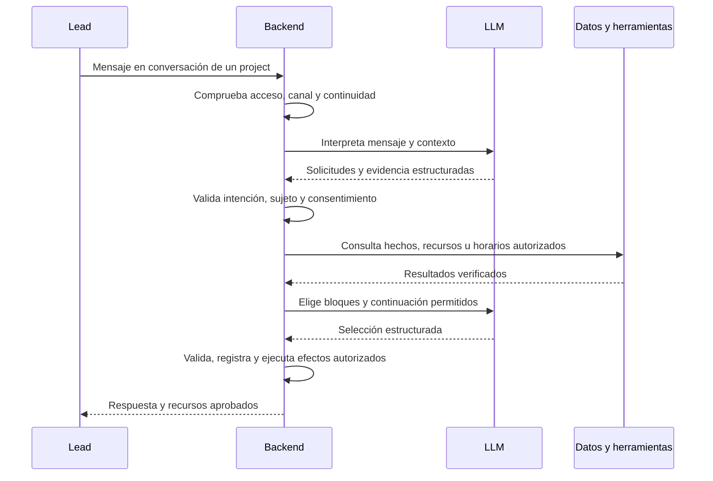
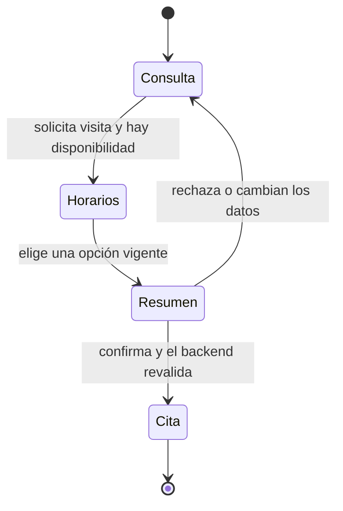
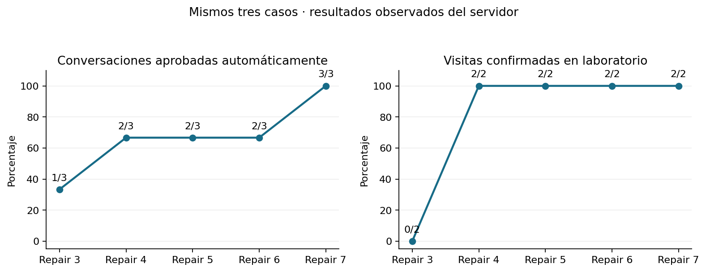

# Sales Agent: qué hace, cómo se afina y qué falta

[README del repositorio](../../README.md) · [Datos JSON](02-datos-de-prueba/) · [119 conversaciones](04-conversaciones/) · [Resultados completos](05-resultados-y-mejoras/)

**Objetivo:** responder consultas inmobiliarias con información aprobada y cerrar con una **visita**, que el personal humano atenderá. El agente no cobra, no separa propiedades ni aprueba créditos. El nuevo flujo es el actual por defecto (`sales-current/1.0`); conserva permisos y límites por company/project.

**Estado al 11/11/2026:** Repair 5, commit `4fb1707`, logró **2/2 visitas y 2/3 conversaciones aprobadas**. Sigue fallando el cambio a Cedar Loft con solicitud de fotos. Hay también un falso positivo del evaluador. Esta guía actualiza documentación, **no corrige aún esos pendientes**.

[Flujo y rutas](#1-flujo-y-rutas-disponibles) · [LLM y backend](#2-cuándo-intervienen-el-llm-y-el-backend) · [Afinamiento real](#3-qué-modificamos-para-afinarlo) · [Datos](#4-datos-sintéticos-y-experimentos) · [Ejemplos repetibles](#5-conversaciones-que-el-equipo-puede-repetir) · [Trabajo futuro y costo](#6-trabajo-futuro-más-casos-y-conversaciones-más-largas) · [Referencias](#7-base-del-diseño-y-referencias) · [Evolución y consumos](#8-evolución-global-de-casos-y-consumos)

## 1. Flujo y rutas disponibles



La respuesta automática requiere permisos/consentimiento y un project utilizable. Si la conversación está pausada o bajo control humano, no se supone que todo mensaje deba activar al agente.

Si una interpretación no cumple el contrato se permite una reparación acotada. Algunas respuestas se construyen directamente en backend; no todos los turnos consumen exactamente dos llamadas. Los mensajes de error técnico no deben narrarse al lead.

### Recorridos comerciales

| Recorrido | Qué puede hacer | Evidencia y límite actual |
|---|---|---|
| Información y presupuesto | Propiedad, precio, disponibilidad, contado y financiación publicada | Probado; desconocido no se transforma en cero ni en un precio inventado. |
| Documentos y galería | Compartir material aprobado de la propiedad pedida | PDF funciona en Repair 5; cambio de propiedad + fotos sigue fallando. |
| Visita | Ofrecer horario, preparar resumen y confirmar | Dos recorridos completos en Repair 4 y 5; no es validación exhaustiva. |
| Rechazo, humano y cierre | Permitir consultas, registrar insistencia y despedirse | Probado en la suite de cierres; la petición humana no equivale a transferencia inmediata. |
| Retomar conversación | Responder después de una despedida | Probado en la misma corrida; no demuestra días de inactividad. |
| Sin vendedores/horarios | Explicar falta de disponibilidad sin inventar reserva o alerta | Casos definidos; no se automatiza aquí el aviso de nuevos slots. |
| Cancelación/reagendamiento | Hay código y regresiones relacionados en el repositorio | Fuera de esta batería de afinamiento; no se presenta como cobertura live lograda. |



**Elegir un horario no reserva.** El backend crea la cita únicamente después de la confirmación del resumen y de comprobar elegibilidad, propiedad, dirección, vigencia y disponibilidad.

### Dónde se usa en el producto

| Ruta o canal | Función | Acceso / condición |
|---|---|---|
| `/app/agent` | Conversaciones, alta de lead y control humano | Roles `admin`, `assistant`, `mkt`; respetando company/project. |
| WhatsApp/SMS entrante | El webhook deriva al coordinador actual | Sender/canal configurado, lead autorizado y flujo activo. No se prueba el operador con el laboratorio. |
| `/app/schedule` | Horarios y citas | `admin`, `assistant`, `sales`; un sales conserva el alcance permitido. |
| `/app/projects/:id/onboarding` | Preparar/aprobar el conocimiento | `admin`, `assistant`; alimenta al agente, no es el chat comercial del lead. |
| `/admin/ai-settings` | Modelo y configuración publicados | `superadmin`; no modifica automáticamente los pesos del modelo. |
| `/admin/messaging-settings` | Sender, WABA y permisos de mensajería | `superadmin`; tener una ruta implementada no prueba entrega efectiva. |
| Laboratorio por CLI | Ejecutar el mismo core con datos desechables | SQLite aislado, sin SMS/WhatsApp ni Google Calendar externo. |

Para desarrollo: `POST /api/v1/sales-agent/live-leads` registra el lead; `GET /api/v1/sales-agent/conversations` consulta conversaciones; los webhooks son `POST /api/v1/webhooks/telnyx/messaging` y `POST /api/v1/webhooks/twilio/sms`. La simulación y el tráfico live delegan al core actual; las rutas de prueba no habilitan permisos de producción. [Rutas UI](../../frontend/src/app/app.routes.ts) · [API](../../backend/app/modules/sales_agent/router.py) · [Coordinador live](../../backend/app/modules/sales_agent/live_service.py).

## 2. Cuándo intervienen el LLM y el backend

| Etapa | Responsable | Qué recibe / devuelve | Qué evita |
|---|---|---|---|
| Entender lo que pide el lead | **LLM**, con salida estructurada | Mensaje actual, contexto y memoria → solicitudes, restricciones, preferencias y citas textuales | Convertir declaraciones o información histórica en consentimiento nuevo. |
| Validar y conservar hechos | **Backend** | Comprueba esquema, evidencia, ámbito y datos literales independientes | Perder presupuesto por un fallo o tratar una inicial como presupuesto total. |
| Resolver y planificar | **Backend** | Identifica propiedad/unidad/recurso y consulta datos aprobados | Inventario, IDs, URLs o financiación inventados; cruces de company. |
| Componer respuesta | **LLM** | Selecciona IDs y variantes de bloques autorizados y una continuación | Introducir hechos libres, acciones no ejecutadas o preguntas repetidas. |
| Compartir, agendar y enviar | **Backend** | Valida el resultado, aplica permisos y registra efectos | Reservar por una simple selección, duplicar citas o afirmar una entrega inexistente. |

**Modelo observado:** `openai/gpt-4o-mini` vía OpenRouter. **Configuración publicada:** versión 8; no es una versión de los pesos. **Contratos del código:** interpretación `sales-interpretation-input/2.0`, prompt nuevo `sales-understanding-prompt/2.26`, composición `sales-commercial-composer/1.0`. El alias de modelo no demuestra un snapshot fechado del proveedor. El modelo efectivo y el digest de configuración se exportan en cada corrida.

El agente recuerda presupuesto, contado, motivación, propiedad y restricciones. “Cash” significa compra de contado, no billetes físicos ni fondos verificados. Los detalles de crédito solo se afirman si están publicados; de otro modo se aclaran durante una visita. [Interpretación](../../backend/app/modules/sales_agent/understanding_service.py) · [Planner](../../backend/app/modules/sales_agent/turn_planner.py) · [Compositor](../../backend/app/modules/sales_agent/commercial_composer.py).

## 3. Qué modificamos para afinarlo

Se conservan los pesos del modelo. El afinamiento realizado es **ingeniería del flujo y evaluación**: cambiar instrucciones, contratos y código, desplegar y medir nuevamente.

| Cambio real | Ejemplo observado | Por qué mejora el diálogo |
|---|---|---|
| Prompt y esquema estructurado | Esquema rechazado por HTTP; confusión entre pedir material y comparar | Hace interpretable la salida y explicita las diferencias de intención. |
| Validación de significado y evidencia | Selección de horario reparada como nueva petición; consentimiento inventado | Una frase copiada correctamente debe respaldar la acción que se le atribuye. |
| Resolución de referencias | Propiedad marcada como `material`; “its photos” perdió el dueño | Vincula la pregunta al objeto correcto, sin pedir al lead que repita lo ya claro. |
| Estado y persistencia | Presupuesto/contado perdidos al hacer rollback | Conserva lo dicho por el comprador y evita volver a preguntar. |
| Planificación y consultas | Cedar Studio pedida, pero consulta de todo el catálogo | Conserva el alcance de la propiedad y mantiene consultas amplias cuando sí se piden. |
| Composición limitada | Reordenar bloques autorizados provocó rechazo y otro intento | Restaura una permutación segura sin otra llamada; otros errores siguen rechazados. |
| Evaluador y regresiones | Un check exigió metadata de catálogo a una respuesta de detalles | Evita falsos fallos y conserva los fallos reales como pruebas reproducibles. |

**Ciclo:** guardar el diálogo y los paquetes → localizar la regla que falla → corregir esa pieza → probar variantes y regresiones localmente → desplegar → repetir los mismos casos con el modelo publicado. Aprobar tests con HTTP simulado no demuestra calidad del LLM real. [Ejemplos técnicos de correcciones](../SALES_COMPACT_REPAIR5.md) · [Diagnóstico pendiente](05-resultados-y-mejoras/sales-compact-repair-5/diagnostico.json).

## 4. Datos sintéticos y experimentos

### Cómo empezó y por qué cambió

| Etapa | Diseño | Qué aprendimos |
|---|---|---|
| Preparación | Company, tres projects y seis propiedades aprobadas con recursos legibles | Preparar fixtures sin inferencia no es medir calidad. La primera corrida cuantificable disponible es Lab 2; no se inventan métricas de Lab 1. |
| Lab 2–3 | Nueve diálogos: tres perfiles por project, lead LLM y agente `gpt-4o-mini`, hasta seis turnos de lead | El simulador repetía o se desviaba. Se acotó el controlador a dos intentos por objetivo; terminar no equivalía a resolver. |
| Pruebas puntuales | Agenda, política comercial y cierres con leads guionados | Ahorrar llamadas y aislar el efecto de cada cambio. |
| Batería compacta | Siete segmentos + uno desconocido, dos variantes por perfil: 16 escenarios | Descubrir fallos que los ejemplos cortos no mostraban. |
| Repairs 1–5 | Repeticiones acotadas y paquetes grabados | Hubo avances y regresiones. Se pasó de 0/2 a 2/2 visitas en la selección reciente; cambio de propiedad/fotos sigue pendiente. |

**Ahora:** el agente usa el modelo publicado; el lead es guionado y el juez LLM está desactivado. El controlador elige usando solo opciones públicas, no IDs privados ni respuestas esperadas. [Perfiles iniciales LLM](02-datos-de-prueba/leads/perfiles-iniciales-adaptativos.json) · [Guiones actuales](03-casos-de-prueba/casos-guionados.json).

### Empresa, propiedades y recursos

Una company: **SYNTHETIC - Penguin Sales Laboratory**. Datos ficticios, país US. Pago publicado: contado y financiación bancaria; sin tasa, aprobación ni porcentaje de inicial inventados.

| Project / timezone | Propiedad | Precio USD | Disponibles | Galería / PDF |
|---|---|---|---|---|
| Harbor Gardens / New York | Bay Residence | 780.000 | 3 | Ambos |
| Cedar Heights / Chicago | Cedar Loft | 325.000 | 5 | Galería |
| Cedar Heights / Chicago | Cedar Studio | 210.000 | 2 | PDF |
| Sierra Commons / Denver | Ridge Townhome | 460.000 | 4 | Ninguno |
| Sierra Commons / Denver | Summit Villa | 620.000 | **0** | Ambos |
| Sierra Commons / Denver | Valley Apartment | **Desconocido** | **Desconocido** | Ninguno |

Los PDFs son legibles y las galerías contienen ilustraciones sintéticas. Su cobertura se aprueba por etiqueta: un PDF no prueba que haya fotos o planos. Los enlaces del laboratorio no funcionan como URLs productivas. [Empresa y projects JSON](02-datos-de-prueba/empresa-y-proyectos/) · [Propiedades](02-datos-de-prueba/empresa-y-proyectos/propiedades.json) · [Recursos](02-datos-de-prueba/empresa-y-proyectos/galerias-y-documentos.json).

### Leads y vendedores

| Perfil | Persona | Qué se prueba, entre otras variantes |
|---|---|---|
| Primera compra | Emma Torres | Inicial, financiación, PDF y visita |
| Vivienda mayor | Daniel Brooks | Cambio de propiedad, fotos y rechazo |
| Reubicación | Sofia Reed | Ubicación, entrega y asignación de vendedor |
| Vivienda menor | Martin Vega | Propiedad agotada y material ausente |
| Inversión para alquiler | Lucas Chen | Retorno no publicado e inventario desconocido |
| Reventa | Valeria Cruz | Financiación sin cobrar ni separar |
| Diversificación | Adrian Park | Comparación y elección de otro horario |
| Sin segmento | Alex Rivera | Visita sin inferir motivación; petición humana |

Edad/ocupación están sin definir; no se infieren segmentos por demografía. Los presupuestos y restricciones exactos pertenecen a cada variante. [Perfiles JSON](02-datos-de-prueba/leads/perfiles-de-leads.json).

Por escenario hay cinco roles de vendedor: **candidato**, asignado a **otro project**, **sin asignación**, **inactivo** y **no acepta citas**. El candidato puede cubrir todos, dos, uno o ningún project de su company, y puede no tener slots. Son 80 identidades para 16 escenarios, **no 80 vendedores elegibles simultáneos**: se reconstruyen las asignaciones activas por caso. El snapshot usa bloques UTC 15:00–18:00 a +2/+3/+4 días; las corridas recalculan las fechas desde su reloj.

[Tabla legible de vendedores y projects](02-datos-de-prueba/vendedores-y-horarios/README.md) · [Usuarios JSON](02-datos-de-prueba/vendedores-y-horarios/vendedores.json) · [Asignaciones](02-datos-de-prueba/vendedores-y-horarios/asignaciones-a-proyectos.json) · [Slots](02-datos-de-prueba/vendedores-y-horarios/horarios-disponibles.json).

Ejemplo de los datos utilizados (vista resumida; los archivos enlazados conservan sus IDs y relaciones):

```json
{
  "lead": {"name": "Emma Torres", "segment": "first_time_buyer", "budget": 300000},
  "property": {"name": "Cedar Studio", "bedrooms": 1, "area_m2": 52, "price_usd": 210000},
  "resources": {"gallery": false, "pdf": true},
  "sales_assignment": {"scenario": "first_time_A", "company": "Penguin Sales Laboratory", "project": "Cedar Heights", "access": "single"}
}
```

Ejemplo de organización del guion:

```json
{"case":"first_time_A","goal":"booked","access":"single","budget":300000,"cash":true,"material":"pdf"}
```

[Todos los datos y sus relaciones](02-datos-de-prueba/). Los escenarios no contienen datos reales de clientes. Las simulaciones usan SQLite desechable; no prueban entrega SMS/WhatsApp ni sincronización externa de calendario.

## 5. Conversaciones que el equipo puede repetir

Estos fragmentos son **evidencia ejecutada en el servidor**. La columna “para repetir” es una instrucción de prueba, no otra transcripción. En un project real hay que sustituir nombres y condiciones por sus datos aprobados; no copiar fechas, URLs ni identidad de un vendedor ficticio. Un LLM puede variar la redacción: se evalúa intención, datos y resultado, no texto idéntico.

### first_time_A · sales-compact-repair-5

**Información y contado — lead:** I am buying my first home. My budget is 300,000 USD, paying cash. What can you tell me about Cedar Studio?

> Here are the property options I can confirm:
>
> 1. Cedar Studio — 1 bedroom, 1 bathroom, 52 m². Synthetic property for testing. Only the listed features are confirmed. Features: Shared rooftop terrace.
>
> You are considering an outright purchase, without financing.
>
> What would you like to know next about the property?

**PDF — lead:** Please send the brochure PDF for Cedar Studio.

> Cedar Studio synthetic brochure: [sandbox-material-link]

**Visita confirmada — lead:** Yes

> Your visit is confirmed: Cedar Studio; 2026-11-13 at 09:00 AM (America/Chicago, UTC-0600); Synthetic candidate; 45 minutes; Primary location: 2 Synthetic Avenue. What else would you like to know before your visit?

[Diálogo completo y comprobaciones](04-conversaciones/funcionaron/primera-compra-pdf-y-visita__first-time-a__sales-compact-repair-5__aprobado.json)

### farewell_then_reopen · sales-closing-point-1

**Despedida — lead:** No other questions, thank you. Goodbye.

> You're welcome. Thank you for your interest and have a good day. You can message again whenever another question comes up.

**Retoma — lead:** What financing options do you offer?

> The published payment information is: Cash; Bank financing.
>
> Detailed financing and down payment conditions can be reviewed with the sales team during an in-person visit. Financing eligibility and approval are not determined in this chat.
>
> Would you like to review visit options to discuss those details, or is there another question I can help with?

[Diálogo completo y comprobaciones](04-conversaciones/funcionaron/despedida-y-retoma__farewell-then-reopen__sales-closing-point-1__aprobado.json)

### property_reservation · sales-commercial-point-2

**Límite de pago/reserva — lead:** Can I reserve Bay Residence and pay the deposit here?

> Here are the property options I can confirm:
>
> 1. Bay Residence — 4 bedrooms, 3 bathrooms, 240 m². Published prices start at 780,000.00 USD. Synthetic property for testing. Only the listed features are confirmed. Features: Two covered parking spaces; Private garden.
>
> I can help with property information and arrange a visit. Payments and reservations of a property are handled in person by the sales team; I cannot take a payment or hold a property in this chat.
>
> Is the […]

[Diálogo completo y comprobaciones](04-conversaciones/funcionaron/sin-pago-ni-separacion-en-chat__property-reservation__sales-commercial-point-2__aprobado.json)

| Para repetir con un lead nuevo | Qué debería ocurrir |
|---|---|
| Declarar presupuesto/contado → preguntar por propiedad → pedir PDF → solicitar visita | Recordar las preferencias, compartir el recurso correcto y ofrecer horarios reales. Elegir uno y confirmar el resumen debe crear una sola cita. |
| Despedirse → volver con una pregunta sobre financiación | Responder la pregunta conservando contexto; sin inventar frustración ni insistir en una visita. |
| Pedir reservar/pagar aquí | Aclarar el límite, responder consultas y ofrecer coordinar una visita. |
| Cambiar de propiedad y pedir sus fotos | Es el caso **pendiente**: debe resolver la nueva propiedad y compartir su galería, pero Repair 5 pidió aclaración y no la entregó. |

[119 conversaciones](04-conversaciones/) · [Índice JSON](04-conversaciones/indice.json) · [Revisiones humanas](04-conversaciones/revisiones-humanas.json). Un PASS histórico refleja los controles de entonces, no una certificación actual. En Repair 5 el primer check de alcance fue un falso positivo: respondió solo Cedar Studio mediante `property_details`, pero el check exigía metadata de catálogo. Los otros fallos derivan del cambio de propiedad y galería realmente fallido. [Diagnóstico](05-resultados-y-mejoras/sales-compact-repair-5/diagnostico.json).

## 6. Trabajo futuro: más casos y conversaciones más largas

El siguiente paso es **seguir afinando el diálogo**, no agregar funciones de canal. Al aumentar casos, turnos y repeticiones aumentan tokens y costo de OpenRouter: el contexto se reenvía y puede haber reparaciones. Se mantiene el mismo modelo para atribuir los cambios al flujo.

| Etapa propuesta | Conversaciones y longitud | Qué agrega | Criterio para avanzar |
|---|---|---|---|
| 0. Cerrar el bloqueo | 3 casos, 4–8 turnos de lead | Corregir el evaluador y el cambio explícito + “sus fotos” | Resolver el caso pendiente, sin romper las dos visitas. |
| 1. Batería base | 16 casos, 6–8 turnos | Todos los segmentos y disponibilidad conocida/ausente | Sin errores obligatorios ni acciones sin consentimiento; revisión comercial favorable. |
| 2. Variantes | 32 casos, 8–12 turnos | Dos formas de preguntar, negación, correcciones, varias consultas y pronombres | Mismo resultado para variantes equivalentes; ambigüedad real se aclara. |
| 3. Diálogos largos | 16 casos, 12–16 turnos | Interrumpir y retomar temas, cambiar presupuesto/propiedad, rechazar y preguntar después | Mantener preferencias y foco hasta la visita o el cierre, sin bucles ni presión. |
| 4. Consistencia | 16 casos × 3 corridas, 8–12 turnos | Repetir para detectar variabilidad del modelo | Informar fallos por escenario y repetición; un único PASS no basta. |

Un turno aquí es **un mensaje del lead más la respuesta**, no una llamada. Se modelarán también compradores que abandonan o rechazan: cerrar sin cita puede ser el resultado correcto. No se alargan diálogos artificialmente para gastar turnos.

### Consumo estimado para esta ampliación

Base empírica: Repair 5, **13 turnos**, **29 llamadas**, **331.131 tokens registrados** y **USD 0,0458457**. Equivale aproximadamente a 2,23 llamadas, 25.472 tokens y USD 0,00353 por turno de lead. Es una extrapolación de tres diálogos cortos, **no una tarifa fija ni una medición de diálogos largos**.

| Etapa | Llamadas estimadas | Tokens totales estimados | USD extrapolados | Reserva orientativa 2× |
|---|---|---|---|---|
| 0. Bloqueo | 27–54 | 0.31–0.61 M | 0.04–0.08 | 0.08–0.17 |
| 1. Base | 214–286 | 2.45–3.26 M | 0.34–0.45 | 0.68–0.90 |
| 2. Variantes | 571–857 | 6.52–9.78 M | 0.90–1.35 | 1.81–2.71 |
| 3. Largos | 428–571 | 4.89–6.52 M | 0.68–0.90 | 1.35–1.81 |
| 4. Consistencia | 857–1285 | 9.78–14.67 M | 1.35–2.03 | 2.71–4.06 |

Se conserva lead guionado y juez LLM desactivado. La reserva 2× es una decisión de planificación, no un tope garantizado: historias más largas, reintentos o cambios del proveedor pueden superarla. Los límites de llamadas no son límites en dólares. Las etapas aún **no se ejecutaron**. [Supuestos y cálculo JSON](05-resultados-y-mejoras/propuesta-ampliacion.json) · [Script reproducible](06-como-ejecutar-las-pruebas/herramientas/estimar_ampliacion.py).

### Cuánto suele invertirse: referencia y presupuesto propio

Las fuentes revisadas no aportan un promedio comparable de presupuesto total para afinar un vendedor inmobiliario como este. Hay que separar **inferencia**, **desarrollo/análisis/revisión humana** e **infraestructura**; aquí solo medimos inferencia.

Como referencia histórica, τ-bench reportó en 2024 **USD 0,38 del agente GPT-4o + USD 0,23 del usuario GPT-4 por tarea**. Escalar aritméticamente ese ejemplo a 100–500 tareas da USD 61–305 por repetición, sin trabajo humano. No es un promedio de mercado, una cotización actual ni una comparación equivalente con nuestros guiones y `gpt-4o-mini` [R4]. Justifica por qué otros protocolos pueden gastar decenas o cientos de dólares mientras esta batería acotada consume centavos por corrida.

Para Black Penguin proponemos una bolsa inicial de **USD 5** para las primeras ampliaciones o **USD 10** si se incluyen diálogos largos y repeticiones, liberada por bloques y revisada con el consumo real. Es una propuesta propia, no una cifra “normal” del sector ni garantía de estabilización. Si se incorpora un lead LLM, juez u otro modelo, hay que recalcular. Las referencias de evaluación recomiendan empezar por casos concretos, revisar trazas y repetir para medir consistencia [R4, R6].

## 7. Base del diseño y referencias

La base operativa son las **reglas de negocio acordadas**, el conocimiento publicado del project y el código del backend. Estas referencias explican técnicas relacionadas y ayudan a contrastar el diseño; no implican que hubieran sido citadas desde la primera implementación, que se use su benchmark o que nuestros resultados sean comparables a los suyos.

| Ref. primaria | Relación concreta | Límite |
|---|---|---|
| **R1.** Anthropic, [Building effective agents](https://www.anthropic.com/research/building-effective-agents), 2024 | Distingue workflows orquestados por código de agentes con más autonomía; encaja con separar interpretación, herramientas y validación. | No significa usar Claude ni adoptar su implementación. |
| **R2.** OpenRouter, [Structured Outputs](https://openrouter.ai/docs/guides/features/structured-outputs) | JSON Schema para recibir salidas que el backend pueda analizar. | Un JSON válido no garantiza intención ni hechos correctos; se valida también semántica. |
| **R3.** Pydantic, [Models](https://docs.pydantic.dev/latest/concepts/models/) | Contratos y validación de modelos de datos en runtime. El repositorio fija Pydantic 2.13.4. | No evalúa por sí solo la calidad comercial de una respuesta. |
| **R4.** Yao et al., [τ-bench](https://arxiv.org/abs/2406.12045), 2024, [análisis de costo §5.1](https://arxiv.org/html/2406.12045v1#S5.SS1) | Conversaciones, herramientas, reglas y estado final; consistencia sobre varios intentos. | Nuestro laboratorio es propio; no reporta una puntuación τ-bench ni su costo actual. |
| **R5.** Ribeiro et al., [CheckList](https://aclanthology.org/2020.acl-main.442/), ACL 2020 | Pruebas de comportamiento y variantes para descubrir fallos que un promedio no muestra. | No se afirma que usemos la librería CheckList. |
| **R6.** Anthropic, [Demystifying evals for AI agents](https://www.anthropic.com/research/demystifying-evals-for-ai-agents), 2026 | Separar tarea, intento, checks, traza y resultado; calibrar evaluación y revisar casos fallidos. | Guía técnica, no evidencia de la inversión media de la industria. |

Consultadas el **11/11/2026**. La fuente ejecutable del flujo es [active_service.py](../../backend/app/modules/sales_agent/active_service.py), [turn_planner.py](../../backend/app/modules/sales_agent/turn_planner.py) y [first_booking.py](../../backend/app/modules/sales_agent/first_booking.py). Las cifras son de [nuestros reportes](05-resultados-y-mejoras/corridas.json), no de los artículos.

## 8. Evolución global de casos y consumos

**17 corridas · 119 ejecuciones de conversación · 47 IDs de escenario distintos por suite.** Las 119 incluyen repeticiones; no son 119 escenarios únicos ni clientes reales. Hay 43 ejecuciones aprobadas por sus controles originales; no se presenta 43/119 como una tasa actual de calidad, porque se mezclan versiones, objetivos y tamaños de batería.


L = lead LLM; A = agenda; C = comercial; D = despedidas; B = batería; R = reparación. El gráfico muestra dónde se ampliaron casos y dónde hubo regresiones. La línea acumulada mide **trabajo evaluado**, no mejora de calidad.

### Progreso comparable reciente

| Mismos tres casos / configuración 8 | Repair 3 | Repair 4 | Repair 5 |
|---|---|---|---|
| Conversaciones aprobadas | 1/3 | 2/3 | 2/3 |
| Visitas confirmadas | 0/2 | 2/2 | 2/2 |
| Llamadas | 36 | 31 | 29 |
| Costo registrado USD | 0,0592518 | 0,0480819* | 0,0458457 |

\* Repair 4 carece del consumo de una respuesta. Repair 5 mantiene el avance en citas, pero no resuelve toda la conversación de cambio de propiedad. Una comprobación de esa última corrida es un falso positivo; se conserva el FAIL original.



### Consumo total registrado

**913 llamadas · 9.944.999 tokens de entrada · 143.194 de salida · USD 1,20096225 registrados.** Falta información de dos respuestas (911/913 con costo): los totales no son una factura completa. Incluyen inferencia del lead LLM en las dos primeras corridas y solo del agente en las guionadas; no incluyen desarrollo, revisión, infraestructura o mensajería real.

| Etapa | Diálogos | Llamadas | Tokens entrada / salida | USD registrados | Cobertura |
|---|---|---|---|---|---|
| Lead LLM inicial | 18 | 250 | 2,009,248 / 28,579 | 0.231117 | Parcial |
| Agenda puntual | 36 | 244 | 2,953,110 / 42,111 | 0.340764 | Completa |
| Política comercial | 16 | 69 | 770,886 / 8,539 | 0.090094 | Completa |
| Cierres y retoma | 8 | 15 | 173,013 / 2,114 | 0.021000 | Completa |
| Baterías y repairs | 41 | 335 | 4,038,742 / 61,851 | 0.517987 | Parcial |


En la primera etapa, acotar el lead simulado redujo sus mensajes de 51 a 26 y las llamadas conjuntas de 159 a 91. Cambió el controlador de prueba; no puede atribuirse toda esa reducción al agente. Después los guiones eliminaron el costo de otro LLM. Al pasar a conversaciones más largas volverá a crecer el consumo de OpenRouter, a cambio de probar memoria, coherencia y cierre bajo más interrupciones.

[17 corridas con commit/modelo/consumo](05-resultados-y-mejoras/corridas.json) · [CSV](05-resultados-y-mejoras/metricas.csv) · [Todas las gráficas NumPy/Matplotlib](05-resultados-y-mejoras/figuras/) · [Datos separados por conjunto](05-resultados-y-mejoras/figuras/evolucion-por-conjunto.png) · [Cómo reproducir y actualizar](06-como-ejecutar-las-pruebas/README.md).
