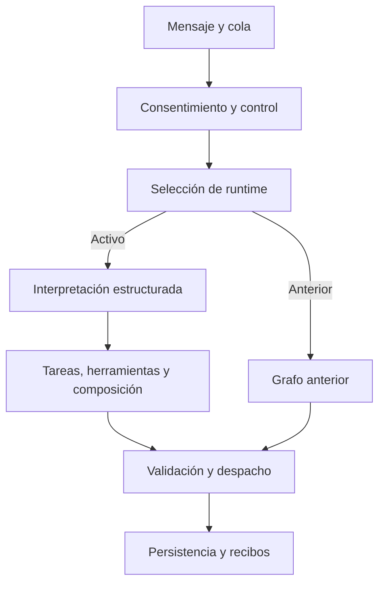

# Sales AI — Grupo A, pasos 1 y 2

Estado: **completado**, 8 de noviembre de 2026. Siguiente grupo: **B, pasos 3 y 4**.

Esta entrega fija la base y prepara pruebas reproducibles. No modifica `backend/app`,
el frontend, prompts publicados, variables del despliegue, migraciones ni el comportamiento
del worker. Los escenarios T01–T26 describen la aceptación de los grupos siguientes;
ninguno se da por aprobado por haber preparado sus datos o simulado un modelo.

## Base y trazabilidad

- Repositorio: `BlackPenguinAI/BlackPenguin`.
- Main verificado al iniciar: `f7e7f055fd0499f2224b43bad8f9128db2eaf434`.
- Rama de trabajo: `sales-ai/group-a-foundation`, creada desde ese commit.
- No había un grupo A aceptado anteriormente. Se conservó intacto el otro checkout,
  que contenía cambios anteriores sin confirmar; no se mezclaron con esta base.
- No se encontraron instrucciones `AGENTS.md` aplicables en el repositorio/directorios padre.
- Snapshot de referencia: exportación del 8 de noviembre, 1.268 registros de 65 tablas,
  completada a las 13:23:42 UTC (08:23:42 de Lima). Su manifiesto registra el mismo commit.
- El snapshot completo permanece fuera del repositorio. El fixture identifica el SHA-256
  del archivo reconstruido que se usó como entrada, no el del gzip original del servidor.
- Configuración registrada: global `cbc8abfa-23d3-417c-97dd-fd12e3406ed4`, publicación 8,
  modelo de producto `openai/gpt-4o-mini`. El replay usa `test/offline-scripted` con respuestas
  inyectadas; no invoca ese modelo de producto.

## Paso 1 — Base reproducible

Se ejecutó la regresión antes de incorporar el grupo y de nuevo con las nuevas pruebas:

| Comprobación ejecutada | Resultado |
|---|---|
| Backend de main, antes de A | 1.479 aprobadas, 2 omitidas, 0 fallidas |
| Backend completo con A | 1.516 aprobadas, 2 omitidas, 0 fallidas |
| Pruebas nuevas focalizadas | 37 aprobadas |
| Agent, Agent Settings y render de revisión | 34 aprobadas en 3 archivos |
| Replay del coordinador actual | 20/20 comprobaciones de seguridad/persistencia |
| Cabeza de Alembic inspeccionada | `20261106_sales_dialogue` |

Las dos omisiones son las pruebas PostgreSQL, que requieren una base desechable
configurada expresamente. No se ejecutó concurrencia PostgreSQL, modelo real, SMS/WhatsApp
real ni Calendar real. Persisten avisos de deprecación de dependencias/`datetime.utcnow`;
no son fallos nuevos. No se repitió el build frontend, ya que A no modifica frontend.

Entorno observado: Python 3.12.14, pytest 9.1.1, SQLAlchemy 2.0.50, FastAPI 0.136.3,
Pydantic 2.13.4 y LangGraph 1.2.11. Frontend: Node 24.22.1 y Vitest 4.1.9.

### Inventario de las rutas actuales

| Responsabilidad | Código actual |
|---|---|
| Webhooks de mensajería, normalización y recibos | `backend/app/modules/sales_agent/provider_router.py` |
| Cola, reintentos, coordinador entrante y despacho | `live_worker.py`, `live_service.py` |
| Cohorte y selección del runtime | `runtime_policy.py`, `active_service.py` |
| Contexto comercial aprobado | `commercial_context.py`, `projects/locations.py` |
| Interpretación estricta y reparación acotada | `understanding_service.py`, `understanding_contract.py` |
| Estado, eventos y referencias de conversación | `dialogue_store.py`, `dialogue_models.py`, `conversation_scope.py` |
| Tareas, herramientas y composición | `dialogue_orchestrator.py`, `dialogue_tools.py`, `dialogue_composer.py` |
| Ruta anterior | `graph.py`, `response_policy.py`, `intent_contract.py` |
| Slots, Sales elegible y reserva | `sales_crm/scheduling.py`, `project_team/service.py` |
| Moderación, consentimiento y revisión | `continuity_policy.py`, `escalation_policy.py`, `conversation_review.py` |
| Evidencia ya existente | `turn_trace.py`, `AgentRun`, `SalesDialogueEvent` y metadatos de mensajes |

Los nombres sin ruta completa de esta tabla pertenecen a
`backend/app/modules/sales_agent/` salvo que se indique otro módulo.



Es un mapa del código base, no una afirmación de que el recorrido comercial objetivo
ya esté completado. La configuración de producción continúa fuera del alcance de A.

### Contrato de evidencia definido

`tests/sales_ai_support/trace.py` establece `sales-ai-test-trace/1.0`, separado del
`schema_version=1.0` de las trazas históricas. Es un contrato de prueba para orientar
los siguientes grupos; A no lo conecta a las tablas/API de producción.

Identidad obligatoria: company, project, lead, conversation, mensaje entrante, run y commit.
Configuración y versión/modelo pueden ser desconocidos y quedan como `null`.
Cada evento tiene secuencia, instante UTC, fase, estado y evidencia JSON copiada.
Fases: `inbound`, `context`, `understanding`, `plan`, `tool`, `compose`, `validate`,
`persist`, `dispatch`, `complete`. Estados: `ok`, `failed`, `skipped`, `pending`.

La evidencia contiene IDs, revisión aprobada, códigos de error y resultados observables;
rechaza claves de credenciales y razonamiento privado. Una traza completada no acepta
más eventos. El harness registra las fronteras que observa; no inventa eventos internos
de planificación/composición que todavía no instrumenta. Un estado `completed` del run
no borra un `error_code` interior ni acredita una respuesta comercial correcta.

## Paso 2 — Fixtures y reproducción

### Catálogo procedente de la exportación

`backend/tests/fixtures/sales_ai/real_catalog_20261108.json` contiene exclusivamente
campos permitidos de información aprobada, IDs, revisión, fechas, procedencia,
asignaciones y disponibilidad. No incluye filas de leads, contactos, chats completos,
credenciales, URLs firmadas ni contenido de archivos privados.

| Proyecto | Procedencia | Revisión | Tipologías confirmadas |
|---|---|---:|---:|
| The Trails | REAL_APPROVED | 31 | 2 |
| Ashville Park | REAL_APPROVED | 27 | 1 |
| Fouquet's Hotel & Residences | REAL_APPROVED, aprobación legacy | Desconocida | 2 |
| Coahuila 34 | REAL_APPROVED, aprobación legacy | Desconocida | 1 |
| Wildflower | EXPORTED_DEMO | 0 | 3 |
| East Hills Crossing | EXPORTED_DEMO | 0 | 3 |

La tabla original tenía 14 tipologías; el fixture conserva las 12 confirmadas de la
fuente aplicable. No inventa las dos restantes como oferta aprobada. No existen unidades
individuales en la exportación; las 12 tipologías no se convierten en 12 unidades.
Las seis identidades de equipo se cargan con nombres/correos ficticios y conservan IDs,
roles, capacidades y zonas para comprobar relaciones. Se preservan nueve asignaciones
y 63 bloques de disponibilidad; los flags/fechas determinan si realmente aplican.

Cuando existe `published_snapshot`, prevalece sobre el borrador. En los dos casos
legacy con `final_approved=true`, la revisión continúa siendo desconocida. El importador
rechaza snapshots incompletos, conteos incorrectos y asociaciones de otro proyecto/tenant.

La extracción global con leads y conversaciones fue autorizada posteriormente por Jorge
y se recibió antes de A. Esta autorización no cambia el valor por defecto del nuevo
extractor acotado: las capturas siguientes requieren IDs de proyectos explícitos.

### Incidentes históricos preservados

`historical_cases_20261108.json` conserva seis mensajes comerciales revisados, sus IDs,
fechas, engine/commit cuando existe evidencia, respuesta/código de error y aceptación pendiente.

| Caso | Evidencia histórica |
|---|---|
| H01 | Solicitud normal de información por SMS termina en pausa; `missing_or_invalid_confidence` y `missing_reply` |
| H02 | Solicitud de vivienda de tres dormitorios por WhatsApp termina en pausa |
| H03–H05 | Tres consultas de propiedades, incluida una con errores tipográficos, reciben la misma aclaración tras `ValueError` |
| H06 | Consulta de dos dormitorios termina en `IntegrityError`, sin respuesta posterior registrada en ese recorrido |

H03–H05 registran el commit histórico `bf6623fc…`; no acreditan que el mismo error continúe
en `f7e7f05`. Para H06 no se dispone de stack/constraint suficiente para atribuir la causa.
Las tres pausas administrativas actuales del snapshot indican desconexión de recursos
Telnyx por un administrador, una causa distinta de esos bloqueos históricos.

### Variantes sintéticas

`synthetic_catalog.json` identifica como `SYNTHETIC`:

- Un proyecto con una tipología y otro con tres, para pivotes y referencias ambiguas.
- Dos especialistas en zonas distintas, asignaciones y bloques temporales que se cruzan.
- Folleto de una propiedad sin fotos, fotos de otra y un documento vencido.
- Dos ubicaciones, respuestas Meta y citas activa/pasada/cancelada como datos de escenarios.
- Una ocupación externa de Calendar; fallos y recibos se inyectan mediante adaptadores.

Las variantes de cita/Meta están disponibles como datos; no se cargan como operaciones
reales ni prueban que ya exista reprogramación/cancelación en producción. Todos los
recursos de archivo en el sandbox son placeholders `example.invalid`, nunca copias
verificadas del contenido real. Los tres materiales aprobados reales son metadatos de
`location_map`; no se presentan como un catálogo real de PDF/fotos aprobadas.

### Harness y fronteras

- `Sandbox` crea una SQLite en memoria propia con claves foráneas; nunca usa el engine
  configurado por el despliegue para escribir fixtures. Solo registra modelos, sin `init_db`.
- El reloj de referencia es UTC y explícito. Se fijan fechas de seed y se parchean los
  módulos del coordinador/contexto/agenda utilizados en replay. Los defaults ORM que ya
  estaban ligados a `datetime.utcnow` no se presentan como globalmente congelados.
- `ScriptedModel` consume respuestas determinadas; si se agotan, falla. No usa OpenRouter.
- `RecordingMessenger` distingue aceptación `sent` de recibo `delivered`; permite fallos.
- `FakeCalendar` proporciona ocupaciones y eventos externos sintéticos, con reintentos,
  conflictos y errores. Se conecta a las funciones proveedor; no sustituye la transacción
  de reserva del backend ni implementa el grupo G.
- Se bloquean conexiones/DNS de sockets durante cada turno. La entrada, estado, coordinador,
  herramientas, composición, despacho y persistencia del backend son los reales.
- El harness conserva la cadencia fuera del replay; no valida el worker de seguimientos.

El replay ejecuta los seis textos históricos en ambos canales (12 casos), cuatro recorridos
de catálogo sintético y cuatro fallos de modelo. Los canales alternativos son variantes
simuladas, no nuevas conversaciones históricas. Comprueba respuesta con propiedad aprobada
en los casos normales, ausencia de pausas/reservas/intervenciones indebidas y deduplicación
al repetir el mensaje. El modelo devuelve contratos inyectados; no se mide su interpretación
real ni se acepta la calidad comercial por el solo hecho de superar estas comprobaciones.

### Matriz T01–T26

`acceptance_matrix.json` conserva los 26 recorridos del plan, fixtures, ambos canales,
mensajes, resultados requeridos/prohibidos, grupos responsables y referencias parciales
a pruebas existentes. Cada caso permanece `PENDING_NEW_FLOW`; no se introducen `xfail`
para ocultar fallos ni tests que den por implementada una historia futura.
La matriz de 27 issues anterior sigue intacta: es otro conjunto de requisitos.

## Comandos reproducibles

Desde un checkout de desarrollo con dependencias backend instaladas:

```bash
cd backend
BP_PYTHON=/ruta/al/venv/bin/python bash tools/sales_ai/offline.sh test
BP_PYTHON=/ruta/al/venv/bin/python bash tools/sales_ai/offline.sh baseline
BP_PYTHON=/ruta/al/venv/bin/python bash tools/sales_ai/offline.sh replay /tmp/sales-ai-replay.json
```

El wrapper crea configuración de prueba en el proceso hijo, con SQLite y claves ficticias;
no se debe ejecutar mediante `source`. Los adaptadores bloquean la red del replay.
El reporte identifica hashes de fixtures, modelo inyectado, `external_actions=0`,
`model_quality_evaluated=false` y aceptación T01–T26 pendiente. Los tiempos de pytest/replay
son de ejecución local; latencia, coste y variación del modelo real siguen sin medirse.

Para importar otra copia diagnóstica completa de forma explícita:

```bash
python -m tools.sales_ai.build_fixtures --snapshot /ruta/copia.jsonl.gz --output-dir /tmp/reviewed-sales-fixtures
```

El importador de incidentes solo admite los seis textos/IDs revisados; otros casos quedan
como faltantes. No copia chats nuevos por inferencia. La entrada completa debe mantenerse
fuera del repositorio; no colocarla en `tests/fixtures`.

Para una nueva captura acotada en DigitalOcean, cuando estos archivos estén instalados:

```bash
docker exec -w /app bp_api_prod python -m tools.sales_ai.export_context --project-id UUID --days 30 --output /tmp/sales-context.json
```

Se pueden repetir `--project-id`. La transacción PostgreSQL usa `REPEATABLE READ, READ ONLY`,
límites de espera y columnas permitidas. Los especialistas/agenda se limitan a las asignaciones
seleccionadas; los intervalos de citas carecen de lead, notas o enlaces y abarcan 30 días
(configurable hasta 90). Los estados determinan si bloquean horario. No se consulta Calendar,
renuevan tokens, generan enlaces ni envían mensajes. El archivo se crea con permisos 0600,
sin reemplazar una captura existente; los errores de driver no exponen parámetros/credenciales.

Desde `frontend`, las comprobaciones ejecutadas fueron:

```bash
node node_modules/vitest/vitest.mjs run --environment jsdom src/app/pages/client/agent/agent.spec.ts src/app/pages/client/agent-settings/agent-settings.spec.ts src/app/pages/client/agent/agent-review-render.spec.ts
```

## Datos que requieren validación posterior

- Fouquet's tiene `30.00 USD` como precio en los dos registros confirmados. Se conserva
  ese valor observado; no se cambia a 30.000 por deducción. Validar el precio antes de
  utilizar ese proyecto como demostración comercial real.
- The Trails tiene `America/Los_Angeles` en proyecto y perfil aprobado. No se deduce otra
  zona por su dirección; confirmar la intención de esa configuración antes de una visita real.
- No hay citas ni respuestas comerciales Meta reales. Sus variantes se mantienen sintéticas.
- Los contenidos de PDF/fotos no se verificaron. Los metadatos no prueban lo que muestran.
- El estado almacenado de conexiones no acredita entrega, permisos vigentes o disponibilidad
  externa; esas comprobaciones y un contacto autorizado corresponden a K/L.

## Continuidad hacia B

Estado por grupo en `implementation-state.json`. Continuar desde esta entrega acumulada y
reconciliar con main si se actualiza. El grupo B unifica configuración/playbooks y aplica
inglés exclusivamente. Conservar inicialmente el modelo de producto configurado.
Antes de exponer cambios de B–J al runtime global activo se debe mantener el trabajo
incompleto aislado; A solo añade herramientas/pruebas explícitas, sin activación nueva.

Reversión de A: retirar estos archivos nuevos de herramientas, fixtures, pruebas y documentación.
No hay migraciones ni datos de producción que revertir.
