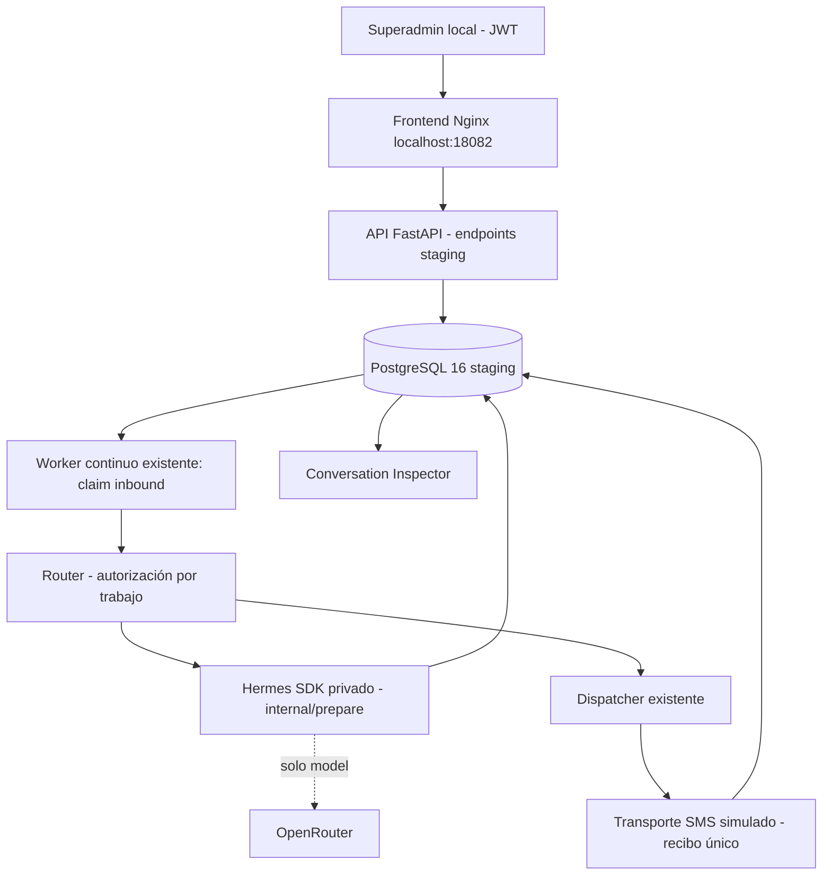

# HEI-06A.2b.3 — Continuous Staging Worker Authorization

**Base certificada:** `fc77fe6ab67d13811e62c23a5757aa7eeb901cdf` (HEI-06A.2b.2).  
**Estado:** candidato para CI; la aceptación Docker, PostgreSQL y SDK real aún no se ha ejecutado con este diferencial.  
**Production readiness:** `CLOSED`.

## 1. Objetivo y alcance

Certificar el procesamiento de un mensaje sintético mediante la API y el worker comercial continuo de BlackPenguin. Se reemplaza el arnés one-shot de autorización por una integración explícita compilada en imágenes derivadas de staging. No se usa `unittest.mock.patch` para autorizar o ejecutar el worker continuo o el SDK. La inferencia offline y el transporte SMS son adaptadores deliberadamente simulados; en modalidad model se utiliza el SDK real.

No se modifican archivos de `backend/`, el frontend productivo, el Dockerfile productivo, el selector global, el prompt ni el SDK fijado. Esto **no equivale a incorporar una autorización definitiva en las imágenes productivas**. Las imágenes derivadas ejecutan el código de BlackPenguin con puntos de integración exclusivos de staging. No se sustituye el worker continuo por otra cola o un proceso one-shot; se conserva el arranque ASGI de `app.main` y su bucle de reclamación y enrutamiento de `SalesInboundJob`.

El alcance está deliberadamente limitado a dos mensajes fijos de lectura y un tercer trabajo negativo. No se implementa aún un chat libre ni el envío a proveedores externos, ni se despliega un servidor persistente fuera del runner hospedado de GitHub.

## 2. Topología

La API y el SDK usan UID/GID 10001 y no publican puertos. Se conserva la red interna de staging. Solo el SDK obtiene una red de salida temporal cuando se solicita OpenRouter; no es una allowlist de destinos. El frontend continúa enlazado a localhost. No se suministran credenciales de Telnyx, Twilio, Calendar o Firebase. PostgreSQL conserva su volumen durante la prueba y después de recrear/reiniciar servicios; CI lo elimina al finalizar.

## 3. Integración a nivel de código

`continuous_overlay.py` valida el hash Git blob de diez archivos de `backend/app` y que cada punto de inserción aparezca exactamente una vez. Compila la fuente resultante antes de escribirla en la imagen. El workflow también ejecuta la transformación en memoria sobre el checkout antes de Docker; cualquier diferencia detiene el candidato. La construcción parte de las imágenes base de la etapa Foundation, genera dos imágenes derivadas y no cambia el checkout ni la imagen habitual. No se relaja la protección de integridad del workflow original.

| Módulo | Cambio exclusivo de la imagen de staging |
|---|---|
| `engine_selection.py` | `require_selectable` exige capacidad por trabajo; `live_hermes_ready()` sigue siendo `False`. |
| `engine_router.py` | Usa la resolución del motor con permiso, alcance y política; un job no autorizado se revisa sin fallback. |
| `live_worker.py` | Conserva el ciclo continuo de reclamación; enlaza contexto por job. Deshabilita carriles de seguimiento, calendario, waits y outbox operacional. |
| `runtime_health.py` | Refleja únicamente scans reales del carril inbound, no presenta como saludables carriles deshabilitados. |
| `sdk_service.py` | Autentica el token interno y verifica por separado job/AgentRun antes de preparar. |
| `live_preparation.py` | Obtiene la clave de inferencia del secreto exclusivo de staging. No cambia las herramientas comerciales. |
| `runtime.py` | Contabiliza invocaciones; devuelve respuesta fixture solo offline. En model se conserva el ciclo agéntico real. |
| `provider_delivery.py` | Revalida permiso, alcance y entrega de texto antes del plan original. |
| `live_job.py` | Bloquea efectos nativos y programación, conserva conciliación y recibos. |
| `messaging_gateway.py` | SMS exclusivamente simulado, otras rutas de envío denegadas. |

### Responsabilidades de Hermes y BlackPenguin

Hermes conserva interpretación, razonamiento, selección de herramientas y composición de la respuesta, como en `jorgektch/testing-hermes-agent`. BlackPenguin mantiene catálogo, persistencia, autorización, cola, plan de entrega, recibos e idempotencia. No se incorpora otro LLM, grafo ni reglas de interpretación.

## 4. Autorización, revocación y limitaciones

La capacidad se deriva del job persistido y del permiso en PostgreSQL, no de datos arbitrarios recibidos del navegador. Se valida marcador de instalación, candidato, identidad PostgreSQL, UID/GID, rol del proceso, empresa/proyecto/lead/conversación, canal SMS sintético, lead `is_test`, consentimiento, continuidad, generación, política publicada, caducidad y `active_job`. Los únicos tools permitidos son `get_project_overview` y `get_unit_details`. El scope es el de la fixture certificada A.2b.2 (`stg-live-company`, `stg-live-project`, `stg-live-lead`, `stg-live-conversation`). El permiso dura 30 minutos y no existe regrant automático. El selector global sigue mostrando LangGraph y Hermes no disponible; las solicitudes administrativas de selección global de Hermes deben seguir denegadas.

Las tablas de prueba reutilizan el contrato `hei06a2_live_grant`, `hei06a2_live_invocation` y `hei06a2_live_send`. Se crean solo tras atestar la base aislada. Un identificador único por job impide repetir inferencia o entrega simulada incierta. El endpoint de revocación y el envío simulado se serializan mediante el lock de la fila del permiso. Una inferencia ya iniciada no se cancela instantáneamente: los controles posteriores impiden continuar si el permiso deja de ser válido. Una entrega aceptada antes de revocar no se deshace. No se afirma aún que esta protección cubra efectos de proveedores reales.

La tercera fixture registra el trabajo y revoca el permiso en la misma transacción, para que el worker continuo no pueda reclamar un trabajo momentáneamente autorizado por una carrera. Los trabajos desconocidos no se enrutan a LangGraph. Se conserva el tratamiento de errores y revisión del worker.

## 5. API autenticada de staging

Las rutas solo se montan en `continuous_entrypoint.py`, no en `app.main` productivo ni en la Foundation cerrada. Requieren JWT del superadmin exclusivo de staging y la identidad local. Todas las rutas no enumeradas siguen bloqueadas por el middleware externo de staging. No se aceptan mensajes ni IDs arbitrarios: los casos son literales.

| Método | Ruta bajo `/api/v1/staging/hermes` | Uso |
|---|---|---|
| POST | `/grant` | Inicializa una única fixture y concede permiso. |
| POST | `/enqueue/first` | Registra una pregunta sobre habitaciones de Van Buren. |
| POST | `/enqueue/second` | Registra una pregunta sobre baños de Van Buren, después del primer turno. |
| POST | `/enqueue/revoked` | Registra el caso negativo y revoca atómicamente. |
| POST | `/replay` | Reencola solo el primer job ya procesado para comprobar idempotencia. |
| POST | `/revoke` | Revoca el permiso; es idempotente. |
| GET | `/job/first`, `/job/second`, `/job/revoked` | Estado y evidencia sanitizada del job. |
| GET | `/result` | Verifica el resultado final y los contadores. |

La evaluación usa el login existente y el Conversation Inspector existente. No requiere un frontend nuevo; todavía no incluye una pantalla de chat de libre entrada. En las imágenes cerradas, estas rutas devuelven 403. No deben montarse públicamente en producción.

## 6. Aceptación integral

El workflow canónico ejecuta primero las pruebas de Foundation (incluida recreación con conservación de política). Después, si `run_continuous=true`:

1. Construye imágenes derivadas sobre los blobs certificados. Inicia API y SDK en la red interna, sin detener PostgreSQL ni recrear datos.
2. Verifica health real del bucle inbound, autenticación de las nuevas rutas, ausencia de acceso anónimo, rechazo de scope desconocido y seis denegaciones privadas del SDK.
3. Crea un permiso y encola el primer turno **vía HTTP**. Espera a que el worker que vive dentro del lifespan de la API reclame y procese el trabajo. No invoca `_claim_inbound_jobs`, `_isolated_job` ni `run_job` manualmente desde la orquestación.
4. Comprueba AgentRun, hecho comercial de habitaciones de Van Buren, recibo de dispatcher, estado revisión 1 y evento duplicado idempotente.
5. Reinicia API y SDK conservando PostgreSQL. Verifica health real, red del SDK y reencola el primer evento vía HTTP; el worker debe conservar run, mensaje, revisión e identificadores de recibo, incrementando solo el contador de intentos.
6. Encola el segundo turno vía HTTP. Verifica hecho comercial de baños, segundo AgentRun y revisión 2.
7. Encola y revoca atómicamente el tercer job. Debe terminar en `review` con `HERMES_NOT_READY`, sin fallback, AgentRun ni recibo adicional.
8. Comprueba que los dos registros de invocación correspondan a la modalidad solicitada (`offline` o `model`), que las tablas de operaciones externas estén vacías y que el inspector muestre revisión 2. Verifica que el webhook de Telnyx siga bloqueado.
9. Desconecta el egress del SDK, restaura los servicios Foundation cerrados, verifica que las rutas nuevas ya no estén disponibles y que el estado permanezca accesible. El workflow limpia recursos de CI.

Contadores objetivo: `SalesInboundJob=3`, `AgentRun=2`, `OutboundMessage=2`, `replies=2`, `invocations=2`, `simulated_sends=2`, `revision=2`. Cero filas en Meeting, CalendarConnection, HermesSalesOperation, SalesAssetShare y SalesFollowUpJob. Cero inferencias y entregas adicionales tras replay/revocación.

## 7. Instalación (Upload Ready)

1. Descomprimir el ZIP y subir su contenido a `main`, preservando las rutas. No ejecutar scripts ni aplicar parches antes de subir.
2. El único YAML de workflow a reemplazar es `.github/workflows/hermes-hei06a2-persistent-staging.yml`. No crear una copia con otro nombre. `continuous.compose.yml` es un override Compose en `services/hermes_worker/persistent_staging/`, no un workflow.
3. Commit sugerido: `test(hermes): certify continuous scoped staging worker without runtime patches`.
4. Comprobar `Hermes HEI-06 isolated evaluation` automático. No es necesario que se active el deploy productivo para este paquete, ya que solo modifica staging y su workflow.
5. Ejecutar `Hermes HEI-06A.2 persistent staging foundation` sobre `main`, marcando solo `run_continuous`. Mantener `run_scoped`, `run_live_worker` y `run_openrouter` desmarcados.
6. Si pasa, ejecutar nuevamente con `run_continuous=true` y `run_openrouter=true`. Los demás parámetros deben quedar desmarcados. El secreto existente `HEI06_OPENROUTER_API_KEY` se inyecta únicamente en el SDK derivado y no se imprime.
7. No es necesario entrar por SSH, cambiar `.env`, contratar servidor ni habilitar Hermes en producción. El orquestador de aceptación exige runner hospedado de GitHub, directorio bajo `RUNNER_TEMP`, candidato limpio y contexto Docker local.

Artefacto `hei06a2-foundation-<sha>`: `initial.json`, `recreated.json`, `continuous-worker.json`, `summary.json`; `startup-failure.json` cuando falle. El archivo central es `continuous-worker.json`, que incluye checkpoint, estado, contadores, modos de inferencia y diagnósticos sanitizados (tipo y ubicaciones). Nunca incluye texto de excepción, mensajes completos, claves o variables de entorno.

Resultado objetivo del resumen: `Continuous API worker (staging-only build): PASS; real inference: PASS` y `Production readiness: CLOSED`. Una ejecución offline tendrá `real inference: NOT_RUN`. No interpretar ese resultado como certificación de producción.

## 8. Validación local y pendientes

Se ejecutaron las 65 pruebas locales originales y 15 nuevas, todas aprobadas (80/80 ejecutadas). Una prueba adicional de compilación sobre la copia completa de los archivos de backend se omitió localmente por no disponer del checkout privado íntegro; CI exige esa compilación antes de construir las imágenes. Los 10 blobs y 19 anclas de integración se comprobaron directamente en GitHub, así como los ocho hashes de los archivos previos de staging reconstruidos. Se comprobaron sintaxis Python, YAML, Bash y estructura del ZIP. No se dispone de Docker ni PostgreSQL local para ejecutar la aceptación de extremo a extremo ni una llamada a OpenRouter en esta iteración. No se certifican aún el worker continuo, las dos modalidades de inferencia ni la revocación concurrente real hasta obtener las evidencias de CI. El próximo objetivo después de superar ambas modalidades será preparar la aceptación de proveedores reales en un entorno controlado (HEI-06B), sin abrir el selector productivo.
